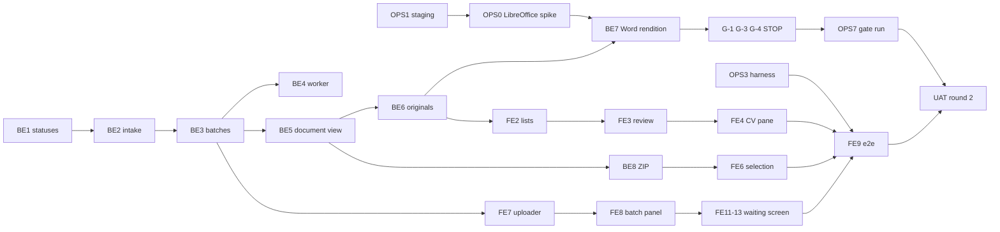
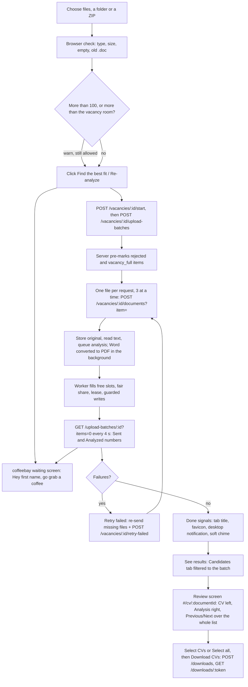

# parallax CV Screener: Stage 2 development plan

**Status:** plan for approval and hand-off. Nothing in this document is built, tested or committed yet.
**Date:** 20 October 2026.
**Owner:** Kamran Karimli (product owner).
**Built by:** the development team and Claude Code together. Any work package can be picked up by either.
**Source:** `cv_screener_stage_2_planning_brief.md` (the UAT feedback brief), plus the owner's answers on 20 October 2026.
**Repository:** `CV_screening` at commit `611fa08` (branch `main`, 13 Oct 2026).

## 0. How to read this plan

**Scope.** Stage 2 improves the recruiter workflow. It does not change the screening engine. The five requirements:

| ID | Requirement | Asked by |
|---|---|---|
| R1 | Show the original CV beside its AI analysis on one screen | UAT brief |
| R2 | Previous CV / Next CV through the list, with "CV 3 of 20" | UAT brief |
| R3 | Upload up to 100 CVs in one batch, with per-file status and safe retry | UAT brief |
| R4 | Select CVs (one, several or all) and download the selected originals as one ZIP | Owner, 20 Oct |
| R5 | A calm "coffeebay" waiting screen while CVs are analyzed, with done signals | Owner, 20 Oct |

**Labels used in this plan.**

- **Verified:** seen in the repository. A file and line are given, for example `processor.service.ts:59-78`. Paths are relative to the repo root; the common prefixes `apps/api/src/`, `apps/web/src/` and `packages/shared/src/` are sometimes left out when the file name is unique.
- **ASSUMPTION:** a reasoned guess that the build must check.
- **TO CONFIRM:** a fact outside the repo (Render plan sizes, provider limits) that someone must look up or measure.
- **[Owner]:** a decision taken by the owner on 20 October 2026 (section 3).

**Story IDs.** `CLAUDE.md` asks for story IDs in code comments and commit messages. Stage 2 uses the work-package IDs from section 7 as story IDs, with the prefix `S2-` (for example `S2-BE4`).

**Repository rules that every work package keeps** (from `CLAUDE.md`):

- Knockout stays deterministic code with zero model calls and never auto-rejects.
- `not_found` is never coerced to `not_met`. A score never serialises without its breakdown.
- No provider key, SDK or endpoint in the browser bundle (`npm run guard:bundle`).
- No resource outside the EU.
- Audit and decision tables stay append-only.
- Every migration is reversible (`npm run db:roundtrip`).
- Every new English UI string has an Azerbaijani entry (`i18n.test.tsx`).
- New colour pairs go into `contrast.test.ts`.
- The API coverage floor stays 85/75/85/85.
- The CI volume suite keeps its p95 limits.

**In one paragraph.** Most of R1 and R2 already exists in a first form:
- a side-by-side report;
- Previous/Next from the Candidate pool.

But three gaps remain:
- The CV pane shows extracted text, not the original.
- Previous/Next walks only the 50 analyzed rows that are loaded.
- CVs that are not analyzed open an error page.

Batch upload also already works in a first form (groups of 50), but it throws away each file's result, cannot retry and runs only 2 analyses at a time.

Stage 2 keeps the architecture: one Render service, Postgres, the in-process worker. It adds:
- a server-side upload batch, one file per request;
- a faster and safer worker;
- a document-keyed review screen with an in-app PDF viewer (Word files converted to PDF on the server);
- list-wide Previous/Next;
- selection with ZIP download;
- the coffeebay waiting screen.

The riskiest unknown is whether the Word converter and a 100-CV batch fit the current Render "starter" plan. That is checked early and is a STOP gate (section 5.6).

---

## 1. Current-state summary (verified)

### 1.1 Stack and layout

| Part | What it is | Where |
|---|---|---|
| API | NestJS 11 on Fastify; one process also serves the web build | `apps/api`, `app.factory.ts:14-62` |
| Web | React 19, Vite, Tailwind 4, hash routes | `apps/web`, `App.tsx:217-233`, `route.ts:4-17` |
| Shared | Types, vocabularies, scoring display bands | `packages/shared` |
| Database | PostgreSQL 17 (+pgvector); CVs stored as `BYTEA` | `db/migrations/0007_pipeline.up.sql:34` |
| Queue | In-process worker over Postgres (`FOR UPDATE SKIP LOCKED`); no Redis or BullMQ | `processor.service.ts:41-78` |
| Hosting | One Render Docker web service (`starter`) + Render Postgres (`basic-256mb`), Frankfurt | `render.yaml:3-21`, `docker/render.Dockerfile` |
| Image | `node:22-bookworm-slim` + `poppler-utils` (pdftotext) | `docker/render.Dockerfile:16-20` |
| Auth | Bearer token in `sessionStorage`, no cookies; refresh every few minutes; idle sign-out after 30 minutes | `api.ts:14-38`, `App.tsx:32, 108-127` |
| Security headers | `X-Frame-Options: DENY`; CSP `default-src 'self'; style-src 'self' 'unsafe-inline'; img-src 'self' data:; frame-ancestors 'none'; base-uri 'none'`; `cache-control: no-store` | `app.factory.ts:40-58` |
| Tests | Jest (API, DB-gated integration suites with a scripted fake model); Vitest + jsdom (web); `node --test` (scripts). No browser e2e | `apps/api/jest.config.cjs`, `.github/workflows/ci.yml` |

### 1.2 Upload today

1. The recruiter adds files on the Resumes card (`ResumesCard.tsx`) by:
   - drag and drop, including folders;
   - the file picker;
   - the folder picker;
   - a ZIP.

   The client checks only the extension (`.pdf .docx .txt .zip`, `ResumesCard.tsx:18`). It has no count cap and no size check. Its duplicate key is name + size, so two different files with the same name and size are wrongly dropped (`ResumesCard.tsx:21-23`).
2. "Find the best fit →" / "Re-analyze" (`ResumesCard.tsx:117`) calls `POST /vacancies/:id/start` (freeze criteria, confirm the candidate notice), then `startIntake` (`intake.ts`).
3. `startIntake` sends groups of 50 files per multipart request (`MAX_BATCH=50`, a ZIP alone). It awaits the first group, then sends the rest in the background with 2 parallel requests (`intake.ts:17-63`).
4. It **discards the per-file results** and counts a failed group as "sent". It keeps one error string, and its progress lives in a module `Map` that is lost on reload (`intake.ts:19-21, 46-53`). The selection is cleared after the first group, so failed files cannot be retried.
5. The server, `POST /vacancies/:id/documents` (`documents.controller.ts:136-250`):
   - accepts up to 50 parts per request;
   - buffers each part fully (`toBuffer`, part limit = `MAX_ZIP_MB` 100 MB), and only then checks `MAX_UPLOAD_MB` (10 MB);
   - sniffs the type from magic bytes (`documents.ts:12-18`);
   - hashes with sha256 and refuses a duplicate in the vacancy (`UNIQUE(vacancy_id, sha256)`, check-then-insert, no 23505 handling);
   - extracts text **inside the request** (pdftotext 20 s timeout, mammoth);
   - in one transaction, inserts `cv_document` (with the original bytes) and a `screening` row `queued` (or `manual` when no text was read).

   The outcomes are `queued | duplicate | unreadable | rejected | skipped`, with English messages only. Non-queued outcomes go to the append-only `intake_skip` table, which Results shows as "N skipped" (`GET /vacancies/:id/skipped`, keyed by filename).
6. Gaps found:
   - The upload route does not check an archived vacancy or edit rights (`/start` does).
   - The vacancy cap `MAX_RESUMES_PER_RUN` (500) counts every document ever stored, erased ones included, once per request, so parallel requests can exceed it (`documents.controller.ts:162-185`).
   - Erasure keeps sha256, so re-uploading an erased CV is refused as a duplicate (`erase-document.ts:17-21`).

### 1.3 Analysis (screening) today

- **One row per CV per criteria version.** The `screening` table has one row per (document, frozen requirement set), with states `queued | processing | completed | failed | manual`. "Stopped" is `queued` + `cancelled_at`. No batch or upload-session table exists.
- **Start.** Screening starts automatically when a file is ingested.
- **Worker.** It ticks every 3 s and claims **at most one row per tick**, global FIFO by `created_at`. In-flight work is capped by `WORKER_CONCURRENCY` (default 2, max 8; `env.ts:60`). Nothing is claimed while no AI provider is active (`processor.service.ts:62`).
- **Model calls.**
  - One logical model call per CV per attempt (`assess.ts:52-60`, `maxTokens` 4000 × the provider's budget factor), up to 3 attempts (30 s, 60 s back-off).
  - The gateway retries a 429/5xx once after 1.5 s. A breaker pauses a failing model for 60 s after 5 failures in 120 s (`ai-gateway.service.ts:23, 61-91`).
  - Knockout, evidence checks and scoring are deterministic code.
- **Stale rows.** A row stuck in `processing` is recovered only at boot, and only after 10 minutes (`processor.service.ts:41-47`).
- **Unguarded writes.** The completion and failure UPDATEs have no state guard, so erasing a CV during its analysis can be overwritten (`processor.service.ts:104-131, 178-198`).
- **Retry.** `POST /screenings/:id/retry` exists for one failed screening, but writes no audit event and has no caller in the web app.
- **Viewing.** Viewing a result never calls the AI: all read endpoints are DB reads.

### 1.4 Review today

- **Route and layout.**
  - `#/candidates/:matchId` (a screening id) opens `CandidateReport.tsx`: the stored analysis on the left, the "resume" on the right.
  - The divider can be dragged and moved by keyboard (28-72 %, saved in `localStorage 'cv-report-split'`). Below 1024 px the panes become Report | Resume tabs.
- **The "resume" pane.** It shows **extracted text** (`GET /candidates/:id/resume`, capped at 60,000 characters) with evidence highlighted (`<mark>`) and "Page n" separators for PDFs, not the original document.
- **The original file.**
  - The bytes are stored. `GET /documents/:id/file` streams them as an attachment (TA roles, no audit), but the web app never calls it.
  - `docs/decisions.md` (row "Original resume") says: shown as HTML, no download of the original. Stage 2 replaces that row.
- **Previous/Next.**
  - It already exists, with "{a} of {b}", J/K keys and disabled ends (`CandidateReport.tsx:289-303, 446-473`).
  - It walks only the screening ids that `CandidatePool.leave()` wrote to `sessionStorage 'cv-pool-origin'`: the rows loaded so far (50 per page) and only analyzed rows.
  - It is hidden when the report is opened from Results, SenAI or a link. The stored list is never cleared.
- **The 404 gap.** `GET /candidates/:id/report` and `/resume` resolve only through the pool rows (`candidate-pool.controller.ts:339-357`, `pool.service.ts:142`). So failed, unreadable, needs-review (knockout or suspected injection) and erased CVs return **404**. The Results "Needs a human look → Open" link leads to that 404 (`Results.tsx:705-732`).
- **The any-state list.** `GET /vacancies/:id/candidates` lists every document in every state. It is the only any-state list today (`documents.controller.ts:379-400`).
- **Status counting bugs.**
  - The list shows a missing screening on the current criteria as `queued` (`candidates.service.ts:23-24`). After a criteria change this "phantom queued" keeps the 4 s polling alive.
  - Failed CVs are counted twice on the vacancy summary (`vacancy.service.ts:310-359`).

### 1.5 Batch handling today

- There is no batch entity. The code's "run" is one frozen requirement set for a vacancy (`vacancy.service.ts:682`). Progress and counts are per vacancy.
- Upload progress (browser memory) and analysis progress (database counts) are separate already, but the per-file upload results are lost.
- With concurrency 2 and one claim per 3 s, 100 CVs take at least 5 minutes, realistically 15 to 30 depending on the provider (section 5.4).

---

## 2. Requirements mapping

| Requirement (brief or owner) | Exists today | Missing or broken | Stage 2 work |
|---|---|---|---|
| R1 Original CV beside the analysis | Side-by-side report with extracted text, highlights, resizable divider, phone tabs | Original not shown; Word has no visual form; non-analyzed CVs give 404; no Open/Download; no audit of file access | In-app PDF viewer (pdf.js), Word → PDF on the server, any-state document view, Open/Download with audit (S2-BE5, BE6, BE7, FE3, FE4) |
| R1 Candidate and file clearly identified | Name in header | Filename not shown on every surface; mixed fallbacks | Header shows name, filename and status everywhere (S2-FE3) |
| R1 Panes scroll independently | Only the CV pane | Analysis pane scrolls with the page | Both panes sticky with their own scroll (S2-FE3) |
| R1 Phone layout | Report/Resume tabs below 1024 px | Wording; no bottom navigation | Tabs "CV \| Analysis", phone bottom bar (S2-FE3) |
| R2 Previous/Next with "CV 3 of 20" | From the pool only, loaded rows only, analyzed only | Not from Results, SenAI or links; counter wrong above 50; stale origin | List store keyed in the URL, whole-list ids from the server, all four surfaces (S2-BE5, FE2, FE5) |
| R2 Pending, failed, unreadable handled | Not reachable | 404 | Status panels, Retry for failed, decisions on unreadable CVs (S2-BE5, FE3) |
| R2 No AI rerun on revisit | True already (DB reads) | Each view rebuilds the vacancy pool (slow) | Single-document query; review JSON prefetch only (S2-BE5, FE3) |
| R2 CV and result never mismatched | `key={id}` remount | Mark PUTs use the URL id; three separate requests per view | One response per CV keyed by `documentId`; `data-document-id` checks in tests (S2-BE5, FE3) |
| R3 Select up to 100 files | Multi-select, folder, drag-drop, ZIP | No count warning; no size pre-check; wrong duplicate key | Pre-upload check list, usage "312 of 500", warn above 100 (S2-FE7) |
| R3 Payload and timeouts | 50 files per request, parsing inside the request | Request size and duration grow with the batch; unverified multipart limits | One file per request, 3 lanes, server permits (S2-BE2, BE3, FE7, OPS6) |
| R3 Per-file status, partial failure, retry | Server returns per-file outcomes | Client discards them; no retry; state lost on reload | Server-side upload batch, per-item status, Retry failed, re-select after reload (S2-BE3, FE7, FE8) |
| R3 Duplicate filenames | Server dedupes by content | Client drops same name + size; `/skipped` keyed by filename | Items keyed by id; same name, different content kept and shown apart (S2-BE3, FE7) |
| R3 Bounded AI concurrency | Concurrency 2, one claim per 3 s | Too slow for 100 in 10 minutes; stuck rows after restarts; erase race | Fill all slots, fair share, lease and guards, breaker-aware (S2-BE4) |
| R3 Existing single-CV upload still works | Yes | — | The legacy multi-file route stays for scripts and old tabs; regression tests (S2-BE2) |
| R4 Select and download selected CVs | Row checkboxes for marks; "Select all shown" (100 max) | No download; select-all limited to loaded rows | documentId selection, "Select all N in this list", streamed ZIP with audit (S2-BE8, FE6) |
| R5 Waiting screen with done signals | A star sky component exists but is not used (`Sky.tsx`) | — | coffeebay panel, scene, title and favicon progress, desktop notification, soft chime (S2-FE11 to FE15) |

---

## 3. Owner decisions (20 October 2026)

| # | Topic | Decision |
|---|---|---|
| 1 | Scope | R1 to R3 from the brief, plus R4 (select and download) and R5 (waiting screen). Scoring methodology unchanged. SenAI behaviour unchanged except its English wording (#33). No new auth system, no architecture replacement |
| 2 | Devices | Desktop and phone get equal design and test effort |
| 3 | CV pane | The original document first, plus a "Text" tab with today's highlighted text. "Show in CV" jumps to the page in the original, or to the exact line in Text |
| 4 | Desktop layout | CV on the left, Analysis on the right (as in the brief's sketch). Phone tabs "CV \| Analysis" |
| 5 | Open and Download | Allowed for every CV. Every open and every download is written to the audit trail. The decisions.md row "Original resume" is replaced |
| 6 | Who sees originals | Recruiters (TA_PARTNER) and team leads (TA_LEAD) only. Governance keeps reports and audit, not files |
| 7 | Word files | Must look like the original: LibreOffice converts each Word file to PDF on the server, in the background, one at a time, after upload |
| 8 | Converter fallback | If the load test shows the current Render plan cannot run it safely, development stops and the measured numbers go to the owner, who decides (upgrade, or a fallback) |
| 9 | Previous/Next list | The list the CV was opened from (vacancy Candidates tab, Candidate pool, Results, a SenAI answer), with the same filter and sort, over the whole list |
| 10 | CVs without a result | In the walk, each with the original and a status panel: "Being analyzed", "Analysis failed · Retry", "No readable text", "Needs a human look" |
| 11 | Counter | "CV 3 of 20" counts the list being walked. A "Latest upload" filter narrows the list to the batch just uploaded |
| 12 | More than 100 files | Warn, but allow up to the room left in the vacancy |
| 13 | Upload status | Kept on the server. It survives a reload, a sign-out and a switch to another device. "Retry failed" works later: the recruiter re-selects the files and only the missing ones are sent |
| 14 | Retry failed | One button re-sends failed uploads and re-runs failed analyses, plus a Retry on each row. Completed CVs are never re-run |
| 15 | Speed | 100 CVs analyzed within 10 minutes, measured from the start click to the last final status |
| 16 | Vacancy limit | Only live CVs count. The limit stays 500. Usage shows before upload ("312 of 500 used"). Safe when two uploads run at once |
| 17 | Browser tests | Add Playwright tests on desktop Chromium, an Android-class phone (Chromium) and an iPhone-class phone (WebKit), run before every UAT build and on main |
| 18 | Hosting | Render, current plans only (starter + basic-256mb). No automatic upgrade |
| 19 | Gate server | Load and memory gates run on a temporary copy on the same plans, with test data only, deleted afterwards |
| 20 | Files | This plan lives in `docs/stage-2/`. The five parallax documents move to `docs/parallax/`. Nothing is committed until the owner says so |
| 21 | Wording | "CV" and "Analysis" ("Previous CV", "Next CV", tabs "CV \| Analysis"). English "Resume" labels become "CV" across the app. Azerbaijani is checked |
| 22 | Select and download, where | A checkbox on every row in the vacancy Candidates tab and in the Candidate pool, on desktop and phone. "Select all" selects the whole filtered list |
| 23 | ZIP contents | The original files exactly as uploaded (PDF as PDF, Word as Word), under their original names. Same names become `cv.pdf`, `cv (2).pdf` |
| 24 | ZIP limit | Up to 500 CVs per download (the vacancy limit) |
| 25 | Excel export | Every CV, with a Status column (not only analyzed CVs) |
| 26 | Decisions on CVs without a result | Allowed for unreadable CVs (after reading the original). Failed CVs are retried first |
| 27 | Waiting screen | A "coffeebay" coffee-shop scene, calm and relaxing, with Google-style motion. The name "coffeebay" appears on the café sign, after a Brand/Legal check |
| 28 | Voice | SenAI speaks and greets the recruiter by first name: "Hey Aysel, go grab a coffee and relax. SenAI is reading your 100 CVs for you." Azerbaijani uses the friendly "sən" |
| 29 | When it shows | When the recruiter has added CVs and clicks the start button ("Find the best fit →" / "Re-analyze"). The button label does not change |
| 30 | Done signals | Progress in the tab title and favicon; a desktop browser notification when done; a soft chime (off by default, switchable) |
| 31 | Sign-in | No automatic sign-out. The 30-minute idle sign-out is removed, and the session renews itself for as long as the tab is open. Only "Sign out" or closing the tab ends it |
| 32 | Phones and notifications | Desktop notifications only. Phones get the title, the chime and the finished screen |
| 33 | SenAI wording | SenAI's English answer words say "CV". Its prompts and question reading stay the same (it still understands "resume"), and its release gates are rerun |

**Decisions this replaces.**

- `docs/decisions.md`, row "Original resume" ("shown as HTML … no download"): replaced by #3 to #6.
- `App.tsx:32, 108-127` idle sign-out (IAM-06): replaced by #31. This is a security decision, recorded in decisions.md for IT. The per-token lifetime limit stays; only the renewal changes.
- UAT round 1 criteria that are no longer wanted and are not retested:
  - the anonymised viewer and the separate "Show original" reveal (UAT-02 criteria 14-15);
  - the 25/75 divider limits;
  - the 768 px phone switch.

  The owner confirms their retirement at UAT round 2 entry.

---

## 4. Recommended solution

This section is the **frozen contract**. Backend, frontend and tests all use these names. Where earlier drafts differ, this section wins.

### 4.1 One status vocabulary (S2-BE1)

New `packages/shared/src/status.ts` exports `CvStatus`, `cvStatus(input)` and the English labels. The API (lists, batch, document view) and the web (lists, batch panel, review screen, waiting screen, summary strip) use only this table. Each document is counted once.

| Status | Comes from | Label (EN) | Action |
|---|---|---|---|
| `not_sent` | upload item not received | Not sent | Re-send |
| `sending` (client only) | file in flight in this tab | Sending… | — |
| `waiting_to_send` (client only) | file held, not yet in flight | Waiting to send | — |
| `could_not_send` (client only) | last send failed in this tab | Could not send · Retry | Re-send |
| `rejected` | item outcome rejected (type, size, empty, bad ZIP entry) | Not accepted: {reason} | — |
| `duplicate` | same content already in the vacancy | Already in this vacancy · Open | Open the existing CV |
| `vacancy_full` | beyond the vacancy room | Vacancy full | Re-send when there is room |
| `analyzing` | screening queued (not cancelled) or processing | Being analyzed | — |
| `stopped` | queued + cancelled | Stopped | Continue (vacancy) |
| `failed` | screening failed | Analysis failed · Retry | Retry |
| `unreadable` | no text could be read (`manual`) | No readable text | Read the original; decision allowed (#26) |
| `needs_look` | completed with band `needs_review` (knockout or suspected injection) | Needs a human look | Decision allowed (as today) |
| `analyzed` | completed with a score | Analyzed | — |
| `not_analyzed` | readable, no screening on the current criteria | Not analyzed for the current criteria | Re-analyze |
| `erased` | `erased_at` set | Erased | — |

The vocabulary fixes three counting bugs:
- **Phantom queued.** `candidates.service.ts` returns `not_analyzed`, not `queued`, for a document with no current screening, so polling stops.
- **Failed counted twice.** `vacancy.service.ts` counts `failed` on the current criteria only. "Need a look" = `unreadable` + `needs_look`.
- **Mislabelled summary.** The summary strip says "Analysis failed", not "Could not be read".

### 4.2 R3: upload batches and reliable intake (S2-BE2, BE3, FE7, FE8)

**Request shape.** One file per HTTP request (a ZIP alone), 3 lanes per browser tab, and server-side permits `INTAKE_MAX_CONCURRENT=3`.
- Why: per-file status equals the request result, retry is exact, and a 401 or network drop loses one file, not 50.
- Each request stays small (≤ 10 MB, ≤ 20 s of text extraction), which avoids the unverified 50-part and body limits.
- Memory is about the same as today.
- The legacy 50-file route stays for `uat-seed.mjs`, existing tests and browser tabs that were open before the deploy.

**Migration `0036_upload_batch` (up).** `down` drops these tables and the column, and restores the old unique constraint after giving colliding erased rows a filler hash.
```sql
SET lock_timeout = '10s';
CREATE TABLE upload_batch (
  id ulid PRIMARY KEY, vacancy_id ulid NOT NULL REFERENCES vacancy(id),
  created_by ulid NOT NULL REFERENCES app_user(id), created_at TIMESTAMPTZ NOT NULL DEFAULT now(),
  file_count INT NOT NULL CHECK (file_count > 0));
CREATE INDEX upload_batch_vacancy_idx ON upload_batch (vacancy_id, created_at DESC);
CREATE TABLE upload_item (
  id ulid PRIMARY KEY, batch_id ulid NOT NULL REFERENCES upload_batch(id),
  parent_item_id ulid REFERENCES upload_item(id),       -- an entry unpacked from a ZIP item
  position INT NOT NULL, filename TEXT NOT NULL, client_path TEXT, size_bytes BIGINT NOT NULL,
  outcome TEXT CHECK (outcome IN ('queued','duplicate','unreadable','rejected','skipped')), -- NULL = not received
  code TEXT, message TEXT, document_id ulid REFERENCES cv_document(id), received_at TIMESTAMPTZ,
  UNIQUE NULLS NOT DISTINCT (batch_id, parent_item_id, position));
CREATE INDEX upload_item_document_idx ON upload_item (document_id) WHERE document_id IS NOT NULL;
ALTER TABLE intake_skip ADD COLUMN upload_item_id ulid REFERENCES upload_item(id);
ALTER TABLE cv_document DROP CONSTRAINT cv_document_vacancy_id_sha256_key;   -- name: verify
CREATE UNIQUE INDEX cv_document_live_sha_idx ON cv_document (vacancy_id, sha256) WHERE erased_at IS NULL;
SELECT app_grant('GRANT SELECT, INSERT, UPDATE ON upload_batch, upload_item TO cv_app');
```
`upload_item` is a working table, not an audit or decision table, so the app role may UPDATE it. `intake_skip` stays append-only; it only gains a link column.

**Endpoints.**

| Method and path | Request | Response | Notes |
|---|---|---|---|
| `GET /vacancies/:id/intake` | — | `{used, limit, maxFileMb, maxZipMb, accepts, latestBatch: {id, createdAt, createdBy, fileCount, mine} \| null}` | `used` = live documents. Drives "312 of 500 used" and the return of the waiting screen |
| `POST /vacancies/:id/upload-batches` | `{files: [{name, path?, size}]}` (1 to 500) | 201 `{batchId, items: [{itemId, position, pre?: {outcome, code, message}}], capacity: {used, limit, room}}` | Pre-marks wrong type or size as `rejected`, and positions beyond `room` as `skipped/vacancy_full` (a snapshot, not a reservation). 403 non-editor, 409 archived, notice not confirmed or criteria not frozen |
| `POST /vacancies/:id/documents?item=<itemId>` | multipart, one part | `{results: [{itemId, filename, status, code, message, documentId?}]}` | Idempotent: an item with a final outcome returns it again without processing. Retryable: not received, `vacancy_full` |
| `GET /upload-batches/:id?items=0\|1` | — | `{batch, lastReceivedAt, counts: {upload: {...}, byStatus: Record<CvStatus, n>}, items?: [...]}` | `items=0` (counts only, under 2 KB) is what the waiting screen polls; `items=1` only while the file list is open. Items carry status, never a score |
| `POST /vacancies/:id/retry-failed` | `{batchId?}` | `{requeued, resend: [{itemId, filename, size}]}` | Requeues only `failed` screenings on the current criteria; audit `screening.retried {scope, batchId, count}` |
| `GET /candidates?…&batch=<id>`, `GET /vacancies/:id/candidates?batch=<id>` | — | as today, limited to the batch | "Latest upload" filter. The batch list = every live document linked from its items, duplicates included. No "latest" alias: the client passes the id from `/intake` |

**Ingest algorithm.** It lives in a new `IntakeService`, shared by the legacy route, the item route and SenAI's "Analyze for this vacancy" copy:
1. Read the part with a capped reader: `MAX_UPLOAD_MB` for a CV, `MAX_ZIP_MB` for a ZIP. Bytes beyond the cap are drained, not buffered, and the result is `rejected/too_large`.
2. Sniff the type and hash the file. Pre-check for a live duplicate.
3. Extract text outside any transaction.
4. In one transaction:
   1. take `pg_advisory_xact_lock` on the vacancy;
   2. lock the item row (stop if it is already final);
   3. recheck the live duplicate;
   4. count live documents against the cap (else `skipped/vacancy_full`);
   5. insert the document and the screening, update the item, then write the audit last.
5. Catch 23505 as `duplicate`.
6. After commit, call `processor.nudge()`.
7. ZIP entries are read one at a time (an async generator over jszip) and become child items. A ZIP takes all intake permits.

**Fixes that come with it.**
- **Archived vacancy:** 409 "Restore this vacancy first".
- **Non-editor:** 403. This mirrors the existing UI lock (`ResumesCard.tsx:53`) and is recorded in decisions.md as a bug fix.
- **Erased CV:** re-uploading one creates a new document. One new AI call is correct, because the old analysis was erased.
- **Failed CV:** re-uploading one returns `duplicate` with a link. The recruiter uses Retry; an upload never re-runs an existing document.
- **`/skipped`:** keys rows by `COALESCE(upload_item_id, filename)`.
- **Wording:** "A run holds at most N resumes" becomes "This vacancy holds at most N CVs".

**Web: the pre-upload check (rewritten `intake.ts` and `ResumesCard.tsx`).**
- Ignore system files (as today).
- Flag the following, each with its reason and a Remove button, before anything is sent:
  - a wrong type (`.doc` gets "Old Word format: save it as .docx or PDF");
  - an empty file;
  - a file over the limit.
- Keep same-name files with different content. Show them apart by folder path or size.
- Report when the folder walk stops (5,000 files or depth 8).
- Hide the folder button where folder picking is unsupported (iOS Safari).
- Show "312 of 500 CVs used in this vacancy" and "140 files · 182 MB · 136 ready · 4 need attention".
- Above 100: "You chose 136 CVs. Up to 100 per upload is recommended so results arrive sooner. You can still send all of them." It does not block.
- Above the room: "Only 188 more CVs fit in this vacancy. The last 52 will not be sent." Those rows show "Vacancy full".
- The start button keeps its label (#29). On click:
  1. synchronously: ask notification permission once (desktop) and unlock audio if the chime is on;
  2. `POST /start`;
  3. `POST /upload-batches`;
  4. then 3 lanes of `?item=` requests, each retried once after 2 s on a network error, 5xx or 429.
- On 401: pause the queue and offer "Continue sending" after sign-in. This is rare once #31 is in.
- **After a reload or on another device:** the batch says which items are not received. The panel says "Choose the files again; only the missing ones are sent". Chosen files are matched to open items on **filename + size**. When several open items share both, one file goes to each item, and the server's content check catches a true copy. No hashing in the browser.

**Web: one batch panel (S2-FE8, with the waiting screen in S2-FE11 to FE13).**
- **Running state.** The coffeebay scene shows, with two numbers: "Sent 37 of 100 · Analyzed 20 of 100".
- **Details.** The per-file list with a "Needs attention" filter, "Retry failed (n)" (one call to `retry-failed`, plus re-sending the failed files held in this tab) and a Retry on each row.
- **One store.** A single watcher in `intake.ts` (`subscribeBatch`, `useBatchStatus`) polls `?items=0` every 4 s while the tab is visible and every 15 s while it is hidden. It stops when the batch is final and restarts after a retry. The vacancy page's own 4 s poll pauses while it runs.
- **See results** opens the Candidates tab filtered to the batch.
- **One owner of vacancy-wide figures.** Results, the Resumes card and the summary strip keep only vacancy-wide figures and drop their own "Sending…" notices.
- **Rows show status only.** "Analyzed" or "Needs a human look" with Open. Scores appear only in the lists and the review screen, where they always come with their breakdown.

### 4.3 R3: worker speed and safety (S2-BE4)

**Migration `0037_worker_lease`.** It adds `screening.claim_id ulid` and `screening.lease_until timestamptz`, with an index on `lease_until WHERE state='processing'`. `down` drops them.

- **`fill()`.** While there are free slots (`running < WORKER_CONCURRENCY`), the active model's breaker is closed and an active model exists, it claims one row and processes it without awaiting. Finishing work, uploads (`nudge()`), retries and a 2 s timer all call `fill()`. `tick()` and `drain()` keep their meaning for the tests.
- **Fair share.** The claim takes the queued row whose vacancy has the fewest CVs in flight, then the oldest (one CTE with `FOR UPDATE SKIP LOCKED`), so a 100-CV batch cannot starve a small upload.
- **Lease.**
  - Every 30 s the worker extends its own leases (`lease_until = now() + 2 min`).
  - Recovery runs at boot and every 30 s: an expired lease goes back to `queued`, or to `failed` after 3 attempts. An expiry counts as an attempt.
  - On shutdown: stop claiming, wait up to 20 s, then release the remaining claims.
- **Guards.** The completed, failed and manual UPDATEs require `claim_id = $claim AND state = 'processing'`. The completed UPDATE runs first in its transaction. If it changes 0 rows, everything rolls back. This fixes the erase-during-analysis race and double processing.
- **Breaker-aware.** When the active model's breaker is open, nothing is claimed, so no attempts are burned during an outage.
- **Settings.** `WORKER_CONCURRENCY` default 2 → 4, maximum 8 → 12. The production value is set in `render.yaml` from the calibration run (S2-OPS8).
- **Audit.** Both `retry-failed` and the existing per-row retry write `screening.retried`.

### 4.4 R1 and R2: the review screen (S2-BE5, BE6, FE2 to FE5)

**API.**

| Method and path | Roles | Returns | Notes |
|---|---|---|---|
| `GET /documents/:id` | TA_PARTNER, TA_LEAD | `{documentId, vacancy, filename, kind, sizeBytes, uploadedAt, name, pseudonym, pseudonymNo, status, statusDetail: {error?, reason?, retryable}, screeningId, matchId, original: {available, view: 'pdf'\|'pending'\|'failed'\|'none'\|'unavailable'}, text: {available}, analysis: <existing report shape, score with breakdown> \| null}` | Any state. Identity, file facts and analysis in **one** response keyed by `documentId`. `analysis` is the latest completed screening (out-of-date included); `status` is for the current criteria. 404, never 403 |
| `GET /documents/:id/text` | TA | today's resume-text shape | Any state; 409 when there is no text |
| `GET /documents/:id/view` | TA | `application/pdf`: the PDF original, or the Word rendition | 409 `RENDITION_PENDING` (and raises its priority), `RENDITION_FAILED`, `NO_PREVIEW` (TXT). Audit `document.opened {as}` before the bytes are sent |
| `GET /documents/:id/file` | TA | the original bytes, attachment | Existing route; now audits `document.downloaded {via:'file'}` |
| `GET /candidates/ids?<same query as /candidates>` | as `/candidates` | `{items: [[documentId, matchId \| null]], total, truncated, asOf}` | The whole ordered list (cap 5,000) |
| `GET /candidates?status=all\|<list>&batch=<id>` | as today | today's rows plus status rows `{documentId, …, status, matchId: null, score: null}` | Without `status`, the output is unchanged (export, summary and SenAI stay as they are). Status rows sort after scored rows, in upload order (the existing "unreadable last" rule) |

Other server changes:
- `PoolService.rowForDocument()` is a single-document query, so a report no longer rebuilds the vacancy pool.
- `PoolAnswerRow.documentId` lets SenAI answer lists open the new route.
- `setMark` accepts `manual` (#26).
- The Excel export gets a Status column and includes every CV (#25).
- `GET /documents/:id/view` and `/file` keep `nosniff`, `no-store`, `X-Frame-Options: DENY` and the CSP. **No header changes.** A `createApp` test now asserts these headers.

**Web route and lists.**
- New route `#/cv/:documentId?l=<listId>`. `#/candidates/:id` and `#/screenings/:id` look up the documentId through `GET /screenings/:id` and replace the route, so old links and bookmarks keep working.
- `review.ts` holds the list store: `{id, label, back, ids, total, complete}` in sessionStorage, the last 5 lists, and the list id in the URL (this fixes stale origins). The old `cv-pool-origin` key is removed.
- **Candidates tab and pool.** On open, store the loaded ids and the total. Then fetch `/candidates/ids` with the same query and swap in the whole list. "CV n of N" uses `total` from the start.
- **Results.** The order Results draws, over the whole list (ranked, limited, human, pending). The Open links go through the list store. "Retry on the Table tab" becomes an inline Retry.
- **SenAI answer.** The answer's `documentId`s. Older answers without them keep the legacy link.
- **A link without a list** falls back to the vacancy's default Candidates list.
- **Back** returns to the list with its filter, scroll and active row.

**Web screen.**
- **Header.** Name, then filename, upload time and vacancy, then the band and score chip or the status chip, then the decision.
- **Navigation.**
  - Desktop: a sticky row "← Back to {list} · CV n of N · ‹ Previous CV · Next CV ›".
  - Phone: a fixed bottom bar "‹ Previous CV n/N Next CV ›" with 44 px targets. It replaces the phone navigation on this screen; the header shrinks to one line and Decision moves into the Analysis tab.
- **Layout.**
  - **CV left, Analysis right** (#4). Two panes when the content column is at least 60 rem (a container query). Otherwise tabs, for example when the SenAI panel is open at 1280 px.
  - Both panes scroll on their own. The saved divider value is read as `100 − x` once, so testers keep their width.
- **Status panels** sit at the top of the Analysis pane:
  - Being analyzed: polls every 5 s and fills in on the same CV.
  - Analysis failed · Retry: the existing per-row retry.
  - No readable text: points to the original; the decision control is enabled.
  - Needs a human look: reason shown above the analysis.
  - Stopped: "Continue on the vacancy page".
- **CV pane (`CvPane.tsx`).**
  - Tabs **Original | Text** (accessible `Tabs` helper: roles, `aria-controls`, arrow keys).
  - Original: drawn by **pdf.js** in a lazy chunk (`PdfPages.tsx`). pdf.js renders from an ArrayBuffer fetched with the Bearer token (`isEvalSupported: false`), with its worker served from `/assets/`, so no CSP change is needed.
  - Pages fit to width, with zoom (−/Fit/+ on desktop; pinch on phones). Only the visible page ±1 is rendered; device pixel ratio capped at 2.
  - The original is fetched, and so audited, **only while the Original panel is visible**. On the phone's Analysis tab, or in the Text tab, nothing is fetched.
- **"Show in CV".**
  - Original: jump to the page. Use the stored page when there is one; otherwise search the page texts with `findQuotePage`, which covers Word renditions and older PDFs.
  - Text: the exact line, as today.
  - If no page is found, switch to Text with "Shown in Text: the page is not known for this file".
- **Open and Download.**
  - Open: a full-screen viewer (`role=dialog`, Esc and Back close it) that reuses the loaded document.
  - Download: the original bytes (Word stays Word) through the existing Bearer download helper.
- **Per file type.**
  - TXT: Text only.
  - Unreadable: Original only.
  - Word being converted: "Preparing the Word file for viewing…", with the Text tab ready.
  - Word failed or unavailable: "This Word file cannot be shown as pages. Download it, or read the Text tab."
  - Password-protected PDF: "This PDF is protected with a password. Download it to open it."
  - pdf.js cannot load: Text plus Download.
  - A stale lazy chunk after a deploy: "parallax was updated. Reload to see the CV."
- **Race safety.** Everything is keyed by `documentId`. An AbortController runs on unmount. Mark PUTs use `analysis.matchId`. Review JSON for the next and previous CV is prefetched; the file bytes are not (that would audit opens nobody made).
- **Keys.**
  - J/K are ignored while focus is in inputs, buttons, links or editable areas, while the overlay is open, and with modifier keys.
  - After Next, focus goes to the name heading and a polite live region says "CV 4 of 20, {name}".

### 4.5 R1: Word files that look like the original (S2-BE7, OPS0, OPS6)

**Migration `0038_rendition`.**
- `cv_document` gains `rendition_pdf BYTEA`, `rendition_state` (`pending | processing | ready | failed`, NULL for non-Word), `rendition_error`, `rendition_attempts`, `rendition_started_at` and `rendition_priority` (boolean).
- Live Word documents are backfilled as `pending`. `down` drops the columns.

**`RenditionService` (new).**
- **One at a time.** The claim takes `pending` rows, or a live Word document whose state is NULL (one uploaded by an older instance during a deploy), with `rendition_priority` first, then the oldest.
- **When it starts.** Only when `RENDITION_ENABLED`, no intake permit is held, and the container's working set is under 60 % of its memory limit.
- **Recovery.** A stale `processing` row goes back to `pending` after 5 minutes, or to `failed` after 2 attempts.
- **Guarded write.** The final UPDATE requires `rendition_state = 'processing' AND erased_at IS NULL`.

**Converter hardening.** This was the reviewers' one blocker: a Word file is untrusted input.
1. Convert only a real WordprocessingML package (`[Content_Types].xml` with the main document part). Force the import filter with `--infilter=MS Word 2007 XML`, so a renamed ODT or RTF is refused.
2. Sanitise first, with jszip. Remove external relationships except hyperlinks, `INCLUDETEXT`, `INCLUDEPICTURE`, `LINK`, `DDE`, `DDEAUTO` and `IMPORT` fields, `altChunk`, `subDocument`, `attachedTemplate` and `oleObject` external data.
3. Spawn `soffice` with a **minimal explicit environment** (`PATH`, `HOME=<temp>`, `LANG=C.UTF-8`, `SAL_USE_VCLPLUGIN=svp`), never the API's environment, which holds the session and encryption secrets. Use `--headless --norestore --nologo --nodefault --nolockcheck --convert-to pdf`, a per-boot profile whose settings turn off link updates and macros, a private temp directory (mode 0700), `detached` with `setPriority(10)`, and a 60 s timeout that kills the whole process group.
4. Refuse output over 20 MB or 50 pages. Clean the temp directory in `finally`, and sweep old ones at boot.
5. Add hostile fixtures to the image smoke test: a field-injection DOCX and an ODT renamed `.docx`. Any leak fails CI.

**Image.** Add `libreoffice-writer-nogui fonts-liberation2 fonts-crosextra-carlito fonts-crosextra-caladea fonts-dejavu-core fontconfig` (`--no-install-recommends`) to `docker/render.Dockerfile`, then `fc-cache -f`.
- The fonts cover Calibri (Carlito), Cambria (Caladea), Arial, Times and Courier (Liberation), with DejaVu as the fallback for ə ğ ı İ ş ç ö ü and Cyrillic.
- ASSUMPTION: +300-450 MB image size, measured in the CI images job.
- `render-start.mjs` warns when `soffice` is missing; the API then reports `original.view: 'unavailable'`.

**Erasure and copies.**
- Erasing a CV also clears `rendition_pdf` and its state. Retention reuses the erase path.
- SenAI's copy into another vacancy copies the rendition and goes through `IntakeService` (live dedupe and cap).

**Page jumps for Word.** The web `findQuotePage` searches the rendered page texts. The server does not compute page starts for Word.

**Before any of this is built (S2-OPS0).** Deploy the image with the apt line to the temporary staging service. Convert the 35-file Word fixture set from the Render shell. Report peak memory, time per file and image size to the owner. If it does not fit, the owner decides before S2-BE7 starts (#8).

### 4.6 R4: select and download (S2-BE8, FE6)

**Migration `0039_download_ticket`.**
```sql
CREATE TABLE download_ticket (
  id ulid PRIMARY KEY, token_hash CHAR(64) NOT NULL UNIQUE,
  created_by ulid NOT NULL REFERENCES app_user(id), created_at TIMESTAMPTZ NOT NULL DEFAULT now(),
  expires_at TIMESTAMPTZ NOT NULL, used_at TIMESTAMPTZ, archive_name TEXT NOT NULL,
  document_ids CHAR(26)[] NOT NULL CHECK (cardinality(document_ids) BETWEEN 1 AND 500));
SELECT app_grant('GRANT SELECT, INSERT, UPDATE ON download_ticket TO cv_app');
```
It is a database table, not memory, because during a Render deploy the old and new instances overlap, and the GET may reach the other instance (TO CONFIRM).

**Endpoints.**
- **`POST /downloads`** (TA roles) takes `{documentIds: [1..500]}`, **explicit ids only**. "Select all" resolves the ids on the client through `/candidates/ids?status=all`, so what is downloaded is exactly what was ticked, analyzed or not.
  - Returns 201 `{url: '/downloads/<token>', files, bytes, expiresAt (+120 s), excluded: [{documentId, label, reason: 'erased' | 'not_found'}]}`.
  - Returns 413 above 500 files or 1 GB.
  - The token is 32 random bytes; only its sha256 is stored.
- **`GET /downloads/:token`** (no session; the token is the credential).
  - It marks the ticket used in one atomic UPDATE (else 410).
  - It reads every file from **one repeatable-read snapshot**, so an erase during the stream cannot shorten the body.
  - It sends `application/zip` with an exact `content-length` (STORE method), so phones show a progress bar.
  - The browser's download manager streams it; no large blob is held in the page.
  - Each file writes `document.downloaded {via: 'zip', ticketId}` in its own short transaction, plus one summary event. A cancelled download audits only what was sent.
  - At most 2 downloads run at once (`DOWNLOAD_MAX_CONCURRENT=2`); a third waits.
  - The `/downloads/` URL is redacted in request logs. The token in the URL is a recorded exception (single use, 2 minutes, no-referrer).
- **One CV.** A single file uses the existing `GET /documents/:id/file` with the Bearer download helper; no ticket.

**ZIP writer (new `zip-writer.ts`, about 120 lines).**
- STORE method, `zlib.crc32` (Node 22), UTF-8 names, file dates from `uploaded_at`, no ZIP64 (the limits stay under 4 GB).
- Names are the original filenames:
  - path separators and control characters removed;
  - `<>:"|?*` become `_`;
  - an empty name becomes `cv.<ext>`.
- Case-insensitive clashes become `cv.pdf`, `cv (2).pdf`.
- The archive is named `CVs - <vacancy> - <date>.zip` (`CVs - <date>.zip` from the pool).

**Web.**
- **Selection.** A `Map<documentId, matchId | null>` that survives "Show more", sort changes and a trip to a CV and back. Changing filters or the search clears it.
- **Checkbox and header.** A checkbox on every row at all sizes, inside a 44 px hit area. The header checkbox selects the loaded rows.
- **Select all banner.** "All 50 shown are selected. [Select all 312 in this list]", then "All 312 in this list are selected. [Clear selection]".
- **Phones.** A "Select all" row above the list (the header row is desktop only).
- **Keys.** X toggles the active row; Space works on the checkbox.
- **Selection bar.**
  - It reads "12 selected · [Download CVs] · Mark as [Choose…] · Clear selection".
  - Mark stays limited to 100 at a time with its existing message. Rows without a result are reported as "not analyzed yet, not marked".
- **Download notice.** "Downloading 311 CVs (96 MB) as one ZIP. 1 left out: Candidate 07 (the CV was erased)."
- **Over 500.** The button is disabled with "Up to 500 CVs per download. Narrow the list."

### 4.7 R5: the coffeebay waiting screen (S2-FE11 to FE15)

**When it shows.**
- After the recruiter has added CVs and clicks the start button (#29), for any batch size.
- Re-analyze without new files shows no waiting screen.
- It returns when the same recruiter comes back to the vacancy while the batch is running, and stays after finishing until Close. A recruiter who hid it for that batch does not see it again.
- It is only for the person who started the batch (`latestBatch.mine`); a team lead looking at a colleague's vacancy sees the batch panel only.

**Where.**
- In the page flow on the vacancy page, above the summary strip. It is the running state of the one batch panel (4.2).
- It is not a modal: the recruiter can scroll, use the tabs or leave. Hide unmounts the scene and leaves a "Show the waiting screen" button.

**Scene.** A flat, Google-style illustration in SVG and CSS, in a lazy chunk (`CoffeebayScene.tsx`, `coffeebay.css`, ≤ 12 kB gzip, ASSUMPTION).

| Layer | Desktop (720×300) | Phone (384×216) |
|---|---|---|
| Wall and floor | `--c-cafe-wall` | same |
| Café window | wide window with a wood frame. Inside it, the existing star sky (`Sky.tsx`, new `lit` and `className` props) | strip across the top |
| Drizzle | 4 slow drops on the glass | off |
| Pendant lamps | 2 lamps, gently swaying | 1 lamp |
| Sign | navy hanging sign with the lowercase **coffeebay** wordmark (Manrope 800) and one gold dot like a lit bulb. Nothing taken from any real café's logo | smaller, left |
| Chalk board | "Now brewing · 42 of 100 CVs" in chalk | right |
| Counter and cup | counter in wood and navy; a cup printed with the parallax mark; 3 steam curls | same |
| Plant | static leaves | omitted |

**Progress picture.** The 14 window stars light one by one (`lit = round(14 × p)`). A constellation line lights when both of its ends are lit, so the constellation draws itself as CVs finish. This links to the "Your constellation" star map.

**Motion** (Material easing: standard `cubic-bezier(0.2,0,0,1)`, emphasized-decelerate `cubic-bezier(0.05,0.7,0.1,1)`, ambient sine `cubic-bezier(0.37,0,0.63,1)`):

| Element | Motion | Timing | Reduced motion |
|---|---|---|---|
| Panel entrance | rises 12 px and fades in | 400 ms, once | none |
| Steam ×3 | rises 28 px, sways ±3 px, fades in and out | 4.8 s loop, staggered 1.6 s | still wisps |
| Lamps | rotate ±1.5° | 7 s and 9 s, alternate | still |
| Sign glow | opacity 0.35 ↔ 0.65 | 6 s, alternate | still at 0.5 |
| Window stars | existing twinkle | 3.2 s | still |
| Drizzle | slides down and fades | 11-17 s, staggered | none |
| Star lights up | dim → gold, scale 0.6 → 1 | 600 ms per step | instant |
| Line draws | stroke-dashoffset | 800 ms | instant |
| Finished | lines glow, steam fades over 1.2 s, all loops stop 12 s later | once | — |

**Motion rules.**
- Only `transform` and `opacity` are animated, plus a one-shot `stroke-dashoffset`. No requestAnimationFrame loop, no JavaScript timers for animation, no filters or shadows in keyframes.
- At most 16 animations run at once on desktop and 5 on phones. Under `prefers-reduced-motion` none run; under `forced-colors` the scene is hidden.
- Everything pauses when the tab is hidden or the scene is scrolled off-screen.
- The fastest change is 0.31 Hz, far below WCAG 2.3.1's limit, and nothing flashes. Hide and the automatic stop meet WCAG 2.2.2.
- **Device targets:** a mid-range Android, scene visible for 60 s: main thread busy ≤ 3 %, no long task over 50 ms. Desktop ≤ 1 %.

**Colours.**
- Five new tokens, all declared in the base `:root` with cream and dark overrides: `--c-cafe-wall`, `--c-cafe-wood`, `--c-cafe-board`, `--c-cafe-chalk`, `--c-cafe-light` (the brand gold `#F5C461`).
- Everything else reuses existing tokens (`brand`, `on-brand`, `card`, `edge`, `link`, `ink-3`, `ok-line`).
- The new contrast pair `['cafe-chalk','cafe-board']` (≈ 11:1) goes into `contrast.test.ts`.

**Copy (SenAI speaks; English keys are the exact `t()` strings; Azerbaijani uses "sən" and needs a native speaker's check, S2-FE15).**

| When | English | Azerbaijani (proposed) |
|---|---|---|
| Greeting, more than 5 CVs | Hey {name}, go grab a coffee and relax. | Salam, {name}! Özünə bir qəhvə götür və dincəl. |
| Greeting, 1-5 CVs | Hey {name}, this only takes a minute or two. | Salam, {name}! Bu, bir-iki dəqiqə çəkəcək. |
| No first name | Go grab a coffee and relax. | Özünə bir qəhvə götür və dincəl. |
| Second line | {assistant} is reading your {n} CVs for you. | {assistant} {n} CV-ni sənin üçün oxuyur. |
| While sending | Sending files: {sent} of {total}. Keep this page open until they are all sent. | Fayllar göndərilir: {sent} / {total}. Hamısı göndərilənə qədər bu səhifəni açıq saxla. |
| All sent | All files are sent. You can close this page: {assistant} keeps reading. | Bütün fayllar göndərildi. Bu səhifəni bağlaya bilərsən: {assistant} oxumağa davam edir. |
| Progress | Sent {sent} of {total} · Analyzed {done} of {total} · about {m} minutes left | Göndərildi: {sent} / {total} · Təhlil olundu: {done} / {total} · təxminən {m} dəqiqə qalıb |
| Slow | This is taking a little longer than usual. {assistant} keeps going, and you can leave this page. | Bu, adi haldan bir az uzun çəkir. {assistant} davam edir, bu səhifədən çıxa bilərsən. |
| Finished | All {n} CVs are ready, {name}. Enjoy your coffee. | {name}, bütün {n} CV hazırdır. Qəhvənin dadını çıxar. |
| Partial | {ready} of {total} CVs are ready, {name}. | {name}, {total} CV-dən {ready} ədədi hazırdır. |
| Buttons | See results so far · See results · Details · Hide · Close · Retry failed ({n}) | İndiyədək olan nəticələr · Nəticələr · Ətraflı · Gizlət · Bağla · Uğursuzları təkrarla ({n}) |
| Tab title | ({done}/{total}) parallax → ✓ Ready · parallax | ({done}/{total}) parallax → ✓ Hazırdır · parallax |

**Copy rules.**
- **Speaker.** `{assistant}` is the SenAI name from Admin. When SenAI is switched off, it is "parallax".
- **First name.** The first word of `displayName`, only when it looks like a name ("UAT Recruiter" gets the no-name greeting). Check the real directory format, since a surname-first entry would greet the surname.
- **Words.** The copy says "reading", never "queue", "model", "scoring" or "deciding".

**ETA.** It is simple and is hidden whenever it would be a guess:
- It needs at least 45 s of samples and 3 finished CVs.
- rate = finished / time, over the last 2 minutes.
- The shown minutes change only when the new value is lower, or at least 2 higher.
- "Slow" replaces it after 3 minutes without a new result.

**Done signals (`done-signals.ts`, main bundle, so they work while the scene is hidden or on other pages).**
- **Title.** "(42/100) parallax", then "✓ Ready · parallax". Restored 10 s after the tab is visible again, on Close, or on sign-out.
- **Favicon.** A small `data:image/svg+xml` progress ring in navy and gold, which the CSP allows (`img-src 'self' data:`). A check mark when done. Restored afterwards.
- **Desktop notification.**
  - Permission is asked once, inside the start click, never again after "denied".
  - It fires on the finished transition only if the tab is hidden or unfocused.
  - Text: "{assistant}: your CVs are ready" / "{ready} of {total} CVs are ready to review". No names, filenames or vacancy.
  - Clicking it focuses the tab and opens the vacancy.
  - No phone notifications (#32).
- **Soft chime.**
  - Synthesised with Web Audio (E5 then B5, about −24 dBFS, 1.6 s), so no audio file and no CSP change.
  - Off by default. The switch "Soft sound when ready" plays it once as a preview and is remembered per user on that device (localStorage `cv-coffeebay:<userId>`).
- **Return visits.** On a return visit while the batch is running, the vacancy page starts tracking again, so the signals still fire.
- **Wake lock.** While this tab is sending, a screen wake lock (where supported) stops a phone from sleeping and pausing the upload.

**Accessibility.**
- The scene is decorative (`aria-hidden`).
- The panel is a labelled section with the greeting as its heading and a thin `<progress>`.
- A polite live region announces 25 %, 50 % and 75 %, then the finished headline.
- Focus goes to the greeting only after the start click. Hide moves focus to "Show the waiting screen".
- The Azerbaijani slogan carries `lang="az"`.

**Brand.**
- `SCENE_NAME = 'coffeebay'` lives in `brand.tsx`, so a rename touches one constant.
- A café business named "Coffeebay" may exist (ASSUMPTION). Brand/Legal checks the name (WIPO, EUIPO, the Azerbaijan IP register; classes 9, 42, 43) **before the first UAT build that shows it** (S2-FE15).

### 4.8 Sign-in stays open (S2-FE16)

- Remove the idle sign-out (`App.tsx:32, 108-127`). Keep the existing `/auth/refresh` call on its timer for as long as the tab is open, whether or not the user is active.
- The per-token lifetime limit (`MAX_TOKEN_LIFETIME_SECONDS`) is unchanged. The token is renewed, not lengthened.
- **What still ends a session:**
  - Sign out;
  - closing the tab (sessionStorage);
  - a disabled account (refresh fails);
  - a device that sleeps or goes offline for longer than one token lifetime (about an hour by default).
- Recorded in decisions.md as an owner security decision, against IAM-06, for IT.

### 4.9 Wording (S2-FE1, BE10)

- **Rename.** English "resume/Resume" becomes "CV" in about 70 web strings (13 files, plus `plural()` arguments). The phone tabs become "CV | Analysis", with "Previous CV" and "Next CV". The vacancy "Report" tab keeps its name.
- **Server messages** shown in the UI are renamed with their Azerbaijani keys.
- **SenAI (S2-BE10).** Only its English answer strings change (`senai/deep-words.ts`, `senai/tools-words.ts`, user-facing strings in `pool-assistant.service.ts`). System prompts and question reading are untouched, so "resume" is still understood. Rerun `npm run gates:assistant`. The prompt lock must not change.
- **i18n test, landing first in slice 0:**
  - also scan `plural()` arguments;
  - fail when one key has two different Azerbaijani values in two files;
  - check every status label.
- **Azerbaijani files.** All new and renamed strings go into one new `i18n/az.stage2.ts`, spread **last** in `az.ts` (later spreads win). Fix the misleading comment in `az.ts`, and the remaining "rezyume/Rezümə" in `az.pool.ts`.

---

## 5. 100-file batch feasibility

### 5.1 Limits found in the repository (verified)

| Limit | Value | Where |
|---|---|---|
| Client file types | `.pdf .docx .txt .zip` by extension | `ResumesCard.tsx:18, 189` |
| Client count cap / size check | none / none | `ResumesCard.tsx:60-80` |
| Client folder walk | stops at 5,000 files or depth 8 (silently) | `intake.ts:75, 84` |
| Client request grouping | 50 files per request, 2 parallel after the first | `intake.ts:17-18` |
| Server files per request | 50 (`MAX_FILES`) | `documents.controller.ts:48, 187` |
| Multipart plugin | fileSize `MAX_UPLOAD_MB`, files 50, fields 10 | `app.factory.ts:24-26` |
| Fastify body limit | 2 MB (applies to JSON; multipart behaviour to verify) | `app.factory.ts:22` |
| Per-part limit on the upload route | `MAX_ZIP_MB` (100 MB) for every part; the 10 MB check comes after buffering | `documents.controller.ts:186-191, 230-237` |
| CV size | `MAX_UPLOAD_MB` 10 (range 1-50) | `env.ts:62-65` |
| ZIP size | `MAX_ZIP_MB` 100 (range 1-500); unpacked ≤ 200 MB held in memory | `env.ts:64`, `documents.controller.ts:203-208`, `zip-intake.ts:118-127` |
| CVs per vacancy | `MAX_RESUMES_PER_RUN` 500 (range 1-5,000), counts every document ever stored | `env.ts:65`, `documents.controller.ts:162-185` |
| Server-detected types | PDF by `%PDF-`; DOCX = PK + `.docx` name; TXT/MD without NUL | `documents.ts:12-18` |
| Text extraction | pdftotext with a 20 s timeout and 5 MB output cap; text capped at 60,000 characters | `documents.ts:4, 89-118` |
| Worker | 3 s tick, at most 1 claim per tick; `WORKER_CONCURRENCY` 2 (1-8) | `processor.service.ts:49, 59-78`, `env.ts:60` |
| Retries | gateway: once after 1.5 s on 429/5xx; worker: 3 attempts (30 s, 60 s) | `ai-gateway.service.ts:73-91`, `processor.service.ts:19, 98-113` |
| Breaker | 5 failures in 120 s → paused 60 s | `ai-gateway.service.ts:23` |
| Provider timeouts | 120-300 s per call | `ai/catalog.ts` |
| Model output budget | `maxTokens` 4000 × budget factor (Google, OpenAI-reasoning, Z.ai, NVIDIA: 4) | `assess.ts:59`, `ai/catalog.ts` |
| DB pool | `DB_POOL_MAX` 10, shared by API, uploads and worker | `env.ts:17`, `db.service.ts:18` |
| Session | `LOCAL_SESSION_SECONDS` 3600; `MAX_TOKEN_LIFETIME_SECONDS` 5400 | `env.ts:29, 71` |
| Limits in render.yaml | none of the above are set, so production runs on code defaults unless they were set by hand in the dashboard (TO CONFIRM) | `render.yaml:22-55` |

### 5.2 Platform facts to confirm (not in the repo)

| Fact | Planning value | How it is confirmed |
|---|---|---|
| Render starter RAM / CPU | 512 MB / 0.5 CPU, no swap (TO CONFIRM) | S2-OPS2 logs cgroup `memory.max` and `cpu.max` at boot |
| Postgres basic-256mb disk size, `max_connections` | 1 GB disk (TO CONFIRM) | dashboard; `SHOW max_connections` |
| Request and stream timeouts, body limits at the Render proxy | TO CONFIRM; one file per request keeps every request small | gate G-2, G-7 |
| Deploy overlap, shutdown grace | new instance starts before the old one stops; 30 s (TO CONFIRM) | gate G-9 |
| Shell access on the starter plan | TO CONFIRM (needed for the report script); fallback: allow the tester's IP on the temporary staging database only | S2-OPS1 |
| Live environment values | read the dashboard first; a Blueprint sync overwrites hand-set values | S2-OPS1 |

### 5.3 Memory budget for one starter instance (ASSUMPTIONS, measured at G-0 and G-3)

The pass line is 85 % of `memory.max` (about 435 MB if the limit is 512 MB).

| Part | Typical MB | Worst MB, with caps | Controlled by |
|---|---|---|---|
| `render-start.mjs` parent (Node + pg) | 40 | 50 | — |
| API process, warm | 150 | 190 | — |
| GC slack, results, ~20 users polling | 30 | 60 | `DB_POOL_MAX` 10 |
| Intake: per permit one part ≤ 10 MB + mammoth or a pdftotext child | 30 | 180 | `INTAKE_MAX_CONCURRENT=3` (new, per server) |
| ZIP intake (takes all 3 permits) | — | 160 instead of the row above | permits + `MAX_ZIP_MB` |
| File reads (`/view`, `/file`, ZIP entries, rendition source); BYTEA arrives as hex, about 3× the file size for a moment | 12 | 120 | `FILE_READ_CONCURRENCY=4`, `DOWNLOAD_MAX_CONCURRENT=2` (new) |
| Worker, C analyses in flight | 6 | 36 | `WORKER_CONCURRENCY` |
| soffice (one process) | 150 | 300 | 1 at a time; starts only with no intake permit held and working set < 60 % |

- If every cap were hit at the same moment the total would be about 650 MB, which does not fit. The soffice rule is what keeps the conversion phase away from the upload phase.
- The realistic peak that G-3 measures is about 415 MB: one recruiter uploading 100 files, two opening CVs, one 100-CV ZIP downloading, and C = 6 analyses.
- If G-3 fails, lower in this order without a plan upgrade:
  1. `INTAKE_MAX_CONCURRENT` 2;
  2. `FILE_READ_CONCURRENCY` 2;
  3. `MAX_ZIP_MB` 50 (changes a current limit, so the owner approves);
  4. read BYTEA in binary mode (ASSUMPTION about node-pg).

### 5.4 CPU, storage and throughput

**CPU (0.5 CPU, TO CONFIRM).**
- 100 files at about 0.3-0.5 s of CPU each (pdftotext or mammoth) is about 40 s of CPU, which is about 80 s of wall time. So "100 files accepted in 60 s" may be CPU-bound. G-2 reports it (it does not stop work).
- Each Word conversion costs about 2-8 s of CPU. 35 Word CVs finish roughly 3-6 minutes after the upload ends, while analysis continues in parallel.

**Database storage per 100-CV batch (ASSUMPTIONS, measured at G-8).**

| Item | UAT volume set (avg 1.5 MB, 35 % Word) | Typical CVs (avg 0.3 MB) |
|---|---|---|
| Originals (BYTEA) | 150 MB | 30 MB |
| Word PDFs | 4-10 MB | 4-10 MB |
| Text | ~1 MB | ~1 MB |
| Screening, assessments, items, audit | 2-4 MB | 2-4 MB |
| **Total** | **≈ 160 MB** | **≈ 40 MB** |

- One full vacancy (500 UAT-size CVs) is about 750 MB. On a 1 GB disk that alone breaks the headroom.
- Erasing does not shrink the disk.
- Headroom = (disk × 0.70 − current size) / 160 MB batches.

**Throughput for 100 CVs in 10 minutes (#15).**
- Wall time ≈ ⌈100 / C⌉ × T, where T is the mean time of one analysis call. Analysis starts as files arrive (`nudge`). The window for analysis is about 540 s of the 600 s, leaving about 60 s for sending.
- Today: claims alone take ≥ 297 s. At C = 2 and T = 30 s, a batch takes about 1,500 s.

| T (measured later) | C needed | Wall time |
|---|---|---|
| 20 s | 4 | 500 s |
| 30 s | 6 | 510 s |
| 45 s | 9 | 540 s |
| 60 s | 12 | 540 s |

- Above T ≈ 64 s, even C = 12 cannot meet the target. That is then an owner decision at the gate.
- **Requests per minute** are fixed by the target, not by T: 100 CVs in 9 minutes ≈ 11-12 RPM, plus retries. Provision about 16 RPM.
- **Tokens per CV (ASSUMPTION):** input ≈ 2,000-5,000 (p95 ≈ 8,000), output ≈ 1,000-2,500 plus any reasoning tokens. At the target rate that is ≈ 60k input tokens/min (125k at p95) and ≈ 40k output tokens/min. Tokens per minute, not requests, is the likely binding quota.
- **The owner or admin must confirm** (S2-OPS8):
  1. the production company and model id (the same model on staging; a model change triggers the evaluation gates);
  2. the key's RPM, input and output tokens per minute and daily limits;
  3. a separate staging key, and approval of about 0.6-1.5 M tokens for 2-3 calibration runs;
  4. that SenAI shares the key;
  5. that the 10-minute target is for one batch at a time.

**Settings added to `render.yaml`** (a "gate" value is set from measurement):
- `WORKER_CONCURRENCY` (gate; placeholder 6), `MAX_RESUMES_PER_RUN=500`, `MAX_UPLOAD_MB=10`, `MAX_ZIP_MB=100` (gate), `DB_POOL_MAX=10`;
- `INTAKE_MAX_CONCURRENT=3`, `FILE_READ_CONCURRENCY=4`, `DOWNLOAD_MAX_CONCURRENT=2`, `RENDITION_ENABLED=true`;
- deploy keys `maxShutdownDelaySeconds: 30` and `autoDeployTrigger: checksPass` (both TO CONFIRM).

### 5.5 Recommended upload and processing approach (summary)

- **Upload.** One user action and one server batch. The browser sends one file per request, 3 at a time; the server takes 3 at a time across all users. Each item's status is stored. Retry sends only what is missing.
- **Processing.** The existing in-process worker fills every free slot, with fair share between vacancies, a lease against stuck rows and guarded writes. The concurrency is set from measurement.
- **Word conversion.** Runs separately, one at a time, only when uploads are idle and memory allows.
- **Not adopted** (each rejected for complexity with no Stage 2 need):
  - chunked or resumable uploads (files are ≤ 10 MB);
  - a new queue service (Redis or BullMQ);
  - a separate worker service;
  - websockets.

### 5.6 Gates (measured on the temporary staging copy on the same plans)

| Gate | Type | Scenario | Pass |
|---|---|---|---|
| G-0 | baseline | current main, idle 10 min | recorded only |
| G-1 | **STOP** | image with LibreOffice (CI smoke + Render deploy) | the Azerbaijani/Cyrillic fixture converts; `pdftotext` shows `Əə Ğğ Iı İi Şş Çç Öö Üü` and `Иван`; hostile fixtures leak nothing; image ≤ 1.2 GB; build + deploy ≤ 20 min |
| G-2 | report | 100 UAT-size files (≈ 150 MB) from desktop Chrome | 100 of 100 accepted, 0 5xx; p95 per file ≤ 5 s; time to all accepted reported (target 60 s) |
| G-3 | **STOP** | G-2 + a second user opening a CV every 5 s + a 100-CV ZIP download + analyses; then the conversion phase; then a 100 MB ZIP upload during a download | peak working set ≤ 85 % of `memory.max`; 0 out-of-memory kills or restarts |
| G-4 | **STOP** | 35 Word CVs from the batch | p95 ≤ 20 s and max ≤ 60 s per file; 0 failures on valid files; all done ≤ 10 min after the last upload; soffice peak ≤ 300 MB |
| G-5 | **STOP** | 100 CVs with the real provider | last final status ≤ 600 s after the start click; 0 failed among readable CVs; > 1 attempt on ≤ 5 % |
| G-6 | report | during G-3 | `GET /documents/:id`, `/upload-batches/:id` and the first `/candidates` page each ≤ 1.5 s p95; event-loop delay p99 ≤ 200 ms |
| G-7 | **STOP** | ZIP of 100 selected CVs (≈ 150 MB), then 500 files (≈ 750 MB) | first byte ≤ 3 s; exact length; valid CRCs and 100 original names; ≤ 60 s for 100; working set rises ≤ 60 MB; one audit row per file plus one summary; the 500-file run completes within the platform's stream limits |
| G-8 | **STOP** | seed data + 2 UAT-size batches | disk used ≤ 70 %; MB per 100 CVs and remaining batches reported |
| G-9 | rollout | deploy during a 100-file batch | every item ends with a final outcome; 0 analyses still `processing` 3 min after the new instance is live; 0 completed CVs analyzed twice |
| G-10 | rollout | Render rollback to the previous image with the new schema | sign in, open a CV, upload 1 file; then roll forward |

**STOP rule (#8).** If a STOP gate fails:
1. Work that depends on it stops.
2. The measured numbers go into `docs/performance-run.md` under "Stage 2 hosting gate".
3. The owner chooses one of:
   - upgrade the plan;
   - `RENDITION_ENABLED=false` (Word shown as Text + Download; the web already handles this);
   - convert only when a Word CV is opened;
   - lower the caps (5.3);
   - accept the number.
4. Nothing is upgraded automatically.

**Early warning in CI.** Every e2e run starts the server container with `--memory=512m --memory-swap=512m --cpus=0.5`. Exit code 137 (out of memory) fails the job, and `memory.peak` is written to the job summary. This warns early; it does not replace the Render gates.

**Early spike (S2-OPS0).** Before S2-BE7 starts, deploy the LibreOffice image to staging and convert the 35 Word fixtures from the Render shell. Peak memory, time per file and image size go to the owner. This moves the riskiest unknown to the first slice.

---

## 6. Files expected to change

Paths are relative to the repository root. **NEW** marks a new file.

### 6.1 Database and shared

| Path | Change | Package |
|---|---|---|
| `db/migrations/0036_upload_batch.up.sql` / `.down.sql` **NEW** | batch and item tables; `intake_skip.upload_item_id`; live-only sha index | S2-BE2, BE3 |
| `db/migrations/0037_worker_lease.up.sql` / `.down.sql` **NEW** | `claim_id`, `lease_until` | S2-BE4 |
| `db/migrations/0038_rendition.up.sql` / `.down.sql` **NEW** | rendition columns, backfill, queue index | S2-BE7 |
| `db/migrations/0039_download_ticket.up.sql` / `.down.sql` **NEW** | ticket table | S2-BE8 |
| `packages/shared/src/status.ts` **NEW**, `packages/shared/src/index.ts` | `CvStatus`, `cvStatus()`, labels, upload codes | S2-BE1 |

### 6.2 API (`apps/api/src/`)

| Path | Change | Package |
|---|---|---|
| `pipeline/intake.service.ts` **NEW** | capped reader, permits, lock, live cap and dedupe, codes, 23505, ZIP generator, `admit()` | S2-BE2, OPS6 |
| `pipeline/upload-batches.controller.ts` **NEW** | `/intake`, `/upload-batches`, `?items=0\|1`, `/retry-failed` | S2-BE3, BE4 |
| `pipeline/cv-view.controller.ts` **NEW** | `GET /documents/:id`, `/text`, `/view` | S2-BE5, BE6 |
| `pipeline/downloads.controller.ts` **NEW** | `POST /downloads`, `GET /downloads/:token` | S2-BE8 |
| `pipeline/zip-writer.ts` **NEW** | streaming STORE ZIP and name rules | S2-BE8 |
| `pipeline/rendition.service.ts` **NEW** | conversion queue, sanitiser, hardened soffice wrapper | S2-BE7 |
| `pipeline/documents.controller.ts` | `?item=` delegates to IntakeService; archived/edit checks; `/skipped` key; retry audit; `/file` audit | S2-BE2, BE3, BE4, BE6 |
| `pipeline/processor.service.ts` | `fill`, fair share, lease, guards, breaker-aware, shutdown, `nudge` | S2-BE4 |
| `ai/ai-gateway.service.ts` | `activePaused()` for the active model only | S2-BE4 |
| `pipeline/pool.service.ts` | `rowForDocument`, status rows | S2-BE5 |
| `pipeline/candidate-pool.controller.ts` | `status=`, `batch=`, `/candidates/ids`, single-document resolve, `setMark` accepts `manual` | S2-BE5 |
| `pipeline/candidate-view.service.ts` | view row with a nullable score; text by documentId | S2-BE5 |
| `pipeline/candidates.service.ts`, `pipeline/vacancy.service.ts` | status field and count fixes; batch filter | S2-BE1, BE3 |
| `pipeline/export.service.ts` | every CV with a Status column | S2-BE5 |
| `pipeline/erase-document.ts` | clear the rendition | S2-BE7 |
| `pipeline/zip-intake.ts` | entries as an async generator; codes | S2-BE2 |
| `assistant/pool-assistant.service.ts` | copy path through IntakeService, copies the rendition; `PoolAnswerRow.documentId` | S2-BE2, BE5, BE7 |
| `assistant/senai/deep-words.ts`, `assistant/senai/tools-words.ts` | English answer words "resume" → "CV" (prompts unchanged) | S2-BE10 |
| `pipeline/pipeline.module.ts` | register the new controllers and services | wiring |
| `app.factory.ts` | export the header installer for tests; redact `/downloads/` URLs in logs (CSP unchanged) | S2-BE6, BE8 |
| `config/env.ts` | `WORKER_CONCURRENCY` 4/12; `INTAKE_MAX_CONCURRENT`, `FILE_READ_CONCURRENCY`, `DOWNLOAD_MAX_CONCURRENT`, `DOWNLOAD_MAX_FILES` 500, `DOWNLOAD_MAX_MB` 1024, `RENDITION_ENABLED`, `RENDITION_TIMEOUT_MS`, `RENDITION_MAX_PAGES`, `SOFFICE_BIN` | several |
| `common/semaphore.ts` **NEW** | named semaphores for the permits | S2-OPS6 |
| `testing/app-harness.ts` | install headers in one test path; item upload helper | tests |
| `testing/fixtures/cv-az-fonts.docx` **NEW** + hostile fixtures **NEW** | Azerbaijani/Cyrillic Word file; field-injection DOCX; ODT renamed `.docx` | S2-BE7 |

### 6.3 Web (`apps/web/src/`)

| Path | Change | Package |
|---|---|---|
| `App.tsx` | `#/cv/:documentId` route; legacy redirect; idle sign-out removed; `me` passed to VacancyPage; signal reset on sign-out | S2-FE2, FE13, FE16 |
| `route.ts` | `splitRoute()`, `replaceRoute()` | S2-FE2 |
| `api.ts` | `signal` and priority options; `bytes()`; ticket download | S2-FE2, FE6 |
| `pool.ts` | types for the document view, status rows, ids | S2-FE2 |
| `review.ts` **NEW** | list store, fallback list, review cache and prefetch | S2-FE2 |
| `pdf-logic.ts` **NEW** | fit and zoom maths, canvas caps, `findQuotePage` | S2-FE4 |
| `pages/CandidateReport.tsx` | document-keyed review screen, CV left, status panels, tabs, keys, focus | S2-FE3 |
| `pages/ReviewNav.tsx` **NEW** | top navigation row and phone bottom bar | S2-FE3 |
| `pages/CvPane.tsx` **NEW** | Original/Text, Open overlay, Download, file-type states | S2-FE4 |
| `pages/PdfPages.tsx` **NEW** (lazy) | pdf.js renderer | S2-FE4 |
| `pages/CandidatePool.tsx` | status rows and filter, Latest upload chip, documentId keys, selection, Select all banner, Download | S2-FE5, FE6 |
| `pages/CandidatePreview.tsx` | analyzed rows only | S2-FE5 |
| `pages/Results.tsx`, `pages/CandidateCard.tsx`, `pages/PoolPanel.tsx` | open through the list store; inline Retry; legacy fallback | S2-FE5 |
| `pages/ResumesCard.tsx` | pre-upload check, usage, warnings; synchronous permission/audio unlock in the click | S2-FE7, FE11 |
| `intake.ts` | rewrite: batch create, per-file queue, pause and resume, re-select matching, batch watcher | S2-FE7, FE8 |
| `pages/BatchPanel.tsx` **NEW** | one batch panel (running state = waiting screen; Details = file list) | S2-FE8 |
| `pages/Coffeebay.tsx` **NEW**, `pages/CoffeebayScene.tsx` **NEW** (lazy), `pages/coffeebay.css` **NEW** | waiting panel and scene | S2-FE12 |
| `coffeebay-logic.ts` **NEW**, `done-signals.ts` **NEW** | first name, progress, phase, ETA, title, favicon, notification, chime, wake lock | S2-FE11 |
| `Sky.tsx` | optional `lit` and `className` props (no change without props) | S2-FE12 |
| `brand.tsx` | `SCENE_NAME` | S2-FE12 |
| `pages/VacancyPage.tsx` | mount the batch panel; return rule; shared poll | S2-FE8, FE13 |
| `Shell.tsx` | hide the phone navigation on `/cv/` | S2-FE3 |
| `ui.tsx` | accessible `Tabs`, `CvStatusChip` | S2-FE3 |
| `index.css` | five `--c-cafe-*` tokens | S2-FE12 |
| `i18n/az.stage2.ts` **NEW**, `i18n/az.ts`, `i18n/az.pool.ts`, `i18n/az.home.ts` | new and renamed strings; spread order; "rezyume" fixes | S2-FE1, FE15 |
| `i18n/i18n.test.tsx`, `contrast.test.ts`, `a11y.test.tsx` | new checks | S2-FE1, FE12 |
| `apps/web/package.json` | `pdfjs-dist` (exact pin) | S2-FE4 |

### 6.4 Operations, tests and docs

| Path | Change | Package |
|---|---|---|
| `docker/render.Dockerfile` | LibreOffice + fonts; copy `scripts/ops-report.mjs` | S2-BE7, OPS2 |
| `render.yaml` | environment list (5.4); deploy keys (TO CONFIRM) | S2-OPS10 |
| `scripts/render-start.mjs` | log cgroup limits and a boot id; warn when soffice is missing | S2-OPS2, BE7 |
| `scripts/ops-report.mjs` **NEW** | SQL report: timings, attempts, 429s, text sizes, renditions, table sizes | S2-OPS2 |
| `scripts/uat-seed.mjs` | fix the order (freeze, notice, then upload; today it likely gets 409 — verify); recruiter display name with a first name | S2-OPS11 |
| `scripts/check-main-chunk.mjs` **NEW** | fail CI if pdf.js lands in the main chunk or the main chunk grows > 15 kB | S2-FE4 |
| `package.json`, `package-lock.json` | `@playwright/test` (exact pin); scripts `e2e`, `e2e:fixtures`, `gate:render` | S2-OPS3 |
| `e2e/playwright.config.ts`, `e2e/tsconfig.json` **NEW** | projects desktop-chromium, phone-android, phone-ios, gate | S2-OPS3 |
| `e2e/server/start.mjs`, `e2e/server/app.mjs`, `e2e/server/stub-model.mjs` **NEW** | DB setup; `createApp()` from `dist` with the stub fetcher; safety refusals | S2-OPS3 |
| `e2e/fixtures/make.mjs` **NEW** | deterministic fixture generator + manifest (`ci`, `uat` profiles) | S2-OPS4 |
| `e2e/global-setup.ts`, `e2e/support/fixtures.ts` **NEW** | users (incl. "Aysel Mammadova"), sessions, CSP guard, stub client | S2-OPS3 |
| `e2e/specs/*.spec.ts` **NEW** (11 files) | see section 8.3 | S2-FE9, FE14, OPS3 |
| `e2e/gate/render-gate.spec.ts` **NEW** | G-2, G-5, G-6, G-7, G-9 measurements | S2-OPS7 |
| `.github/workflows/ci.yml` | `e2e` matrix job; push on `stage2`; images job prints size and runs the conversion smoke | S2-OPS5, BE7 |
| `apps/api/src/pipeline/volume.integration.spec.ts` | limits `ids` 1000 ms, `document` 400 ms, `intakeItem` 500 ms | S2-OPS9 |
| `.gitignore`, `.prettierignore`, `eslint.config.mjs` | e2e state and reports; `docs/parallax/`; e2e globals | S2-OPS3, OPS11 |
| `docs/decisions.md` | rows for #3-#6, #16, #24-#26, #31, #33, the upload edit check, the download-token exception, Brand/Legal result (edited once, by S2-FE10) | S2-FE10 |
| `docs/deploy-render.md`, `docs/performance-run.md`, `docs/uat/README.md`, `docs/uat/retest-notes.md`, `docs/accessibility-audit.md`, `docs/design-tokens.md`, `docs/adr/0010-mvp-internal-trial.md`, `README.md` | Stage 2 updates | S2-OPS12, FE10 |
| `docs/uat/round-2.md` **NEW** | UAT round 2 table, entry and exit criteria, defect log | S2-OPS11 |
| `docs/dpia-fria-draft.md` | owner reviews the new data flow: originals now open and download to recruiters' devices | owner |

---

## 7. Work packages and phases

### 7.1 Work packages

Size: S ≈ up to 2 days, M ≈ 3-5 days, L ≈ 6-10 days for one developer (rough; no dates promised). Each package is one or more pull requests with its story ID in the commits.

**Backend.**

| ID | Title | Depends on | Size | Acceptance checks |
|---|---|---|---|---|
| S2-BE1 | Shared statuses + count fixes | — | S | Status table unit-tested; no phantom "queued" after a criteria change; failed counted once; summary strip wording |
| S2-BE2 | Intake hardening (`IntakeService`, live sha index, permits) | BE1 | M | An 11 MB file → `too_large` without full buffering; a 3 MB file accepted; parallel identical bytes → 1 queued + 1 duplicate, no 500; parallel requests never pass the cap; an erased CV can be uploaded again; archived → 409; non-editor → 403; SenAI copy obeys the cap; the legacy route still passes its suites |
| S2-BE3 | Upload batches (0036 tables, endpoints, counts poll, batch filter, `/skipped` key) | BE2 | M | After a reload, `GET /upload-batches/:id` matches; re-sending a received item is idempotent; files beyond the room are pre-marked `vacancy_full` and show in `resend` once there is room; `?items=0` under 2 KB for 500 items, p95 < 150 ms |
| S2-BE4 | Worker speed and safety (0037) + `retry-failed` + audits | BE1, BE3 | M | C rows claimed in one fill; two vacancies alternate; an expired lease recovers in ≤ 2.5 min; erase during analysis stays erased; breaker open → 0 claims and 0 attempts burned; retries audited; completed rows never requeued; a 100-CV run with a 0.3 s fake model at C = 6 finishes in ≤ ⌈100/6⌉ × 0.3 s + slack |
| S2-BE5 | Any-state document view, `/candidates/ids`, status and batch filters, `rowForDocument`, `PoolAnswerRow.documentId`, decisions on unreadable CVs, Excel Status column | BE1, BE3 | M | Every state opens (no 404 for failed, unreadable, needs-look); ids equal the list order for every sort; default `/candidates` output unchanged; Excel has every CV with its status; volume limits hold at 300 and 5,000 rows |
| S2-BE6 | Original view and download + audit + header test | BE5 | S | `document.opened` and `document.downloaded` rows written; CSP and X-Frame-Options unchanged (asserted through `createApp`) |
| S2-BE7 | Word rendition (0038, image, hardening, fonts) | BE6, OPS0 | L | The fixture converts inside the image; Azerbaijani and Cyrillic text survive; hostile fixtures leak nothing; the timeout kills soffice; erase clears the PDF; the NULL-state Word rows from an older instance are converted |
| S2-BE8 | Selected-CVs ZIP (0039, writer, snapshot stream) | BE5, BE6 | M | Explicit ids only; erased files listed as left out; single use (410 on reuse); exact length; valid ZIP with original names and `(2)` rule; one audit row per file; 413 above 500 files or 1 GB; a third download waits |
| S2-BE10 | SenAI English wording | FE1 | S | No "resume" in SenAI's English answers; `gates:assistant` passes; prompt lock unchanged; the question parser still accepts "resume" |

**Frontend.**

| ID | Title | Depends on | Size | Acceptance checks |
|---|---|---|---|---|
| S2-FE1 | i18n checks (slice 0) and the "CV" wording (slice 6) | — | S/M | The three new i18n checks pass; no English "resume" left in web literals; `az.stage2.ts` spread last; no conflicting duplicate keys |
| S2-FE2 | Types, `api.ts`, `route.ts`, legacy redirect, `review.ts` lists | BE5 | M | Old `#/candidates/:id` and `#/screenings/:id` land on `#/cv/:doc` with no extra history entry; a pasted link shows no stale Back label; at most 5 lists stored |
| S2-FE3 | Review screen (CV left, header, navigation, status panels, tabs, keys, focus, phone bar, prefetch, abort) | FE2, BE5 | L | Every state shows its panel; Retry moves failed to analyzing; J ignored on buttons and links; focus and live region after Next; 20 fast J presses never pair one CV with another's analysis (`data-document-id` equal in header, CV and Analysis); Back returns to the list |
| S2-FE4 | CV pane and pdf.js (Original/Text, Show in CV, Open, Download, file-type states) | FE3, BE6 | L | PDF and Word renditions show with page numbers on Chromium and WebKit, desktop and phone; Show in CV goes to the right page or to Text; 0 CSP violations against the `createApp` server; no fetch of the original while it is not visible; main chunk ≤ baseline + 15 kB, no pdf.js in it |
| S2-FE5 | List surfaces (status rows and filter, Latest upload, Results, SenAI) | FE2, BE5 | M | "CV n of N" equals the list's total including unloaded rows; pending, failed, unreadable and needs-look CVs are in the walk; Back restores filter, scroll and active row |
| S2-FE6 | Selection and ZIP download | FE5, BE8 | M | "Select all 312" selects exactly the server list; selection survives Show more, sort and a trip to a CV; the ZIP starts without a page blob; left-out files listed; above 500 the button explains the limit; works on phones |
| S2-FE7 | Pre-upload check and batch uploader | BE3 | L | Wrong type, size, empty and `.doc` flagged before sending; same name, different content both sent; more than 100 warns but allows; usage shown; one failing file never stops the others; a 401 pauses and resumes; after a reload, re-chosen files send only the missing items |
| S2-FE8 | One batch panel + shared watcher + Retry failed + See results | FE7, BE4 | M | Upload and analysis counts equal the server's and the list's; Retry failed never touches completed CVs (stub call log); See results opens Candidates filtered to the batch |
| S2-FE9 | Playwright specs for the flows | OPS3, FE3-FE8 | M/L | All specs green on the three projects, against the production build served by `createApp` (CSP on) |
| S2-FE10 | Docs (single owner of `decisions.md`) | FE4, FE6 | S | All decision rows written once; design-tokens has the review screen and waiting-screen rules |
| S2-FE11 | Waiting-screen logic and done signals | FE8 | M | Unit tests: first name; phase and counts for every status; ETA shown, hidden and damped; thresholds once each; title and favicon set and restored; permission asked inside the click, once, never after "denied", never on phones; notification only when hidden or unfocused, with no candidate data; chime only when on; wake lock only while sending; sign-out resets everything |
| S2-FE12 | Panel and scene (lazy), Sky props, tokens, copy | FE11, FE1 | L | All phases render in English and Azerbaijani; stars light at `round(14p)`; contrast passes on all four backgrounds; scene not in the main chunk; reduced motion → 0 running animations; forced-colors hides the scene; phone scene ≤ 216 px; 44 px targets; existing Sky tests unchanged |
| S2-FE13 | Vacancy-page wiring | FE12, FE5, FE8 | M | Appears only after a start click with files; focus on the greeting; return rule (mine, not hidden, running or finished until Close); a colleague's batch shows nothing; Hide per batch; Details opens the file list; Retry failed re-arms the signals |
| S2-FE14 | Waiting-screen e2e and device check | FE13, OPS3 | M | Playwright green on the three projects; ≤ 3 min added to the e2e job; device record on a mid-range Android and an iPhone against the motion targets |
| S2-FE15 | Native Azerbaijani review + Brand/Legal gate for "coffeebay" | FE12 | S | AZ sign-off recorded; Brand/Legal result recorded (or `SCENE_NAME` renamed) **before** the first UAT build that shows it |
| S2-FE16 | Sign-in stays open | — | S | No idle sign-out after 45 minutes untouched; refresh keeps running while the tab is open; Sign out and closing the tab still end the session; decisions.md row written |

**Operations.**

| ID | Title | Depends on | Size | Acceptance checks |
|---|---|---|---|---|
| S2-OPS0 | LibreOffice spike on Render | OPS1 | S | Peak memory, time per file and image size for 35 Word fixtures reported to the owner before BE7 starts |
| S2-OPS1 | Temporary staging copy on the same plans + platform facts + G-0 | — | S | Web service (starter) and database (basic-256mb) in Frankfurt from branch `stage2`, test data only; facts in 5.2 recorded; deleted after the gate runs |
| S2-OPS2 | Boot limits log + report script | — | S | Boot log shows `memory.max`, `cpu.max` and a boot id; `ops-report.mjs` runs inside the image |
| S2-OPS3 | Playwright harness and smoke spec | — | M | `npm run e2e` green locally (Docker and host modes) and on the three projects; the stub logs every call; the launcher refuses a non-local database; the CSP guard is active |
| S2-OPS4 | Fixture generator and manifest | OPS3 | M | The same seed gives the same files; every fixture kind exists; `ci` ≤ 15 MB; `uat` = 100 files, 150 MB ± 10 % |
| S2-OPS5 | CI e2e job + deploy after checks | OPS3, OPS4 | S | Runs on PRs, main and `stage2` in ≤ 35 min per leg; the main job is unchanged; a failing spec blocks a deploy (checked once); `memory.peak` in the job summary |
| S2-OPS6 | Capacity guards | BE2, BE7, BE8 | M | 6 parallel uploads → at most 3 extracting; a ZIP waits for all permits; a third download waits; soffice never starts while uploads run or above 60 %; the boot sweep works |
| S2-OPS7 | Gate runs | OPS1, OPS2, OPS4, OPS6; BE3, BE4, BE7, BE8; FE7 | M | G-1 to G-10 measured; numbers in `performance-run.md`; any STOP failure recorded with the owner's decision before work continues |
| S2-OPS8 | Throughput calibration | BE4, OPS1, OPS2; owner inputs (5.4) | S | Two staging runs; C computed and committed; 100 CVs ≤ 600 s with 0 failed |
| S2-OPS9 | Regression additions | BE3, BE5, FE4 | S | New volume limits green at 300 and 5,000 rows; chunk-guard test; main CI job ≤ 16 min, or the 5,000-row run moves to its own job (it still runs) |
| S2-OPS10 | Rollout | OPS7, all BE | S | `render.yaml` environment merged; `lock_timeout` in 0036-0039; G-9 and G-10 rehearsed; rollback steps in the deploy doc |
| S2-OPS11 | UAT round 2 pack | OPS4, OPS7 | M | `uat:seed accounts` and `data` work; tester fixture sets; `docs/uat/round-2.md`; fresh baseline |
| S2-OPS12 | Ops docs | all | S | README, deploy, performance, accessibility and ADR 0010 updated |

### 7.2 Phases (slices)

Work runs on branch `stage2`. The temporary staging copy deploys from it. Merging `stage2` into `main` produces the UAT build.

| Slice | Contents | Gates | Why this order |
|---|---|---|---|
| 0 Groundwork | OPS1, OPS0, OPS2, OPS3, OPS4, OPS5; BE1; FE1 checks; FE16 | G-0; LibreOffice spike reported | The riskiest unknown (converter memory) and the test harness come first |
| 1 Reliable intake and worker | BE2, BE3, BE4 | G-2, G-5, G-9 | Everything else reads batch and status data |
| 2 Upload UX and waiting screen | FE7, FE8, FE11, FE12, FE13, FE14 | — | One batch panel with the coffeebay running state |
| 3 Review | BE5, BE6, FE2, FE3, FE4, FE5 | G-6 | Needs the status vocabulary and batches |
| 4 Word | BE7, OPS6 | **G-1, G-3, G-4: STOP point** | Measured with real uploads running |
| 5 Selection, download, export | BE8, FE6 | G-7, G-8 | Needs the document-keyed lists |
| 6 Finishing | FE1 wording, BE10, FE9, FE10, FE15, OPS7 (full run), OPS8 to OPS12 | all gates recorded | Wording last, to avoid merge conflicts |

### 7.3 Critical path



### 7.4 Who does what

- **Any package can be picked up by a developer or by Claude Code.** A package is done when its acceptance checks pass in CI and its story ID is in the commits.
- **Good first packages for Claude Code** (well bounded, test-heavy): BE1, BE2, BE4, BE8 (`zip-writer.ts`), FE1 checks, FE11, OPS3, OPS4.
- **Packages that need a person:**
  - OPS0, OPS1, OPS7 and OPS8 (Render dashboard, provider keys, measurements);
  - FE15 (native Azerbaijani review, Brand/Legal);
  - the real-device rows of UAT round 2.
- **Two-person rule.** Security-relevant changes get a second reviewer before merge: BE7 converter hardening, BE8 download tokens, FE16 sign-in.

---

## 8. Testing plan

### 8.1 New and changed automated tests per package

| Package | Tests |
|---|---|
| BE1 | `packages/shared/src/status.test.ts` |
| BE2, BE3 | `upload-batch.integration.spec.ts` (capped reader, races, cap, erased re-upload, archived, roles, idempotency, `vacancy_full`, re-send, `?items=0`), permit cases |
| BE4 | `worker.integration.spec.ts` (fill, fair share, lease, guards, breaker, shutdown ≤ 20 s, retry audit, throughput with a 0.3 s fake model) |
| BE5, BE6 | `cv-view.integration.spec.ts` (every state, roles incl. governance 403 on `/view` and `/downloads`, TXT 409, Word pending 409 + priority, audits); `app.spec.ts` asserts the headers through `createApp` |
| BE7 | `rendition.spec.ts` (sanitiser, real-package check, minimal env, timeout and process-group kill through a fake `SOFFICE_BIN` script, boot sweep, working-set rule); CI images job: real conversion of `cv-az-fonts.docx` + hostile fixtures |
| BE8 | `zip-writer.spec.ts` (round trip with jszip `checkCRC32`, non-ASCII names, `(2)` rule, length formula); `downloads.integration.spec.ts` (single use, 410, erase during stream, queue) |
| BE10 | assistant suites and `gates:assistant` |
| FE1 | `i18n.test.tsx` (`plural()` scan, duplicate keys, status labels); `contrast.test.ts` (`ink/neutral`, `cafe-chalk/cafe-board`) |
| FE2-FE5 | `review.test.tsx` (lists, legacy redirect, status panels, Retry, tab keys, J/K rule, focus, phone tab memory, fast navigation with delayed mocks, Show in CV, file-type states, Open and Esc, no fetch while hidden); `pdf-logic.test.ts`; `App.test.tsx` (Results Open and Retry) |
| FE6 | selection cases in `pool.test.tsx` |
| FE7, FE8 | `batch.test.tsx` (status mapping, filters, Retry failed, re-select by name + size, 401 pause and resume); `intake.test.tsx` moves to one file per request |
| FE11-FE13 | `coffeebay.test.tsx` (logic, panel phases EN and AZ, signals, return rule); `coffeebay-css.test.ts` (only transform, opacity and stroke-dashoffset in keyframes; reduced-motion and forced-colors blocks); `a11y.test.tsx` additions |
| FE16 | `App.test.tsx`: no sign-out after a simulated 45 minutes idle; refresh still called |
| OPS6, OPS9 | `common/semaphore.spec.ts`; volume limits; guards test for `check-main-chunk.mjs` |

### 8.2 Regression suites that must stay green

- **API:** `app.spec`, `iam`, `local-auth`, `auth/*` including MFA, `ai/*`, `assistant/*` (release-gates and release-lock: no prompt changes), `monitoring/*`, and in `pipeline/`: adjustments, anonymise, bias, candidate-pool (default output unchanged), intake integration and unit, names-and-history, pages, pipeline-units, pipeline, reports, retention, run-control, scoring-redaction, vacancy-pool, volume (300 and 5,000 rows).
- **Web:** `App`, `a11y`, `assistant`, `brand`, `contrast`, `i18n`, `intake`, `pages/security`, `pool`, `results-logic`, `shared-report`, `shell-prefs`, `shortlist`.
- **Shared and scripts:** `language`, `shared`, `skills`; `scripts/__tests__/guards.test.mjs`.
- **CI steps:** lint, `format:check`, typecheck, `db:roundtrip` (4 new pairs, grants checked as the app role), build, `guard:bundle`, `guard:residency`, `guard:isolation`, taxonomy parity (no new enum types), SBOM, images job.

### 8.3 Browser tests (Playwright, `e2e/`, S2-OPS3 to OPS5, FE9, FE14)

- **How it runs.**
  - `e2e/server/app.mjs` imports the compiled production `createApp()` (real CSP, static serving, multipart limits) and swaps `AiGateway.fetcher` for a stub before `listen`.
  - It refuses to start unless `E2E=1` and the database is local, so no stub code ships in `dist`, the image or the bundle.
  - The server runs inside the production image with `--memory=512m --cpus=0.5`.
  - The stub model is a JS port of the scripted test model. It has a latency setting and markers to fail or hold a CV, and it logs every call per document for the "no rerun" checks.
  - Any `securitypolicyviolation` fails the test.
- **Projects:** `desktop-chromium` (1280×800), `phone-android` (Pixel 7, Chromium), `phone-ios` (iPhone 14, WebKit). `gate` runs only against staging with `E2E_GATE=1`.
- **Fixtures:** made by `e2e/fixtures/make.mjs` with a seed, not committed:
  - 100 valid CVs with fixed bands;
  - Word files with tables, headers and Azerbaijani/Cyrillic text;
  - a scan-only PDF, a password-protected PDF, a damaged DOCX, an 11 MB file;
  - `.png`, `.doc`, `.exe`, an empty file, `.txt`, `.md`;
  - a ZIP with a nested ZIP;
  - duplicate content under another name, two different `cv.pdf` files, a CV without a name, two CVs with the same name;
  - long and non-ASCII filenames;
  - the hostile Word files.

| Spec | Covers |
|---|---|
| `smoke-existing` | Single upload, ZIP, marks, Excel download (now with Status), a SenAI question answered by the rules; every score has its breakdown; knockout never rejects |
| `batch-100` | 100 files in one action; stub calls = 100; all analyzed ≤ 60 s with the stub (catches a return to one claim per tick); counts match the list |
| `batch-limits` | more than 100 warns and sends; vacancy room; invalid, oversize and mixed files flagged before sending; duplicate filenames |
| `batch-failures` | 10 items aborted and one 401 mid-batch; reload; a second browser context; re-choose files (different `lastModified`), only the missing ones sent; Retry failed (both kinds); per-row Retry; completed CVs get 0 new calls |
| `review-walk` | 20 CVs in every state, opened from the Candidates tab, the pool, Results and SenAI; `data-document-id` equal in header, CV and Analysis on every step; Latest upload; ends disabled; J/K; phone bottom bar with 44 px targets; page canvas ≥ 55 % of the phone viewport height |
| `cv-original` | page canvases; Show in CV page jump; Text line; Open and Esc; Download bytes equal the fixture; audit row counts; TXT, scan, password-protected |
| `word-rendition` (`@word`) | "Preparing…", then pages; page-1 text contains `Əliyev` and `Иван`; page jump; damaged DOCX |
| `select-download` | row ticks; Select all banner; ZIP via the download event, checked with jszip (count, names, `(2)`, non-ASCII, bytes); left-out list; audit count; phone Select-all row |
| `waiting-screen` | EN and AZ greetings with "Aysel"; no-name greeting; permission asked on the click (desktop), never on phones; title and favicon progress and restore; finished headline; notification when hidden (stubbed); chime spy; reduced motion → no running animations; animation budget; no horizontal scroll at 390 px |
| `wording-legacy` | no visible English "resume" outside SenAI history; AZ spot-check; `#/candidates/:id` and `#/screenings/:id` land on `#/cv/:doc` |
| `session` | the tab stays signed in after a simulated long idle (clock control); Sign out still works |

**CI job `e2e`.** It is separate from the 20-minute main job:
- a matrix of the three projects, `fail-fast: false`, 35 minutes per leg, with its own pg17 service;
- it builds the render image once, caches the browsers, and keeps the report, traces and `memory.peak` for 7 days (test data only);
- it runs on every PR, on `main` and on `stage2`.
- "Before every UAT build" means Render deploys only after GitHub checks pass (`autoDeployTrigger: checksPass`, TO CONFIRM). The fallback is `autoDeploy: false` plus a deploy-hook job that needs all checks.

**Simulated phones are not real phones.** WebKit on Linux and the Pixel profile do not reproduce iOS memory limits, background suspension or download managers. The real-device rows below are therefore required.

### 8.4 UAT round 2 (`docs/uat/round-2.md`)

- **Devices.** Each row runs on a desktop **and** a phone; rows marked **P** run on both phones.
  - Desktops: Windows 11 with Edge and Chrome, at 1366×768 and 1920×1080.
  - Phones: an iPhone with iOS 17 or later (Safari; minimum version TO CONFIRM for pdf.js) and an Android 12+ phone with Chrome and at least 4 GB RAM.
- **Environments.**
  - The UAT site, with "UAT R2" vacancies and the `uat` fixture set.
  - The temporary staging copy, for failure injection and the deploy test.
- **Build tag:** the commit SHA of the Render deploy.

| ID | Brief or decision | Data | Steps | Expected (phone differences in brackets) |
|---|---|---|---|---|
| R2-01 | One CV | `cv-two-pages.pdf` | New vacancy, criteria, freeze, notice, add 1, start | Waiting screen, then "Analyzed"; open it: name, filename, page 1 of the original on the left, analysis on the right (tabs "CV \| Analysis", CV first) |
| R2-02 | Several CVs | 10 mixed PDF/DOCX | Add 10, start | 10 rows; progress numbers match the Candidates tab |
| R2-03 | Switching updates both | R2-02 | Next 5 times quickly (J on desktop) | Name, filename, original page and analysis always belong to the same CV; "CV n of 10" (bottom bar "‹ Previous CV n/N Next CV ›") **P** |
| R2-04 | No rerun on revisit | R2-02 | Open CV 3, Next, Previous | "Analyzed … ago" unchanged; no "Being analyzed"; one `screening.completed` per CV in the audit |
| R2-05 | Pending and failed | staging, 20 CVs | Open a queued CV; the admin replaces the key with an invalid one; restore the key; Retry failed | "Being analyzed" fills in on the same CV; "Analysis failed · Retry", then analyzed; completed CVs untouched |
| R2-06 | Unreadable or no preview | scan-only, password-protected, damaged DOCX, TXT | Upload and open each | Scan: Original only, "No readable text", a decision can be recorded; password-protected: message + Download; damaged DOCX: "cannot be shown as pages" + Download; TXT: Text only **P** |
| R2-07 | Start and end of the list | any list | First CV, last CV, Back | Previous and Next disabled at the ends; Back restores filter, sort and scroll |
| R2-08 | Missing or duplicate names and files | no-name CV, two "Aysel Mammadova", two `cv.pdf`, duplicate content | Upload and open each | Pseudonym label for the no-name CV; rows told apart by filename, each with its own original; duplicate content shows "Already in this vacancy · Open" |
| R2-09 | 100 valid CVs | the UAT folder (≈ 150 MB) | Desktop: drag the folder; phone: choose 100 in Files | "100 ready"; the upload number reaches 100; all analyzed within 10 minutes of the click (stopwatch); statuses correct **P** |
| R2-10 | More than 100 | 136 files; a vacancy with 450 live CVs | Choose 136; then 136 in the near-full vacancy | Warning, sending still allowed; "Only 50 more fit…", 86 rows "Vacancy full"; usage "x of 500" |
| R2-11 | Invalid, oversize, mixed | `.png .doc .exe`, empty, 11 MB, nested ZIP + 5 valid | Choose all | Each flagged before sending with its reason; the 5 valid ones analyzed |
| R2-12 | Network failure partway | the 100 set | At about 30 sent: Wi-Fi off (phone: airplane mode) for 20 s; reload; open the vacancy on a second device | Files already sent stay; "Could not send" rows; the same status on the other device; after re-choosing the files, Retry failed sends only the missing ones **P** |
| R2-13 | Duplicate filenames stay correct | two different `cv.pdf` | Upload both, open both | Two candidates, each with its own original and analysis |
| R2-14 | Progress accurate | R2-09 | Compare the batch panel with the Status filter counts | Sent and Analyzed numbers are separate and equal the list counts |
| R2-15 | Provider limits, no rerun | staging G-5 | Read the gate report; Retry failed | No failures caused by 429; completed CVs never requeued |
| R2-16 | Existing behaviour | the 10 UAT text CVs | Round 1 checklist: single add, ZIP, marks, Excel, SenAI | Every score has its breakdown; knockout never rejects; "Not found" stays "Not found"; the Excel file has every CV with a Status column |
| R2-17 | Selection and ZIP | a 60-CV vacancy and the Candidate pool | Tick 3, Download; Select all, banner, "Select all 60", Download | One ZIP with the original files and names, `cv.pdf` and `cv (2).pdf`, Word as `.docx`; an erased CV listed as left out (ZIP saved in Files or Downloads) **P** |
| R2-18 | Word looks like the original | 5 template CVs with tables and AZ/RU text | Open each; compare with Word on a desktop | "Preparing…", then pages; fonts, tables, ə İ ş and Cyrillic, same page count; Show in CV goes to the right page; Download gives the `.docx` |
| R2-19 | Audit | R2-17, R2-18 | Open 2, download 1, ZIP 3 | Audit has `document.opened` × 2 and `document.downloaded` × 4 (checked by the integration test plus `ops-report.mjs`; there is no audit viewer screen) |
| R2-20 | Waiting screen | 20 CVs, signed in as Aysel | Click start; allow notifications; switch tab; wait; turn the sound on; set reduced motion | "Hey Aysel, go grab a coffee and relax. SenAI is reading your 20 CVs for you." and the AZ text with "sən"; progress in the tab title and favicon; desktop notification and the optional chime when done; still scene under reduced motion (phones: no notification prompt; finished screen and title on return) **P** |
| R2-21 | Wording | the whole app, EN and AZ | Walk every screen | No "Resume" in English; "CV \| Analysis", "Previous CV", "Next CV"; native AZ review signed off |
| R2-22 | Legacy links and an old tab | a round 1 bookmark | Open `#/candidates/<id>`; keep a tab open across a deploy | Lands on the CV view; the old tab keeps working; the new screen appears after reload |
| R2-23 | Sign-in stays open | any | Leave the tab untouched for 45 minutes (desktop) | Still signed in; Sign out works; closing the tab signs out |

- **Entry criteria:**
  1. The UAT commit has a green main job, images job and all three e2e legs.
  2. G-1 to G-10 pass, or the owner's written decision exists for each failed gate.
  3. Accounts and fixture sets are seeded and handed to the testers.
  4. The docs and the decisions.md rows are updated.
  5. The Azerbaijani review and the Brand/Legal check are done.
  6. The device list is confirmed.
  7. The retired round 1 criteria are confirmed (section 3).
- **Exit criteria:**
  1. Every R2 row passes on desktop **and** phone.
  2. 0 S1 and 0 S2 defects. S1 means:
     - a CV shown with another CV's analysis;
     - an upload lost without a status;
     - a completed CV analyzed again;
     - a missing audit row;
     - a download outside the user's access;
     - an out-of-memory crash.
  3. The owner accepts any S3 defects.
  4. Peak memory during R2-09 ≤ 85 %, with 0 out-of-memory kills.
  5. Owner sign-off is recorded in `docs/uat/round-2.md`.

---

## 9. Risks and open items

### 9.1 Risks that change the build

| # | Risk | Effect | What we do | Owner |
|---|---|---|---|---|
| 1 | Render starter memory and CPU are not in the repo (512 MB / 0.5 CPU assumed) | LibreOffice + uploads + downloads may not fit; 100 files may take > 60 s to accept | Early spike (OPS0); caps and permits (5.3); STOP gates G-1, G-3, G-4 | Dev lead, then owner |
| 2 | Provider latency and quota unknown | 100 CVs in 10 minutes may be impossible at C ≤ 12 | Calibration on staging with a separate key (OPS8); G-5 STOP | Admin, owner |
| 3 | Database disk on basic-256mb (1 GB assumed) | A full UAT-size vacancy (≈ 750 MB) breaks the headroom | G-8; the owner decides on storage before production use | Owner |
| 4 | Word files are untrusted input to LibreOffice | A crafted file could read local files into the PDF | Hardening in 4.5 (real-package check, sanitiser, minimal env, profile, kill), hostile fixtures in CI, two-person review | Dev lead |
| 5 | Removing the idle sign-out (#31) | An unattended, unlocked computer stays signed in to CV data | Recorded security decision; the token lifetime limit is kept; Sign out stays one click; IT informed; device screen-lock policy recommended | Owner, IT |
| 6 | Download token travels in a URL | Could leak through logs or history | Single use, 2 minutes, sha256 stored, URL redacted in logs, no-referrer; recorded exception | Dev lead |
| 7 | pdf.js on older phones (iOS < 17, low-memory Android) | The original may not render | Text + Download fallback; canvas caps; real-device rows **P** | QA |
| 8 | Word layout fidelity in LibreOffice | Some complex layouts (text boxes, unusual fonts) may differ from Word | Metric-compatible fonts; R2-18 compares with Word; Download always gives the real file | QA |
| 9 | "coffeebay" may be someone's trademark (ASSUMPTION) | Rename needed late | Brand/Legal check before the first UAT build that shows it; one constant to rename (`SCENE_NAME`) | Owner, Legal |
| 10 | Background-tab timers on browsers | The done signal may arrive up to ~60 s late; iOS suspends hidden tabs | Accepted; the finished screen and title show on return | — |
| 11 | CI time | Main job near its 20-minute limit; e2e legs ≈ 16-22 min | e2e in its own job; the 5,000-row volume run may move to its own job | Dev lead |
| 12 | Render deploy overlap | Old and new instances run together for a short time | Additive migrations with `lock_timeout`; rendition sweep picks up NULL-state Word rows; DB-backed tickets; G-9 | Dev lead |
| 13 | `uat:seed data` probably returns 409 today (uploads before `/start`) | UAT setup fails | Fix the order in OPS11; verify on staging | QA |
| 14 | `displayName` format | A surname-first directory greets the surname | Check the real format; first-name rule in `coffeebay-logic.ts` | Admin |

### 9.2 Inputs needed from the owner or admin

1. Production AI company and model id, the key's RPM and tokens-per-minute limits, a separate staging key, and approval of about 0.6-1.5 M calibration tokens (S2-OPS8).
2. Render facts: starter RAM/CPU, basic-256mb disk and connections, proxy timeouts, deploy overlap, shell access, the `checksPass` deploy key (S2-OPS1).
3. Approval of the temporary staging copy's cost while it exists (decided: yes, #19).
4. The Brand/Legal result for "coffeebay" (S2-FE15).
5. A native Azerbaijani review of the new strings (S2-FE15).
6. IT informed of the sign-in decision (#31). The DPIA draft reviewed for the new flow: originals now open and download to recruiters' devices.
7. Confirmation at UAT entry that the round 1 criteria in section 3 are retired.

---

## 10. MVP completion criteria (definition of done)

1. **Merged and green.**
   - All Stage 2 work packages are merged.
   - Lint, format, typecheck, `npm test`, `db:roundtrip`, `guard:bundle`, the guards and the main-chunk check all pass.
   - The coverage floor (85/75/85/85) and the volume p95 limits at 300 and 5,000 rows hold.
2. **Browser tests.** The e2e suite passes on desktop Chromium, Android-class Chromium and iPhone-class WebKit, against the production image at 512 MB / 0.5 CPU, with 0 CSP violations. Render deploys only after it passes.
3. **Gates.** G-1 to G-10 are recorded in `docs/performance-run.md`, each passed or decided by the owner.
4. **Upload.**
   - A recruiter can upload 100 CVs in one action and see each file's status, which survives a reload and a second device.
   - "Retry failed" re-sends only the missing files and re-runs only failed analyses. Completed CVs get 0 extra model calls (the stub call log and the G-9 audit check prove it).
5. **Speed.** 100 CVs are analyzed within 600 s of the start click on staging with the production model, and `WORKER_CONCURRENCY` is committed.
6. **Review.**
   - Every CV opens from any of the four lists, in any state, with its original (PDF, or Word converted to PDF) on the left and the analysis keyed to the same `documentId` on the right.
   - "CV n of N" counts the whole list, and Previous and Next disable at the ends. Phones use the CV | Analysis tabs and the bottom bar.
7. **Download.** Selected CVs, or "Select all", download as one ZIP of originals under their original names, up to 500. Every open and download is audited.
8. **Waiting screen.** It appears on the start click and greets the recruiter by first name. The tab title and favicon show progress, a desktop notification and the optional chime fire when done, and it is still under reduced motion.
9. **Sign-in.** It stays open while the tab is open, until the recruiter signs out.
10. **Wording.** The English UI says "CV", SenAI's English answers say "CV", and the Azerbaijani review is signed off.
11. **UAT.** The UAT round 2 exit criteria are met, and the docs in section 6.4 are updated.

---

## 11. Visual plans

All drawings below are **PROPOSAL, not a screenshot**. They show layout and behaviour, not final styling. The build follows the existing tokens (`docs/design-tokens.md`) and components.

### 11.1 Desktop review screen (content column ≥ 60 rem)

```text
PROPOSAL, not a screenshot
+ navy header: parallax by Azerconnect Group . [Ask SenAI ...]                                (AK) +
|rail| <- Back to Candidates . Network Engineer          CV 3 of 20   [< Previous CV] [Next CV >]  | sticky
|    | +---------------------------------------------------------------------------------------+ |
|    | | Aysel Mammadova                                            Decision [ Shortlist     v ] | |
|    | | aysel_cv.pdf . uploaded 20 Oct 14:05 . Network Engineer                                 | |
|    | | 86 (Strong) . Must-haves 4 of 5 . Analyzed 2 h ago          [Add a note...] [Save note] | |
|    | +---------------------------------------------------------------------------------------+ |
|    | + CV (own scroll) ------------------------------+#+ Analysis (own scroll) --------------+ |
|    | | [Original] [Text]     Page 2 of 3  [-] Fit [+] |#| Summary ...                          | |
|    | |                          [Open]  [Download]    |#| Must-haves                           | |
|    | | +--------------------------------------------+ |#| +- BGP routing ------- (Found) ----+ | |
|    | | | page 1, drawn in the app, fit to width     | |#| | why it matched ...               | | |
|    | | +--------------------------------------------+ |#| | [Show in CV]  page 2             | | |
|    | | +--------------------------------------------+ |#| +----------------------------------+ | |
|    | | | page 2  <- "Show in CV" scrolled here       | |#| Nice-to-haves ...  History ...       | |
|    | | +--------------------------------------------+ |#|                                      | |
|    | +------------------------------------------------+#+--------------------------------------+ |
|    | Keys: J next CV . K previous CV                   # = divider (keyboard and drag)          |
|    | Without a result, the Analysis pane starts with a status panel, e.g.                     |
|    |   [!] Analysis failed . the provider did not answer . [Retry]                            |
```

### 11.2 Phone review screen (390 px)

```text
PROPOSAL, not a screenshot        CV tab                         Analysis tab
+------------------------------+          +------------------------------+
| navy . parallax        (AK)  |          | navy . parallax        (AK)  |
| <- Back . Aysel M. (Strong)  |          | <- Back . Aysel M. (Strong)  |
| [     CV     ][  Analysis  ] |          | [     CV     ][  Analysis  ] |
| (Original)(Text) 1/3 [O][D]  |          | Decision [Shortlist      v]  |
| +--------------------------+ |          | Note [.............] [Save]  |
| | page 1, fit to width     | |          | aysel_cv.pdf . 86 . 4 of 5   |
| | (pinch to zoom)          | |          | Summary ...                  |
| |                          | |          | Must-haves                   |
| |                          | |          |  BGP routing (Found)         |
| |                          | |          |  [Show in CV] page 2 -> CV tab, page 2
| +--------------------------+ |          | Nice-to-haves ...            |
+------------------------------+          +------------------------------+
|[< Previous CV] 3/20 [Next CV >]|        |[< Previous CV] 3/20 [Next CV >]|
+------------------------------+          +------------------------------+
 The bar replaces the phone navigation on this screen; 44 px targets; [O] Open, [D] Download
```

### 11.3 Upload and batch progress (desktop)

```text
PROPOSAL, not a screenshot - Resumes card before sending
+ CVs ------------------------------------------------------------------------------------------+
| 312 of 500 CVs used in this vacancy                                                            |
| Drag files or a folder here, or [Choose files] [Choose a folder] [Add a ZIP]                   |
| 140 files . 182 MB . 136 ready . 4 need attention                                              |
| (!) You chose 136 CVs. Up to 100 per upload is recommended so results arrive sooner.          |
|     You can still send all of them.                                                            |
| notes.png        40 KB   Not accepted: not a CV file type                            [Remove]  |
| old_cv.doc       88 KB   Old Word format: save it as .docx or PDF                    [Remove]  |
| empty.pdf         0 KB   The file is empty                                           [Remove]  |
| huge_scan.pdf   11.2 MB  Over 10 MB                                                  [Remove]  |
| ... 136 ready (show)                                                                           |
|                                                                   [ Find the best fit -> ]     |
| When you start, your browser may ask to show a notification when the CVs are ready.           |
+------------------------------------------------------------------------------------------------+
```

```text
PROPOSAL, not a screenshot - batch panel, Details open (desktop)
+ Latest upload . today 14:05 . by Aysel ------------------------------------------- [Hide] +
| Sent 128 of 136 . Analyzed 71 of 136                                                     |
| [Retry failed (5)]   [See results]                     Show: (All 136) (Needs attention 9) |
| File                              Size      Status                                         |
| cvs/2026/aysel_cv.pdf             412 KB    Analyzed                                 Open  |
| cvs/old/cv.pdf                     98 KB    Analysis failed                         Retry  |
| cvs/new/cv.pdf                    120 KB    Could not send                          Retry  |
| scan_001.pdf                      2.1 MB    No readable text                         Open  |
| rashad.docx                        56 KB    Already in this vacancy                  Open  |
| 8 files are not sent yet. Choose them again and only those are sent.   [Choose files]     |
+--------------------------------------------------------------------------------------------+
```

### 11.4 Upload and progress (phone, 390 px)

```text
PROPOSAL, not a screenshot
+------------------------------+        +------------------------------+
| <- Vacancies                 |        | Latest upload . 14:05        |
| Network Engineer (Open)      |        | Sent 37 of 100               |
| 312 of 500 CVs used          |        | Analyzed 20 of 100           |
| [ Choose files ] [ Add ZIP ] |        | [  Retry failed (2)       ]  |
| 100 files . 150 MB           |        | [  See results            ]  |
| 98 ready . 2 need attention  |        | v Details (100)              |
| huge.pdf  Over 10 MB [x]     |        |  aysel_cv.pdf                |
| notes.png Not a CV   [x]     |        |   Analyzed           [Open]  |
| [   Find the best fit ->   ] |        |  cv.pdf (98 KB)              |
| (no folder button on iPhone) |        |   Could not send    [Retry]  |
+------------------------------+        +------------------------------+
| Vacancies | Candidates | Ask |        | Vacancies | Candidates | Ask |
+------------------------------+        +------------------------------+
```

### 11.5 Selection and download

```text
PROPOSAL, not a screenshot - vacancy Candidates tab (desktop)
+------------------------------------------------------------------------------------------+
| 50 selected . [Download CVs] . Mark as [Choose... v] . Clear selection                   |
+------------------------------------------------------------------------------------------+
| All 50 shown are selected.  [Select all 312 in this list]                                |
| [x] CANDIDATE                  MATCH / STATUS          MUST-HAVES  DECISION    UPDATED   |
| [x] Aysel Mammadova            86 (Strong)             4 of 5      Shortlist   2 h ago   |
|     aysel_cv.pdf                                                                          |
| [x] Candidate 14               Being analyzed          -           -           1 min ago |
|     cv (2).pdf                                                                            |
| [x] Candidate 19               No readable text        -           Not now     1 h ago   |
|     scan_019.pdf                                                                          |
Download notice: "Downloading 311 CVs (96 MB) as one ZIP. 1 left out: Candidate 07 (the CV was erased)."
```

```text
PROPOSAL, not a screenshot - phone
+------------------------------+
| 12 selected  [Download CVs]  |  sticky
| [Mark as v]   Clear          |
+------------------------------+
| [x] Select all 312 in list   |
| [x] Aysel Mammadova          |
|     86 (Strong) . 4 of 5     |
| [ ] Candidate 14             |
|     Being analyzed           |
+------------------------------+
| Vacancies | Candidates | Ask |
+------------------------------+
```

### 11.6 coffeebay waiting screen

```text
PROPOSAL, not a screenshot - desktop, in progress (panel >= 48 rem)
+-------------------------------------------------------------------------------------------+
| .-------------------------------------------------.  (*) SenAI  Sən istə, Senai tapsın    |
| |  |        |                    [ coffeebay * ]  |                                       |
| | (lamp)   (lamp)                .--------------. |  Hey Aysel, go grab a coffee and      |
| | +--------------------------+   | NOW BREWING  | |  relax. SenAI is reading your 100     |
| | | .  *    *---*---*   .  * |   | 42 of 100 CVs| |  CVs for you.                         |
| | |   *   (6 of 14 lit)  '  ,|   '--------------' |                                       |
| | +--------------------------+                    |  Sent 100 of 100 . Analyzed 42 of 100 |
| |    ~ ~ ~                                        |  about 6 minutes left                 |
| |   [cup*]  ====== counter ===============  (plant)|  [==========.............]            |
| '-------------------------------------------------'  All files are sent. You can close   |
|                                                       this page: SenAI keeps reading.     |
|                                                       [See results so far] [Details] Hide |
|                                                       ( o) Soft sound when ready          |
+-------------------------------------------------------------------------------------------+
 tab title: "(42/100) parallax"   favicon: navy square with a gold progress ring
```

```text
PROPOSAL, not a screenshot - desktop, finished with problems
| (scene still: constellation complete, chalk "All ready", steam faded, loops stopped)       |
|  98 of 100 CVs are ready, Aysel.                                                          |
|  92 analyzed . 6 need a human look . 1 analysis failed . 1 file was not sent              |
|  [See results]  [Retry failed (2)]  [Details]  Close                                      |
 tab title: "✓ Ready · parallax"   favicon: full ring + check   desktop notification if the tab was hidden
```

```text
PROPOSAL, not a screenshot - phone 390 px     in progress              finished
+------------------------------+        +------------------------------+
| +--------------------------+ |        | +--------------------------+ |
| | . * *--*--*   night   *  | |        | | *--*--*--*  all 14 lit   | |
| +--------------------------+ |        | +--------------------------+ |
| [coffeebay*]    .--------.   |        | [coffeebay*]    .--------.   |
|  (lamp)  ~ ~    |42 / 100|   |        |  (lamp)         |All     |   |
|         [cup*]  '--------'   |        |         [cup*]  |ready   |   |
| ======= counter ============ |        | ======= counter ============ |
| (*) SenAI . Sən istə, ...    |        | (*) SenAI . Sən istə, ...    |
| Hey Aysel, go grab a coffee  |        | All 100 CVs are ready,       |
| and relax. SenAI is reading  |        | Aysel. Enjoy your coffee.    |
| your 100 CVs for you.        |        | 94 analyzed . 6 need a look  |
| Sending files: 37 of 100.    |        | [       See results       ]  |
| Keep this page open until    |        | [ Details ]      [ Close ]   |
| they are all sent.           |        | ( o) Soft sound when ready   |
| [=========...............]   |        |                              |
| [  See results so far     ]  |        |                              |
| [ Details ]       [ Hide ]   |        |                              |
+------------------------------+        +------------------------------+
 scene <= 216 px high; buttons >= 44 px; no notification on phones (#32)
```

### 11.7 Upload-to-review workflow



---

## Appendix A. Owner decisions → work packages → tests

| # | Decision (short) | Work packages | Proved by |
|---|---|---|---|
| 1 | Scope; scoring and SenAI unchanged | all; BE10 | assistant suites, release lock, candidate-pool default output |
| 2 | Desktop and phone equal | FE3-FE8, FE12, FE14 | all e2e specs on three projects; **P** rows |
| 3 | Original first + Text tab, Show in CV | BE6, BE7, FE4 | `cv-original`, `word-rendition`, R2-01, R2-18 |
| 4 | CV left, Analysis right | FE3 | `review-walk`, R2-01 |
| 5 | Open/Download audited | BE6, BE8 | `cv-view.integration`, `cv-original`, R2-19 |
| 6 | Originals for TA roles only | BE5, BE6, BE8 | role cases in `cv-view.integration` and `downloads.integration` |
| 7 | Word → PDF on the server | BE7 | `rendition.spec`, images smoke, R2-18 |
| 8 | STOP at the converter gate | OPS0, OPS7 | G-1, G-3, G-4 |
| 9 | Prev/Next over the opened list | BE5, FE2, FE5 | `review-walk`, R2-03, R2-07 |
| 10 | CVs without a result in the walk | BE5, FE3 | `review-walk`, R2-05, R2-06 |
| 11 | Counter + Latest upload | BE3, FE5 | `review-walk`, R2-14 |
| 12 | Warn above 100 | FE7 | `batch-limits`, R2-10 |
| 13 | Status kept on the server | BE3, FE7, FE8 | `batch-failures`, R2-12 |
| 14 | Retry failed, never re-run completed | BE4, FE8 | `worker.integration`, `batch-failures`, R2-05, R2-15 |
| 15 | 100 CVs in 10 minutes | BE4, OPS8 | G-5, R2-09 |
| 16 | Live-only cap, usage, race-safe | BE2, FE7 | `upload-batch.integration`, R2-10 |
| 17 | Playwright | OPS3-OPS5, FE9, FE14 | CI e2e job |
| 18 | Current Render plans | OPS1, OPS6, OPS7 | gates |
| 19 | Temporary gate server | OPS1 | OPS1 acceptance |
| 20 | Files in docs/ | (this plan) | — |
| 21 | "CV" wording | FE1, BE10 | `wording-legacy`, i18n test, R2-21 |
| 22 | Select and Select all in two lists | FE6 | `select-download`, R2-17 |
| 23 | ZIP of originals with original names | BE8 | `zip-writer.spec`, `select-download`, R2-17 |
| 24 | 500 per ZIP | BE8, FE6 | `downloads.integration` (413), G-7 |
| 25 | Excel with Status | BE5 | `smoke-existing`, R2-16 |
| 26 | Decisions on unreadable CVs | BE5, FE3 | `cv-view.integration`, R2-06 |
| 27 | coffeebay scene | FE12, FE15 | `waiting-screen`, `coffeebay-css.test`, R2-20 |
| 28 | SenAI voice, first name, "sən" | FE11, FE12, FE15 | `coffeebay.test`, AZ review, R2-20 |
| 29 | Shown on the start click | FE13 | `waiting-screen`, R2-20 |
| 30 | Title, favicon, desktop notification, chime | FE11 | `coffeebay.test`, `waiting-screen` |
| 31 | No automatic sign-out | FE16 | `session` spec, App test, R2-23 |
| 32 | Desktop notifications only | FE11 | `waiting-screen` (no prompt on phones) |
| 33 | SenAI English wording | BE10 | `gates:assistant`, `wording-legacy` |

## Appendix B. Brief scenarios → UAT round 2 rows

| Brief "Regression and UAT scenarios" | R2 row(s) | e2e spec |
|---|---|---|
| One CV uploaded and screened | R2-01 | `smoke-existing` |
| Multiple CVs uploaded and screened | R2-02 | `batch-100` |
| Switching updates the CV and analysis together | R2-03 | `review-walk` |
| Revisiting does not rerun the AI | R2-04 | `review-walk`, `batch-failures` |
| Analysis pending, fails or errors | R2-05 | `review-walk`, `batch-failures` |
| Unreadable or not previewable | R2-06 | `cv-original`, `word-rendition` |
| Previous/Next at start and end | R2-07 | `review-walk` |
| Missing or duplicate names or filenames | R2-08, R2-13 | `batch-limits`, `review-walk` |
| Batch of 100 valid files | R2-09 | `batch-100` |
| More than 100 files | R2-10 | `batch-limits` |
| Invalid, unsupported, oversized, mixed | R2-11 | `batch-limits` |
| Network failure partway; retry | R2-12 | `batch-failures` |
| Duplicate filenames stay correctly associated | R2-13 | `batch-limits` |
| Batch progress and statuses accurate | R2-14 | `batch-100` |
| Provider limits respected, no needless reruns | R2-15 | G-5, `batch-failures` |
| Existing behaviour and upload flow still work | R2-16, R2-22 | `smoke-existing`, `wording-legacy` |
| Owner additions: selection and ZIP, Word look, audit, waiting screen, wording, sign-in | R2-17 to R2-21, R2-23 | `select-download`, `word-rendition`, `cv-original`, `waiting-screen`, `wording-legacy`, `session` |

