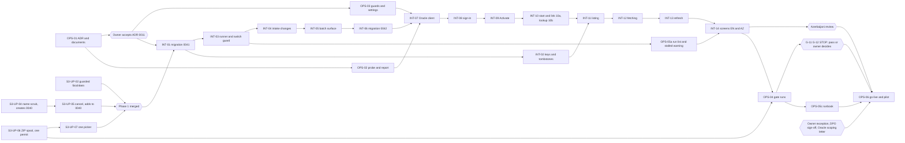

# Plan — Oracle HCM CV import and bulk-upload hardening (Parallax)

<!-- contents:start -->

**Contents**

- 1 · Context
- 2 · What exists today (verified in code)
- 3 · Design decisions
- 4 · Feature 2 — bulk upload: gap closure
- 5 · Feature 1 — Oracle import
- 6 · Security and privacy controls
- 7 · Capacity and failure modes
- 8 · Governance — what must be true before code merges and before live data
- 9 · Phasing
- 10 · Risk register
- 11 · Critical files
- 12 · Open questions
- 13 · Verification
- 14 · Bulk upload: files, work packages and order
- 15 · Oracle import on the server: files, work packages and order
- 16 · Screens: files, visual plans and wording
- 17 · Operations: work packages, gates, capacity, rollout and runbook
- 18 · Testing plan
- 19 · Definition of done
- Appendix A. Owner decisions and acceptance criteria → stories → tests

<!-- contents:end -->

## 1. Context

**What was asked.** Two ways to get many CVs into a Parallax vacancy:

1. **Oracle import** — the recruiter adds an Oracle vacancy ID to a Parallax vacancy and Parallax pulls that vacancy's CVs from Oracle over an API.
2. **Bulk upload** — upload many CVs at once, with single-file, multi-file and ZIP offered together.

**What the owner confirmed (20 Nov 2026).**

| Question                         | Answer                                                                                                                                                                    |
| -------------------------------- | ------------------------------------------------------------------------------------------------------------------------------------------------------------------------- |
| Oracle product                   | Oracle Fusion Cloud HCM — Oracle Recruiting (ORC)                                                                                                                         |
| Access path                      | Direct REST from the Parallax backend (no middleware)                                                                                                                     |
| Volume                           | 100 to 500 CVs per Oracle vacancy                                                                                                                                         |
| Trigger                          | On demand: Import, then Refresh later for what is new. No scheduled polling                                                                                               |
| Which applicants                 | Active only (confirmed, not withdrawn, not disqualified)                                                                                                                  |
| Hosting at go-live               | Render Frankfurt (current trial host, ADR 0010)                                                                                                                           |
| Bulk-upload scope                | No preference → this plan's recommendation (section 4)                                                                                                                    |
| Who may link a vacancy to Oracle | Any recruiter who can edit the vacancy, audited — no approval step                                                                                                        |
| Confirmation                     | Once up front on Oracle's estimate; the import pauses again only on exceptions                                                                                            |
| Set-up                           | **Super simple**: an admin pastes the Oracle API address and the account into one form in the admin panel and clicks **Activate**. No server configuration per connection |

**Key finding.** Bulk upload is **already largely built** (Stage 2, S2-BE2/S2-BE3): multi-file, folder, drag-and-drop and ZIP, per-file status that survives a reload, and retry. Feature 2 is therefore **gap closure**, not a new build. The Oracle import is new and is designed to feed the same intake path, so every existing rule (duplicate check, 500-CV cap, notice + frozen-criteria gate, audit) applies to imported CVs unchanged.

**How this plan was produced.** Eight read-only explorers mapped the code and the Oracle REST documentation; an architect drafted the design against the source; six adversarial reviewers (code fit, Oracle API, security/privacy, operations, recruiter UX, governance/tests) raised 79 findings (2 critical, 25 high); every critical and high finding is resolved below or explicitly rejected with a reason.

**Intended outcome.** A recruiter fills a vacancy from Oracle and sees each applicant's file status in the panel uploads already use; bulk uploads stop failing or blocking each other at the edges; and the governance record covers the new data flow before any live Oracle data moves.

## 2. What exists today (verified in code)

| Area          | Fact                                                                                                                                      | Where                                                                |
| ------------- | ----------------------------------------------------------------------------------------------------------------------------------------- | -------------------------------------------------------------------- |
| Intake        | One service takes every CV: type sniff, sha256 duplicate check, per-vacancy advisory lock, 500-CV cap, document + screening insert, audit | `apps/api/src/pipeline/intake.service.ts:300-507`                    |
| Gate          | Upload needs edit right, vacancy not archived, candidate notice confirmed, criteria frozen                                                | `intake.service.ts:161-177`                                          |
| Batches       | Browser announces a batch (max 500 files), then sends one request per file, 3 in parallel; server keeps per-file outcome                  | `upload-batches.controller.ts:121-209`, `apps/web/src/intake.ts`     |
| ZIP           | Expanded inside the upload request, whole archive in memory, **holds all 3 intake permits**                                               | `intake.service.ts:517-622`, `zip-intake.ts:83`                      |
| Storage       | Original files are `BYTEA` in Postgres (Render `basic-256mb`)                                                                             | `0007_pipeline.up.sql:34`, `render.yaml:6`                           |
| Worker        | In-process, Postgres queue with `SKIP LOCKED` + 120 s lease; single instance                                                              | `processor.service.ts:140-195`                                       |
| Limits        | 10 MB/file, 100 MB/ZIP, 500 live CVs/vacancy, 3 intake permits, 4 analyses at once                                                        | `apps/api/src/config/env.ts:67-80`                                   |
| Oracle slot   | `vacancy.external_ref` exists ("Oracle HCM requisition key", unique per org) but **nothing reads or writes it**                           | `0001_core_schema.up.sql:32-38`                                      |
| Secrets       | AI keys AES-256-GCM in Postgres via `SettingsCrypto`; admin-only, hint-only, audited                                                      | `apps/api/src/ai/settings-crypto.ts:20-34`, `ai-admin.controller.ts` |
| Outbound HTTP | No shared client, no proxy/static egress, no OAuth client code                                                                            | `apps/api/src/ai/providers.ts:69-95`                                 |
| Governance    | ADR 0002: "No ATS/HCM integration before R4". ADR 0010: Oracle HCM "not built". No DPIA/DPA row for an inbound integration                | `docs/adr/0002`, `docs/adr/0010:36`                                  |

## 3. Design decisions

1. **Every imported file enters through `IntakeService.admit`.** No second insert path (the SenAI copy path that bypasses it is a known defect, fixed in P2).
2. **One import = one `import_run`** executed by an in-process, lease-based runner modelled on `ProcessorService`. No new queue service, no separate worker (Stage-2 decision #1).
3. **The run lists first, then fetches, and pauses only on exceptions** (owner decision). The recruiter confirms once up front on Oracle's estimate; the run continues on its own unless the exact count is higher than the estimate or exceeds the room left in the vacancy. The batch and its items are created only when at least one file will be fetched, so `BatchPanel` never shows an empty Oracle batch.
4. **Each Import or Refresh is a new run and a new batch** (`upload_batch.source = 'oracle_hcm'`).
5. **The actor is the recruiter who clicked**, re-loaded from the database and re-gated on every item (decisions.md:64 "edit check on every request"). No anonymous service user as uploader.
6. **Raw Oracle IDs live only while a run is active; afterwards only keyed hashes remain.** "Already imported", reconciliation and tombstones all compare HMAC hashes under a dedicated, versioned key.
7. **An erased candidate cannot come back on Refresh** — erasure writes a hashed tombstone (per application, and per person × requisition).
8. **One Oracle vacancy ↔ one Parallax vacancy** (the existing unique index stays).
9. **Any recruiter who can edit the vacancy may link it, with no approval step** (owner decision, 20 Nov 2026). The security review rated the underlying exposure critical: one integration account can see more than the clicking recruiter may, so a recruiter could pull a requisition they cannot open in Oracle. The owner accepts this for the trial on three compensating controls, all mandatory: (a) the Oracle team restricts the integration account's data security to in-scope recruiting organisations and excludes confidential requisitions — **a go-live gate**; (b) every lookup, link, unlink and import is audited with the requisition number, and lookups are rate-limited in the database; (c) the control is a connection setting (`linkPolicy: open | lead_approval`), so lead approval can be switched on later without a migration.
10. **Set-up is one admin form: paste the Oracle API address, the integration account and its password, click Activate** (owner decision, 20 Nov 2026). Activate validates the address, stores the password encrypted (`SettingsCrypto`, new `integration_connection` table), makes one test call and switches the integration on if it passes. Because a person now types the address, the server accepts only `https://` hosts ending in `.oraclecloud.com` that resolve to a public address, and never follows a redirect to another host. The password is never returned, logged or audited; the saved address is shown to admins only; no Oracle host or secret is in the web bundle (AISEC-01).
11. **Sign-in to Oracle is user name + password (Basic) by default — that is what the simple form asks for.** OAuth (client credentials or JWT assertion) sits under "Advanced" for the case where the Oracle team does not allow Basic. No runtime fallback between them (it doubles failed logins and can lock the account).
12. **Minimal fields only**: no names or e-mails are requested from Oracle; identity still comes from the CV text as for uploads.
13. **Import never calls `/start`** (which re-queues every out-of-date CV); it uses the notice and freeze routes only.
14. **An Oracle outage parks the run without spending an attempt; an API 401 opens one database-backed auth circuit.**
15. **No scheduled polling** (owner decision). Every Refresh reconciles withdrawn/removed applicants; a reminder appears after 30 days without one.
16. **States are `TEXT` + `CHECK`, no new Postgres enum** (keeps `check-taxonomy-parity.mjs` untouched).
17. **The integration can be activated only on the production service.** One deploy switch, `ORACLE_IMPORT_ENABLED`, is set there and nowhere else; everywhere else the admin form says "not available in this environment". So neither a production pod nor a TEST pod cloned from production can be connected from a lower environment, with no per-environment allow-lists to maintain. Tests use an in-process fake Oracle. Setting the switch is the governance gate (section 8).
18. **Capacity is proven by measurement on the current Render plans; no upgrade is assumed** (Stage-2 decisions #18, #19, #8).
19. **`.doc`/`.rtf`/`.odt` conversion is deferred behind a flag** until the probe shows the real format mix (LibreOffice needs 150–300 MB on a 512 MB instance).

## 4. Feature 2 — bulk upload: gap closure

Single, multi-file, folder, drag-and-drop and ZIP already work together in one drop zone. These are the gaps.

| P   | Gap                                                                                                                             | Evidence                                                             | Fix                                                                                                                                    | Test                                   |
| --- | ------------------------------------------------------------------------------------------------------------------------------- | -------------------------------------------------------------------- | -------------------------------------------------------------------------------------------------------------------------------------- | -------------------------------------- |
| P0  | Picking more than 500 files returns HTTP 400 (client sends unchunked, server caps at 500; the UI allows folders of 5,000)       | `apps/web/src/intake.ts:345-355`, `upload-batches.controller.ts:43`  | Announce `min(500, room + ZIPs)`; the rest are left out with a notice; typed `TOO_MANY_FILES`                                          | `intake.test.tsx`; new L1 case UP-16   |
| P0  | A final item outcome can be overwritten (unconditional `UPDATE`) — breaks cancel and retries                                    | `intake.service.ts:223-231`                                          | Guarded `finishItem` (only when not final); callers read the stored result back                                                        | race spec                              |
| P0  | Unexpected error mid-ZIP gives a 500 and leaves the item "not received"; codes `server_error`/`bad_zip_entry` are never written | `intake.service.ts:581-582`, `packages/shared/src/status.ts:104,113` | Per-entry try/catch → `bad_zip_entry`; `take()` → `skipped/server_error`                                                               | `intake.integration.spec.ts`           |
| P0  | Erase keeps the file name (usually the candidate's name) on `cv_document` and `upload_item`                                     | `erase-document.ts:17-22`, `0036:21-22`                              | Scrub names on erase and retention purge; keep `erased_name_sha` so the skipped list still matches                                     | erase + retention specs                |
| P1  | No cancel for a running upload                                                                                                  | `apps/web/src/api.ts:116-120`                                        | `AbortController` + `POST upload-batches/:id/cancel`; open items → `skipped/cancelled` (migration 0040)                                | unit + L2                              |
| P1  | A ZIP holds every permit and the whole archive in memory (≈300 MB worst case on a 512 MB instance)                              | `intake.service.ts:520`, `zip-intake.ts:83`                          | Spool to a temp file, streaming reader, **one** permit, ZIPs in one client lane                                                        | memory assertion with three 90 MB ZIPs |
| P1  | One ZIP per pick; "Choose files" does not list `.zip`                                                                           | `ResumesCard.tsx:250,261`                                            | `accept` includes `.zip`, `multiple` allowed — shipped **after** the spool                                                             | L1 UP-03 extension                     |
| P1  | ZIP contents not counted in the "room left" hint                                                                                | `ResumesCard.tsx:151`                                                | "About n" from the ZIP central directory                                                                                               | unit                                   |
| P1  | No downloadable outcome list                                                                                                    | `BatchPanel.tsx:356`                                                 | `GET upload-batches/:id/report.csv` (position, label, status, reason, document ID), audited; reuses `safe()` in `export.service.ts:33` | integration + L1                       |
| P1  | Missing fixture and thin e2e (bad/nested ZIP, 401 pause, retry-failed, re-choose unsent, ZIP via picker)                        | `e2e/fixtures/files.ts:23`                                           | Regenerate `oversize.zip`; `too-many.zip` above 1,000 entries; add the cases                                                           | L1, L2                                 |
| P2  | SenAI "Analyze for this vacancy" bypasses lock, cap and the erased check                                                        | `apps/api/src/assistant/pool-assistant.service.ts:266-300`           | Route through `IntakeService`                                                                                                          | integration                            |
| P2  | `.doc`/`.rtf`/`.odt` rejected; ZIP expansion still inside the request                                                           | —                                                                    | Behind flags, after measurement                                                                                                        | —                                      |
| P2  | Older file names in append-only `intake_skip`                                                                                   | `0016_intake_skip.up.sql:15-18`                                      | DPO decision (cannot be updated by design)                                                                                             | —                                      |

Not in scope and recorded as risks: antivirus scanning (none exists for any path today), per-file byte progress, uploading without starting analysis.

## 5. Feature 1 — Oracle import

### 5.1 Recruiter flow

| State                   | What the recruiter sees                                                                                                                                                                                                                                                       |
| ----------------------- | ----------------------------------------------------------------------------------------------------------------------------------------------------------------------------------------------------------------------------------------------------------------------------- |
| Hidden                  | Nothing — feature flag off or no connection configured                                                                                                                                                                                                                        |
| Ready                   | One field, "Oracle vacancy ID", and one button, **Import CVs from Oracle**. Needs frozen criteria and the confirmed notice, like any upload                                                                                                                                   |
| Confirm (one dialog)    | "{Oracle title} · {state}. About {n} applications. Their CVs will be copied and analyzed by AI. Room for {r}." **Start** / Cancel. Start saves the link and begins the import; the Oracle title is what catches a typo                                                        |
| Linked afterwards       | The ID is shown read-only with **Refresh**. Changing it: the recruiter while nothing has been imported; a TA lead afterwards                                                                                                                                                  |
| Listing                 | "Reading the application list from Oracle…" (1–3 min for 500), then continues on its own                                                                                                                                                                                      |
| Paused (exception only) | Shown only if the exact count is above the estimate or above the room left: "{n} new CVs, {a} already here, {w} withheld, {f} filtered, {z} without a CV file. Room for {r}; oldest application first." **Continue** / Cancel. Unanswered for 2 h → cancelled, nothing copied |
| Fetching                | "Fetched {a} of {n} · Analyzed {b}" in the existing `BatchPanel`; **Cancel import** (asks once; CVs already copied stay)                                                                                                                                                      |
| Finished                | Counts that sum to the listed total, **Download report**, **Refresh** with last time and person                                                                                                                                                                               |
| Empty                   | Three distinct texts: no applications (check the integration user's access) · applications but no CV file in the categories read · nothing new                                                                                                                                |
| Error                   | One plain line per code (Oracle unavailable, sign-in to Oracle failed — ask an admin, storage low, …)                                                                                                                                                                         |

**Admin set-up (`apps/web/src/pages/Admin.tsx`) — one card, one button:**

| Field               | What the admin does                                                                                                                                                                                                                                 |
| ------------------- | --------------------------------------------------------------------------------------------------------------------------------------------------------------------------------------------------------------------------------------------------- |
| Oracle API address  | Paste it, e.g. `https://xxxx.fa.em2.oraclecloud.com`. A full REST link pasted from Oracle's documentation is accepted and trimmed to the address                                                                                                    |
| User name, Password | The Oracle integration account. Oracle has no single "API key": its API needs an account, so these two fields cannot be dropped                                                                                                                     |
| Tick-box            | "Applicants on our Oracle career site are told that AI assists screening" (required)                                                                                                                                                                |
| **Activate**        | Validates the address, saves the password encrypted, makes one test call, switches the integration on. One plain result line: Active · Sign-in failed · Connected but the account sees no vacancies · Address not reachable · Not an Oracle address |

After activation the card shows "Active since …, last check OK" with **Test again**, **Replace password** (the new password is tested first; the saved one stays unless the test passes), **Turn off**, and the list of import runs with **Abandon**. Everything else has a working default and sits under "Advanced", closed until opened, with its own Save and no need to activate again: the sign-in method (password, or OAuth), the CV categories, and three switches — "A team lead approves each link" (off: the owner's open linking), "Only use an AI company that processes in the EU" (**on** by default; an administrator may switch it off only after the DPO's decision, and the change is audited) and "When an applicant is gone from Oracle: flag for review / erase" (flag).

### 5.2 Data model (migrations, each with `.down.sql`)

```sql
-- 0040_upload_cancel (ships with Phase 1)
ALTER TABLE upload_batch ADD cancelled_at TIMESTAMPTZ, ADD cancelled_by ulid REFERENCES app_user(id);
ALTER TABLE cv_document  ADD erased_name_sha CHAR(64);

-- 0041_import (Phase 2)
ALTER TABLE upload_batch ADD source TEXT NOT NULL DEFAULT 'browser'
  CHECK (source IN ('browser','oracle_hcm'));
CREATE TABLE import_run (            -- one per Import / Refresh click
  id, vacancy_id, batch_id NULL UNIQUE, kind 'oracle_hcm', mode 'import'|'refresh',
  state 'queued'|'running'|'awaiting_confirm'|'completed'|'failed'|'cancelled',
  phase 'listing'|'fetching', external_ref, external_id, list_cursor, listed,
  projected_bytes, fetched_bytes, attempts, run_after, wait_reason, waited_since,
  claim_id, lease_until, progress_at, error_code, stats JSONB /* counts only */,
  started_by, started_ip, confirmed_by, confirmed_at, cancel_requested_at/_by, created_at, finished_at);
CREATE UNIQUE INDEX import_run_one_active_uq ON import_run (vacancy_id)
  WHERE state IN ('queued','running','awaiting_confirm');      -- double-click and Refresh-while-running safe
CREATE TABLE import_item (           -- only applications with a CV to fetch
  id, run_id, vacancy_id, system, seq,
  external_application_id, external_attachment_id,              -- NULLed when the run ends or on erase
  app_key_hash, att_key_hash, person_key_hash, key_version,     -- HMAC, what remains
  external_applied_at, size_bytes, attempts,
  upload_item_id UNIQUE, document_id, supersedes_document_id, source_gone_at,
  UNIQUE (run_id, app_key_hash));
CREATE TABLE import_tombstone (      -- append-only suppression list
  id, system, key_kind 'application'|'person_requisition', key_hash, key_version,
  vacancy_id, cause 'erase'|'purge'|'source_removed', created_at, UNIQUE (system, key_hash));
-- cv_app: SELECT/INSERT/UPDATE on import_run, import_item; SELECT/INSERT only on import_tombstone
-- (forbid_mutation triggers, as 0016 does for intake_skip).

-- 0042_integration_connection (Phase 3)
CREATE TABLE integration_connection (
  id, system UNIQUE 'oracle_hcm', base_url /* pasted by the admin; origin only, validated */,
  token_url NULL /* Advanced: OAuth only */,
  auth_mode 'basic' (default) |'oauth_client_credentials'|'oauth_jwt_assertion',
  principal_name, settings JSONB, secret_ciphertext, secret_hint, secret_aad, secret_set_at,
  secret_expires_on, notice_attested_by/_at, notice_version, notice_effective_from,
  enabled, auth_failed_at, last_test_at, last_test_code, budget_day, calls_used, updated_by, timestamps);
ALTER TABLE vacancy ADD external_system, external_id, external_link_state 'proposed'|'approved',
  external_linked_by/_at, external_approved_by/_at;             -- external_ref (0001:33) is reused
-- With linkPolicy 'open' (the owner's choice) a link is written as 'approved' at once; the
-- 'proposed' state and the approver columns are used only if lead approval is switched on.
-- import_run also carries estimate INT (Oracle's up-front count) and confirm_reason TEXT.
```

Round-trip additions in `scripts/migrate-roundtrip.mjs`: tombstone UPDATE/DELETE/TRUNCATE rejected; a second active run per vacancy rejected; a linked vacancy survives one step down and up.

### 5.3 Backend

**New module `apps/api/src/integrations/`**

| File                                                               | Role                                                                                                                                                                                 |
| ------------------------------------------------------------------ | ------------------------------------------------------------------------------------------------------------------------------------------------------------------------------------ |
| `import-runner.service.ts`                                         | Claim (`SKIP LOCKED`, 120 s lease renewed **only on progress**), `tick()` / `drainRuns()` for tests, recovery at bootstrap, abort-first shutdown                                     |
| `import-keys.ts`                                                   | HMAC with `IMPORT_TOMBSTONE_KEY` (versioned; old keys match only)                                                                                                                    |
| `principal-loader.ts`                                              | Rebuilds the clicking user's `Principal` from the database (status, roles) for every item                                                                                            |
| `oracle/oracle-hcm.client.ts`                                      | Injectable `fetcher` (same seam as `AiGateway.fetcher`), deadlines, size caps via `readCapped`, `Retry-After` + jittered backoff, same-host redirects only, body-free error messages |
| `oracle/oracle-auth.ts`                                            | The three auth strategies, single-flight token cache                                                                                                                                 |
| `oracle/oracle-admin.controller.ts`, `oracle-import.controller.ts` | Endpoints below                                                                                                                                                                      |

**Endpoints**

| Route                                                                                     | Role                                              | Notes                                                                                                                                                                                                                                                                                                                                                 |
| ----------------------------------------------------------------------------------------- | ------------------------------------------------- | ----------------------------------------------------------------------------------------------------------------------------------------------------------------------------------------------------------------------------------------------------------------------------------------------------------------------------------------------------- |
| `GET admin/integrations/oracle` · `POST …/activate` · `POST …/test` · `POST …/deactivate` | ADMIN                                             | **Activate** is the one call behind the one button: validate the address, store the secret, test, enable. 404 "not available in this environment" unless `ORACLE_IMPORT_ENABLED` is set. Never returns the password; test limited to once per 5 min; all audited                                                                                      |
| `PUT admin/integrations/oracle/settings`                                                  | ADMIN                                             | The "Advanced" settings: sign-in method, CV categories, `linkPolicy`, `requireEuAi`, `goneInSource`. One audit row per change with the old and the new value, never a secret                                                                                                                                                                          |
| `GET admin/integrations/oracle/runs`, `POST admin/import-runs/:id/abandon`                | ADMIN                                             | Counts and states only                                                                                                                                                                                                                                                                                                                                |
| `GET vacancies/:id/oracle`                                                                | TA roles + `scope.assert`                         | `{available, link, run, lastRun, goneCount, staleDays}`                                                                                                                                                                                                                                                                                               |
| `POST vacancies/:id/oracle/lookup`                                                        | TA roles + `assertEdit`                           | Feeds the confirm dialog: number, title, state, estimate; audited; rate-limited in the database (per user and global)                                                                                                                                                                                                                                 |
| `POST vacancies/:id/oracle/imports`                                                       | TA roles + `intake.gate`                          | Body: the vacancy ID and the estimate the recruiter confirmed. The first call **saves the link** (audited with the requisition number; 409 if that requisition is linked to another vacancy) and starts the run. 202 `{runId}`; refusals: integration not active, notice not attested, retention off, cooldown, auth circuit open, run already active |
| `DELETE vacancies/:id/oracle/link`                                                        | Editor while nothing imported; TA_LEAD afterwards | Refused while a run is active                                                                                                                                                                                                                                                                                                                         |
| `POST …/oracle/link/approve`                                                              | TA_LEAD                                           | Used only when `linkPolicy: lead_approval` is switched on                                                                                                                                                                                                                                                                                             |
| `POST import-runs/:id/confirm` · `…/cancel`                                               | same                                              | Confirm is needed only when the run paused on an exception; it re-checks the gate                                                                                                                                                                                                                                                                     |
| `POST upload-batches/:id/cancel`, `GET upload-batches/:id/report.csv`                     | TA roles                                          | Shared with feature 2                                                                                                                                                                                                                                                                                                                                 |

**Changes to existing files**

| File                                                       | Change                                                                                                                                                                                                                                                                                           |
| ---------------------------------------------------------- | ------------------------------------------------------------------------------------------------------------------------------------------------------------------------------------------------------------------------------------------------------------------------------------------------ |
| `pipeline/intake.service.ts`                               | Guarded `finishItem`; `itemOf` requires a browser batch (so the browser route cannot write into Oracle items); `IntakeCtx` gains `label`, `via`, `runId`, `claimId`; `admit` re-reads run-cancel / archive state under its lock; `skipRecord` writes the neutral label; DOCX structure pre-check |
| `pipeline/upload-batches.controller.ts`                    | `source` + `activeImport` in `info()`; source-aware `retryFailed` (on an Oracle batch it starts a refresh run); cancel and report routes                                                                                                                                                         |
| `pipeline/documents.controller.ts`                         | `stop()` also requests cancel of an active import; `/skipped` matches `erased_name_sha`                                                                                                                                                                                                          |
| `pipeline/erase-document.ts`                               | Writes tombstones, nulls raw Oracle IDs, scrubs file names; never throws on a hash failure                                                                                                                                                                                                       |
| `pipeline/retention.service.ts`                            | Clock = the earlier of upload date and Oracle application date                                                                                                                                                                                                                                   |
| `pipeline/vacancy.service.ts`                              | `view()` returns the link; archive cancels a run that is still listing or waiting for confirmation. While files are being fetched archive is refused as it is today ("Stop the running screening first"), and Stop cancels the import                                                            |
| `config/env.ts`, `render.yaml`                             | Three settings only, none per connection: `ORACLE_IMPORT_ENABLED` (deploy switch, default off), `IMPORT_TOMBSTONE_KEY` (generated by Render like `SESSION_SECRET`), `DB_SIZE_LIMIT_MB`. Concurrency (2), rate (4/s) and refresh cooldown (10 min) are code defaults                              |
| `packages/shared/src/status.ts`                            | `RETRYABLE_CODES` (`vacancy_full` and `server_error` in Phase 1; `source_unavailable` is added in Phase 2); codes `source_unavailable`, `source_gone`, `cancelled`, `superseded`, `crash_limit`; statuses `cancelled`, `not_fetched`                                                             |
| `scripts/check-bundle-keys.mjs`, `check-env-isolation.mjs` | Oracle host/secret patterns; `ORACLE_IMPORT_ENABLED` must not appear in a non-production example file                                                                                                                                                                                            |

**From Oracle to `admit`**

1. **Listing** (one claim-guarded transaction per page): compute hashes → tombstone hit counts as _withheld_ → filtered / pre-notice / no-file applications are **counts only** (no IDs stored) → already imported counts as _already_ → a new attachment on an imported application becomes an item with `supersedes_document_id` → otherwise insert `import_item`. Cursor and progress move in the same transaction, so a restart cannot duplicate items.
2. **Reconciliation** on every Refresh: imported applications no longer returned get `source_gone_at` (flag for review by default; auto-erase is a DPO setting).
3. **End of listing**: the run stops with `STORAGE_LOW` (nothing copied) when current DB size + projection × 1.15 exceeds 70 % of `DB_SIZE_LIMIT_MB`. It pauses in `awaiting_confirm` only when the exact count is above the confirmed estimate or above the room left in the vacancy. Otherwise it continues on its own: it creates the batch and one `upload_item` per item, oldest application first, with the **neutral label "Oracle application {n}"** (the real file name is stored only on `cv_document`, where erase scrubs it). The estimate, the exact count and who confirmed are written to the audit trail.
4. **Fetching**, two at a time: check cancel → count the attempt (an item that has already failed twice ends as `rejected/crash_limit`, which is final and is not downloaded again on a later Refresh) → re-resolve the link and download through `readCapped` (10 MB) → name from magic bytes → load principal + `intake.gate` → `admit` → on the first `vacancy_full` stop downloading (so at most room + 2 files are ever downloaded: those that fit, the refused one, and one already in flight).

### 5.4 Oracle calls (`REST-Framework-Version: 4`, base `/hcmRestApi/resources/11.13.18.05`)

| #   | Call                                                                                                                                              | Status                                                                                                                                   |
| --- | ------------------------------------------------------------------------------------------------------------------------------------------------- | ---------------------------------------------------------------------------------------------------------------------------------------- |
| A   | Token (client credentials or JWT assertion), cached                                                                                               | Grants documented; scope, lifetime, JWT set-up → **TEST pod**                                                                            |
| B   | `recruitingJobRequisitions?finder=findByRequisitionNumber;RequisitionNumber={n}`                                                                  | Finder **documented**; `Title` field → TEST                                                                                              |
| C   | `recruitingJobApplications?q=RequisitionId={id}&limit=1&totalResults=true`                                                                        | Documented as an _estimated_ count — this is the number the recruiter confirms up front                                                  |
| D   | Same resource, `q=RequisitionId={id} and JobApplicationId > {cursor}` + filter flags, `orderBy=JobApplicationId:asc&limit=100`, loop on `hasMore` | Fields **documented**; RowMatch `and` syntax required under framework v2+ (the `;` form returns an error) → behaviour to confirm on TEST |
| E   | `…/{application}/child/attachments` (`AttachedDocumentId, CategoryName, DatatypeCode, FileName, UploadedFileLength, DmDocumentId, …`)             | **Documented**                                                                                                                           |
| F   | Download: (1) an advertised enclosure link, else (2) host + `FileUrl` at once, else (3) item `fields=FileContents` (base64, size-capped)          | Only `FileUrl`/`FileContents` are documented on this resource → **probe picks the strategy**                                             |

Resources to avoid: `recruitingCE*` / `recruitingICE*` (career-site internal) and `recruitingUIJobApplications` (recruiter UI; reported to return empty results).

### 5.5 Run state machine

```
queued/listing ─claim→ running/listing ─last page, nothing new→ completed (no batch)
running/listing ─last page, n files within estimate and room→ running/fetching → completed
running/listing ─last page, n above estimate or room→ awaiting_confirm ─2 h unconfirmed→ cancelled
awaiting_confirm ─confirm (gate re-checked)→ queued/fetching → running/fetching → completed
running/listing ─last page, storage projection too high→ failed 'storage_low' (nothing copied)
running ─Oracle 429/5xx/timeout, memory, storage→ queued (parked; attempt returned; fails after 2 h)
running ─no progress 5 min→ lease lapses → queued (attempts+1; 5 → failed)
running ─API 401, gate throws, actor revoked, requisition gone→ failed
any active ─cancel, Stop, flag off, admin abandon→ cancelled
listing or awaiting_confirm ─archive→ cancelled   (while fetching, archive is refused until Stop, as today)
```

Every terminal transition, in one transaction: settles open items, nulls raw Oracle IDs, closes retryable items of older Oracle batches as `superseded`.

### 5.6 Frontend

| File                                      | Change                                                                                                                                                                                             |
| ----------------------------------------- | -------------------------------------------------------------------------------------------------------------------------------------------------------------------------------------------------- |
| `apps/web/src/oracle.ts` (new)            | API shapes and calls                                                                                                                                                                               |
| `pages/OracleStrip.tsx` (new)             | Always-visible strip above `BatchPanel` when linked: number, last refresh, progress, Cancel, Refresh; read-only when archived                                                                      |
| `pages/OracleLink.tsx` (new)              | In `ResumesCard`: one field, one button, one confirm dialog; change or unlink afterwards (and approve, only when lead approval is switched on)                                                     |
| `intake.ts`, `pages/BatchPanel.tsx`       | `adoptBatch` so a server-created batch appears without a reload; source-aware wording; no "re-choose files" for Oracle batches; new statuses; Download report; `AbortController`; ZIPs in one lane |
| `pages/ResumesCard.tsx`                   | Unified picker, announce slice with notice, "about n" ZIP estimate                                                                                                                                 |
| `pages/Admin.tsx`, `api.ts`               | The one-form **Activate** card, status line, run list; `upload(path, files, signal)`                                                                                                               |
| `i18n/az.oracle.ts` (new), `az.stage2.ts` | Every new string in English and Azerbaijani (the i18n coverage test enforces it)                                                                                                                   |

Stop buttons are renamed so three different actions are not confused: "Stop sending files", "Cancel import", "Stop analysis".

## 6. Security and privacy controls

| Threat or obligation                                                                                               | Control                                                                                                                                                                                                                                                                                                             |
| ------------------------------------------------------------------------------------------------------------------ | ------------------------------------------------------------------------------------------------------------------------------------------------------------------------------------------------------------------------------------------------------------------------------------------------------------------- |
| Recruiter pulls a requisition they may not see in Oracle (rated critical; **residual risk accepted by the owner**) | Oracle team scopes the integration account's data security and excludes confidential requisitions (go-live gate); every lookup, link and import audited with the requisition number; database-backed lookup rate limits; `linkPolicy` switch to lead approval without a migration                                   |
| Secret disclosure                                                                                                  | AES-GCM with row-bound AAD; hint only; decrypted per call; never logged, audited or returned                                                                                                                                                                                                                        |
| Admin pastes a wrong or hostile address (SSRF, credential forwarding)                                              | Accepted only if `https`, the host ends in `.oraclecloud.com`, and it resolves to a public address (check reused from `link-reader.ts`, repeated on every connection); no redirect to another host; `Authorization` sent only to the saved host; Activate fails closed                                              |
| Oracle host or key in the browser (AISEC-01)                                                                       | Nothing Oracle-related in the web bundle (new forbidden patterns in `guard:bundle`); the saved address is returned to ADMIN only, the password never                                                                                                                                                                |
| Integration user locked out                                                                                        | One auth circuit for lookup, link, run and test; single-flight login; Basic never retries a 401                                                                                                                                                                                                                     |
| Production data in lower environments                                                                              | Activation exists only where `ORACLE_IMPORT_ENABLED` is set (production); a lower environment cannot connect to any Oracle pod; the probe touches one synthetic requisition and prints counts only                                                                                                                  |
| Erased or withdrawn candidate returns                                                                              | Hashed tombstones; reconciliation on every Refresh; 30-day stale reminder; retention must be ON for a linked vacancy                                                                                                                                                                                                |
| Over-collection                                                                                                    | Field allow-list; raw Oracle IDs only during a run; excluded applicants stored as counts only                                                                                                                                                                                                                       |
| Candidate names in permanent tables                                                                                | Neutral labels in `upload_item` and append-only `intake_skip`; real name only on `cv_document`, scrubbed on erase                                                                                                                                                                                                   |
| Notice for people who applied through Oracle                                                                       | One required tick-box on the Activate form (who ticked it, when, and the notice's effective date are recorded); applications from before that date are skipped                                                                                                                                                      |
| CV text leaving the EU through the AI provider                                                                     | Connection setting `requireEuAi`, **on by default**: an import is refused (`AI_NOT_EU`) while the active AI company does not process in the EU. An administrator may switch it off only after the DPO's decision; the change is audited. The confirmed estimate and the exact count are audited before any analysis |
| Lost authority mid-run                                                                                             | Principal re-loaded and gate re-run on every item                                                                                                                                                                                                                                                                   |
| Malicious file                                                                                                     | Magic-byte sniff, size caps, DOCX structure pre-check, per-item crash limit. Antivirus is a recorded go-live decision (none exists today for any path)                                                                                                                                                              |
| Tenant denial of service against Oracle                                                                            | Concurrency 2, 4 requests/s, cooldown between refreshes, a daily call budget (code default 20,000 calls a day, to confirm with the Oracle team)                                                                                                                                                                     |
| Invariants                                                                                                         | No change to knockout, scoring, `not_found` handling or audit grants. An Oracle state never becomes a decision                                                                                                                                                                                                      |

## 7. Capacity and failure modes

| Scenario                                                                       | Designed behaviour                                                                                                                                                    |
| ------------------------------------------------------------------------------ | --------------------------------------------------------------------------------------------------------------------------------------------------------------------- |
| Memory (Render starter, ~512 MB)                                               | At most two ≤10 MB buffers; own memory ceiling; a memory park reports `capacity_unavailable`. Measured at gate G-11                                                   |
| **Database disk** (BYTEA; one 500-CV vacancy ≈ 750 MB by the Stage-2 estimate) | Projection at confirm, byte counter per item, `STORAGE_LOW`. **On the current plan a 500-CV import may be refused** — gate G-12, then the owner decides under rule #8 |
| DB pool of 10                                                                  | Nothing held across an HTTP call; at most two intake transactions plus a heartbeat                                                                                    |
| Intake permits                                                                 | One per file, so recruiter uploads keep working during an import                                                                                                      |
| AI cost                                                                        | Estimate confirmed up front; a higher exact count pauses the run; one active run per vacancy; cancel also stops new screenings                                        |
| Timing for 500 CVs                                                             | Listing 1–3 min, fetch 5–10 min, analysis 1–2 h or more (to be measured)                                                                                              |
| Oracle outage / throttling                                                     | `Retry-After`, jittered backoff, parking up to 2 h per reason, no attempt spent                                                                                       |
| Hung Oracle call                                                               | Per-call deadline (15 s metadata; downloads 30 s first byte / 20 s idle / 120 s total), progress watchdog, admin abandon                                              |
| Restart or deploy mid-run                                                      | Abort-first shutdown; claim checked inside `admit`; resume from the cursor                                                                                            |
| Feature flag off or rollback                                                   | Sweep cancels active runs; runbook cancels runs before a rollback                                                                                                     |
| Oracle production-to-test refresh                                              | Wipes the integration user → circuit opens → admin re-enters credentials                                                                                              |
| Password / secret expiry                                                       | Expiry date field, banner before expiry, runbook                                                                                                                      |
| Quarterly Oracle update                                                        | Pinned versions; `schema_changed` error; fake-Oracle contract tests                                                                                                   |
| More than 500 applicants                                                       | Oldest application first (stated to the recruiter); the rest `vacancy_full`; count shown                                                                              |

## 8. Governance — what must be true before code merges and before live data

**Sequencing.** ADR 0002 says no HCM integration before R4, and `main` auto-deploys to production. So **ADR 0011 Accepted is the entry gate for Phase 2** (the first Oracle schema). Phase 1 (bulk upload) has no such gate.

**Go-live on Render Frankfurt is an owner exception; this plan cannot grant it.** CLAUDE.md rule D3 (no live candidate data before the 21 R1a gates close) and PLAT-09 (West/North Europe) are met for the trial today only through the exception in ADR 0010 and `docs/mvp-trial-compliance.md`, which covers recruiter uploads. A system-to-system pull of live Oracle applicants is a new flow. Enabling the PROD pod therefore requires, in writing: ADR 0011 Accepted, a `docs/decisions.md` row signed by the owner extending the trial exception to this flow, and DPO sign-off on the new DPIA rows. The gate is the deploy switch: `ORACLE_IMPORT_ENABLED` is set on the production service only after those three exist (recorded in `docs/deploy-render.md`); until then the Activate form is not available. Nothing relaxes the residency guard. Two consequences of staying on Render: outbound IPs are regional ranges shared with other Render customers (a problem if Oracle's security team requires IP allow-listing), and capacity is bound by decision #18. Note: the 21 R1a gates are not listed anywhere in the repository.

**Documents to change**

- New **`docs/adr/0011-oracle-recruiting-import.md`** — read-only CV import before R4; in-process runner; background-actor pattern; supersedes ADR 0002 for this scope; note on ADR 0010:36.
- **`docs/decisions.md`** — pull-forward; **open linking with the accepted residual risk and its three compensating controls**; tombstone rule; lower-environment rule; confirm-on-exceptions; live-data exception; any amendment to #18.
- **`docs/dpia-fria-draft.md`** — source system and purpose compatibility, Art. 13/14 notice, suppression list, person hash, report export, retention clock, antivirus.
- **`docs/dpa-checklist.md`** — a "Source system: Oracle" section (Oracle receives nothing from Parallax, so it is not a column in the processor table); **`docs/mvp-trial-compliance.md`** — the new flow.
- New **`docs/oracle-import-runbook.md`**; updates to `docs/deploy-render.md`, `render.yaml`, `docs/performance-run.md`, `docs/uat/e2e-test-plan.md`, design-spec non-goals.
- **`CLAUDE.md`** sequencing rule names ADR 0011. D3 and PLAT-09 wording unchanged.

**Story IDs** (none collide with repo IDs; confirm INTG numbering against the Programme Plan, which is not in the repo): `S3-UP-01..10` bulk upload · `S3-INT-01..14` link, connection, runner, listing, confirm, fetch, refresh, tombstone, reconciliation · `S3-OPS-01..06` gates, runbook, admin runs.

## 9. Phasing

| Phase | Content                                                                                                                                                                                                | Entry → exit                                                                                                                                                                                                                          | Size | Ships alone     |
| ----- | ------------------------------------------------------------------------------------------------------------------------------------------------------------------------------------------------------ | ------------------------------------------------------------------------------------------------------------------------------------------------------------------------------------------------------------------------------------- | ---- | --------------- |
| 0     | ADR 0011, questions to the Oracle team, DPO consent, **synthetic-only TEST-pod probe** (`scripts/oracle-probe.mjs`)                                                                                    | Owner go → ADR Accepted, probe report, auth mode and download strategy chosen                                                                                                                                                         | S    | —               |
| 1     | Bulk-upload P0 + P1, migration 0040 (spool before multi-ZIP)                                                                                                                                           | None → CI green, UP-16 passes                                                                                                                                                                                                         | L    | **Yes**         |
| 2     | Migration 0041, runner, guarded items, tombstones, batch source, admin run list                                                                                                                        | ADR Accepted → restart and cancel specs green                                                                                                                                                                                         | M    | Dark (flag off) |
| 3     | Migration 0042, client, sign-in, one-call **Activate**, import against the fake Oracle                                                                                                                 | Probe report → integration specs green                                                                                                                                                                                                | L    | Dark            |
| 4     | Recruiter field + button, admin Activate card, i18n, e2e                                                                                                                                               | Phase 3 API stable → L1 green                                                                                                                                                                                                         | L    | Dark            |
| 5     | Gate run on a temporary copy on the current plans with the fake Oracle: G-11, G-12; runbook; DPIA sign-off (the real TEST pod is checked with the probe script, not from a deployed lower environment) | Phases 3–4 → gates pass or owner decides (rule #8)                                                                                                                                                                                    | S    | —               |
| 6     | Switch on in production: set `ORACLE_IMPORT_ENABLED`, admin pastes the address and account and clicks **Activate**, first import on one agreed vacancy as a pilot                                      | Written owner exception + DPO sign-off (section 8); **Oracle team confirms in writing that the integration account is scoped and confidential requisitions are excluded**; retention on; antivirus decision; network access confirmed | S    | Go-live         |
| 7     | P2 items (conversion, runner-based ZIP, SenAI path)                                                                                                                                                    | Production data on formats                                                                                                                                                                                                            | M    | Each alone      |

Phases 0 and 1 can start in parallel. Nothing in Phases 2–4 touches Oracle production. Sections 14 to 19 and Appendix A take each phase down to stories, files, tests and gates.

**State on 20 November 2026 (drafts, nothing committed):** ADR 0011 is written as Proposed (`docs/adr/0011-oracle-recruiting-import.md`). The Stage 3 rows are in `docs/decisions.md`, with new sections in `docs/dpia-fria-draft.md`, `docs/dpa-checklist.md` and `docs/mvp-trial-compliance.md`. The note for the Oracle team is `docs/stage-3/oracle-team-questions.md`. The probe is drafted (`scripts/oracle-probe.mjs`, 44 tests passing against a fake Oracle); it has not been run against Oracle, it signs in with user name and password only, and it refuses any address that does not look like a test environment.

## 10. Risk register

| #   | Risk                                                                                               | L   | I   | Mitigation                                                                                                                     | Owner               |
| --- | -------------------------------------------------------------------------------------------------- | --- | --- | ------------------------------------------------------------------------------------------------------------------------------ | ------------------- |
| 1   | Oracle resources behave differently from the documentation                                         | M   | H   | Probe before build; follow returned links; three download strategies                                                           | Dev                 |
| 2   | No auth mode works for a service identity (SSO may disable Basic)                                  | M   | H   | Three strategies; client-ID user set-up in the runbook                                                                         | Oracle team         |
| 3   | Integration user locked out                                                                        | L   | H   | Auth circuit; no retry on Basic                                                                                                | Dev                 |
| 4   | Password or secret expires silently                                                                | H   | M   | Expiry field, banner, runbook                                                                                                  | Oracle team         |
| 5   | Empty result read as "no applicants" (missing data security returns 200 + empty)                   | M   | H   | `empty_scope` test result; three empty states                                                                                  | Oracle team         |
| 6   | Recruiter imports a requisition they should not see (no approval step — **accepted by the owner**) | M   | H   | Oracle-side scoping as a go-live gate; full audit; rate limits; `linkPolicy` switch                                            | Owner / Oracle team |
| 7   | Real personal data reaches a lower environment via a cloned TEST pod                               | M   | H   | Activation only on the production service; the probe reads one synthetic vacancy only                                          | DPO                 |
| 8   | Erased or withdrawn candidate persists or returns                                                  | M   | H   | Tombstones; reconciliation; reminder; retention ON                                                                             | DPO                 |
| 9   | Tombstone key lost or rotated badly                                                                | L   | H   | Versioned key; old keys kept for matching; runbook                                                                             | Dev                 |
| 10  | **Database disk fills** (Render basic-256mb, BYTEA)                                                | H   | H   | Projection; G-12; owner decision on #18                                                                                        | Owner               |
| 11  | Out-of-memory restart                                                                              | M   | M   | Ceiling; concurrency 2; crash limit; G-11                                                                                      | Dev                 |
| 12  | Unbudgeted AI spend from one click                                                                 | M   | M   | Up-front confirm; pause when the exact count is higher; cancel; cooldown                                                       | Owner               |
| 13  | Oracle throttles the tenant                                                                        | M   | M   | Rate limit; daily budget; parking                                                                                              | Oracle team         |
| 14  | Oracle requires IP allow-listing; Render egress is shared                                          | M   | H   | Ask in Phase 0; fallback is Azure hosting with a NAT gateway                                                                   | Oracle team / Owner |
| 15  | Wrong requisition linked                                                                           | M   | M   | Find step shows the Oracle title before linking; recruiter can unlink until something is imported, a lead afterwards           | Owner               |
| 16  | No lawful notice for people who applied through Oracle                                             | M   | H   | Connection-level attestation; date cut-off                                                                                     | DPO                 |
| 17  | Go-live delayed by the governance exception or gates                                               | H   | H   | Stated plainly; Phases 0–5 proceed meanwhile                                                                                   | Owner               |
| 18  | Many `.doc` / image CVs rejected                                                                   | M   | M   | Oracle-side format report; P2 conversion                                                                                       | Owner               |
| 19  | Scanned PDFs need manual reading (no OCR)                                                          | H   | M   | Shown in the counts line                                                                                                       | Owner               |
| 20  | CV exists only on the candidate profile, not on the application                                    | M   | M   | Probe measures the share; `profileFallback` built only if it matters                                                           | Dev                 |
| 21  | Recruiter-added documents imported as CVs                                                          | L   | H   | Resume-category rule; admin acknowledgement for generic categories                                                             | DPO                 |
| 22  | Quarterly Oracle update breaks parsing                                                             | M   | M   | Pinned versions; contract tests                                                                                                | Oracle team         |
| 23  | Malicious attachment (no antivirus)                                                                | L   | H   | Sniff; caps; pre-check; antivirus decision                                                                                     | DPO                 |
| 24  | Withdrawal in Oracle unseen between Refreshes (no polling)                                         | M   | M   | Accepted by design; reminder + retention bound it                                                                              | DPO                 |
| 25  | Which 500 are imported when there are more (fairness)                                              | L   | M   | Deterministic oldest-first, disclosed; raise cap rather than truncate                                                          | Owner               |
| 26  | Admin pastes a wrong or hostile API address (the address is typed, not fixed in the server)        | L   | H   | `https` + `.oraclecloud.com` + public-address rule; no cross-host redirects; Activate tests before enabling; change is audited | Dev                 |
| 27  | Oracle team does not allow user name + password (SSO-only pod)                                     | M   | M   | "Advanced" OAuth on the same form; settled by the probe before build                                                           | Oracle team         |

## 11. Critical files

- `apps/api/src/pipeline/intake.service.ts` — the single intake path; guarded `finishItem`, new ctx fields
- `apps/api/src/pipeline/upload-batches.controller.ts` — batch info, retry, cancel, report
- `apps/api/src/pipeline/zip-intake.ts` — streaming reader
- `apps/api/src/pipeline/erase-document.ts`, `retention.service.ts` — tombstones, name scrub, clock
- `apps/api/src/pipeline/processor.service.ts` — the lease pattern the runner copies (read only)
- `apps/api/src/ai/settings-crypto.ts`, `ai-admin.controller.ts` — the secret pattern to reuse
- `apps/api/src/integrations/**` — new
- `apps/web/src/intake.ts`, `pages/ResumesCard.tsx`, `pages/BatchPanel.tsx`, `pages/Admin.tsx`
- `packages/shared/src/status.ts`
- `db/migrations/0040..0042`, `scripts/migrate-roundtrip.mjs`, `scripts/check-bundle-keys.mjs`
- `docs/adr/0011-*.md`, `docs/decisions.md`, `docs/dpia-fria-draft.md`, `docs/dpa-checklist.md`

## 12. Open questions

| Question                                                                                                                                                                                                                                                                                                                                                                   | Who answers     |
| -------------------------------------------------------------------------------------------------------------------------------------------------------------------------------------------------------------------------------------------------------------------------------------------------------------------------------------------------------------------------- | --------------- |
| Sign the live-data exception for Render Frankfurt (section 8); amend decision #18 if gate G-12 fails; a vacancy cap above 500? Are internal applicants (Azerconnect employees applying through Oracle) imported or left out?                                                                                                                                               | Owner           |
| Can the integration account be limited to in-scope recruiting organisations with confidential requisitions excluded? (go-live gate)                                                                                                                                                                                                                                        | Oracle team     |
| Pod hosts and region; which auth mode and scope; password policy; IP allow-listing; throttling; resume `CategoryName` values; allowed file formats and size; production-to-test refresh schedule; a synthetic requisition on TEST; data-security scope of the integration user; is the "vacancy ID" the `RequisitionNumber`?                                               | Oracle team     |
| Notice wording and date; lawful basis and transfer assessment; may "Only use an AI company that processes in the EU" be switched off for the trial (while it is on, an import is refused unless the active AI company processes in the EU)?; flag vs auto-erase for applicants gone from Oracle; person-level suppression; tombstone retention; retention clock; antivirus | DPO             |
| Render proxy timeout, temp-disk size, real memory limit, database disk size                                                                                                                                                                                                                                                                                                | Dev (Phase 0/5) |

## 13. Verification

**Acceptance criteria**

1. A folder of 501 files sends 500 with a notice — no 400, one batch.
2. Cancel leaves no item that later changes state.
3. An import of 120 synthetic applications runs from one confirmation to the end, with counts that sum to the listed total; the same import with an estimate of 100 pauses for a second confirmation and copies nothing until it is given.
4. Refresh on unchanged data admits 0 files and makes 0 model calls.
5. An erased candidate is withheld on Refresh; no Oracle file name remains in any table after erase.
6. Revoking the recruiter's role mid-run stops the next item.
7. Killing the process during listing and during fetching resumes without duplicates.
8. G-11: peak memory ≤ 85 % with no OOM during a 500-CV import. G-12: disk ≤ 70 % afterwards.
9. An admin pastes the address and the account, clicks Activate once, and the integration is on; a non-Oracle, non-https or private address is refused with a plain message; where `ORACLE_IMPORT_ENABLED` is not set the form is not available.
10. A recruiter types the vacancy ID, clicks one button, confirms one dialog showing the Oracle title, and the CVs arrive.

**Tests**

- **Unit** — client (RowMatch queries, deadlines, `Retry-After`, circuit, redirects, size caps), file naming from magic bytes, key versions, `uploadStatus` for every code, web tests.
- **Integration** — new `apps/api/src/testing/fake-oracle.ts` (pattern from `intake.integration.spec.ts:130-177`; rejects `;` in `q`): happy path, 401, 200-empty, 429, 503, hang, foreign redirect, oversize, `.doc`, DOCX bomb, restart in each phase, cancel mid-read, POST to an Oracle item refused, refresh idempotency, CV replacement, tombstone, reconciliation, cap, authorisation matrix, flag-off sweep, environment rule.
- **Volume** — `volume-import.integration.spec.ts`, gated by `VOLUME_IMPORT=1`.
- **e2e** — L1 with a route-level fake (happy path, refresh, tombstone, hidden when off, archived read-only); L2 job added before go-live.
- **Probe** — `scripts/oracle-probe.mjs` against the customer's TEST pod, one synthetic requisition, counts only (auth modes, query syntax, link shapes, download strategies, withdrawn/purged shapes, throttling, region).

**Commands**

```bash
docker compose up -d postgres
export MIGRATION_DATABASE_URL=postgres://cv:cv@localhost:5432/cv_screening
npm run lint && npm run format:check && npm run typecheck && npm test && npm run db:roundtrip
npm run build && npm run guard:bundle && npm run guard:residency && npm run guard:isolation
node scripts/check-taxonomy-parity.mjs
npm exec -w apps/api -- jest --coverage=false src/integrations
VOLUME_IMPORT=1 npm exec -w apps/api -- jest --coverage=false volume-import
npm run build -w apps/web && npm run e2e
```

<!-- story-level backlog starts here -->

---

**Part 2: the story-level backlog.** Sections 1 to 13 above are the approved plan. Sections 14 to 19 take it down to the level a developer works from: files to change, work packages with acceptance checks, the order of work, gates with numbers, tests, rollout steps and screens. Where a section below and sections 1 to 13 disagree, sections 1 to 13 win. Story IDs: `S3-UP-*` bulk upload, `S3-INT-*` Oracle import, `S3-OPS-*` operations and governance. Sizes: S up to a day, M two to four days, L about a week.

## 14. Bulk upload: files, work packages and order

<!-- prettier-ignore-start -->

### 14.1 Files expected to change — bulk upload

Line numbers are those of `main` on 20 November 2026. Test file names are those of the testing part's table, which is the only list.

| File | NEW or CHANGED | Change | Story |
|---|---|---|---|
| `db/migrations/0040_upload_cancel.up.sql`, `.down.sql` | NEW | Created by S3-UP-04: `cv_document.erased_name_sha CHAR(64)`; `SET lock_timeout = '10s'` as in `db/migrations/0036_upload_batch.up.sql:5`; backfill for CVs erased before this release (design note 7). S3-UP-05 adds its part to the same file before either story merges: `upload_batch.cancelled_at`, `cancelled_by` with CHECK `upload_batch_cancel_complete` (both set or both empty). Down: drops the three columns and the CHECK; scrubbed names are not restored. No enum. The file must be complete when it first reaches `main`: `scripts/migrate.mjs` (:74-77) refuses an applied file that was edited. | S3-UP-04 (creates it), S3-UP-05 (adds its columns) |
| `scripts/migrate-roundtrip.mjs` | CHANGED | 0040 applies, rolls back and applies again; after the down file the three columns are gone. One more `expectReject`: a batch row with `cancelled_at` set and `cancelled_by` empty. | S3-UP-04, S3-UP-05 |
| `packages/shared/src/status.ts` | CHANGED | NEW `RETRYABLE_CODES`, in Phase 1 exactly `vacancy_full` and `server_error` (S3-INT-05 adds `source_unavailable` in Phase 2, not before); NEW `MAX_ANNOUNCE_FILES = 500`, here because the API and the web both need it; code `cancelled` in `UPLOAD_CODES` (:96) with its text; status `cancelled` in `CV_STATUSES` (:9), label "Cancelled", no action; `uploadStatus` (:139): `skipped/cancelled` gives `cancelled`, any other retryable code gives `not_sent`. | S3-UP-01, S3-UP-02, S3-UP-05 |
| `packages/shared/src/status.test.ts` | CHANGED | Every code in `UPLOAD_CODES` maps to exactly one status; `RETRYABLE_CODES` is exactly `vacancy_full` and `server_error`; no retryable code maps to a final status. | S3-UP-02 |
| `packages/shared/src/zip-names.ts`, `packages/shared/src/index.ts` | NEW, CHANGED | The name rules that are private to `apps/api/src/pipeline/zip-intake.ts:37-52` today (accepted extensions, system litter), so the server reader and the browser estimate use the same ones. | S3-UP-06, S3-UP-08 |
| `apps/api/src/pipeline/intake.service.ts` | CHANGED | Guarded `finishItem` (:223) that returns the result that stands; `isFinalItem` (:63) built from `RETRYABLE_CODES`; the storing transaction (:373-397) also reads the batch's cancel mark; `admitZip` (:517) takes a file path, holds one permit (today `permits.size`, :520), has a try/catch per entry, checks cancel before each entry, and writes one row for all entries past the limit; boot sweep of left-over temp folders; header comment (:22-31) corrected. | S3-UP-02, S3-UP-03, S3-UP-05, S3-UP-06 |
| `apps/api/src/pipeline/zip-intake.ts` | CHANGED | `iterateZip` (:80) reads from a file with a streaming reader instead of `JSZip.loadAsync(buf)` (:83); same checks in the same order (:102-134); an entry that cannot be read becomes `bad_zip_entry`; `unpackZip` (:148) stays as a test helper. | S3-UP-03, S3-UP-06 |
| `apps/api/src/pipeline/zip-spool.ts` | NEW | Writes an upload stream to a private temp file with a byte cap; removes it; sweeps leftovers; checks free space. | S3-UP-06 |
| `apps/api/src/pipeline/documents.controller.ts` | CHANGED | `read()` (:148-156) writes a ZIP to disk instead of `readCapped` into memory; `take()` (:157-165) turns an unexpected error into `skipped/server_error` and removes the temp file in `finally`; `/skipped` (:197-227) also matches `erased_name_sha` at :211. | S3-UP-03, S3-UP-04, S3-UP-06 |
| `apps/api/src/pipeline/upload-batches.controller.ts` | CHANGED | `batchBody` (:33-44): typed `TOO_MANY_FILES` with HTTP 413 instead of the zod `.max(500)`; the pre-mark at :142 no longer counts ZIPs against the room; counts (:271-279) and the resend query (:381-390) use the shared list; NEW `counts.upload.cancelled` and `batch.cancelledAt`; NEW `POST upload-batches/:id/cancel`; NEW `GET upload-batches/:id/report.csv`. | S3-UP-01, S3-UP-02, S3-UP-05, S3-UP-09 |
| `apps/api/src/pipeline/batch-report.ts` | NEW | Pure function: batch rows in, CSV text out. | S3-UP-09 |
| `apps/api/src/pipeline/export.service.ts` | CHANGED | `safe()` (:33) is exported; it is private to the file today. | S3-UP-09 |
| `apps/api/src/pipeline/erase-document.ts` | CHANGED | The UPDATE at :17-22 also sets `erased_name_sha` and `filename = 'erased'`; one more UPDATE clears `upload_item.filename` and `client_path` for that document. | S3-UP-04 |
| `apps/api/src/pipeline/retention.service.ts` | no code change in Phase 1 | The purge already calls `eraseDocumentData` (:145), so it scrubs too. Only its spec changes. (Its clock changes in Phase 2, S3-INT-02.) | S3-UP-04 |
| `apps/api/package.json`, `package-lock.json` | CHANGED | `yauzl` (exact pin) and `@types/yauzl` (dev). See design note 4. | S3-UP-06 |
| `apps/api/src/config/env.ts` | CHANGED | Comment at :79 ("a ZIP takes every permit") corrected. No new setting. | S3-UP-06 |
| `apps/api/src/pipeline/upload-batch.integration.spec.ts` | CHANGED | 501 announced files answer 413 `TOO_MANY_FILES` and write 0 batch rows; 500 still answer 201 (existing case at :307); the pre-mark rule for ZIPs. | S3-UP-01 |
| `apps/api/src/pipeline/intake-race.integration.spec.ts` | NEW | A final item is never written over; parallel sends of one item; `isFinalItem`, the `notReceived` count and the resend list agree for each retryable code. | S3-UP-02 |
| `apps/api/src/pipeline/intake.integration.spec.ts`, `apps/api/src/pipeline/intake.unit.spec.ts` | CHANGED | `server_error` and `bad_zip_entry` cases; the file-based reader gives the same entries and skip codes as today; `intake.unit.spec.ts:102-110` changes on purpose (one row for all extra entries). | S3-UP-03, S3-UP-06 |
| `apps/api/src/pipeline/erase-scrub.integration.spec.ts` | NEW | Scrub on erase; the name search over `cv_document` and `upload_item`; `/skipped` unchanged by the erase. | S3-UP-04 |
| `apps/api/src/pipeline/retention.integration.spec.ts` | CHANGED | The purge leaves the same scrubbed state. | S3-UP-04 |
| `apps/api/src/pipeline/pipeline.integration.spec.ts` | CHANGED (listed among the testing part's regression suites, not in its story table) | No new case. Its erase case (:583-586) finds the CV by file name before the erase; any look-up after the erase must use the document ID. | S3-UP-04 |
| `apps/api/src/pipeline/upload-cancel.integration.spec.ts` | NEW | The cancel route, the second call, a late file, cancel mid-ZIP, the audit row. | S3-UP-05 |
| `apps/api/src/pipeline/zip-spool.integration.spec.ts`, `apps/api/src/testing/fixtures/zips/` | NEW | One permit during a ZIP; spool folder clean-up; the size cap. A block gated by `VOLUME_ZIP=1` (a test-only switch, not a server setting) holds the three-ZIP memory check. The fixture folder holds small real-world and hostile ZIPs (each under 5 KB). | S3-UP-06 |
| `apps/api/src/pipeline/upload-report.integration.spec.ts` | NEW | CSV header, content, cell safety, access and the audit row. | S3-UP-09 |
| `apps/web/src/api.ts` | CHANGED | `upload(path, files, signal)` (:116) passes the signal to `raw()` (:62), which already keeps an abort an abort (:84). | S3-UP-05 |
| `apps/web/src/intake.ts` | CHANGED | NEW pure function for the announce slice (`announceSlice` in the screens part), used by `startBatch` (:344) and by the card; `sendOne` (:295) reads the answer, retries once on `server_error`, never retries an abort; `pump` (:307) keeps at most one ZIP in flight; one `AbortController` per run and a NEW stop function (`cancelRun` in the screens part); the poll stops a run whose batch shows `cancelledAt`; types gain `cancelledAt` and `counts.upload.cancelled`. | S3-UP-01, S3-UP-03, S3-UP-05, S3-UP-06 |
| `apps/web/src/zip-count.ts` | NEW | The one module for the estimate. Reads at most the last 1 MB + 64 KB of a ZIP `File` and counts CV names in its directory. | S3-UP-08 |
| `apps/web/src/pages/ResumesCard.tsx` | CHANGED | Slice notice and row marks replace `overRoom` (:151, :314-321, :325-338); "Choose files" `accept` gains `.zip` (:250); the "Add a ZIP" button and its input go (:224-230, :258-268); "about n CVs" in the summary (:296-305) and in the warnings. | S3-UP-01, S3-UP-07, S3-UP-08 |
| `apps/web/src/pages/BatchPanel.tsx` | CHANGED | NEW button "Stop sending files" (one click, no confirm step); `cancelled` rows and count; "Download report" in Details of every batch, finished or not (:356-381); an erased row shows "Erased", not a name (:393); `limitFor('too_many_entries')` (:58) corrected (design note 7). | S3-UP-04, S3-UP-05, S3-UP-06, S3-UP-09 |
| `apps/web/src/pages/Coffeebay.tsx`, `apps/web/src/coffeebay-logic.ts` | CHANGED | Stop button in the sending phase; `progressOf` (:71) counts `cancelled`. | S3-UP-05 |
| `apps/web/src/i18n/az.stage2.ts`, `apps/web/src/i18n/az.server.ts`, `apps/web/src/i18n/server.ts` | CHANGED | Every new string in English and Azerbaijani, word for word from the screens part's Wording table; a template for the `TOO_MANY_FILES` sentence (Wording key `upload.limit.server`; `apps/web/src/i18n/server-messages.test.ts` enforces it). | all |
| `apps/web/src/intake.test.tsx`, `apps/web/src/pages/BatchPanel.test.tsx`, `apps/web/src/coffeebay-logic.test.ts` | CHANGED | Slice, the 413 answer, abort, `server_error`, ZIP lane, one picker, cancelled, Download report. | S3-UP-01, 03, 05, 06, 07, 09 |
| `apps/web/src/zip-count.test.ts` | NEW | The estimate: counts, skips, the "cannot tell" cases, and the read limit of 1 MB + 64 KB. | S3-UP-08 |
| `e2e/fixtures/make-zips.mjs`, `scripts/__tests__/fixtures.test.mjs` | NEW | `make-zips.mjs` writes `oversize.zip` and `too-many.zip` with JSZip in Node. `fixtures.test.mjs` checks that every file named in `e2e/fixtures/files.ts` exists, that `too-many.zip` holds more than 1,000 entries and that `oversize.zip` holds one entry above 10 MB. | S3-UP-10 |
| `e2e/fixtures/files.ts`, `e2e/fixtures/make-files.py` | CHANGED | `oversizeZip()` (:23) and `tooManyZip()` (:25) use the files `make-zips.mjs` writes, and build them when one is missing; the Python script stops writing the two large ZIPs (:75-82, 600 entries today). | S3-UP-10 |
| `e2e/fixtures/pkg-a.ts`, `e2e/fixtures/pkg-c.ts`, `e2e/fixtures/pkg-d.ts` | CHANGED | `BYSTATUS0` gains `cancelled`; mock routes for cancel and report. | S3-UP-10 |
| `e2e/specs/upload.spec.ts`, `e2e/specs/batch-extra.spec.ts` | CHANGED | UP-01 (:110) and UP-03 (:236) updated for the one picker; new L1 cases UP-16 and UP-18 in `upload.spec.ts`, UP-20 in `batch-extra.spec.ts`. | S3-UP-01, S3-UP-07, S3-UP-08, S3-UP-09 |
| `e2e/fullstack/upload.spec.ts`, `e2e/fullstack/batch.spec.ts` | CHANGED | New L2 cases UP-17 (in `batch.spec.ts`), UP-19 and UP-21. No new control path: the three-ZIP memory check runs in `zip-spool.integration.spec.ts`, not at L2. | S3-UP-05, S3-UP-06, S3-UP-10 |
| `.github/workflows/ci.yml`, `package.json` | CHANGED | NEW job `e2e-full` and NEW script `e2e:full` (named in `e2e/playwright.full.config.ts:7`, absent from `package.json` today). CI runs L1 only today (`.github/workflows/ci.yml:101`). | S3-UP-10 |
| `docs/uat/e2e-test-cases.csv`, `docs/uat/e2e-test-plan.md`, `e2e/UAT-AUTHORING.md` | CHANGED | Rows UP-16 to UP-21, with the IDs and the order of the testing part's catalogue (last IDs today: UP-15, BP-14). No new BP row. | S3-UP-10 |

### 14.2 Work packages — bulk upload

Size: S up to a day, M 2 to 4 days, L about a week. Unit and integration tests ship with each story.

Browser cases are named by the IDs of the testing part's catalogue, which is the only numbering. Six cases are new for bulk upload: UP-16 (more than 500 files in one go, L1), UP-17 ("Stop sending files" cancels a running upload, L2), UP-18 (several ZIPs and loose files in one pick, with "about n CVs", L1), UP-19 (three ZIPs go one at a time, L2), UP-20 ("Download report", L1) and UP-21 (ZIP problems reported file by file, L2). Each case is written with the story it tests. S3-UP-10 closes when all six are green.

On-screen and server sentences come from the screens part's Wording table. A check below quotes a sentence exactly or names its key in that table (for example `upload.started`).

| ID | Title | Depends on | Size | Acceptance checks |
|---|---|---|---|---|
| S3-UP-01 | Announce at most min(500, room + ZIPs); typed `TOO_MANY_FILES` (web + API) | — | M | (1) Room 500, a folder of 501 loose files: exactly one `POST upload-batches`, with the first 500 names; no 4xx; the existing notice "Only 500 more CVs fit in this vacancy. The last 1 will not be sent." shows before the click; after the click the list is empty and the line with the Wording key `upload.started` names 500 sent and 1 left out; no second batch (browser case UP-16). (2) Room 20, 1 ZIP + 30 loose: 21 announced; 10 rows marked "Vacancy full". (3) Room 500, 2 ZIPs + 600 loose: 500 announced (2 ZIPs + 498 loose); the 102 loose files left out are named before the click (design note 2). (4) The start button stays enabled in all three. (5) API, 501 files: HTTP 413 `{code: 'TOO_MANY_FILES'}` with the sentence "Up to 500 files per upload." (Wording key `upload.limit.server`); 0 rows written; 500 files: 201. The status is 413 in the API, in the web unit test, in the integration spec and in the browser case. (6) API, room 3, announce [ZIP, a, b, c]: no item is pre-marked (today `c` is, because the ZIP uses a slot at :142); room 0: the ZIP is pre-marked `vacancy_full` and no bytes are sent. (7) The sentence has an Azerbaijani text. (8) Web: a 413 `TOO_MANY_FILES` answer shows that one sentence in the CVs card, keeps the files listed and opens no waiting screen (the refusal scenario of UP-16). |
| S3-UP-02 | Guarded `finishItem`; one shared `RETRYABLE_CODES` list | — | M | (1) `finishItem` on an item that is `queued`, `duplicate`, `unreadable`, `rejected` or `skipped` with a non-retryable code changes no column and returns the stored result. (2) On an item that is empty, `skipped/vacancy_full` or `skipped/server_error` it writes. (3) 20 parallel sends of one item with the same bytes: 1 `cv_document`, 1 `document.upload` audit row, the item ends `queued`, 0 `intake_skip` rows for it, all 20 answers carry the same result. (4) An item set final by SQL while a send is held before its write stays as set; the answer is the stored result; no skip row is added. (5) For every code in `UPLOAD_CODES`: `isFinalItem('skipped', code)` is false only for the codes in `RETRYABLE_CODES`. (6) `retry-failed` lists an item with `skipped/server_error` in `resend`; `counts.upload.notReceived` counts it. (7) `uploadStatus` is unit-tested for every code. (8) In Phase 1 `RETRYABLE_CODES` is exactly `vacancy_full` and `server_error`, and `packages/shared/src/status.test.ts` asserts the exact list. `source_unavailable` is added to the list and to that assertion by S3-INT-05 in Phase 2, not before ADR 0011 is accepted. |
| S3-UP-03 | `server_error` and `bad_zip_entry` are actually written (no 500, no item left open) | S3-UP-02 | M | (1) A loose file whose processing throws (injected): HTTP 200 with `skipped/server_error`; the item row has that outcome; the batch shows it as "Not sent" with the line "The server could not process this file"; sending it again without the fault ends `queued`. (2) A ZIP of 5 entries where entry 3 is corrupt: entries 1, 2, 4, 5 `queued`; entry 3 `skipped/bad_zip_entry`; the ZIP's own item `queued/zip`, "4 of 5 files taken in"; entry 3 is on `/skipped`. (3) A ZIP where storing entry 3 throws: entry 3 `skipped/server_error`; the others are taken; the ZIP's item `skipped/server_error`; sending the ZIP again creates exactly 1 new `cv_document` and the ZIP's item becomes `queued/zip`. (4) No request above answers 5xx; one error log line with the item ID and no file name. (5) Legacy route: a throwing file gives one `skipped/server_error` result and the other files in the request are still taken. (6) Gate errors (403, 404, 409) still pass through unchanged. (7) A connection dropped mid-upload leaves the item empty ("Not sent"), not `server_error`. (8) Web: on a `server_error` answer the tab retries once after 2 s; after a second one the row shows "Could not send" with Retry and the tab still holds the file. |
| S3-UP-04 | Erase and retention purge scrub file names; `erased_name_sha` (creates migration 0040) | — | M | (1) After `POST documents/:id/erase`: `cv_document.filename = 'erased'`; `erased_name_sha` is the 64-character SHA-256 of the old name; every `upload_item` with that `document_id` (a `duplicate` item too) has `filename = 'erased'` and `client_path` empty; a copy made through `copied_from` is scrubbed too. (2) A search for the original name in `cv_document.filename`, `upload_item.filename` and `upload_item.client_path` finds 0 rows. (3) A retention purge gives the same result for every purged CV. (4) A file skipped on the legacy route, then uploaded again and taken in, then erased, stays off `/skipped`. (5) A CV erased before 0040 is scrubbed by the up file (seed one, migrate, check). (6) `db:roundtrip` passes; taxonomy parity unchanged. (7) The batch Details row of an erased CV reads "Erased" in the screen language and shows no name. (8) `document.erase` and `document.purge` audit rows hold no file name. |
| S3-UP-05 | Cancel a running upload (its columns go into migration 0040; API route; `AbortController`; status `cancelled`). Split: 05a API, 05b web | S3-UP-02, S3-UP-04 | L | (1) `POST upload-batches/:id/cancel`: 200 `{cancelled: n}`; sets `cancelled_at` and `cancelled_by`; every item that is empty or retryable becomes `skipped/cancelled`; final items are untouched; one `upload_batch.cancelled` audit row with the count. A second call answers 200 `{cancelled: 0}`: it changes no row, keeps the first `cancelled_at` and `cancelled_by`, and adds no audit row. (2) Edit right needed (403 without it); unknown batch 404; allowed on an archived vacancy. (3) With 3 sends held in flight when cancel returns: each item ends either `cancelled` with no document or `queued` with one; the document count for the batch is the same 5 s later. (4) A 50-entry ZIP cancelled after entry 10: at most 11 entries have documents; no child item is created afterwards; the ZIP's item is `skipped/cancelled`; its temp folder is gone. (5) No `screening` row is changed by the cancel. (6) `GET upload-batches/:id`: `cancelledAt` set; `counts.upload.cancelled = n`; `received` does not count cancelled items; polling stops. (7) `retry-failed` returns an empty `resend` for the batch. (8) Web: "Stop sending files" (Wording key `stop.sending`) is a new button that shows only while this tab is sending. It has no confirm step: one click aborts the requests in flight, sends exactly one `POST upload-batches/:id/cancel`, sends no waiting file, makes no retry after 2 s, and no row reads "Could not send"; rows read "Cancelled"; the panel shows the line with the Wording key `stop.sending.done`; the leave-page prompt is gone; files already sent keep being analyzed. (9) A second tab sending the same batch stops within one poll (4 s visible, 15 s hidden). (10) `cancelled` is not in "Needs attention"; label and button have Azerbaijani texts. (11) `db:roundtrip` rejects `cancelled_at` without `cancelled_by`. (12) Browser case UP-17 ("Stop sending files" cancels a running upload and nothing changes afterwards, L2) is green. This story renames nothing: "Stop the scan" becomes "Stop analysis" in S3-INT-14. |
| S3-UP-06 | ZIP: temp-file spool, streaming reader, one permit, ZIPs in one client lane. Split: 06a server, 06b client lane | S3-UP-02, S3-UP-03, S3-UP-05 | L | (1) Spooling a 90 MB stream grows heap plus buffers by at most 30 MB; the temp folder exists during the request and is gone after success, a typed refusal, a thrown error and a client abort. (2) The three-ZIP memory check, in the `VOLUME_ZIP=1` block of `apps/api/src/pipeline/zip-spool.integration.spec.ts`: resident memory rises by no more than 80 MB while three 90 MB ZIPs are read one after another; 0 errors; every entry has an outcome. The 80 MB limit is fixed. It may change only by an owner decision recorded in `docs/decisions.md`, never by an edit to the spec. Today's code fails this check. In the tab, three ZIPs chosen together never have more than 1 ZIP request in flight, and never more than 3 requests in all (web unit test; browser case UP-19, L2). (3) During a ZIP `permits.inUse` is 1: two loose files sent meanwhile are answered before the ZIP ends. (4) Limits unchanged: an entry over 10 MB `too_large`; ratio over 200 above 1 MB `suspicious_ratio`; over 200 MB unpacked `zip_too_large`; a header that lies about its size is cut off; nested archive, unsafe path and wrong type as today (the existing unit cases pass with the same names and codes). (5) For the fixtures the entry order and positions equal the JSZip reader's. (6) A ZIP over 100 MB: `rejected/too_large`; never more than 100 MB on disk. (7) "PK not really" and a password-protected ZIP: `rejected/bad_zip`, nothing stored. (8) ZIPs made by Windows Explorer, macOS Finder, 7-Zip, and one written as a stream (data descriptors) are read. (9) A ZIP with 100,000 entries writes at most 1,000 child items plus 1 `too_many_entries` row and ends within 60 s. (10) At boot a `cv-zip-*` folder of a dead process is removed; one of a live process stays. (11) With less free temp space than `MAX_ZIP_MB` + 64 MB the ZIP is answered `skipped/server_error` and nothing is written. (12) Browser cases UP-19 (three ZIPs go one at a time while loose files keep going, L2) and UP-21 (ZIP problems reported file by file: cannot be opened, one unreadable file inside, a file over 10 MB inside, more than 1,000 files, L2) are green. |
| S3-UP-07 | One picker for loose files and several ZIPs (only after S3-UP-06) | S3-UP-06 on `main`, S3-UP-01 | S | (1) "Choose files" accepts `.pdf, .docx, .txt, .md, .doc, .zip`, many at once; 3 PDFs and 2 ZIPs picked together give 5 rows. (2) The "Add a ZIP" button is gone; two buttons remain (one on iPhone). (3) A ZIP over 100 MB is still flagged before sending. (4) Starting 2 ZIPs + 3 PDFs announces 5 items. (5) A ZIP can be chosen from Files on an iPhone (device check). (6) Browser case UP-18 (several ZIPs and loose files in one pick, L1) is green, and the existing cases UP-01, UP-03 and UP-15 are updated for the one picker. |
| S3-UP-08 | "About n CVs" estimate for a ZIP in the room hint | S3-UP-01 | M | (1) `cvs.zip` (3 CVs and a photo) shows "about 3 CVs"; the `too-many.zip` fixture (more than 1,000 entries) shows "about 1,000 CVs". (2) The estimate comes from one module, `apps/web/src/zip-count.ts`, tested in `apps/web/src/zip-count.test.ts`. It reads at most the last 1 MB + 64 KB of the file, never the whole ZIP: for a 90 MB file it reads no more than that. (3) Only names ending `.pdf`, `.docx`, `.txt`, `.md` count; folders, system litter and nested archives do not (same shared rules as the server). (4) A file with no readable directory, or with a directory that does not fit in the bytes read, shows no estimate and no error, and is still sent. (5) The summary line, the 100-per-upload advice and the room warning (Wording key `zip.room_warning`) use loose files + estimates; none of them blocks the start. (6) The announce body and the slice are unchanged by the estimate. (7) Strings in English and Azerbaijani (Wording key `zip.about`). (8) The "about n CVs" part of browser case UP-18 (L1) is green. |
| S3-UP-09 | Outcome report: `report.csv` and a Download report button | S3-UP-02, S3-UP-04, S3-UP-05 | M | (1) `GET upload-batches/:id/report.csv`: 200, `text/csv; charset=utf-8`, attachment `upload-report-<batch id>.csv`, UTF-8 with BOM, header `position,label,status,reason,document_id`, exactly 5 columns. (2) One row per row of Details (ZIP containers left out, their entries in), same order, same status as `?items=1` at that moment. (3) A file named `=HYPERLINK("http://x","y").pdf` starts with `'`; a name with a comma, a quote or a line break stays in one cell. (4) An erased CV's row has label `erased`; its old name is nowhere in the file. (5) The file contains none of: score, band, candidate name, candidate e-mail, uploader e-mail (asserted against a seeded batch). (6) Read access gives 200; no access 404; GOVERNANCE and ADMIN 403. (7) Each download writes one `upload_batch.report_downloaded` audit row with the row count and no names, before the bytes are sent. (8) "Download report" (Wording key `report.button`) is in the Details block of every batch, finished or not, and also for a person who may read the vacancy but not edit it; a report taken while files are still going shows each row as it stands at that moment; the token travels in a header (`api.download`), never in the address; English and Azerbaijani. (9) Browser case UP-20 ("Download report" after an upload, L1) is green. |
| S3-UP-10 | Fixtures and browser tests (`oversize.zip`, `too-many.zip`, the six new cases, the L2 job in CI) | all; the fixture part on nothing | M | (1) `FILES.oversizeZip()` (one CV and one stored entry of 11 MB) and `FILES.tooManyZip()` (more than 1,000 entries) work on a clean checkout with no Python step and no manual step: `e2e/fixtures/make-zips.mjs` writes them in Node, and `scripts/__tests__/fixtures.test.mjs` proves, after that script has run, that every file named in `e2e/fixtures/files.ts` exists. (2) L1 green in CI: UP-01 and UP-03 updated for the one picker; UP-16 (more than 500 files: 500 are sent, the rest are left out with a notice); UP-18 (several ZIPs and loose files in one pick; "about n CVs" in the room hint); UP-20 ("Download report" after an upload). (3) L2 green before the Phase 1 merge: UP-17 ("Stop sending files" cancels a running upload and nothing changes afterwards); UP-19 (three ZIPs go one at a time while loose files keep going); UP-21 (ZIP problems reported file by file); UP-15 updated for the one picker. (4) The NEW CI job `e2e-full` (script `e2e:full`) runs the Stage 3 L2 files, so L2 no longer runs by hand only. BP-09, BP-10 and BP-12 (retry failed, choose again, 401 pause) exist only at L2 (`e2e/fullstack/batch.spec.ts:297, :151, :79`) and never run in CI today; they do once this job runs that file. No L1 copies of them are added. (5) The L1 job stays inside its 15-minute limit (`.github/workflows/ci.yml:91`). (6) Rows UP-16 to UP-21 in `docs/uat/e2e-test-cases.csv` and `docs/uat/e2e-test-plan.md`, in the catalogue's order. (7) Not browser cases, and so not listed here: the three-ZIP memory check (S3-UP-06 check 2), cancel mid-ZIP (S3-UP-05 check 4) and the report content (S3-UP-09 checks 1 to 5) are integration checks. |

### 14.3 Design notes — bulk upload

**1. The guarded update, caller by caller.** The write becomes:

```sql
UPDATE upload_item SET outcome = $2, code = $3, message = $4, document_id = $5, received_at = now()
 WHERE id = $1 AND (outcome IS NULL OR (outcome = 'skipped' AND code = ANY($6)))   -- $6 = RETRYABLE_CODES
```

`finishItem` returns the result that stands and says whether it wrote. Rule for every caller: if it did not write, return the stored result and do not call `skipRecord`.

| Caller in `apps/api/src/pipeline/intake.service.ts` | Runs | When the write is refused |
|---|---|---|
| `early()` :313 (empty, wrong type, duplicate found before the transaction) | outside a transaction | Return the stored result. No skip row. This is the path that today turns a `queued` item into `duplicate`. |
| `reject()` :270 (too large, skipped ZIP entry, `bad_zip`, `no_cvs_in_zip`) | outside | Same. |
| Duplicate :413, vacancy full :433, stored :478 | inside the storing transaction, after the `FOR UPDATE` check at :383-396 | Cannot happen: the row is locked and was just checked. If the row count is still 0, throw, so the transaction rolls back. A CV is never stored with a refused item write. |
| Unique-violation fallback :502 | after the rollback | Return the stored result. No skip row. |
| ZIP's own item :605, :614 | end of `admitZip` | Keep the stored result (for example `cancelled`) as the first element; the entries' results stay. |
| NEW catch in `take()` (S3-UP-03) | outside | Guarded write of `skipped/server_error`; if refused, answer with the stored result. |
| NEW cancel route (S3-UP-05) | one UPDATE over the batch | Uses the same WHERE text. Keep it in one constant. |

`RETRYABLE_CODES` is the only place that says what may be sent again. It replaces the literal `vacancy_full` at `apps/api/src/pipeline/intake.service.ts:64` and `apps/api/src/pipeline/upload-batches.controller.ts:271-276, :383`. In Phase 1 the list is exactly `vacancy_full` and `server_error`. Phase 2 (S3-INT-05) adds `source_unavailable` there and nowhere else, together with its test, and not before ADR 0011 is accepted.

**2. The announce slice.**

- ZIP rows: the first min(ZIPs, 500). Loose rows: the first min(loose, room, 500 − ZIP slots). The announced array keeps list order, because `startBatch` maps answers back by position (`apps/web/src/intake.ts:357`).
- `room` is `limit − used` from `GET vacancies/:id/intake`. If that call failed, only the 500 cap applies. The server stays the authority.
- The estimate of S3-UP-08 never changes the slice. A ZIP always costs one slot.
- What the recruiter is told, before the click, without blocking it:
  - loose rows beyond the room: the existing line "Only {room} more CVs fit in this vacancy. The last {n} will not be sent." and "Vacancy full" on each row;
  - rows beyond 500: the NEW line "One upload takes up to {max} files. The last {n} will not be sent." (Wording key `upload.limit.notice`) and the NEW mark "Not in this upload" on each row (Wording key `upload.limit.row`).
- After the click the list is cleared as today (`apps/web/src/pages/ResumesCard.tsx:123`) and the card shows the line with the Wording key `upload.started`, which names how many files are being sent and how many were left out. The card is off screen then (the page moves to Candidates), so a notice shown only after the click would not be read. That is why the two lines above show before it.
- Server mirror: loose files use the room in announce order; a ZIP is pre-marked only when the room is 0. Without this the server marks one loose file `vacancy_full` for every ZIP in the slice.
- `TOO_MANY_FILES` answers HTTP 413, as `apps/api/src/pipeline/downloads.controller.ts:93-96` does for `DOWNLOAD_TOO_MANY`. It is 413 everywhere: the API, the web unit test, the integration spec and the browser case. Its sentence is the server template "Up to {max} files per upload." (Wording key `upload.limit.server`). The web never triggers it; it serves stale tabs and scripts. When it does arrive, the card shows the sentence and keeps the files listed.
- Known limit: with the default 500 CVs per vacancy the cap can bind only when ZIPs are in the pick. If `MAX_RESUMES_PER_RUN` is ever raised above 500, revisit: picking the same folder again would send the same first 500.

**3. The ZIP temp file.**

- Where: `os.tmpdir()`, in its own folder from `mkdtemp` (mode 0700), named `cv-zip-<pid>-…`, file mode 0600. Same pattern as `apps/api/src/pipeline/docx-convert.ts:170`. No new setting.
- At most `MAX_ZIP_MB` reaches the disk: the multipart limit already stops the stream there (`apps/api/src/pipeline/documents.controller.ts:172`).
- No permit is held while the bytes arrive. One permit is held for the expansion, and entries reuse it (`permitHeld = true`). Word previews still wait while any permit is in use (`apps/api/src/pipeline/rendition.service.ts:150`).
- Clean-up in normal running: the code that creates the folder removes it in `finally`. Reading the request body stays outside the new catch of S3-UP-03: a dropped connection is not a server error, and the item must stay "Not sent".
- Clean-up after a crash: a sweep when the application starts. It removes every `cv-zip-*` folder whose process ID is this process's own (nothing is in flight at boot; containers reuse the same ID) or belongs to no live process. Folders of other live processes stay, so parallel test workers do not delete each other's files. It cannot ride on `sweepTemp()` (`apps/api/src/pipeline/docx-convert.ts:76`), which runs only when Word conversion is on and LibreOffice is found (`apps/api/src/pipeline/rendition.service.ts:83-91`).
- Before writing, check free space with `fs.statfs`: under `MAX_ZIP_MB` + 64 MB the answer is `skipped/server_error`, which can be sent again.
- To confirm on the Render shell (open question in plan section 12): `df -h /tmp`. If it shows a memory-backed disk, set `TMPDIR` in `docker/render.Dockerfile` to a folder on the container disk. That is an image line, not an app setting.

**4. The streaming reader.**

- Installed today (`package-lock.json`): `jszip` 3.10.2 (:10320) needs the whole archive in memory, which is the problem. `unzipper` 0.10.14 (:13763) is there only because `exceljs` pulls it in (:8494). It can read from a file, but it loads `bluebird` and the retired `fstream` (`node_modules/unzipper/lib/Open/directory.js:4, :9`), does not check the unpacked size against the header, has no types, and its version is held by `exceljs`. Not fit to parse untrusted uploads. `archiver`, `zip-stream` and `compress-commons` only write. Nothing else is installed.
- Recommended: `yauzl`, current 3.x, exact pin (as was done for `pdfjs-dist`). It reads the directory first from a file, streams one entry at a time, checks each entry's length against its header, and handles ZIP64 and stream-written ZIPs, which JSZip accepts today. It adds two small packages; a third it needs, `buffer-crc32` 0.2.13, is already in the lockfile (:7290). Confirm version and dependencies when installing.
- How to use it, so today's behaviour holds:
  - read the directory first, for at most the entry limit, and decide every skip from it (same checks, same order as `apps/api/src/pipeline/zip-intake.ts:102-134`), so a skipped entry is never unpacked;
  - decode names yourself (the option that turns its name checks off), so an unsafe path stays a per-entry `unsafe_path` row instead of failing the whole ZIP;
  - keep our own byte cap as well as its length check; a length or data error is `bad_zip_entry`;
  - refuse the whole ZIP as `bad_zip` if an examined entry is encrypted, before anything is stored;
  - walk in directory order and count positions exactly as today, because positions are the keys of the child items (`db/migrations/0036_upload_batch.up.sql:29`). Keep JSZip in the tests as the reference.
- Bounded work: today every entry past the limit gets its own row (`apps/api/src/pipeline/zip-intake.ts:102-105`), so a ZIP with a million empty names means millions of inserts in one request. Write one `too_many_entries` row and stop. This changes `apps/api/src/pipeline/intake.unit.spec.ts:102-110` on purpose.
- A hand-written reader instead: about 250 to 300 lines (end record, directory, ZIP64 fields, local headers, `inflateRaw` with a cap, CRC) plus a hostile-file suite. M (3 to 4 days) against 1 to 2 days for the adapter, a second reviewer, and we own every archiver quirk afterwards. It would add no package and could share its directory code with S3-UP-08. Choose it only if the owner wants no new package on the upload path.
- The browser estimate is separate and small (about 60 lines): it only counts names, unpacks nothing, and the server never trusts it. It is one module, `apps/web/src/zip-count.ts`, with its own test `apps/web/src/zip-count.test.ts`. It reads at most the last 1 MB + 64 KB of the file: 64 KB to find the end record, 1 MB for the directory. That holds the directory of a ZIP at the server's limit of 1,000 entries many times over. A directory that does not fit gives no estimate.

**5. Cancel and a file that is already on its way.**

| Where the file is when Stop is pressed | What happens |
|---|---|
| Waiting in the tab | Never sent. The route closes its item as `cancelled`. |
| Body going up (loose file or ZIP) | The browser aborts. The server stores nothing. The route closes the item. |
| Server reading its text, before the storing transaction | The transaction sees the cancel and stores nothing. The read already running (up to 20 s for a PDF) is left to finish; nothing is killed. |
| Inside the storing transaction | The CV is stored and stays `queued`. Its analysis goes on. Stopping the analysis is a different button: "Stop the scan" today (`apps/web/src/pages/Results.tsx:440`), renamed "Stop analysis" by S3-INT-14. |
| ZIP being expanded | The loop checks the batch before each entry and stops within one entry. Entries already taken stay. The ZIP's item is `cancelled`. The temp file is removed. |
| Item already final | Untouched. |

- Lock order makes this exact. Cancel: update the batch row first, then the items. Storing transaction: advisory lock, then the batch row `FOR SHARE`, then the item `FOR UPDATE` (`apps/api/src/pipeline/intake.service.ts:383`). A storing transaction then either finishes before the cancel or sees it.
- Stop has no confirm step. One click stops the sending. What was already sent stays and is analyzed. A wrong click costs only a second upload of the files that were not sent yet.
- A second cancel call answers 200 with `{cancelled: 0}`. It is idempotent: no row changes, the first `cancelled_at` and `cancelled_by` stay, and no audit row is added. A client that retries, or a second tab that cancels, gets the same stable answer.
- Cancel closes retryable items too (`vacancy_full`, `server_error`), so nothing in a cancelled batch can be sent again.
- A browser abort alone is not enough: the server keeps expanding a ZIP after the connection closes. That is why the route and the per-entry check exist.
- Web trap: `retryable()` (`apps/web/src/intake.ts:292`) is true for an `AbortError`, so today an aborted send would be sent again after 2 s. Check the signal before the retry and after the sleep. An aborted item gets a NEW tab state "stopped" with its file dropped, not "failed".
- Order in the tab: abort and drop the waiting files first, then call the route. If the call fails, the files show as "Not sent" and the notice offers to try the call again (Wording key `stop.sending.failed`).
- `received` (`apps/api/src/pipeline/upload-batches.controller.ts:271`) counts every final item. Leave cancelled items out, or the panel reads "Sent 500 of 500" after a stop at 220.
- Cancel never calls `/stop` and never touches `screening`.

**6. The report.**

- Contains, per row: position (1-based, in the order of Details; ZIP entries follow their ZIP); label (what Details shows: `client_path` or `filename`, a ZIP entry with its ZIP's name in front); status (the shared English label, as the Excel export does at `apps/api/src/pipeline/candidate-pool.controller.ts:317`); reason (the stored `message`); document ID. The header line is exactly `position,label,status,reason,document_id`.
- The button is in Details on every batch, finished or not. A report taken while files are still going shows each row as it stands at that moment.
- It prints `upload_item` columns only. So an erased CV is `erased` with no extra code, and an Oracle batch (Phase 2) prints its neutral label with no change here.
- Must never contain: a score, a band, a knockout result or a decision (a score never appears without its breakdown); the candidate name or e-mail read by the AI; CV text; file hashes; IP addresses; user e-mails; any Oracle ID or requisition number; a name that erase has scrubbed.
- Every text cell goes through `safe()` and is quoted; line breaks inside a name become spaces. File names are chosen by candidates, so this is the formula-injection path.
- The audit row is written before the bytes leave, as `apps/api/src/pipeline/documents.controller.ts:427-438` does, and holds counts only.
- A downloaded file is outside erase and retention. The DPIA row for this export belongs to S3-OPS-01; agree it before this story merges.

**7. Smaller traps.**

- Migration 0040 is created by S3-UP-04, the first story that needs it. S3-UP-05 adds its two columns and the CHECK to the same file before either story ships. `main` deploys on merge (`render.yaml:21`) and an applied migration cannot be edited (`scripts/migrate.mjs:74-77`). So the file that first reaches `main` already holds all three columns, even though the cancel route that uses two of them merges later.
- Backfill (an addition to the plan's sketch): without it, names of CVs erased before the release stay. Two statements: clear `upload_item` rows that point at erased CVs; set `erased_name_sha` and `filename = 'erased'` on erased CVs (one UPDATE; SET reads the old name). It cannot be undone. A rollback to the previous image still works, because the columns are additive. Put both facts in the deploy document.
- `erased_name_sha` is a plain SHA-256 of a file name. A known name can be checked against it, so it is pseudonymous, not anonymous. Say so in the DPIA row.
- Names of files that were never taken in (rejected, vacancy full, not sent, cancelled) have no document, so no erase reaches them. They stay in `upload_item` and in append-only `intake_skip`. Same DPO decision as the plan's P2 row.
- Specs that look up an erased CV by file name must use the document ID.
- `server_error` on a ZIP: an entry that cannot be read is final (`bad_zip_entry`); an entry whose storing failed is `server_error`, and then the ZIP's own item is `server_error` too, so the ZIP can be sent again and only the open entries are redone (`apps/api/src/pipeline/intake.service.ts:558-563`).
- The web must accept a 2xx answer without `results` as sent: the L1 mock answers `{ ok: true }` (`e2e/fixtures/pkg-c.ts:327`).
- `oversize.zip` is git-ignored (`.gitignore:19`) and CI never runs `e2e/fixtures/make-files.py` (which needs Python packages and a Linux font path, :17). No spec calls `FILES.oversizeZip()` or `FILES.tooManyZip()` today; the first one that did would fail in CI, because the file is not in a clean checkout. `too-many.zip` is in the repository but holds 600 entries, under the server limit of 1,000, so it cannot show the limit. Build both large fixtures in Node with the installed `jszip` (`e2e/fixtures/make-zips.mjs`), with fixed bytes instead of `os.urandom` (:77).
- Found while reading: `apps/web/src/pages/BatchPanel.tsx:58` tells the recruiter "more than 500 files" for `too_many_entries`, but the server limit is 1,000 (`apps/api/src/pipeline/intake.service.ts:527`). Fix it with S3-UP-06.
- The jest coverage floor (85 / 75 / 85 / 85, `apps/api/jest.config.cjs`) applies to the new files.

### 14.4 Order inside Phase 1

1. **S3-UP-02 first.** Stories 03, 05, 06 and 09 build on the guard and the shared list.
2. **In parallel with 1:** S3-UP-01 (no dependency, with browser case UP-16), S3-UP-04, and the fixture half of S3-UP-10 (the two ZIPs), which unblocks UP-21. S3-UP-04 creates migration 0040; the S3-UP-05 columns are written into the same file before S3-UP-04 merges.
3. **S3-UP-03** after 02. It works with the JSZip reader still in place; 06 must keep its cases green.
4. **S3-UP-05** after 02 and 04: 05a (API) first, then 05b (web).
5. **S3-UP-06** after 03 and 05a: 06a (server). 06b (one ZIP lane in the tab) can merge at any time; it is safe alone.
6. **S3-UP-07** only after 06a and 06b are on `main`. Merge order is deploy order.
7. **S3-UP-08** after 01 (same code in the card). Its parser can be written at any time. Best released together with 07, when several ZIPs make the estimate matter.
8. **S3-UP-09** after 02, 04 and 05a. Parallel with 06 to 08.
9. **S3-UP-10 closes last:** the `e2e-full` job, the L2 run (UP-17, UP-19, UP-21), the UAT rows UP-16 to UP-21. Phase 1 exit: CI green and UP-16 passing.

Three lanes can run side by side: server intake (02, 03, 06a); data and cancel (04, 05, 09); web (01, 06b, 08, 07). Files that several stories touch, to merge in the order above: `apps/api/src/pipeline/intake.service.ts` (02, 03, 05, 06), `apps/web/src/intake.ts` (01, 03, 05, 06), `apps/web/src/pages/ResumesCard.tsx` (01, 08, 07), `packages/shared/src/status.ts` (02, 01, 05).

A second reviewer before merge for 04 (one-way backfill), 06a (parser of untrusted files) and 09 (export).

Size of the phase: Phase 1 as a whole is L, as in the phase table of plan section 9. The story sizes add up to about 5 to 6 working weeks for one developer, about 3 weeks with two lanes.

Phase 2 does not wait for one upload story. Migration 0041 (S3-INT-01) starts when Phase 1 as a whole is merged and ADR 0011 is accepted.

### 14.5 Left for Phase 7 — bulk upload

These rows of plan section 4 (priority P2) and decision 19 of plan section 3 are not in Phase 1. They have no S3 story ID: the upload IDs stop at S3-UP-10, and each row gets its ID when Phase 7 is planned. Nothing in Phase 1 may make them harder.

| Plan item | Where it is today | What Phase 7 needs | What Phase 1 already does for it |
|---|---|---|---|
| SenAI "Analyze for this vacancy" copies a CV past the vacancy lock, the 500-CV cap and the erased check (plan decision 1 calls it a known defect) | `apps/api/src/assistant/pool-assistant.service.ts:266-300` | Route the copy through `IntakeService`, with an integration test | S3-UP-04 scrubs a copy made through `copied_from` on erase (check 1) |
| `.doc`, `.rtf` and `.odt` conversion | Rejected at intake | Behind a flag, after the format mix is measured (LibreOffice needs 150 to 300 MB on a 512 MB instance) | Nothing. The picker lists `.doc` as today and the server still refuses it |
| ZIP expansion moved out of the upload request into a runner | Inside the request; after S3-UP-06 from a temp file with one permit | Behind a flag, after the three-ZIP memory check and the Render temp-disk numbers are known | S3-UP-06 keeps the reader behind one function (`iterateZip`), so a runner can call it later |
| Older file names in append-only `intake_skip` | `db/migrations/0016_intake_skip.up.sql:15-18` | A DPO decision; the table cannot be updated by design | Design note 7 lists which names stay and why |

Not in scope at all, and recorded as risks in the plan: antivirus scanning (none exists for any path today), per-file byte progress, and uploading without starting analysis.

<!-- prettier-ignore-end -->

## 15. Oracle import on the server: files, work packages and order

<!-- prettier-ignore-start -->

### 15.1 Files expected to change — Oracle import, server

**NEW** marks a file, column, route, code or function that does not exist today. "NEW (proposed here)" marks a name this section adds beyond the approved plan. Every other name was read in the source at the cited line. Test file names are those of the testing part's file table, which is the only list.

| File | NEW or CHANGED | Change | Story |
|---|---|---|---|
| `db/migrations/0041_import.up.sql` / `.down.sql` | NEW | `upload_batch.source` (`TEXT NOT NULL DEFAULT 'browser'`, CHECK); tables `import_run`, `import_item`, `import_tombstone`; `import_run_one_active_uq`; append-only triggers on the tombstone table with `forbid_mutation()` (`db/migrations/0007_pipeline.up.sql:99-106`, as `0016_intake_skip.up.sql:15-18` does); grants through `app_grant()`; `SET lock_timeout = '10s'` as 0036 to 0039 do. Also holds `import_run.estimate` and `confirm_reason` (the plan lists them next to 0042, but the table is made here) and `import_item.seen_in_run_id` NEW (proposed here, design note 11). `import_run.wait_reason` and `error_code` are plain `TEXT` with no value list (proposed here), as `upload_item.code` is (`0036_upload_batch.up.sql:25`), so a later reason such as `oracle_budget` (S3-INT-07) needs no migration | S3-INT-01 |
| `db/migrations/0042_integration_connection.up.sql` / `.down.sql` | NEW | Table `integration_connection`, with `budget_day` and `calls_used` for the daily call budget (S3-INT-07) and `secret_expires_on` for the password expiry date (saved by S3-INT-09, shown by S3-INT-14); vacancy columns `external_system`, `external_id`, `external_link_state`, `external_linked_by/_at`, `external_approved_by/_at`; backfill; CHECK `vacancy_external_complete` added `NOT VALID`, then validated. `external_ref` (`0001_core_schema.up.sql:33`) and its unique index (`:38`) are reused, not changed | S3-INT-06 |
| `scripts/migrate-roundtrip.mjs` | CHANGED | New `expectReject` cases (`:22-33`) inside the invariants block (`:74-198`); a new stage after it for "one step down, then up" with a linked vacancy | S3-INT-01, S3-INT-06 |
| `packages/shared/src/status.ts`, `status.test.ts` | CHANGED | Status `not_fetched`, label "Not fetched". Its entry in `CV_STATUS_ACTION` (`:55-74`) is `null`: the row has no button of its own, and Refresh in the Oracle strip is the only way to fetch again. Codes `source_unavailable`, `source_gone` and `superseded`. Code `crash_limit` (final) is added by S3-INT-12, the story that writes it. `source_unavailable` joins `RETRYABLE_CODES` here, and the test of that list changes with it; in Phase 1 the list is exactly `vacancy_full` and `server_error`. `uploadStatus` (`:139-154`) takes the batch source. `IMPORT_ERROR_MESSAGE` NEW (named by the screens part): one English sentence per run error code. Every sentence is the one in the Wording table of the screens part. Reuses status `cancelled` from S3-UP-05 | S3-INT-05, S3-INT-12 |
| `apps/web/src/i18n/az.stage2.ts` | CHANGED | Azerbaijani text for each new status label and code message, taken from the Wording table of the screens part, in the same pull request: the test at `apps/web/src/i18n/i18n.test.tsx:101` fails without them | S3-INT-05, S3-INT-12 |
| `apps/api/src/integrations/integrations.module.ts` | NEW | Imports `PipelineModule` (exports `IntakeService`, `ProcessorService`, `RetentionService`, `apps/api/src/pipeline/pipeline.module.ts:59-70`) and `VacancyModule`. `PipelineModule` must not import it back | S3-INT-03 |
| `apps/api/src/integrations/import-runs.ts` | NEW (proposed here) | Plain functions on a `Queryable`, in the style of `eraseDocumentData` (`erase-document.ts:11`): `finishRun`, `requestCancel`, `createBatchForRun`. Pipeline files import the functions only, so there is no module cycle | S3-INT-03, S3-INT-11, S3-INT-13 |
| `apps/api/src/integrations/import-runner.service.ts` | NEW | Claim, lease, `tick()`, `drainRuns()`, `recover()`, switch-off sweep, shutdown; then the listing and fetching steps | S3-INT-03, S3-INT-11, S3-INT-12, S3-INT-13 |
| `apps/api/src/integrations/principal-loader.ts` | NEW | `PrincipalLoader.byUserId()`: the checks of `DbUserDirectory.resolve` (`apps/api/src/auth/user-directory.ts:60-86`) without a token | S3-INT-03 |
| `apps/api/src/integrations/import-keys.ts` | NEW | Versioned HMAC from `IMPORT_TOMBSTONE_KEY` | S3-INT-02 |
| `apps/api/src/integrations/oracle/oracle-address.ts` | NEW (proposed here) | The pasted-address rule as one pure function, ported from `normaliseAddress` and `isAllowedAddress` in the probe draft `scripts/oracle-probe.mjs`. The DNS lookup is passed in, so a test can stand in for it | S3-INT-07 |
| `apps/api/src/integrations/oracle/oracle-hcm.client.ts` | NEW | Transport (guarded lookup, deadlines, caps, redirects, backoff, pacing) and calls B to F of plan 5.4. Also here: the daily call counter, the field allow-list and the `schema_changed` error. `fetcher` and `lookup` are both replaceable properties, so a test or the gate launcher can stand the fake in with no network | S3-INT-07 |
| `apps/api/src/integrations/oracle/oracle-auth.ts` | NEW | Basic and OAuth strategies; the stored connection read and decrypted per call; the auth circuit | S3-INT-08 |
| `apps/api/src/integrations/oracle/oracle-names.ts` | NEW | File extension from the first bytes; cleaned base name | S3-INT-12 |
| `apps/api/src/integrations/oracle/oracle-enabled.guard.ts` | NEW (proposed here) | `OracleEnabledGuard`: 404 `ORACLE_NOT_AVAILABLE` on every Oracle route when the switch is off. Created in Phase 2. Its first users are the run-list and Abandon routes in `apps/api/src/integrations/import-runs-admin.controller.ts` (NEW, S3-OPS-05); the two Oracle controllers of Phase 3 carry the same guard | S3-INT-03 |
| `apps/api/src/integrations/oracle/oracle-admin.controller.ts` | NEW | `GET admin/integrations/oracle`, `POST …/activate`, `POST …/test`, `POST …/deactivate`, and `PUT admin/integrations/oracle/settings` for the Advanced section (ADMIN only, behind `OracleEnabledGuard`; S3-INT-09 (15)). The run list and Abandon are not in this file: they live in `import-runs-admin.controller.ts` (S3-OPS-05, Phase 2) | S3-INT-09 |
| `apps/api/src/integrations/oracle/oracle-import.controller.ts` | NEW | `GET vacancies/:id/oracle`, `POST …/oracle/lookup`, `POST …/oracle/imports`, `DELETE …/oracle/link`, `POST …/oracle/link/approve`, `POST import-runs/:id/confirm`, `POST import-runs/:id/cancel`. The approve route is used only when the lead-approval switch is on, and it is off by default | S3-INT-10 (step 10a: the `GET`, imports, unlink; step 10b: lookup, approve), S3-INT-11, S3-INT-13 |
| `apps/api/src/testing/fake-oracle.ts`, `fake-oracle.spec.ts` | NEW | The one fake Oracle, behind the client's `fetcher` and `lookup`: paging, `hasMore`, 401, 200-empty, 429 with `Retry-After`, 503, hang, redirect to another host, oversize, wrong bytes, a renamed field (`schemaChanged`), and a mark on any request for a field outside the allow-list; rejects `;` in `q`. It is the only implementation: the browser-test stack and the gate launcher load this file through `e2e/fullstack/fake-oracle.mjs`, and no second fake is written for the gates | S3-INT-07 |
| `apps/api/src/testing/oracle-harness.ts`, `apps/api/src/testing/app-harness.ts` | NEW, CHANGED | `oracle-harness.ts` sets the three settings before `boot()` (the env block is at `app-harness.ts:109-121`), puts the fake into the client the way `AiGateway.fetcher` is replaced (`app-harness.ts:131`), and has a helper that calls `drainRuns()` then `ProcessorService.drain()`. The fake arrives with S3-INT-07 and the activation step with S3-INT-09. `app-harness.ts`: `boot()` gains an option to start a second app on the same database, for the restart specs | S3-INT-03, S3-INT-07 |
| `apps/api/src/app.module.ts` | CHANGED | Adds `IntegrationsModule` to `imports` (`:21-30`) | S3-INT-03 |
| `apps/api/src/config/env.ts` | CHANGED | `ORACLE_IMPORT_ENABLED` (`'true' \| 'false'`, default `'false'`, same shape as `WORKER_ENABLED` at `:65`), `IMPORT_TOMBSTONE_KEY`, `DB_SIZE_LIMIT_MB`; rule in `superRefine` (`:96-120`). These three are the only new settings: concurrency, pace, cooldown, the daily call budget and the import's memory ceiling are code defaults, and no Oracle address, user name or password is ever read from a setting. The deploy side is S3-OPS-03 | S3-INT-02, S3-INT-03, S3-INT-11 |
| `apps/api/src/pipeline/intake.service.ts` | CHANGED | `itemOf` (`:180-189`) needs a browser batch; `IntakeCtx` (`:42-51`) gains `label`, `via`, `runId`, `claimId`; `skipRecord` (`:276-295`) writes the label; `admitFile` re-reads run and archive state after the lock (`:374`); `document.upload` audit (`:479-487`) gains `via` and `runId`; DOCX structure pre-check before extraction (`:354`) | S3-INT-04 |
| `apps/api/src/pipeline/documents.ts` | CHANGED | `docxStructureOk` NEW (proposed here): entry count and unpacked size from the ZIP directory, limits taken from `apps/api/src/pipeline/docx-sanitize.ts:33-34` | S3-INT-04 |
| `apps/api/src/pipeline/upload-batches.controller.ts` | CHANGED | `info()` (`:82-118`) returns `source` and `activeImport`; `batch()` (`:216-313`) returns `source` and the new counts; `retryFailed` (`:319-393`) is source-aware: on an Oracle batch it re-queues failed analyses and its resend query (`:381-390`) returns nothing (S3-INT-05). Starting a refresh run from it is added later by S3-INT-13 | S3-INT-05, S3-INT-13 |
| `apps/api/src/pipeline/documents.controller.ts` | CHANGED | `stop()` (`:269-297`) asks the active import to cancel in the same transaction; `erase()` (`:453-475`) passes the cause | S3-INT-13, S3-INT-02 |
| `apps/api/src/pipeline/erase-document.ts` | CHANGED | Copies stored hashes into `import_tombstone`, sets raw Oracle IDs to NULL, inside a savepoint; new `cause` argument | S3-INT-02 |
| `apps/api/src/pipeline/retention.service.ts` | CHANGED | The three queries that test `d.uploaded_at < cutoff` (`:97`, `:126`, `:132`) use the earlier of upload date and Oracle application date; purge passes cause `purge` (`:145`) | S3-INT-02 |
| `apps/api/src/pipeline/vacancy.service.ts` | CHANGED | `view()` (`:260-385`): if it carries the Oracle link at all, the key is `oracle`, never `link`, because `link` already means the public job page (`:360`); the screens read the Oracle link from `GET vacancies/:id/oracle`. `archive()` (`:576-601`) cancels a run that is still listing or waiting for confirmation, in its own transaction. While files are being fetched it answers 409 as it does today (`:580-585`), and Stop cancels the import | S3-INT-10, S3-INT-13 |
| `apps/api/src/pipeline/link-reader.ts` | CHANGED | Exports the guarded DNS lookup (`guardedLookup`, `:98`, not exported today). `isBlockedAddress` (`:65`) is already exported. Behaviour of the link reader is unchanged | S3-INT-07 |
| `apps/api/src/ai/catalog.ts` | CHANGED | `euResident(settings)` NEW per company (today only OpenAI has an EU switch, `:80-89`). It feeds the `requireEuAi` refusal `AI_NOT_EU`. The setting itself is on by default; an administrator may switch it off only after the DPO's decision, and the change is audited (S3-INT-09 (15)) | S3-INT-10 |
| `apps/api/src/integrations/**/*.spec.ts` | NEW | The names of the testing part's file table. In `integrations/`: `import-keys.spec.ts`, `import-runner.integration.spec.ts`, `principal-loader.integration.spec.ts`, `oracle-intake.integration.spec.ts`, `oracle-admin.integration.spec.ts`, `oracle-link.integration.spec.ts`, `oracle-listing.integration.spec.ts`, `oracle-fetch.integration.spec.ts`, `oracle-refresh.integration.spec.ts`, `oracle-budget.integration.spec.ts` (the daily call budget, S3-INT-07). In `integrations/oracle/`: `oracle-address.spec.ts`, `oracle-hcm.client.spec.ts`, `oracle-auth.spec.ts`, `oracle-names.spec.ts` | S3-INT-02 to S3-INT-13 |
| `apps/api/src/pipeline/docx-precheck.spec.ts`, `retention.integration.spec.ts`, `run-control.integration.spec.ts`, `apps/api/src/config/env.spec.ts` | NEW, CHANGED, CHANGED, CHANGED | The DOCX pre-check; the retention clock; Stop also cancels the import; the three settings. `intake.integration.spec.ts` and `upload-batch.integration.spec.ts` gain no import cases (those are in `oracle-intake.integration.spec.ts`); their existing cases stay green unchanged | S3-INT-02, S3-INT-04, S3-INT-05, S3-INT-09, S3-INT-13 |

### 15.2 Work packages — Oracle import, server

Sizes: S up to a day, M 2 to 4 days, L about a week. Each package is one or more pull requests with its story ID in the commits. Specs call `runner.drainRuns()` and then `ProcessorService.drain()` (`processor.service.ts:214-216`), because the harness turns the worker off (`app-harness.ts:116`). This part names refusal codes and run error codes only: each one has exactly one sentence, in English and Azerbaijani, in the Wording table of the screens part. Check numbers inside a row are stable: a new check takes the next free number, so references from other parts still hold.

| ID | Title | Depends on | Size | Acceptance checks |
|---|---|---|---|---|
| S3-INT-01 | Migration 0041: `upload_batch.source`, `import_run`, `import_item`, `import_tombstone`; round-trip checks | S3-OPS-01 (ADR 0011 Accepted); Phase 1 merged (migration 0040 is created by S3-UP-04, and S3-UP-05 adds its columns to the same file before either ships, so 0041 follows a complete 0040) | M | (1) `npm run db:roundtrip` passes: all up, all down to `schema_migrations` only, all up (`migrate-roundtrip.mjs:48-71`). (2) Every existing `upload_batch` row reads `source = 'browser'`; `source = 'x'` is rejected. (3) A second `import_run` in `queued`, `running` or `awaiting_confirm` for one vacancy is rejected by `import_run_one_active_uq`; a second one after the first is `completed` is accepted. (4) Two `import_item` rows with the same `(run_id, app_key_hash)` are rejected. (5) UPDATE, DELETE and TRUNCATE on `import_tombstone` each fail with "append-only"; as `cv_app`, UPDATE and DELETE fail with "permission denied"; a second row with the same `(system, key_hash)` is rejected. (6) As `cv_app`: SELECT, INSERT and UPDATE pass on `import_run` and `import_item`; DELETE fails. (7) The 0041 down file stops with an error when `import_tombstone` holds a row, unless `parallax.allow_tombstone_drop` is set (review finding; the "down to empty" stage runs on an empty table, so it still passes). (8) No `CREATE TYPE`: `node scripts/check-taxonomy-parity.mjs` passes unchanged. (9) An unknown `state`, `phase`, `mode` or `cause` value is rejected; `wait_reason` and `error_code` take any text |
| S3-INT-02 | Import keys (versioned HMAC), tombstones on erase and purge, retention clock | S3-INT-01; S3-UP-04 (same function, merge after it) | M | (1) Fixed test vectors: same input and key give the same 64-hex hash; another key version gives another hash. (2) `IMPORT_TOMBSTONE_KEY` as a bare value is version 1; `2:<new>,1:<old>` hashes with 2 and matches 1 and 2. (3) Boot with `ORACLE_IMPORT_ENABLED=true` and no key, or a key under 32 characters, fails and names the variable only (`env.ts:124-131`). (4) Erasing an imported CV writes 2 tombstone rows (`application`, `person_requisition`, cause `erase`) and sets `external_application_id` and `external_attachment_id` to NULL on its `import_item` rows. Erasing a browser-uploaded CV writes 0. (5) The retention purge does the same with cause `purge`. (6) Erase with `IMPORT_TOMBSTONE_KEY` unset still answers `{erased: true}` and writes the 2 rows (it copies hashes, it computes none). (7) A forced failure of the tombstone insert leaves the CV erased (`erased_at` set, audit row written) and the audit row carries `tombstonePending: 1`. (8) A second erase answers 409 "Already erased" (`documents.controller.ts:463-464`) and adds no row. (9) Retention at 180 days: a CV imported today whose application date is 200 days old is counted by `preview()` and erased by `run()`; a CV uploaded today in the browser is not; the preview count equals the run count |
| S3-INT-03 | Import runner (claim, lease renewed on progress, `tick`/`drainRuns`, recovery, shutdown), `PrincipalLoader` and `OracleEnabledGuard` | S3-INT-01 | L. Split: (a) `import-runs.ts` plus claim, lease, recover, `tick`, `drainRuns`, against an in-memory source: M; (b) `PrincipalLoader`, shutdown, switch-off sweep, `OracleEnabledGuard`: S | (1) `tick()` claims one queued run and returns true; with none it returns false. (2) Two parallel `tick()` calls on one queued run: exactly one claims it. (3) A `running` run whose `lease_until` is past goes back to `queued` with `attempts + 1` on `recover()`; at 5 attempts it is `failed` with `error_code = 'did_not_finish'`. (4) The 30-second heartbeat renews the lease only while `progress_at` is under 5 minutes old; with `progress_at` 6 minutes old the lease is left to lapse. (5) A state write with a stale `claim_id` changes 0 rows and the step stops. (6) A park sets `queued`, `run_after` and `wait_reason` and leaves `attempts` unchanged; 2 hours parked for one reason ends `failed` with that reason's code (`oracle_unavailable`, `capacity_unavailable` or `storage_low`). One reason is outside the 2-hour rule: `oracle_budget`, added by S3-INT-07, waits for the next day. (7) `finishRun`, one transaction: open items settled (`skipped/cancelled` on cancel, `skipped/source_unavailable` on failure), `list_cursor` and every raw Oracle ID of the run set to NULL, `finished_at` set, retryable items of older Oracle batches of the vacancy closed as `skipped/superseded`. Afterwards 0 rows of that run hold a raw ID. (8) `recover()` runs at start-up with `WORKER_ENABLED=false` and with the switch off; with the switch off every active run ends `cancelled` with `error_code = 'switched_off'` and one audit row. (9) Shutdown aborts calls in flight, waits at most 20 s, hands the claim back with `attempts - 1`; the run is claimable at once. (10) `PrincipalLoader`: an active recruiter gives the same `userId`, `roles` and `actorType` as `/me`; it throws for a disabled user (`app_user.status = 'disabled'`), a user with no TA role, a user with `must_change` true, and a service account; it writes nothing (no `last_seen_at`, no first-admin path). (11) `OracleEnabledGuard`: with `ORACLE_IMPORT_ENABLED` unset or `false`, a guarded route answers 404 `ORACLE_NOT_AVAILABLE` to a signed-in admin and writes nothing; with `true` the route answers. From Phase 2 on every Oracle route carries this guard, so with the switch unset every Oracle route answers 404 |
| S3-INT-04 | Intake changes for server-created items | S3-INT-01; S3-UP-02 (guarded `finishItem`); S3-UP-05 | M | (1) `POST vacancies/:id/documents?item=<Oracle item>` answers 404; the item is unchanged and 0 documents are added. A browser item of the same vacancy still answers 200. (2) `admit` with `ctx.label = 'Oracle application 7'` and a `.doc` file: the `intake_skip` row holds the label, not the Oracle file name. A taken file keeps its real name on `cv_document.filename` only. Without a label, behaviour is as today. (3) With `ctx.runId`: cancel asked between download and admit gives `skipped/cancelled`, 0 documents, 0 screenings; a `claimId` that is not the run's claim writes nothing. Archive cannot arrive at that point through the API, because it answers 409 while files are being fetched (S3-INT-13 (9)). The re-read of the archive mark under the lock stays as a safety net: its test sets `archived_at` by owner SQL and expects the same `skipped/cancelled` with 0 documents. (4) The `document.upload` audit row carries `via: 'oracle_hcm'` and `runId` for an import and neither for a browser upload. (5) A DOCX with more than 2,000 entries, or more than 120 MB unpacked, is stored as `unreadable/read_failed` with no text extraction and no rendition queued; the normal Word fixture is still `queued`. The check applies to browser uploads too. (6) Race spec, 20 rounds each for a browser file and an Oracle item: once an item is `skipped/cancelled` it never changes again |
| S3-INT-05 | Batch surface for Oracle batches | S3-INT-01; S3-UP-02 (`RETRYABLE_CODES`); S3-UP-05 (status `cancelled`) | M | (1) `GET vacancies/:id/intake` returns `latestBatch.source` and `activeImport` (`null` or `{runId, state, phase, batchId}`). During listing `activeImport.batchId` is `null` and `latestBatch` is still the earlier batch. `latestBatch` is always the newest batch of either source, so once an Oracle batch exists an older browser batch with unsent files is no longer offered for choosing again; those files go in a new upload (the screens part asked for this decision). (2) `GET upload-batches/:id` returns `batch.source`; for an Oracle batch the counts include `notFetched` and `cancelled`, and the status counts sum to the number of items. (3) `uploadStatus` has a unit-test row for every code: on an Oracle batch `skipped/source_unavailable` and `skipped/server_error` give `not_fetched`; `skipped/cancelled`, `skipped/superseded` and `skipped/source_gone` give `cancelled`; on a browser batch `skipped/server_error` stays open for re-sending. `rejected/crash_limit` gives `rejected` and is final (the code and its test row arrive with S3-INT-12). `RETRYABLE_CODES` is now exactly `vacancy_full`, `server_error` and `source_unavailable`, and `status.test.ts` asserts these three (in Phase 1 it asserts the first two). `CV_STATUS_ACTION.not_fetched` is `null`: no row of an Oracle batch offers a button to fetch again. (4) `POST vacancies/:id/retry-failed` with an Oracle `batchId`: `resend` is always `[]`; failed analyses are re-queued as today; no run is started and no call goes to Oracle. Starting a refresh run from Retry failed is S3-INT-13 (13). (5) On a browser batch nothing changes (`upload-batch.integration.spec.ts:340-430` stays green). (6) `?items=0` stays under 2 KB for 500 items. (7) `i18n.test.tsx:101` passes. (8) The codes the runner can write to `import_run.error_code` or `wait_reason` are exactly these thirteen: `oracle_unavailable`, `oracle_budget`, `capacity_unavailable`, `storage_low`, `sign_in`, `vacancy_gone`, `schema_changed`, `actor_revoked`, `did_not_finish`, `not_confirmed`, `switched_off`, `abandoned`, `archived`. As an error code and as a wait reason, each one maps to exactly one row of the Wording table in the screens part, and every run error code has its one sentence in `IMPORT_ERROR_MESSAGE`. Eleven are shown through `run_error.<code>`, the code being the last part of the key: `oracle_unavailable`, `capacity_unavailable`, `storage_low`, `did_not_finish`, `not_confirmed`, `actor_revoked`, `schema_changed`, `switched_off`, `sign_in` (the run met a refused sign-in, S3-INT-08 (2)), `vacancy_gone` (Oracle no longer returns the linked vacancy; how that looks in Oracle's answers is to confirm on the Oracle test environment) and `abandoned` (Abandon, S3-OPS-05). Two are shown through a key the screens part already has, so no second sentence is written: `oracle_budget`, which is only ever a wait reason (S3-INT-07 (12)), through `wait.oracle_budget`; and `archived` (proposed here, S3-INT-13 (9)) through `strip.archived`. While a run is parked, `oracle_unavailable`, `capacity_unavailable` and `storage_low` are wait reasons and show their `wait.*` sentence. A code with no row of its own is shown through `run_error.unknown`. A run that a person cancelled carries no code |
| S3-INT-06 | Migration 0042: `integration_connection` and the vacancy link columns | S3-INT-01 | S | (1) Round trip passes. (2) A second `integration_connection` row is rejected (`system` unique); `auth_mode` defaults to `basic`; an unknown mode is rejected; `calls_used` starts at 0, and `budget_day` and `secret_expires_on` start empty. (3) A vacancy with `external_ref` set and `external_system` NULL is rejected by `vacancy_external_complete`; both set, or both NULL, is accepted; an unknown `external_link_state` is rejected. (4) New round-trip stage: seed a linked vacancy, one step down (the row keeps `external_ref`), up again: `external_system = 'oracle_hcm'` and the constraint is valid. (5) As `cv_app`: SELECT, INSERT, UPDATE pass on `integration_connection`; DELETE fails. (6) No new enum |
| S3-INT-07 | Oracle client, the pasted-address rule, the daily call budget and the field allow-list | S3-INT-06 for the stored address and the budget columns; (b) needs the probe report | L. Split: (a) address rule, transport and the first cut of the fake Oracle (the one test call and the fault switches, which S3-INT-08 and S3-INT-09 need): M; (b) calls B to F, the rest of the fake Oracle, pacing, daily call budget, field allow-list, `schema_changed`: M, at the upper end | (1) Accepted and saved as the origin only: `https://xxxx.fa.em2.oraclecloud.com`; the same with a full REST path and query; the same without a scheme. (2) Refused with no network call: `http://…`, `https://oraclecloud.com.evil.example`, `https://evil-oraclecloud.com`, an address with `user:pw@`, port 8443, `https://10.0.0.5`, `https://[::1]`. (3) A host that passes the text rule but resolves to 10.0.0.5, 127.0.0.1 or 169.254.169.254 is refused at connect time with 0 bytes sent (the spec replaces the client's `lookup`, as it replaces `fetcher`). (4) A 302 to another host is not followed; the other host receives 0 requests and 0 `Authorization` headers. A same-host redirect is followed for at most 3 hops. (5) A metadata call is aborted at 15 s. A download is aborted at 30 s without a first byte, 20 s idle, or 120 s in total. (6) An 11 MB file: the request is aborted once 10 MB is passed and the result is `too_large`; a JSON answer over 5 MB is refused. (7) 429 with `Retry-After: 7`: the next try is no sooner than 7 s; 503 without the header: backoff with jitter; after 2 tries the call reports "Oracle unavailable" to the runner. (8) The fake answers 400, 401 and 500 with a marker text in the body: no error message, log line or audit row contains it. Logs hold the resource name, status, duration and run ID, never an address or query. (9) Never more than 2 calls in flight and never more than 4 started in one second (counted by the fake). (10) The list query has no `;`: the fake answers 400 to one that has (what the real Oracle answers to a `;` is to confirm on the Oracle test environment). (11) The `Authorization` header is sent only to the saved origin. (12) Daily call budget: a code default of 20,000 calls a day (to confirm with the Oracle team, question 13), counted in `integration_connection.budget_day` and `calls_used`. Every request sent to Oracle adds 1 in the database, so the count holds after a restart. The day is the calendar day in Asia/Baku, and the first call of a new day starts again at 0. When the budget is spent: a run parks with `wait_reason = 'oracle_budget'` until the next day, with `attempts` unchanged and no 2-hour limit; lookup, import start and Test again are refused with `ORACLE_BUDGET` and send 0 requests. One integration check (`oracle-budget.integration.spec.ts`), with the default lowered to 5 by the spec: the 6th call is not sent, the run parks, a lookup answers `ORACLE_BUDGET`, and after `budget_day` is moved back one day by owner SQL the run goes on. One runbook line (S3-OPS-05). (13) Field allow-list: every data call carries `fields=`, built from one constant list, the fields named in section 1 of `docs/stage-3/oracle-team-questions.md` (the exact names are to confirm on the Oracle test environment). The list holds no name, e-mail, phone or home-address field. Unit check: a call without `fields=`, or with a name outside the list, throws before anything is sent. Integration check: in every import spec the fake marks 0 calls as asking for a field outside the list. (14) Pinned versions and `schema_changed`: every request carries `REST-Framework-Version: 4` and the base path of plan 5.4, both constants. When an answer lacks a field the client needs (the fake's `schemaChanged` switch renames one), the run ends `failed` with `error_code = 'schema_changed'`. It is not retried and not parked, no item is written from that page, and the log names the resource and the missing field, never a value. In Activate and Test again the same answer gives `unreachable` |
| S3-INT-08 | Sign-in to Oracle: user name + password by default, OAuth under Advanced, one auth circuit | S3-INT-06; S3-INT-07(a); (b) needs the probe report | M. Split: (a) Basic and the circuit: S to M; (b) OAuth strategies, built once the probe names the grant and scope: M | (1) The password is decrypted for each call (as `apps/api/src/ai/ai-gateway.service.ts:190-206` does for AI keys): after Replace password the next call uses the new one with no restart. (2) A 401 from the saved host: exactly 1 request was sent; `auth_failed_at` is set; the next lookup, import start, Test again and run step are each refused with `ORACLE_AUTH` and 0 requests reach the fake. A run that meets the refused sign-in ends `failed` with `error_code = 'sign_in'`. (3) Two first calls at the same moment with a wrong password: the fake sees 1 request. (4) A successful Activate or Replace password clears `auth_failed_at`. A 401 on the test of a new password in Replace password does not set it: the saved password is still the one in use, and running imports go on (S3-INT-09 (8)). (5) A 401 or 403 on a file link does not open the circuit. (6) With `auth_mode = 'basic'` no token call is ever made; with OAuth no Basic header is ever sent. (7) OAuth: 10 parallel calls cause 1 token call; the token is reused until 60 s before it expires; the token address passes the same address rule; a 401 on the token call opens the circuit |
| S3-INT-09 | Admin Activate / Test again / Replace password / Turn off | S3-INT-03(b) for the guard; S3-INT-06; S3-INT-07(a); S3-INT-08(a) | M | (1) Switch off: every `admin/integrations/oracle*` route answers 404 `ORACLE_NOT_AVAILABLE` and writes nothing (the guard of S3-INT-03). (2) A non-admin gets 403. (3) The result codes of Activate and Test again are exactly five: `ok`, `auth_failed`, `empty_scope`, `unreachable`, `not_oracle_address`. Each is produced by the fake as in design note 1. A 403 gives `empty_scope` and a time-out gives `unreachable`; there is no `forbidden` and no `timeout` code. The answer carries the code and the `enabled` value that now holds. (4) The form needs three values and one tick: address, user name, password, and the tick-box. Everything else is optional and has a working default. Tick-box missing or false: 400, nothing saved, 0 requests. On an active connection the recorded tick stands, so Replace password sends the new password only. (5) A marker password appears in 0 response bodies, 0 log lines and 0 audit rows. (6) Only `GET admin/integrations/oracle` returns the saved address; `GET vacancies/:id/oracle` and the vacancy view carry no host. (7) Test again twice within 5 minutes: the second answers 429 with the seconds left and sends 0 requests. (8) Replace password tests the new password first: one test call is made with the new password held in memory, before anything is saved. Only when the code is `ok` does one transaction replace the saved password and clear `auth_failed_at`; the old ciphertext is then gone. A wrong new password answers `auth_failed` and leaves `enabled` and the old ciphertext unchanged, byte for byte, and an import that is fetching at that moment goes on to `completed`. (9) Turn off sets `enabled = false`; active runs end `cancelled` with `error_code = 'switched_off'`; a lookup then answers `ORACLE_NOT_ACTIVE`. (10) A new address while a run is active: 409 `IMPORT_RUNNING`. (11) One audit row per call with the result code and the host. (12) A ciphertext copied to another row does not decrypt (row-bound AAD, `apps/api/src/ai/settings-crypto.ts:20-34`). (13) `GET admin/integrations/oracle` returns an example address and the allowed ending as values, and the "not an Oracle address" sentence is sent by the server with the ending filled in. The web source then holds no Oracle host; the screens part and the bundle guard of S3-OPS-03 rely on this. (14) The optional password expiry date under Advanced is saved in `secret_expires_on` and returned by the `GET`, together with the notice date. The banner before expiry is checked in S3-INT-14. (15) Advanced settings. `PUT admin/integrations/oracle/settings` (NEW) saves what the Advanced section of the admin card holds: the sign-in method (password, or OAuth with token address, client ID and client secret; the OAuth strategies that use them are S3-INT-08(b)), the CV categories, the three switches `linkPolicy`, `requireEuAi` and `goneInSource`, and the two dates of the section (the password expiry date of check 14, saved in `secret_expires_on`, and the notice date). ADMIN only: any other role gets 403. It sits behind `OracleEnabledGuard`: with the switch off it answers 404 `ORACLE_NOT_AVAILABLE` and writes nothing. Each value that changes writes one audit row with the old and the new value, and a value sent unchanged writes none. A secret is never written to an audit row, an answer or a log line: a new client secret is recorded only as replaced. Defaults, returned by `GET admin/integrations/oracle` before anything was saved: `linkPolicy = 'open'`, `requireEuAi` on, `goneInSource = 'flag'`. Saving needs no new Activate: the save makes no test call, leaves `enabled` as it was, and the saved values hold from the next request with no restart. With `requireEuAi` on and an active AI company that does not process in the EU, import start is refused with `AI_NOT_EU`; after an administrator has switched it off through this route (allowed only after the DPO's decision, and audited like every other change), the same import starts. The refusal itself and its test are S3-INT-10 (11) |
| S3-INT-10 | Import start with the implicit link, and unlink (step 10a); lookup and the lead-approval switch (step 10b) | S3-INT-03; S3-INT-06; S3-INT-09; S3-INT-07(b) for the Oracle reads (step 10a reads the vacancy by its number and the count; step 10b also reads the title and state) | L, done in two steps under the one ID. 10a: start, implicit link, unlink (M). 10b: lookup with database-backed rate limits, and the lead-approval switch (M) | **Step 10a: start, implicit link, unlink.** (3) No edit right: 403; out of scope: 404; archived: 409 (the same holds for lookup in 10b). (4) First import on an unlinked vacancy, by any recruiter who may edit it, with no approval step: 202 `{runId}`; the vacancy has `external_ref`, `external_system`, `external_id`, `external_link_state = 'approved'`, who and when; one audit row `vacancy.external_link` NEW with number and ID; one run `queued/listing` with `estimate`, `started_by`, `started_ip`. (5) Two POSTs at once: 1 run, 1 link audit row; the other answer is 409 `IMPORT_RUNNING` with the same `runId`. (6) The requisition is linked to another vacancy: 409 `ORACLE_REQ_LINKED`, nothing written; the other vacancy is named only if the caller may see it. (7) Each refusal has a test: `ORACLE_NOT_ACTIVE`, `NOTICE_NOT_ATTESTED`, `RETENTION_OFF`, `IMPORT_COOLDOWN`, `ORACLE_AUTH`, `IMPORT_RUNNING`, `ORACLE_BUDGET` (S3-INT-07 (12)), `AI_NOT_EU` (check 11), `ORACLE_UNAVAILABLE` (NEW, proposed here: HTTP 503 when Oracle does not answer the read made at lookup or import start; Wording `refusal.oracle_down`), and the upload gate's own 403 and 409 answers (`intake.service.ts:161-177`). (8) Unlink: allowed to an editor while no `import_item` of the vacancy has a `document_id`; afterwards 403 for a recruiter and 200 for a team lead; 409 while a run is active; all link columns NULL afterwards; audit row with the old number; imported CVs stay. (9) Import writes no `vacancy.start` audit row and adds 0 analyses for CVs already in the vacancy. (11) `requireEuAi`: with this connection setting on (the default; it is switched off only through the settings route of S3-INT-09 (15)) and an active AI model that `euResident(settings)` does not report as processed in the EU, import start and Refresh are refused with `AI_NOT_EU`; no link and no run are written and 0 requests go to Oracle. With the setting off, or with an EU model, the import starts. Confirm after a pause checks it again. (12) A first import on a vacancy in `draft` sets its status to `open` in the start transaction; today only `start()` does that (`vacancy.service.ts:790-794`), and the import never calls it. (13) `GET vacancies/:id/oracle` returns `{available, link, run, lastRun, goneCount, staleDays}`. `link` holds the number, who linked it and when, and `canUnlink` for this caller (NEW, asked by the screens part). It never holds a host. `run` and `lastRun` hold the state, the phase, the counts of `stats`, `wait_reason` and `error_code`. **Step 10b: lookup, rate limits, the lead-approval switch.** (1) Lookup, found: `{found: true, number, title, state, estimate, room}` and one audit row `oracle.lookup` NEW with the number. Not found: `{found: false}`. (2) The 11th lookup by one user in 60 s and the 31st by all users in 60 s answer 429; the counts come from the database and hold after a restart (limits proposed here). (10) Lead approval is a switch that is off. With `linkPolicy = 'lead_approval'`: a recruiter's first import writes `proposed` and answers 409 `LINK_NOT_APPROVED`; a team lead's approve sets `approved`. With the default `open`, no vacancy is ever `proposed` |
| S3-INT-11 | Listing, pause on exception, storage projection | S3-INT-02; S3-INT-03; S3-INT-07(b); S3-INT-10 | L. Split: (a) pages, hashes, counts, cursor: M; (b) end of listing: projection, pause and confirm, batch creation: M | (1) 120 synthetic applications, estimate 120, room 500, read over more than one page: `seen = filtered + preNotice + noFile + withheld + already + listed`; one batch with 120 items named `Oracle application 1` to `120`, oldest application first; no pause. One audit row, written before the first download, holds the estimate, the exact count and who confirmed. (2) The same with estimate 100: `awaiting_confirm`, `confirm_reason = 'above_estimate'`, 0 batches, 0 items, 0 downloads. Confirm runs the upload gate again for the person who confirms and then continues the run; a 403 or 409 from the gate leaves the run waiting. Cancel on the pause ends the run `cancelled` with 0 documents. Two hours unanswered: `cancelled`, `error_code = 'not_confirmed'`, 0 documents. While the run waits, `GET vacancies/:id/oracle` returns the pause cause (`confirm_reason`) and the time the pause ends, 2 hours after it began (asked by the screens part). (3) Room 50, 120 listed: pause with `above_room`. (4) The claim is dropped between page 1 and page 2: the run resumes from `list_cursor`; 120 items, 0 duplicates. (5) Unconfirmed, disqualified, withdrawn, earlier-than-notice-date and no-file applications leave 0 rows in `import_item` (the flag values and the state names that mean withdrawn are to confirm on the Oracle test environment). (6) A tombstoned application adds 1 to `withheld` and leaves 0 rows. (7) Refresh on unchanged data: `already = 120`, `listed = 0`, run `completed`, no batch, 0 downloads, 0 model calls. (8) A newer CV on an imported application: 1 item with `supersedes_document_id`; the older document is neither erased nor hidden (which Oracle ID changes when a CV is replaced is to confirm on the Oracle test environment). (9) Database size + projection × 1.15 above 70 % of `DB_SIZE_LIMIT_MB`: run `failed` with `storage_low`, 0 batches, nothing copied. (10) `import_run.stats` holds whole numbers only. (11) While the fake holds a call for 5 s, the app role has 0 sessions "idle in transaction". (12) Internal applicants (`InternalFlag` true): OPEN, the owner decides whether they are imported or left out (plan section 12). The filter reads one code default. A unit check covers both values, and the value follows the owner's answer before this story closes. If they are left out, they are counted under `filtered` and leave 0 rows |
| S3-INT-12 | Fetching | S3-INT-04; S3-INT-05; S3-INT-11; (a) needs the probe report | L. Split: (a) download by the chosen strategy, capped read, names: M; (b) item loop: strikes, gate, admit, full vacancy, parking: M | (1) 120 files end to end: 120 documents with `uploaded_by` = the recruiter who clicked, 120 `document.upload` audit rows with `via` and `runId`, `document_id` set on all 120 import items; the finished counts sum to `listed`. (2) Never more than 2 downloads in flight. An import takes one intake permit per file, so a browser upload sent to another vacancy during the import is answered before the import ends. (3) An 11 MB attachment ends `rejected/too_large`. (4) Oracle name `Resume` with PDF bytes is stored as `Resume.pdf` and analyzed; old-Word bytes named `cv.docx` end `rejected/old_word_format`; Word bytes named `.bin` are taken as `.docx`. (5) The recruiter's role is revoked after item 10: item 11 is not admitted, the run is `failed/actor_revoked`, the open items show `not_fetched`. A disabled user gives the same. (6) Room 50, 120 confirmed: 50 admitted; the fake sees at most room + 2 downloads, here 52: the 50 that fit, the one that is refused as `vacancy_full`, and one that was already in flight, because files are fetched two at a time. The rest are `skipped/vacancy_full` with no download. (7) Two-strike crash limit: the process dies twice on one item after its attempt was counted; on the third pick the item ends `rejected` with the new code `crash_limit` and no download; the other items go on. The outcome is final and not retryable, so no later write changes it, and a later Refresh counts the attachment as already imported and does not download it again (S3-INT-13 (14)). (8) Process killed during fetching: after restart no CV exists twice and the counts are the same. (9) Three 503 answers: the run is parked with `wait_reason = 'oracle_unavailable'`; `attempts` on the run and on the item are unchanged; it resumes when the fake recovers. (10) A 403 on a file link: the link is read again once; then success, or `skipped/source_unavailable` (whether and when a file link expires is to confirm on the Oracle test environment). (11) A download that never answers is aborted at its deadline. (12) `intake.gate` is called once per item attempted. (13) After an imported CV is erased, its Oracle file name is in 0 rows of `cv_document`, `upload_item`, `intake_skip`, `import_item` and `audit_event`. (14) The import has its own memory ceiling, a code default (first value 75 % of the memory limit; gate G-11 fixes it), read the way `memoryShare()` reads memory (`apps/api/src/pipeline/rendition.service.ts:37`). The runner checks it before each download. Above the ceiling no download starts and the run parks with `wait_reason = 'capacity_unavailable'`, with `attempts` unchanged on the run and on the item. It goes on when memory is back under the ceiling; parked for 2 hours it ends `failed` with `error_code = 'capacity_unavailable'`. The spec passes its own memory reading. (15) Byte counter: `import_run.fetched_bytes` rises by the number of bytes downloaded for each item, in the transaction that settles its import item, and `import_item.size_bytes` then holds that number. At the end `fetched_bytes` equals the sum of `size_bytes` over the settled items. In a run where every download succeeds, that is also the number of bytes the fake's log shows as served. A restart in the middle counts no item twice. When `fetched_bytes` passes `projected_bytes × 1.15`, no further download starts and the run parks with `wait_reason = 'storage_low'` (this trigger is proposed here; the plan names the counter and the park) |
| S3-INT-13 | Refresh and reconciliation; interplay with Stop, archive, Retry failed and the switch | S3-INT-02; S3-INT-05; S3-INT-10; S3-INT-11; S3-INT-12 | M | (1) An imported application is gone from the fake: Refresh sets `source_gone_at`; `goneCount` is 1; the document, its analysis and its decisions are untouched. (2) An imported application is now withdrawn: flagged the same way (how a withdrawn, purged or anonymised application looks in Oracle's answers is to confirm on the Oracle test environment). (3) It is back and active on the next Refresh: the flag is cleared. (4) Oracle returns 0 applications while 120 were imported: 0 flags, and the answer carries the state the screens show as "Empty state 1" (Wording key `empty.no_applications`): no applications, check what the Oracle account may see (whether lost access shows as an empty list or as a 403 is to confirm on the Oracle test environment). (5) A listing that did not reach the last page flags nothing. (6) An erased candidate: Refresh adds 1 to `withheld` and 0 documents; a new application by the same person on the same requisition is withheld too. (7) `staleDays` is 31 when the last completed run ended 31 days ago. (8) Stop during fetching: `cancel_requested_at` is set in the Stop transaction; at most 2 downloads finish and none is admitted; the run ends `cancelled`; the answer carries `importCancelled: true`. (9) Archive while the run is listing or waiting for confirmation ends the run `cancelled` with `error_code = 'archived'` inside the archive transaction, and the vacancy is archived. Archive while files are being fetched answers 409 "Stop the running screening first", as it does today (`vacancy.service.ts:580-585`); the run and the vacancy are unchanged. Today's check looks only at analyses that are queued or being processed, so `archive()` also refuses when a run of the vacancy is in the fetching phase. After Stop has cancelled the import (check 8), archive succeeds. (10) Switch off and restart: active runs end `cancelled/switched_off`; erase still writes tombstones; every Oracle route answers 404. (11) Refresh within 10 minutes of the previous run: 409 `IMPORT_COOLDOWN`; the answer carries the time from which a Refresh is allowed again (the `{time}` of Wording key `refusal.too_soon`). (12) With `goneInSource = 'erase'` (off unless the DPO asks): flagged CVs are erased with cause `source_removed`; never when 0 applications came back. (13) Retry failed on an Oracle batch, from this story on: after the failed analyses are re-queued (S3-INT-05 (4)), and only if the batch has at least one `not_fetched` item, a refresh run is started through the start service of S3-INT-10, and its `runId` is returned next to `resend: []`. Its `estimate` is the number of `not_fetched` items in that batch (proposed here), so a listing that finds more files than were confirmed before pauses the run as in S3-INT-11 (2). When the start is refused (`IMPORT_COOLDOWN`, `ORACLE_AUTH`, `IMPORT_RUNNING`, `ORACLE_NOT_ACTIVE`, `ORACLE_BUDGET`, `AI_NOT_EU`), the refusal code is returned in the same answer and the analyses are still re-queued. (14) An attachment that ended `rejected/crash_limit` is counted as `already` on the next Refresh: 0 downloads of it and no new item. (15) Vacancy gone from Oracle. At the click, when Oracle does not return the linked vacancy by its number, the lookup answers `{found: false}` and an import start is refused with 404 `ORACLE_REQ_NOT_FOUND` (NEW, proposed here; Wording `refusal.not_found`); the screens show the sentence of Wording key `refusal.not_found`, and no run is written. When the vacancy disappears after the start, the run ends `failed` with `error_code = 'vacancy_gone'`; nothing more is copied and no imported CV is flagged as gone. How a closed or deleted vacancy looks in Oracle's answers is to confirm on the Oracle test environment |

### 15.3 Design notes — Oracle import, server

1. **The Activate sequence and its five result codes.** `POST admin/integrations/oracle/activate` (NEW, `@Roles('ADMIN')` as `apps/api/src/ai/ai-admin.controller.ts:56`) does this, in order: (a) switch check; (b) body check: when no connection is active, three values (address, user name, password) and the tick-box literally true; (c) the address rule on the text, with no network call; (d) only when no connection is active (no row, or `enabled = false`): transaction A upserts the one row with `enabled = false`, the password encrypted with `SettingsCrypto.encrypt` and an AAD bound to the row id (shape of `ai-admin.controller.ts:125-126`), who ticked the box and when, `auth_failed_at = NULL`, an audit row. When a connection is active (Replace password, or Activate pressed again), nothing is saved at this step: the new values are held in memory; (e) one test call outside any transaction (`recruitingJobRequisitions`, one row, 15 s, no retry), made with the new values; (f) transaction B. If no connection was active: `last_test_at`, `last_test_code`, `enabled = (code is ok)`, an audit row. If one was active (Replace password, or Activate pressed again): on `ok` the new values replace the saved ones and `auth_failed_at` is cleared; on any other code the row stays exactly as it was and only the audit row is written; (g) answer 200 with one result: the code and the `enabled` value that now holds. No database connection is held during (e).

   | Line shown (Wording key) | Code | When | Row saved | Switched on |
   |---|---|---|---|---|
   | Result line 1: active (`result.ok`) | `ok` | 200 with at least 1 item | yes | yes |
   | Result line 2: sign-in failed (`result.auth_failed`) | `auth_failed` | 401 from the saved host | yes | no; the circuit is open |
   | Result line 3: connected, but the account sees no vacancies (`result.empty_scope`) | `empty_scope` | 200 with 0 items, or 403 (which of the two Oracle sends is to confirm on the Oracle test environment) | yes | no |
   | Result line 4: the address could not be reached (`result.unreachable`) | `unreachable` | no DNS answer, refused, TLS error, a time-out (15 s passed), 429, 5xx, an answer that is not the expected JSON | yes | no |
   | Result line 5: not an Oracle address (`result.not_oracle_address`) | `not_oracle_address` | the text rule fails, or the host resolves to a non-public address | no; an earlier connection stays as it was | no |

   These five codes are the whole list. A 403 is `empty_scope` and a time-out is `unreachable`; there is no `forbidden` and no `timeout` code. The two right-hand columns describe Activate when no connection is active. On an active connection only `ok` changes the row: a wrong new password leaves `enabled`, the old ciphertext and running imports as they were, and its 401 does not open the auth circuit.

   Three details. The password may be left empty when one is saved and the address and user name are unchanged, so fixing access on the Oracle side needs no retyping. On an active connection the saved address, the saved user name and the recorded tick stand, so Replace password sends the new password only. Test again repeats (e) with the saved password, then writes `last_test_at`, `last_test_code` and an audit row. The code `auth_failed` also sets `enabled = false`; `ok` and the other codes leave `enabled` as it was. So Test again can switch the integration off (on `auth_failed`), never on: only Activate switches it on. What an environment with single sign-on only answers to a password sign-in (401, or a redirect to another host) is not documented by Oracle: to confirm on the Oracle test environment. Until then a redirect to another host maps to `unreachable`.

2. **The pasted-address rule, at save and on every connection.** One pure function (`oracle-address.ts`) trims the text to the origin and accepts it only if it is `https`, default port, no user name or password, and the host ends in `.oraclecloud.com`. It runs in Activate before anything is saved, and again each time the client reads the stored address, so a row changed by hand is caught. The public-address check runs on the address really connected to, on every connection, through the guarded lookup in `link-reader.ts:98-114`. Redirects are handled by hand: same origin only, at most 3 hops. A `FileUrl` is joined to the saved origin; one that names another host is not fetched. The OAuth token address passes the same rule.

3. **Do not use global `fetch` as the default fetcher.** It has no hook for the DNS check, and `undici` is not a dependency (`apps/api/package.json`). The default fetcher is a small wrapper over `node:https` with `lookup` set to the guarded lookup and `agent: false`, the way `LinkReader` connects (`link-reader.ts:169-184`). Tests replace the `fetcher` property, the same seam as `AiGateway.fetcher` (`ai-gateway.service.ts:36`), and the `lookup` property next to it, because a made-up `*.oraclecloud.com` name has no DNS record. The gate launcher uses the same two seams.

4. **`readCapped` reads to the end.** It counts and drops bytes past the cap (`intake.service.ts:70-90`), which is right for a browser upload. For an Oracle download, wrap the body so the request is aborted as soon as the cap is passed, then hand that to `readCapped`. If the probe picks the base64 route, one file costs about 35 MB of memory instead of 10; fetch one at a time in that case and measure it at G-11.

5. **How the one switch hides every Oracle route.** `ORACLE_IMPORT_ENABLED` is read from `Env`. `OracleEnabledGuard`, created by S3-INT-03 in Phase 2, answers 404 `ORACLE_NOT_AVAILABLE` when it is not `'true'`. It sits on every Oracle controller: first on `import-runs-admin.controller.ts` (the run list and Abandon, S3-OPS-05), then on the two Oracle controllers of Phase 3. So with the switch unset every Oracle route answers 404 from Phase 2 on. Do not register controllers conditionally: `AppModule` is built when the file is imported, before the test harness sets its environment (`app-harness.ts:109-121`). The global sign-in and role guards run first, so the 404 is seen only by a signed-in user with the right role. The web asks `GET vacancies/:id/oracle` once per page load. A 404, or `{available: false}` when the switch is on but no connection is active, hides the feature, and no other Oracle route is called. With the switch off the runner claims nothing and its start-up sweep cancels active runs. Not behind the switch: tombstone writes on erase and purge, the intake changes, and the batch surface. This switch, set on the production service alone, is the only rule for lower environments: there is no pairing check and no list of allowed requisitions.

6. **"First import saves the link" against a double click and a requisition linked elsewhere.** The route first runs `intake.gate` and the refusals (`AI_NOT_EU` and `ORACLE_BUDGET` among them), then re-reads the requisition from Oracle by its number, outside any transaction; the browser never supplies the Oracle ID. Then one transaction: lock the vacancy row (`SELECT … FOR UPDATE`, as `vacancy.service.ts:579`); if unlinked, write the link inside a savepoint, where a unique violation on `vacancy_external_ref_uq` becomes 409 `ORACLE_REQ_LINKED` (pattern of `guardDuplicate`, `ai-admin.controller.ts:376-390`); insert the run, where a violation of `import_run_one_active_uq` becomes 409 `IMPORT_RUNNING` with the active run's ID; set a `draft` vacancy to `open`; write the audit rows. The link and the run commit together or not at all. The second click waits on the row lock and then gets the 409.

7. **The pause rule, in numbers on `import_run`.** At the last page the runner has `listed` (files that would be copied, one per `import_item`), `estimate` (what the recruiter confirmed) and `room` (the vacancy limit minus live CVs, counted then). It pauses if `listed > estimate` or `listed > room`, and writes `confirm_reason` (`above_estimate`, `above_room` or both). Otherwise it creates the batch and goes on. The number compared is `listed`, not the count of applications seen: the estimate is a consent to analysis cost, and only listed files are analyzed. Store `estimate` as the smaller of the confirmed number and a fresh count read at the click, so a wrong number from the browser cannot switch the pause off. The batch is created only when `listed` is at least 1, which keeps `file_count > 0` (`db/migrations/0036_upload_batch.up.sql:12`) true.

8. **How the runner builds the Principal.** The actor is `confirmed_by` when a pause was confirmed, else `started_by`. For every item `PrincipalLoader.byUserId` reads `app_user`, `local_credential` (for `must_change`) and `role_assignment`, and repeats what `DbUserDirectory.resolve` checks (`user-directory.ts:60-86`): status `active`, kind `human`, `must_change` false, roles with `revoked_at IS NULL`. It also requires `TA_PARTNER` or `TA_LEAD`, because the role guard is not on this path. Then `intake.gate` runs for that item and returns the criteria set to use. A disabled user, lost roles, or a 403 or 404 from the gate ends the run as `failed/actor_revoked`; open items become `skipped/source_unavailable`, shown as `not_fetched`, so another recruiter can Refresh. The click-time address (`started_ip`) goes into `IntakeCtx.ip`.

9. **What is stored raw during a run, and what remains.** During a run: `external_application_id` and `external_attachment_id` on `import_item`, and `list_cursor` (it is an application ID, so it is cleared too). A run waiting for confirmation is still active, so these can stay up to 2 hours. Never stored: the person ID in clear, names, e-mails, the file link, and anything about filtered or no-file applicants beyond a count. The Oracle file name is stored only on `cv_document.filename`. After the run: the three hashes and `key_version`, the application date, size, `document_id`, the counts in `stats`, and the requisition number and ID on the vacancy, the run and the audit trail. Keep the hash out of the audit row (the review suggested adding it): the audit trail cannot be pruned, and `runId` plus the item already lead to it.

10. **How a tombstone is matched on Refresh.** `person_key_hash` is stored as the hash of person and requisition together, so erase only copies two stored hashes into `import_tombstone` and needs no key. The copy runs inside a savepoint: in Postgres a failed statement would otherwise undo the erase. On every listing page the runner hashes each application under the current key and every old key in `IMPORT_TOMBSTONE_KEY`, and asks once per page whether any hash is in `import_tombstone`. A hit adds to `withheld` and stores nothing. An `import_item` that points at an erased document also counts as withheld, in case a tombstone write was missed. This fallback compares both stored hashes of that item (the application, and the person with the requisition). So it also covers a CV erased while an image without the import code was live after a rollback: the next Refresh still withholds that person, and no back-fill job is needed for matching. Tombstones are matched by `(system, key_hash)` across all vacancies. Render's generated value has no version prefix: read a bare value as version 1.

11. **"Final" is not "already imported".** `skipped/cancelled` is final for the item, but a later Refresh must fetch that CV. Count an application as `already` only when the same attachment has a live document, or ended `duplicate` or `rejected`. `rejected` includes `rejected/crash_limit`, the end of the two-strike crash limit: that attachment is never downloaded again. For reconciliation, `seen_in_run_id` is set on earlier items whose application came back and is still active; at the last page, items with a live document and another value get `source_gone_at`. A memory-only set would be lost on a restart in mid-listing. Skip the step when Oracle returned 0 applications: lost access looks the same as "all gone".

12. **One function ends a run.** The runner, the cancel route, Stop, archive (for a run that is listing or waiting for confirmation), Abandon, Turn off, the 2-hour limits and the switch-off sweep all call `finishRun`. A run that no worker holds (`queued` or `awaiting_confirm`) is finished by the caller's own transaction. A `running` run gets `cancel_requested_at`, and the runner finishes it before the next download and inside `admit`. `retryFailed` sits in `PipelineModule`. In Phase 2 it starts no run. When S3-INT-13 adds the refresh run, it must look the start service up at call time, not import the module.

13. **Order of items and the notice date.** Listing reads in application-ID order, because the cursor needs it. "Oldest first" is by application date, so `seq` is renumbered by `external_applied_at` in the transaction that creates the batch. The notice date under Advanced must default to "no cut-off", not to the day of activation: with "today" the first import would skip every existing applicant as earlier than the notice. Whether the date is required is the DPO's open question.

14. **Which Oracle facts are documented, and which the probe must settle.**

   | Fact | Status | Settled by (probe step in `scripts/oracle-probe.mjs`, or question or check in `docs/stage-3/oracle-team-questions.md`) | Story that waits |
   |---|---|---|---|
   | Base path, framework header, `fields`, `limit`, `hasMore`, estimated `totalResults` | Documented | — | none |
   | `findByRequisitionNumber` finder | Documented | — | none |
   | `Title` comes back; the "vacancy ID" is the requisition number | To confirm on the Oracle test environment | `find_requisition`; question 1; check 3 | S3-INT-10: the read by number in both steps, the title in step 10b |
   | List query: `and` form, "ID greater than", order, offset fallback | Oracle's documents conflict: to confirm on the Oracle test environment | `list_rowmatch`, `list_semicolon`, `list_offset`; check 2 | S3-INT-07(b), S3-INT-11 |
   | Field names on vacancies, applications and attachments | Documented; that each field comes back is to confirm on the Oracle test environment | `find_requisition`, `list_rowmatch` and `attachments` report the fields that are missing | S3-INT-07 (13), the allow-list |
   | Flag values and the state names that mean withdrawn | Not documented: to confirm on the Oracle test environment | `list_rowmatch` counts; question 19 | S3-INT-11 filter |
   | Attachments in the same call as applications; paging of a long attachment list | To confirm on the Oracle test environment | `attachments`; check 5 | S3-INT-11 call count |
   | Which `CategoryName` values mean CV | A site setting, not documented: to confirm on the Oracle test environment and with the Oracle team | question 14; counts-only report, question 29 | S3-INT-11 selection |
   | Download: advertised link, `FileUrl` with or without sign-in, or base64 field; redirect host; bytes against stated length | Only `FileUrl` and `FileContents` are documented; the rest is to confirm on the Oracle test environment | `download`; check 6 | S3-INT-12(a) |
   | Password sign-in allowed, or refused under SSO, and how the refusal looks | Not documented: to confirm on the Oracle test environment | `sign_in`; question 4; check 1 | S3-INT-08, result mapping in S3-INT-09 |
   | OAuth grant, scope, token lifetime | Grants documented; the values are to confirm on the Oracle test environment | question 5; check 1 | S3-INT-08(b) |
   | No access: empty list or 403 | To confirm on the Oracle test environment | `signals`; question 10; check 10 | S3-INT-09 `empty_scope`, S3-INT-13 guard |
   | Which ID changes when a CV is replaced | Not documented: to confirm on the Oracle test environment | check 8 | S3-INT-11 attachment hash |
   | How a withdrawn, purged or anonymised application looks | Not documented: to confirm on the Oracle test environment | check 9; question 20 | S3-INT-13 |
   | Throttling and `Retry-After` | Not published: to confirm on the Oracle test environment and with the Oracle team | check 11; question 13 | the pace defaults and the daily budget of 20,000 calls in S3-INT-07 (12) |
   | The real address ends in `.oraclecloud.com` | Assumed (ADR 0011): to confirm on the Oracle test environment | question 2 | S3-INT-07 rule; if it does not, the owner decides before S3-INT-09 |
   | Internal applicants (`InternalFlag` true): imported or left out | OPEN: the owner decides (plan section 12) | question 33 gives the facts | S3-INT-11 (12) |

15. **The Advanced settings: one route, no new Activate.** `PUT admin/integrations/oracle/settings` (ADMIN only, behind `OracleEnabledGuard`) writes the sign-in method to `auth_mode` and `token_url`, and the CV categories and the three switches to `settings`, on the one `integration_connection` row (plan 5.2), in one transaction with one audit row per changed value, old and new. It makes no test call and does not touch `enabled`; a client secret is encrypted as the password is (S3-INT-09 (12)) and never reaches an audit row.

16. **`requireEuAi` is on unless an administrator switches it off.** A key that is missing from `settings` reads as its default (`linkPolicy` `open`, `requireEuAi` on, `goneInSource` `flag`; proposed here), so the defaults hold from the first Activate with no extra write. `requireEuAi` is read at import start, at Refresh and at Confirm (S3-INT-10 (11)), so a change holds from the next click; switching it off is allowed only after the DPO's decision, and its audit row is the record of who did it and when.

### 15.4 Order inside Phases 2 and 3

Phase 2 opens when ADR 0011 is Accepted and Phase 1 is merged. The plan (section 9) names only the ADR as the entry to Phase 2. The second condition is added here, because migration 0041 must follow a complete 0040 and the intake and batch stories build on the guarded `finishItem` and on cancel. It is a change to the plan for the owner to note. Phase 3 opens on the probe report (plan section 9).

1. **S3-INT-01** — migration 0041. Nothing else can start without it.
2. **S3-INT-03(a)** and **S3-INT-02**, side by side — run-state functions and the runner skeleton; keys, tombstones, retention clock. The runner's listing and fetching steps sit behind a small source interface, so Phase 2 is tested with an in-memory source and no Oracle code.
3. **S3-INT-04** and **S3-INT-05**, side by side — intake changes; batch surface. Both need the run columns from step 1.
4. **S3-INT-03(b)** — `PrincipalLoader`, shutdown, switch-off sweep, `OracleEnabledGuard`. Part a of S3-OPS-05 (the run list and Abandon in `import-runs-admin.controller.ts`) follows here, behind the guard. Phase 2 exit: the restart and cancel specs are green, and with the switch unset every Oracle route answers 404.
5. **S3-INT-06** — migration 0042.
6. **S3-INT-07(a)** — address rule, transport, and the first cut of the fake Oracle (the one test call and the fault switches).
7. **S3-INT-08(a)** — password sign-in and the auth circuit.
8. **S3-INT-09** — Activate, Test again, Replace password, Turn off, and the Advanced settings route.
9. **Probe report in (S3-OPS-02).** Sign-in mode, list query form and download method are chosen.
10. **S3-INT-07(b)** — calls B to F and the rest of the fake Oracle, written to what the probe saw; with them the daily call budget, the field allow-list and `schema_changed`.
11. **S3-INT-08(b)** — OAuth, only for the grant the probe names; it can ship after step 15 if the password sign-in is accepted.
12. **S3-INT-10** — step 10a (import start, implicit link, unlink), then step 10b (lookup with rate limits, the lead-approval switch).
13. **S3-INT-11** — listing, pause, storage projection.
14. **S3-INT-12** — fetching.
15. **S3-INT-13** — Refresh, reconciliation, Stop, archive, the refresh run from Retry failed, switch. Phase 3 exit: the integration specs are green; S3-INT-14 (Phase 4) starts when the routes of steps 12 to 15 are stable.

**Can start before the probe report:** S3-INT-01, S3-INT-02, S3-INT-03, S3-INT-04, S3-INT-05 (all of Phase 2; they need ADR 0011 only).

**Carry no open Oracle fact, so they could be pulled forward if the probe is late — the owner's call, because the plan sets the probe report as the entry to Phase 3:** S3-INT-06, S3-INT-07(a), S3-INT-08(a), S3-INT-09 (two result mappings stay provisional), and step 10a of S3-INT-10, written against the fake Oracle (its two Oracle reads are finished with S3-INT-07(b)).

**Cannot start before the probe report:** S3-INT-07(b), S3-INT-08(b), step 10b of S3-INT-10, S3-INT-11, S3-INT-12(a), S3-INT-13. S3-INT-12(b) can be written against the in-memory source, but is not done until (a) is.

**Critical path:** S3-INT-01 → S3-INT-03 → S3-INT-04 → S3-INT-11 → S3-INT-12 → S3-INT-13, with the probe report gating S3-INT-07(b) in the middle.

<!-- prettier-ignore-end -->

## 16. Screens: files, visual plans and wording

<!-- prettier-ignore-start -->

### 16.1 Files expected to change — screens

Line numbers are today's code. "NEW (proposed here)" marks a name this section introduces; plain NEW marks one the Stage 3 plan introduces. Test file names are those of the testing part's file table, which is the only list.

| File | NEW or CHANGED | Change | Story |
|---|---|---|---|
| `apps/web/src/oracle.ts` | NEW | Shapes and calls for `GET vacancies/:id/oracle`, `POST …/oracle/lookup`, `POST …/oracle/imports`, `DELETE …/oracle/link`, `POST import-runs/:id/confirm`, `…/cancel`, the four admin routes, and `PUT admin/integrations/oracle/settings` for the Save button of Advanced (check A14). `useOracle(vacancyId)` NEW (proposed here): one request per page load. Only while a run is active it asks the Parallax API for the run's state again, every 4 s when the tab is visible and every 15 s when it is hidden, and it stops when the run ends. Nothing here calls Oracle and nothing runs on a schedule. `countRows(stats)` NEW (proposed here): the ordered count lines and their sum. No Oracle host, Oracle path or secret in this file | S3-INT-14 |
| `apps/web/src/pages/OracleLink.tsx` | NEW | Inside the CVs card: one field, one button, the needs list, one error line, the one confirm dialog (a modal `<dialog>`, pattern of `RequirementsDrawer.tsx:39-102`), and the one-line linked state with Unlink | S3-INT-14 |
| `apps/web/src/pages/OracleStrip.tsx` | NEW | Above the batch panel when linked: listing, fetching, paused, finished, empty, error, 30-day reminder, read-only. Buttons: Cancel import, Continue, Refresh, Download report. Cancel import asks its one inline question first (Wording key `cancel.confirm`); no other button of the strip asks one. Calls `adoptBatch` when the run gets a batch. `data-testid="oracle-strip"` | S3-INT-14 |
| `apps/web/src/pages/lazy.ts` | CHANGED | `OracleLink` and `OracleStrip` load on demand, and only when the API says `available: true` | S3-INT-14 |
| `apps/web/src/pages/VacancyPage.tsx` | CHANGED | Mounts `OracleStrip` just above `BatchPanel` (line 261), outside the fold-away set-up grid (line 363), so it stays visible when "Role and CVs" is closed | S3-INT-14 |
| `apps/web/src/pages/ResumesCard.tsx` | CHANGED | Mounts `OracleLink` under the drop zone (after line 269), hidden when `locked` (line 86). One picker: `accept` at line 250 gains `.zip`; the "Add a ZIP" button (224-230) and its input (258-268) go. Announce slice and its two notices replace the count at line 151 and the notice at 314-321; the row marker at 326/338 follows the slice. "about n CVs" on ZIP rows, in the summary (296-305) and in the room warning | S3-INT-14, S3-UP-01, S3-UP-07, S3-UP-08 |
| `apps/web/src/intake.ts` | CHANGED | `announceSlice(ready, room)` NEW (proposed here), used by `startBatch` (344-355) and by the card. It reads `MAX_ANNOUNCE_FILES` (500) from `packages/shared/src/status.ts`, where S3-UP-01 puts it because the API needs it too. One `AbortController` per run, `cancelRun(vacancyId)` NEW (proposed here); an abort in `pump` (329-331) ends as cancelled, not "Could not send". At most one ZIP in flight in `pump` (307-338, `LANES` at 235). `adoptBatch(vacancyId, batchId)` NEW with `useAdopted` NEW (proposed here), same store pattern as `useRun` (260-268). `IntakeInfo` (153-160) gains `activeImport`; `LatestBatch` (161-167) and `BatchStatus.batch` (182-189) gain `source`. `isFinal` (558-561): an Oracle batch with an open item is not final. `Checked` (31-40) gains `estimate` for ZIP rows | S3-UP-01, S3-UP-05, S3-UP-06, S3-UP-08, S3-INT-14 |
| `apps/web/src/zip-count.ts` | NEW | The one module for the "about n CVs" estimate. Reads at most the last 1 MB + 64 KB of a ZIP in the browser with `File.slice`, no library, and counts entries that end in `.pdf`, `.docx`, `.txt` or `.md`. Returns `null` when it cannot tell | S3-UP-08 |
| `apps/web/src/api.ts` | CHANGED | `upload(path, files, signal)`: passes the signal that `raw()` already accepts (62-86, 116-120). `download()` (126-134) is reused as it is for the report | S3-UP-05, S3-UP-09 |
| `apps/web/src/pages/BatchPanel.tsx` | CHANGED | Batch choice at line 109 becomes: this tab's run, then the adopted import batch, then the latest. For an Oracle batch: heading "Latest import from Oracle" (274-281), "Fetched" for "Sent" (293-296), rows titled "Oracle application n" built from the position (393), no re-choose notice (328-354). `not_fetched` joins `NEEDS_ATTENTION` (44-53) and not `OPEN_FOR_SEND` (54); `cancelled` joins neither; both get their label through `label()` (62-66). A `not_fetched` row has no button of its own: Refresh in the Oracle strip is the only way to fetch again. "Stop sending files": one click, no confirm step. "Download report" in the Details header (361-381) of every batch, finished or not | S3-INT-14, S3-UP-05, S3-UP-09 |
| `apps/web/src/pages/Coffeebay.tsx` | CHANGED | Optional `onStop` and `source` props. Oracle wording for the line at 184-191 and the progress line at 139-141. The "Stop sending files" button (one click, no confirm step) joins the row at 222-251 | S3-UP-05, S3-INT-14 |
| `apps/web/src/coffeebay-logic.ts` | CHANGED | `progressOf` (70-87): `cancelled` counts as settled; an Oracle batch with open items is in the sending phase, never `finished` | S3-UP-05, S3-INT-14 |
| `apps/web/src/pages/Results.tsx` | CHANGED | "Stop the scan" (line 440) becomes "Stop analysis". It stays a one-click button with no confirm step, as today | S3-INT-14 |
| `apps/web/src/pages/Admin.tsx` | CHANGED | New export `OracleSettings` NEW: the Activate card, built from the patterns already in this file: hint-only secret (725-744), inline confirm (245-268), result line beside its button (1138-1139, 1326-1345), tick-box with "last confirmed by" (1413-1430), closed `<details>` (918-921). The card also shows the password-expiry banner (check A13). The Advanced section, with its own Save button, is part of this export (check A14, drawing 2a). The run list with Abandon is drawn under the card by S3-OPS-05 part b, with the `runs.*` rows of the Wording table | S3-INT-14, S3-OPS-05 |
| `apps/web/src/App.tsx` | CHANGED | Sixth admin tab "Oracle import" in `AdminNav` (66-72), a lazy import like `AiSettings` (33), and the route `#/admin/oracle` NEW in the switch at 279-287 | S3-INT-14 |
| `apps/web/src/ui.tsx` | CHANGED | `Field` (38-54) gains an optional `error`: the line gets an id and `role="alert"`, and the input gets `aria-invalid` and `aria-describedby`. Today no field error in the app is tied to its input this way | S3-INT-14 |
| `apps/web/src/i18n/az.oracle.ts` | NEW | Every Oracle sentence of the admin card, the CVs card, the dialog and the strip | S3-INT-14 |
| `apps/web/src/i18n/az.ts` | CHANGED | Spreads `AZ_ORACLE` before `AZ_STAGE2` (13-26) | S3-INT-14 |
| `apps/web/src/i18n/az.stage2.ts` | CHANGED | Bulk-upload sentences; labels for `cancelled`, `not_fetched`; texts for the codes `cancelled`, `source_unavailable`, `source_gone`, `superseded` and `crash_limit`. Every text is taken word for word from the Wording table | S3-UP-01, 05, 07, 08, 09; S3-INT-05; S3-INT-12; S3-INT-14 |
| `apps/web/src/i18n/az.results.ts` | CHANGED | "Stop analysis" replaces "Stop the scan" (line 61) | S3-INT-14 |
| `apps/web/src/i18n/az.server.ts`, `apps/web/src/i18n/server.ts` | CHANGED | Azerbaijani for each new sentence the API sends: the Wording rows marked "Server" (the test `server-messages.test.ts` fails without them). Three templates in `SERVER_TEMPLATES` (18-37): the upload limit with `{max}`, the address rule with `{suffix}`, the refresh wait with `{time}` | S3-UP-01, S3-INT-07, S3-INT-09, S3-INT-10 |
| `apps/web/src/i18n/i18n.test.tsx` | CHANGED | `['oracle', AZ_ORACLE]` joins the list at 78-89; the new run-error map joins the check at 101-107 | S3-INT-14 |
| `packages/shared/src/status.ts` | CHANGED | Owned by S3-UP-01, S3-UP-02, S3-UP-05, S3-INT-05 and S3-INT-12. The screens need: `CV_STATUS_LABEL` (36-52) entries "Cancelled" and "Not fetched"; `CV_STATUS_ACTION` (55-74) `null` for both, so no row gets a button to fetch again; `UPLOAD_CODE_MESSAGE` (118-136) texts for the five new codes (`cancelled`, `source_unavailable`, `source_gone`, `superseded`, `crash_limit`); `MAX_ANNOUNCE_FILES`; and `IMPORT_ERROR_MESSAGE` NEW (proposed here), one English sentence per run error code, same pattern as `UPLOAD_CODE_MESSAGE`. Every sentence is the one in the Wording table | S3-UP-01, S3-UP-05, S3-INT-05, S3-INT-12 |
| `apps/web/src/intake.test.tsx` | CHANGED | Slice (501 gives 500; room plus ZIPs), the 413 answer, abort ends as cancelled with no confirm step, one ZIP in flight, one picker, `isFinal` for an Oracle batch | S3-UP-01, 05, 06, 07, 08; S3-INT-14 |
| `apps/web/src/zip-count.test.ts` | NEW | Counts, skips, the "cannot tell" cases, and the read limit of 1 MB + 64 KB | S3-UP-08 |
| `apps/web/src/pages/BatchPanel.test.tsx`, `apps/web/src/coffeebay-logic.test.ts` | CHANGED | Oracle wording, adoption of a batch the server made, no re-choose notice, no button on a "Not fetched" row, "Cancelled" is neutral, "Stop sending files" on one click, Download report on every batch, phases | S3-INT-05, S3-INT-14, S3-UP-05, S3-UP-09 |
| `apps/web/src/oracle.test.tsx`, `apps/web/src/oracle-admin.test.tsx` | NEW | The checks marked "unit" in the tables below: the recruiter checks (B) in the first file and the admin checks (A) in the second, except where another test file of this table is named for them | S3-INT-14 |
| `apps/web/src/a11y.test.tsx`, `apps/web/src/App.test.tsx` | CHANGED | Dialog name, focus in, Tab kept inside, focus back; field error tie; admin tab; "Stop analysis" (line 951); the three stop labels are three different names | S3-INT-14 |
| `e2e/fixtures/oracle.ts`, `e2e/specs/oracle.spec.ts`, `e2e/specs/admin-oracle.spec.ts` | NEW | L1, English and Azerbaijani, desktop and phone. The fake Oracle is not used at L1: Parallax's own Oracle routes are answered by `mockApi`, with the answers kept in `e2e/fixtures/oracle.ts`. Cases OR-01, OR-02, OR-04, OR-08, OR-10, OR-11, OR-12; AD-23, AD-24, AD-29 | S3-INT-14 |
| `e2e/fullstack/oracle.spec.ts`, `e2e/isolated/oracle-iso.spec.ts` | NEW | L2 against the one fake Oracle (`apps/api/src/testing/fake-oracle.ts`, loaded through `e2e/fullstack/fake-oracle.mjs`). Cases OR-03, OR-05, OR-06, OR-07, OR-09, OR-13; AD-25, AD-26, AD-28; OR-14 and AD-27 with their own process | S3-INT-14 |
| `e2e/specs/results-extra.spec.ts` (451-452), `e2e/fullstack/run-control.spec.ts` (95), `e2e/fullstack/vacancy-list.spec.ts` (472), rows VP-06 and RS-14 of `docs/uat/e2e-test-plan.md` and `docs/uat/e2e-test-cases.csv` | CHANGED | The button name "Stop analysis" | S3-INT-14 |
| `docs/design-tokens.md` | CHANGED | A short "Stage 3" section: the strip and the Activate card use existing tokens and notice kinds; no new colour, so `contrast.test.ts` does not change | S3-INT-14 |

---

### 16.2 Work package — screens

**The rule every screen is held to (owner decision "super simple").** Admin, before activation: 3 fields, 1 tick-box, 1 button. Recruiter: 1 field, 1 button. Dialog: 2 buttons. Strip: never more than 2 buttons at once. A pull request that adds a visible control beyond this must name the owner decision that allows it.

S3-INT-14 is larger than L. It splits into three slices under the same ID. No other story is renumbered. The plan lists Phase 4 as L (section 9). That holds with two people: 14a and 14b side by side, then 14c.

S3-INT-14 also owns the three stop labels: it renames "Stop the scan" to "Stop analysis", adds "Cancel import", and checks that these two and "Stop sending files" (the button S3-UP-05 adds in Phase 1 under that name) are three different names (check B20). "Stop sending files" and "Stop analysis" act at once, with no question. "Cancel import" asks one short question first (Wording key `cancel.confirm`), because it ends a run that took minutes to list; CVs already copied stay (check B12).

Browser cases are named by the IDs of the testing part's catalogue (UP-16 to UP-21, OR-01 to OR-14, AD-23 to AD-29), which is the only numbering. Check numbers below are stable: a new check takes the next free number.

| ID | Title | Depends on | Size | Acceptance checks |
|---|---|---|---|---|
| S3-INT-14 | Screens: recruiter field, button, confirm dialog, progress strip, BatchPanel adoption; admin Activate card; the three stop labels; English and Azerbaijani | see the slices | larger than L: split into 14a, 14b, 14c | A1 to A15, B1 to B22, C1 to C8 |
| S3-INT-14a | Admin Activate card, with the password-expiry field and banner and the Advanced section | S3-INT-09 (answer shapes agreed), S3-OPS-03 (bundle patterns) | M | A1 to A15 |
| S3-INT-14b | Recruiter field, button, dialog, strip, adoption; the three stop labels | S3-INT-05, S3-INT-10 (steps 10a and 10b), S3-INT-11, S3-INT-12, S3-INT-13; S3-UP-05, S3-UP-09 | L | B1 to B22 |
| S3-INT-14c | Azerbaijani review, phone, browser tests | 14a, 14b | M | C1 to C8 |

#### 14a. Admin Activate card

| # | Check | Tested in |
|---|---|---|
| A1 | An admin sees a sixth tab "Oracle import" at `#/admin/oracle`. Anyone else who opens that address sees "Administrators only." (`App.tsx:290`) | unit |
| A2 | When `GET admin/integrations/oracle` answers 404, the card is one sentence, "Oracle import is not available in this environment.", with 0 inputs, 0 buttons and no error notice | unit, L2 (AD-27) |
| A3 | Before activation the card has exactly 3 inputs, 1 tick-box and 1 primary button. The only other controls are Show (password) and a closed "Advanced" | unit |
| A4 | With a field empty or the box not ticked, a click on Activate sends 0 requests, shows one line per missing item tied to its control, and moves focus to the first one | unit |
| A5 | A complete form and 1 click send exactly 1 `POST admin/integrations/oracle/activate`. The button reads "Activating…" and is disabled until the answer; a second click in that time sends 0 requests | unit |
| A6 | Every answer of Activate, Test again and Save and test shows exactly one of the five lines of drawing 3, chosen by the answer's code: `ok` gives line 1; `auth_failed` gives line 2; `empty_scope` gives line 3; `unreachable` gives line 4; `not_oracle_address` gives line 5. These five codes are the whole list. The server sends a 403 as `empty_scope` and a time-out as `unreachable`, and the web maps no other code: there is no `forbidden` and no `timeout`. An answer with any other code, or no answer at all, shows the app's usual error notice and never the code. Line 1 is kind ok, line 3 is warn, the others are error. The state word beside the card title follows the `enabled` value in the answer, not the code | unit |
| A7 | For line 2 the user name and password inputs, and for lines 4 and 5 the address input, carry `aria-invalid="true"` and `aria-describedby` pointing at the line. Focus moves to the first of them | unit |
| A8 | After "Active" the card has no password input. The test password is absent from the page HTML and from every API answer recorded in the test | unit, L1 (AD-23) |
| A9 | After activation the card shows the word "Active", the line "Active since … · Last check OK, …", the address and user name as text, the notice line, exactly 3 buttons (Test again, Replace password, Turn off), and Advanced closed | unit |
| A10 | Test again sends 1 `POST …/test`; a refusal (the 5-minute limit, `ORACLE_BUDGET`, or `ORACLE_AUTH` while the sign-in circuit is open) shows its one sentence under the button. Replace password shows 1 password input with its hint, "Save and test" (1 `…/activate` call) and Cancel (focus returns to Replace password). The server tests the new password first (S3-INT-09 (8)): after `ok` the row closes; after any other code the result line shows under Save and test, the row stays open, and the card still reads "Active" with its three buttons, because the saved password is still in use. Turn off asks once inline with focus on Cancel, then sends 1 `POST …/deactivate` | unit |
| A11 | `npm run build && npm run guard:bundle` passes with the one pattern list S3-OPS-03 owns: `oraclecloud.com`, `hcmRestApi`, `recruitingJob`, `ORACLE_IMPORT_ENABLED`, `IMPORT_TOMBSTONE_KEY`. None of the five is found in `apps/web/dist`. The example address and the allowed ending on the card are values in the answer of `GET admin/integrations/oracle` (S3-INT-09 (13)). They are fixed texts in the API code, not server settings; the address the integration uses is only ever the one the admin pasted | CI |
| A12 | `i18n.test.tsx` passes. With Advanced untouched, Activate sends no optional setting | unit |
| A13 | Password expiry. Advanced holds one optional date field, "Password expires on". The saved date comes back in `GET admin/integrations/oracle` (S3-INT-09 (14)). From 14 days before that date the card shows one warn banner above the status line, with the date (Wording key `admin.expiry.soon`). On and after the date the banner is kind error (`admin.expiry.passed`). With no date, or a date 15 or more days away, no banner shows. Once a date 15 or more days away is saved with the Save button of Advanced (check A14), the banner is gone. The banner is on the admin card only and names no password | unit |
| A14 | Advanced. The section is a closed `<details>` on every load, before and after activation; closed, it adds no visible control, so the counts of A3 and A9 hold. Open (drawing 2a), under its heading (Wording key `admin.adv.heading`), it holds: the sign-in method, one choice of two, "User name and password" (the default) or OAuth, where OAuth shows three more fields (token address, client ID, and the client secret as a password field that is never filled from the server); the CV categories; and three switches with these defaults: `linkPolicy` "A team lead approves each link" off, `requireEuAi` "Only use an AI company that processes in the EU" ON, and `goneInSource` "When an applicant is gone from Oracle" set to "Flag for review" (the other choice is `admin.adv.gone.erase`). Directly under the `requireEuAi` switch one hint line says that the DPO decides (`admin.adv.require_eu_ai.hint`); it always shows with the switch and is tied to it by `aria-describedby`. Advanced has its own Save button (`admin.adv.save`): one click sends exactly 1 `PUT admin/integrations/oracle/settings` (S3-INT-09 (15)) with the values shown and 0 calls to `…/activate` or `…/test`. Then the line `admin.adv.saved` shows beside the button, and the state word and the buttons of the card are as they were: no new Activate is needed. The two dates of the section (the password expiry date of A13 and the notice date) are saved by the same button. Every sentence of the section is a Wording row `admin.adv.*`, in English and Azerbaijani | unit |
| A15 | Test again can switch the integration off, never on. The button shows only on an active card. When its answer carries `enabled: false` (the server sends this on `auth_failed` only, S3-INT-09 (3) and design note 1 of the server part), the card follows it as it does after Turn off: the state word reads "Off", the form with Activate is back, and the one result line of the code (check A6) still shows. With `ok` or any other code the answer carries the `enabled` value that held before, and the card stays "Active". No answer of Test again makes a card that reads "Off" or "Not connected" read "Active": only Activate switches the integration on | unit |

Advanced holds what check A14 lists (the sign-in method with the OAuth fields, the CV categories and the three switches) and two dates: the notice date and the password expiry date (check A13). The notice date starts as "no cut-off" (design note 13 of the server part: with the day of ticking as the default, the first import would leave out every earlier application). The three switches ship with these defaults: lead approval of a link (`linkPolicy`) off, which is the owner's open linking; "EU-hosted AI only" (`requireEuAi`) ON, to be switched off only by an administrator after the DPO's decision; and "gone from Oracle" (`goneInSource`) set to flag for review. Filters other than the CV categories are added only if the probe report (S3-OPS-02) shows the defaults do not fit; that is one more S. With lead approval switched on, a recruiter's first import is refused with the one line `link.needs_approval`. The Approve button for the team lead is not drawn in this part: it is one more S, to be built before the owner switches lead approval on.

#### 14b. Recruiter field, button, dialog, strip, adoption

| # | Check | Tested in |
|---|---|---|
| B1 | Hidden: with `available: false`, a 404 or a failed request, the vacancy page has no element containing "Oracle" and no error notice, sends 1 request to `vacancies/:id/oracle` and no more, and loads no Oracle script chunk | unit, L1 (OR-11) |
| B2 | Ready: the CVs card gains exactly 1 field ("Oracle vacancy ID") and 1 button ("Import CVs from Oracle"), under the drop zone. Both are absent when the vacancy is archived or the person cannot edit (`ResumesCard.tsx:86`) | unit |
| B3 | Pressed too early (empty field, unsaved role, no skill, notice not confirmed) the button sends 0 requests and lists what is missing, with the same sentences as the main button plus "Type the Oracle vacancy ID." | unit |
| B4 | One click sends 1 `POST …/oracle/lookup`; the button reads "Looking in Oracle…". An answer `found: false` and each refusal of the lookup or of the import start (the `refusal.*` rows of the Wording table, `ORACLE_BUDGET` and `AI_NOT_EU` among them) shows its one line under the field, tied by `aria-describedby`; focus returns to the field. No code, no HTTP number and no Oracle address is shown | unit, L1 (OR-12) |
| B5 | The dialog shows the Oracle title and state, the ID, "About n applications", "Room for r", and 2 buttons; title, state, estimate and room come from the one lookup answer. The page behind cannot be clicked or tabbed to. Esc and Cancel close it with 0 further requests and focus back on the button that opened it | unit, L1 (OR-02) |
| B6 | Start sends, in this order: `POST vacancies/:id/notice-confirm` only if the notice was ticked now; `POST vacancies/:id/criteria/freeze` only if `hasDraft` is true (`pool.ts:107`); then exactly 1 `POST …/oracle/imports` with the ID and the estimate shown. It never sends `POST …/start`. `prepareSignals` runs inside the click (`ResumesCard.tsx:105-106`) | unit |
| B7 | After the 202 answer the strip shows the listing line within one poll (4 s), with no reload, also when "Role and CVs" is folded away. Focus is on the strip heading | unit, L1 (OR-02) |
| B8 | When the run gets a batch, `BatchPanel` shows it within one poll with no reload: "Fetched a of n", rows titled "Oracle application n". No file name from Oracle and no "Choose them again" notice appears for an Oracle batch. No row of an Oracle batch has a button to fetch or send again: a "Not fetched" row shows its label only, and Refresh in the strip is the only way to fetch again | unit, L1 (OR-04) |
| B9 | Status requests to the Parallax API: every 4 s visible and 15 s hidden while a run is active; 0 requests to `vacancies/:id/oracle` in the 30 s after the run ends. The page never starts an import or a refresh by itself: nothing is scheduled. An Oracle batch with an open item keeps the batch watcher alive | unit (fake timers) |
| B10 | Paused: the strip shows the cause, the count lines, the room line, the time limit, Continue and Cancel import. The cause is the answer's `confirm_reason`: above the estimate, above the room, or both (then the estimate sentence is the cause and the room line says how many will not fit). The time limit is the pause end the API sends. Continue sends 1 `POST import-runs/:id/confirm`. Nothing else on the page starts a fetch | unit, L2 (OR-05) |
| B11 | The count lines add up to the first number, in the paused and the finished state, for 6 prepared sets of counts. A line with 0 is not shown | unit |
| B12 | Cancel import asks once inline (the one question, Wording key `cancel.confirm`; focus on "Keep importing"), then sends 1 `POST import-runs/:id/cancel`. "Keep importing" closes the question with 0 requests. It is the one stop label that asks first: it ends a run that took minutes to list, a cancelled import leaves CVs uncopied, and the next Refresh may have to wait out the 10-minute refresh wait. CVs already copied stay. "Stop sending files" and "Stop analysis" act on one click, with no confirm step. Afterwards open rows read "Cancelled", they are not counted under "Needs attention", and the strip says how many CVs were copied | unit, L1 (OR-04) |
| B13 | Finished: "Last refreshed … by …", the counts, Download report and Refresh. Download report sends 1 `GET upload-batches/:id/report.csv` with the token in a header | unit, L1 (OR-04) |
| B14 | The three empty states show three different sentences, each with Refresh, and the batch panel does not change | unit |
| B15 | Each run error code shows exactly one sentence. An unknown code shows "The import did not finish. Try Refresh, or tell an administrator." (Wording key `run_error.unknown`) and never the code itself. While a run waits, the strip shows the one waiting sentence for its `wait_reason` (`oracle_unavailable`, `capacity_unavailable`, `storage_low`, `oracle_budget`), or the general waiting sentence for any other reason; Cancel import stays | unit |
| B16 | Archived, or no right to edit: the strip shows the ID, the last refresh and the counts, and no button except Download report. A run that an archive ended while it was listing or waiting for confirmation shows the sentence with the Wording key `strip.archived`. While files are being fetched the archive is refused with the existing sentence "Stop the running screening first" and the strip does not change; after "Stop analysis" has cancelled the import, the archive goes through | unit, L1 (OR-10) |
| B17 | Unlink shows only when the API says it is allowed (`link.canUnlink`), asks once, sends 1 `DELETE …/oracle/link`, and the field and button are back afterwards | unit |
| B18 | At 30 days or more without a refresh the reminder line shows. With applicants gone from Oracle the count line shows. Neither sends a request: a refresh starts only when a person presses Refresh and then Start | unit, L2 (OR-13) |
| B19 | No score appears in the strip or on any Oracle row (same rule as `BatchPanel.test.tsx:150`) | unit |
| B20 | The three stop labels. No two buttons on the vacancy page share a name: "Stop sending files", "Cancel import" and "Stop analysis" are three different labels, in English and in Azerbaijani. "Stop the scan" is found nowhere in `apps/web/src` or in the browser tests; "Stop analysis" is. "Stop analysis" also cancels a running import (S3-INT-13 (8)), and the strip then reads "Import cancelled." within one poll | unit, L1 (OR-04), L2 (UP-17) |
| B21 | "Retry failed" on an Oracle batch is the batch's existing button, not a row action; rows still have no button. It sends 1 `POST vacancies/:id/retry-failed` and never asks for files, because the answer's `resend` is empty. From S3-INT-13 on the answer may carry a `runId` (the server started a refresh run for the "Not fetched" items): the strip then shows the listing line within one poll, with no reload. If it carries a refusal code instead, the one sentence of that code shows next to the button, and the failed analyses are still queued again | unit |
| B22 | Run codes and their Wording rows. The runner can write thirteen codes to a run's `error_code` or `wait_reason`: `oracle_unavailable`, `oracle_budget`, `capacity_unavailable`, `storage_low`, `sign_in`, `vacancy_gone`, `schema_changed`, `actor_revoked`, `did_not_finish`, `not_confirmed`, `switched_off`, `abandoned`, `archived`. Each one shows exactly one row of the Wording table. As an error code, eleven show `run_error.<code>` and `archived` shows `strip.archived`. As a waiting reason, `oracle_unavailable`, `capacity_unavailable`, `storage_low` and `oracle_budget` show `wait.<reason>`; `oracle_budget` is a waiting reason only, so it has no `run_error` row. The test walks all thirteen, in English and in Azerbaijani, and fails when one has no sentence. A code outside the thirteen shows `run_error.unknown` as an error and `wait.unknown` while the run waits, and the code itself is never on the page | unit |

#### 14c. Azerbaijani review, phone, browser tests

| # | Check | Tested in |
|---|---|---|
| C1 | A native reviewer has settled every line marked [check] in the Wording table, and the result is recorded (as S2-FE15 was) | person |
| C2 | The L1 cases OR-01, OR-02, OR-04, OR-08, OR-10, OR-11 and OR-12 are green in `e2e/specs/oracle.spec.ts`, on the devices and in the languages the catalogue lists for each: hidden when off; the field and button; the dialog; listing, fetched and finished with no reload; Cancel import; the three empty results; one line per refusal; archived read-only | L1 |
| C3 | The L1 cases AD-23, AD-24 and AD-29 are green in `e2e/specs/admin-oracle.spec.ts`: the form, the five result lines for the five codes, the card after activation, the run list with Abandon | L1 |
| C4 | At 375 px in Azerbaijani the CVs card, the dialog, the strip and the admin card do not scroll sideways (`pageScrollsSideways`, already used by UP-14) and no button label is cut off | L1 |
| C5 | On the two phone projects every new button, link and field is at least 44 px high (`smallTargets`) | L1 |
| C6 | With a screen reader region log: the strip announces listing started, fetching started, paused, and the end; it does not announce on every poll | L1 |
| C7 | The two new L1 spec files add 3 minutes or less to the L1 job, which stays inside its 15-minute limit (`.github/workflows/ci.yml:91`) | CI |
| C8 | The L2 cases are green before go-live: OR-03, OR-05, OR-06, OR-07, OR-09 and OR-13 in `e2e/fullstack/oracle.spec.ts`; AD-25, AD-26 and AD-28 in `e2e/isolated/oracle-iso.spec.ts`; OR-14 and AD-27 with their own process. They run against the one fake Oracle | L2 |

#### Web side of the bulk-upload stories

These checks are the web half of the upload part's rows; they use the same Wording keys and the same browser cases.

| Story | Web size | Checks |
|---|---|---|
| S3-UP-01 | S | 501 loose files in an empty vacancy: the announce body has 500 entries, 1 `POST …/upload-batches`, 0 answers with a 4xx status, 1 batch. The notice names 500 and 1 before the click; the line with the Wording key `upload.started` names 500 and 1 after it. With room 188 and 2 ZIPs in a pick of 600, 190 entries are announced. Rows beyond the 500 of one upload get the line `upload.limit.notice` and the mark `upload.limit.row`. A 413 answer with code `TOO_MANY_FILES` (a stale tab) shows the one sentence `upload.limit.server` in the CVs card, keeps the files listed and opens no waiting screen. Browser case UP-16 |
| S3-UP-05 | M | "Stop sending files" shows only in the tab that holds the files, while it is sending. It has no confirm step. One click aborts the in-flight requests and sends exactly 1 `POST upload-batches/:id/cancel`; 0 rows read "Could not send"; open rows read "Cancelled" and are not counted under "Needs attention"; the panel shows the line `stop.sending.done`; the leave-page prompt (`intake.ts:248-254`) no longer fires; files already sent keep being analyzed. If the cancel call does not reach the server, the line `stop.sending.failed` shows with Retry. This story renames nothing: "Stop the scan" becomes "Stop analysis" in S3-INT-14 (check B20). Browser case UP-17 |
| S3-UP-07 | S | The one file input has `accept=".pdf,.docx,.txt,.md,.doc,.zip"` and `multiple`. One pick of 2 ZIPs and 3 PDFs gives 5 rows. There is no "Add a ZIP" button. With 3 ZIPs and 10 PDFs, at most 3 requests and at most 1 ZIP request are in flight. Merged only after S3-UP-06, which owns the one-ZIP-at-a-time rule (browser case UP-19). Browser case UP-18 |
| S3-UP-08 | M | A ZIP with 96 PDFs, 4 PNGs and `__MACOSX` entries shows "about 96 CVs". The estimate comes from the one module `apps/web/src/zip-count.ts`, tested in `apps/web/src/zip-count.test.ts`; it reads at most the last 1 MB + 64 KB of the file, never the whole ZIP. A damaged archive, or one whose directory does not fit in the bytes read, shows no estimate and no error, and is still sent. The estimate never changes the announce slice, never disables the start button and never removes a file. Browser case UP-18 |
| S3-UP-09 | S | "Download report" is in the Details header of every batch, finished or not, also for a team lead who cannot edit. One click sends 1 `GET upload-batches/:id/report.csv` through `api.download` (token in a header, never in the address). The file's header is `position,label,status,reason,document_id`. The saved file name holds no vacancy title and no candidate name. Browser case UP-20 |

#### What the screens need from other stories

Each need below is carried by the story named, most of them by a numbered check.

| Need | From | Why |
|---|---|---|
| `GET admin/integrations/oracle` returns an example address and the allowed ending as values. The address-rule sentence is sent with the ending filled in | S3-INT-09 (13) | The bundle guard scans every text file in `apps/web/dist` (`scripts/check-bundle-keys.mjs:28-48`), including the Azerbaijani lists. The example in plan 5.1 and the ending `.oraclecloud.com` must not be written in the web source |
| The answer of Activate, Test again and Save and test is one of exactly five codes (`ok`, `auth_failed`, `empty_scope`, `unreachable`, `not_oracle_address`) and carries the `enabled` value that now holds | S3-INT-09 (3) | Check A6. The card follows `enabled`, not the code. On a first Activate every code but `ok` leaves the integration off, so after "sees no vacancies" the form stays. Test again can switch it off (on `auth_failed`), never on (check A15) |
| Replace password tests the new password first. The saved password and `enabled` stay unchanged unless the test answers `ok` | S3-INT-09 (8) | One typing mistake must not turn the integration off or stop running imports. The card stays "Active" after a failed Save and test (check A10) |
| The password expiry date and the notice date come back in the `GET`. The notice date starts as "no cut-off"; whether a date is required is the DPO's open question | S3-INT-09 (14), DPO | Check A13. With the day of ticking as the default, the first import would leave out every earlier application. The card shows the date, or "covers every application", in its Notice line |
| `source` on `latestBatch` and on the batch status; `activeImport` in `/intake` | S3-INT-05 (1), (2) | Adoption, wording, and the rule that an Oracle batch with open items is not finished |
| `latestBatch` is always the newest batch of either source. Once an Oracle batch exists, an older browser batch with unsent files is no longer offered for choosing again; those files go in a new upload | S3-INT-05 (1) | `/intake` returns one latest batch (`upload-batches.controller.ts:82-118`). The screens asked for this decision |
| "Retry failed" on an Oracle batch answers `resend: []`. From S3-INT-13 on the answer may also carry a `runId` or a refusal code | S3-INT-05 (4), S3-INT-13 (13) | Check B21 |
| The Oracle link is not added to the vacancy view under the name `link` | S3-INT-10 (step 10a) | `VacancyView.link` already means the public job page (`pool.ts:97`). The screens read the Oracle link from `GET vacancies/:id/oracle` |
| `canUnlink` on the link in `GET vacancies/:id/oracle`: whether this person may unlink | S3-INT-10 (13), step 10a | The web must not rebuild the role rule |
| A first import on a draft vacancy also opens it | S3-INT-10 (12), step 10a | Today only `/start` moves a vacancy from draft to open (`vacancy.service.ts:790-794`), and the import never calls `/start` |
| The lookup answers `{found: true, number, title, state, estimate, room}` or `{found: false}` | S3-INT-10 (1), step 10b | Check B5: the dialog is filled from this one answer. `found: false` shows the Wording row `refusal.not_found` and opens no dialog |
| The count keys of `stats`: `seen`, `filtered`, `preNotice`, `noFile`, `withheld`, `already`, `listed`, with `seen` equal to the sum of the other six; at the end the number of CVs copied, so that copied plus not copied equals `listed`; the pause cause (`confirm_reason`); the time the pause ends | S3-INT-11 (1), (2); S3-INT-12 (1) | Checks B10 and B11. The count lines are: `seen`; `listed` (new CVs) or copied and not copied; `already`; `withheld`; `filtered` plus `preNotice` (left out); `noFile` |
| The run's `wait_reason` and `error_code` in `GET vacancies/:id/oracle` | S3-INT-03 (6), S3-INT-07 (12), (14), S3-INT-12 (14) | Checks B15 and B22: one sentence per waiting reason and per error code |
| Archive cancels a run that is listing or waiting for confirmation. While files are fetched it answers 409 "Stop the running screening first", as today | S3-INT-13 (9) | Check B16. No new sentence is needed for the 409: `az.server.ts` already has it |
| The run-list routes and their answer shape | S3-OPS-05 part a | S3-OPS-05 part b draws the list under the admin card with the `runs.*` rows of the Wording table |
| `GET admin/integrations/oracle` returns the Advanced values (sign-in method, token address, client ID, CV categories, `linkPolicy`, `requireEuAi`, `goneInSource`), with the defaults before anything was saved, and never the client secret. `PUT admin/integrations/oracle/settings` saves them, makes no test call and leaves `enabled` as it was | S3-INT-09 (15) | Check A14: the section shows the saved values, and its Save button sends this one call and no Activate. The Save button also saves the two dates of the section (the notice date and the password expiry date, S3-INT-09 (14)): the settings call must accept them, or S3-INT-09 names the call that does |

---

### 16.3 Visual plans

All drawings are **PROPOSAL, not a screenshot**. They show layout and behaviour, not final styling. The build uses the existing tokens (`docs/design-tokens.md`) and components (`ui.tsx`).

#### 1. Admin Activate card, before activation

```text
PROPOSAL, not a screenshot - Administration, Oracle import tab, before activation (desktop)
 Administration
 [Users] [AI models] [SenAI] [Fairness monitoring] [Data retention] [Oracle import]
+ Oracle import ---------------------------------------------------------------- Not connected +
| Connect once. Recruiters can then bring the CVs of an Oracle vacancy into a vacancy here.    |
|                                                                                              |
| Oracle API address                                                                           |
| [ https://                                                                      ]            |
|   Paste the address of your Oracle site. A full link is fine: only the address is kept.      |
|   Example: https://xxxx.fa.em2.oraclecloud.com                                               |
|                                                                                              |
| User name                                    Password                                        |
| [ parallax.integration                  ]    [ ****************              ] [Show]        |
|   The Oracle account made for this connection. The password is encrypted on the server       |
|   and never shown again.                                                                     |
|                                                                                              |
| [ ] Applicants on our Oracle career site are told that AI assists screening.                 |
|                                                                                              |
| [ Activate ]                                                                                 |
|                                                                                              |
| > Advanced                                                                                   |
+----------------------------------------------------------------------------------------------+

 Where the deploy switch is off, the whole card is one sentence:
+ Oracle import -------------------------------------------------------------------------------+
| Oracle import is not available in this environment.                                          |
+----------------------------------------------------------------------------------------------+
```

- Three fields, one tick-box, one button. Advanced is a closed `<details>`, as "Key and settings" is (`Admin.tsx:918`).
- The example line comes from the API answer. The drawing shows the plan's example; the web source holds no Oracle host.
- Activate is the only primary button. While it works it reads "Activating…" and cannot be pressed again.
- The password field uses `autocomplete="new-password"`, so the browser does not fill in the admin's own password.

#### 2. The same card after activation

```text
PROPOSAL, not a screenshot - the same card after activation (desktop)
+ Oracle import ----------------------------------------------------------------------- Active +
| Active since 20 Nov 2026, 14:05 · Last check OK, 20 Nov 14:05                                |
| Address     https://xxxx.fa.em2.oraclecloud.com                                              |
| User name   parallax.integration · password saved 20 Nov 2026                                |
| Notice      confirmed by Aysel Mammadova, 20 Nov 2026 · covers applications from 1 Oct 2026  |
|                                                                                              |
| [Test again]   [Replace password]   [Turn off]                                               |
|                                                                                              |
| > Advanced                                                                                   |
+----------------------------------------------------------------------------------------------+
 Imports: the run list with Abandon sits under this card (S3-OPS-05).

 After Replace password is pressed, in place of the three buttons:
| New password  [ ****************             ] [Show]               [Save and test]   Cancel |
|   The new password is tested first. The saved one stays in use unless the test passes.       |
 After Turn off is pressed, in place of the three buttons:
| (!) Turn off the Oracle import? Imports that are running are cancelled.                      |
|     CVs already imported stay.                                         [Cancel]   [Turn off] |
 After a failed check, the first line reads:
| Last check failed, 20 Nov 14:20. New imports wait until this is fixed.                       |
 From 14 days before the password expiry date (set under Advanced), above the first line:
| (!) The Oracle password expires on 4 Dec 2026. Replace it before then.                       |
 On and after that date:
| (x) The Oracle password expired on 4 Dec 2026. Replace it now.                               |
```

- The form is gone. The address and the user name are text (sent to admins only); the password is never sent back, so there is nothing to show.
- Three buttons, no more. Each opens at most one inline row; only one row is open at a time.
- Turn off uses the inline confirm already used for users (`Admin.tsx:245-268`): focus starts on Cancel.
- Replace password uses the same call as Activate and shows one of the same five lines. The server tests the new password before it saves anything. After a wrong password the card still reads "Active", the saved password is still in use, and imports that are running go on.
- The expiry banner shows only when an admin has typed an expiry date under Advanced. It is a reminder on this card; it does not stop imports (check A13).
- Test again can switch the integration off, never on (check A15). When Oracle refuses the saved sign-in (`auth_failed`), the answer says the integration is now off: the card shows the form again with result line 2. Only Activate switches it on.

#### 2a. Advanced, open

```text
PROPOSAL, not a screenshot - Advanced, open (desktop; the section is closed on every load)
+ Oracle import ----------------------------------------------------------------------- Active +
| ( the status line, the three rows and the three buttons, as in drawing 2 )                   |
|                                                                                              |
| v Advanced                                                                                   |
|   Optional settings                                                                          |
|                                                                                              |
|   Sign-in method                                                                             |
|   (o) User name and password      ( ) OAuth (client ID and secret)                           |
|                                                                                              |
|   Oracle file categories that count as a CV (separate with commas)                           |
|   [ ( the default list )                                               ]                     |
|                                                                                              |
|   [ ] A team lead approves each link                                                         |
|   [x] Only use an AI company that processes in the EU                                        |
|         The data protection officer (DPO) decides this. Every change is recorded.            |
|                                                                                              |
|   When an applicant is gone from Oracle                                                      |
|   (o) Flag for review      ( ) Erase the CV here                                             |
|                                                                                              |
|   Password expires on                                                                        |
|   [ 4 Dec 2026         ]                                                                     |
|     Optional. A reminder shows on this card from 14 days before that date.                   |
|   ( the notice date field; its label is written with S3-INT-09 after the probe report )      |
|                                                                                              |
|   [ Save ]   (ok) Saved.                                                                     |
+----------------------------------------------------------------------------------------------+

 With OAuth chosen, three more fields show under the sign-in method:
|   Token address                                                                              |
|   [ https://                                                           ]                     |
|   Client ID                                  Client secret                                   |
|   [                                     ]    [ ****************              ] [Show]        |
```

- Closed by default: a closed `<details>` on every load, before and after activation (drawings 1 and 2 show it closed). Opening it sends nothing.
- The values drawn are the defaults that ship: sign-in by user name and password; lead approval off, so any recruiter who can edit a vacancy may link it; "EU only" ON; an applicant gone from Oracle is flagged for review, not erased.
- "Only use an AI company that processes in the EU" may be switched off only by an administrator, after the DPO's decision. The one hint line under it says who decides; the server records every change with the old and the new value (S3-INT-09 (15)).
- Save is the section's own button. It sends one `PUT admin/integrations/oracle/settings` and never Activate: the card stays "Active", imports that are running go on, and "Saved." shows beside the button. The same button saves the two dates of the section (check A14).
- The three OAuth fields show only while OAuth is chosen. The client secret is a password field and is never sent back to the browser, like the password. The token address must pass the same address rule as the Oracle API address (S3-INT-08 (7)).
- "( the default list )" stands for the saved category names, which come from the API answer and are shown as Oracle writes them, never translated. Which category names Oracle uses for a CV is to confirm on the Oracle test environment (probe report, S3-OPS-02).

#### 3. The five Activate result lines

```text
PROPOSAL, not a screenshot - the one line under Activate (also under Test again and Save and test)
(ok)    Active. Signed in to Oracle, and the account can see vacancies.
(error) Sign-in failed. Oracle did not accept this user name and password.
(warn)  Connected, but this account sees no vacancies. Ask the Oracle team to give it
        access to Recruiting, then try again.
(error) The address could not be reached. Check it and try again.
(error) This is not an Oracle address. It must start with https:// and end in
        .oraclecloud.com.
```

- One line for each of the five result codes, in this order: `ok`, `auth_failed`, `empty_scope`, `unreachable`, `not_oracle_address`. There is no sixth code: Oracle's "no access" answer (403) arrives as `empty_scope`, and a time-out arrives as `unreachable`.
- Exactly one line at a time, directly under the button that was pressed (the rule at `Admin.tsx:1138-1139`).
- The first words carry the meaning; colour only supports them. The word next to the card title (Not connected, Active, Off) says what state the integration is in now.
- Lines 4 and 5 are tied to the address field, line 2 to the user name and password. After a failure the typed values stay in the form so the admin can correct one and press again.
- The ending in line 5 is a value the server sends; it is not in the web source.

#### 4. The recruiter's CVs card with the Oracle field and button

```text
PROPOSAL, not a screenshot - CVs card, Oracle not linked yet (desktop)
+ CVs -----------------------------------------------------------------------------------------+
| 312 of 500 CVs used in this vacancy · 300 analyzed                                           |
| + - - - - - - - - - - - - - - - - - - - - - - - - - - - - - - - - - - - - - - - - - - - - +  |
| |                                      Drop CVs here                                      |  |
| |               PDF, DOCX, TXT or MD files, a whole folder, or a ZIP of CVs               |  |
| |                            [Choose files]   [Choose a folder]                           |  |
| + - - - - - - - - - - - - - - - - - - - - - - - - - - - - - - - - - - - - - - - - - - - - +  |
| Or bring them from Oracle                                                                    |
| Oracle vacancy ID                                                                            |
| [ 4711                                  ]   [Import CVs from Oracle]                         |
|   The number of the vacancy in Oracle Recruiting.                                            |
|                                                                                              |
| ( the candidate notice block, as today, while the notice is not confirmed )                  |
| [ Find the best fit -> ]                                                                     |
+----------------------------------------------------------------------------------------------+

 Pressed too early, the needs show under the Oracle button (no request is sent):
|   Type the Oracle vacancy ID.   Save the role first.   Confirm the candidate notice.         |
 An answer that stops the import shows as one line under the field:
|   (!) No Oracle vacancy has this ID. Check the number and try again.                         |
 After linking, the block is one line (Refresh lives in the strip, drawings 6 to 9):
| Oracle vacancy ID 4711 · linked 20 Nov 2026 by Aysel Mammadova                        Unlink |
```

- One field, one button, shown only when the integration is active and the person can edit the vacancy.
- "Choose files" is now the one picker for files and ZIPs, several at once (S3-UP-07); the separate "Add a ZIP" button goes.
- The Oracle button follows the same needs as the main button (`ResumesCard.tsx:142-146, 404-420`); it never needs a file.
- The ID is free text (letters and digits), trimmed; Enter presses the button, as in the vacancy link field (`RoleCard.tsx:887-892`).
- Any recruiter who can edit the vacancy may link it: there is no approval step and no approval control on this card. That is the default. Only if an administrator switches on "A team lead approves each link" under Advanced (drawing 2a) is a recruiter's first import refused, with the one line `link.needs_approval` under the field.
- Unlink shows only when the API allows it (`canUnlink`); otherwise a quiet line says "To change it now, ask a team lead."

#### 5. The one confirm dialog

```text
PROPOSAL, not a screenshot - the one confirm dialog (desktop; the page behind cannot be used)
          + Import CVs from Oracle? ---------------------------------------+
          | Senior Network Engineer · Open                                 |
          | Oracle vacancy ID 4711                                         |
          |                                                                |
          | About 212 applications. Their CVs will be copied and analyzed  |
          | by AI. Room for 188.                                           |
          | More applications than fit: the oldest come first.             |
          |                                                                |
          |                                             [Cancel]   [Start] |
          +----------------------------------------------------------------+

 The same dialog for Refresh:
          + Refresh from Oracle? ------------------------------------------+
          | Senior Network Engineer · Open                                 |
          | Oracle vacancy ID 4711                                         |
          |                                                                |
          | About 230 applications in Oracle now. New CVs will be copied   |
          | and analyzed by AI; CVs already here are not copied again.     |
          | Room for 38.                                                   |
          |                                                                |
          |                                             [Cancel]   [Start] |
          +----------------------------------------------------------------+
```

- One dialog, two buttons. The Oracle title and state are shown exactly as Oracle sends them and are never shortened: the title is what catches a wrong ID.
- The "more than fit" line shows only when the estimate is above the room.
- Start saves the link and starts the run. It never calls `/start`. If the requirements changed since the last run they are frozen first; older CVs then show the existing "scored against earlier requirements" notice (`VacancyPage.tsx:354-361`) and are not analyzed again by the import.
- Refresh uses the same dialog, because each Refresh also sends a confirmed estimate.

#### 6. Progress: listing, then fetched n of N

```text
PROPOSAL, not a screenshot - the strip above the batch panel (desktop)
 Listing (1 to 3 minutes for 500 applications; no batch exists yet)
+ Oracle vacancy 4711 -------------------------------------------------------------- Importing +
| Reading the application list from Oracle… 140 read so far.                                   |
| [ = = = = = = = = = = = = = =  moving bar, no number  = = = = = = = = = = = = = = ]          |
| You can leave this page. The import continues.                               [Cancel import] |
+----------------------------------------------------------------------------------------------+

 Fetching (the batch panel below shows this import by itself, with no reload)
+ Oracle vacancy 4711 -------------------------------------------------------------- Importing +
| Fetched 37 of 212                                                            [Cancel import] |
+----------------------------------------------------------------------------------------------+
+ Latest import from Oracle · today 14:07 · Aysel Mammadova --------------------------- [Hide] +
| Fetched 37 of 212 · Analyzed 12 of 212                                                       |
| [See results so far]   [Details]                                                             |
| Oracle application 1                              Analyzed                              Open |
| Oracle application 2                              Being analyzed                             |
| Oracle application 38                             Waiting to be fetched                      |
+----------------------------------------------------------------------------------------------+

 After Cancel import is pressed, in place of the strip's buttons (listing, fetching or paused):
| (!) Cancel the import? CVs already copied stay and are analyzed. The rest are not copied.    |
|                                                           [Keep importing]   [Cancel import] |
```

- The strip stays visible when "Role and CVs" is folded away, and for a colleague who opens the vacancy.
- Cancel import is the one stop label that asks first (Wording key `cancel.confirm`), because it ends a run that took minutes to list. The question takes the place of the strip's buttons, focus starts on "Keep importing", and nothing is sent until the second press. CVs already copied stay. "Stop sending files" (drawing 11) and "Stop analysis" act at once and ask nothing.
- While listing there is no total yet, so the bar has no number; the sentence beside it carries the meaning.
- The strip keeps its own "Fetched a of n", because the batch panel may be showing this tab's own upload instead (order: this tab's upload, the import, the latest).
- Rows are "Oracle application n". No Oracle file name and no applicant name is shown here.
- No row has a button of its own. A row that could not be fetched reads "Not fetched"; Refresh in the strip (drawing 8) is the only way to fetch it again.
- For the person who started it, the panel is the usual waiting screen with "Fetching CVs from Oracle: 37 of 212. You can leave this page: the import continues."
- While the run waits (Oracle is not answering, the service is busy, storage is low, or today's Oracle call limit is used up), the first line of the strip is the one waiting sentence for that reason (Wording keys `wait.*`). Cancel import stays.

#### 7. Paused on an exception

```text
PROPOSAL, not a screenshot - paused on an exception (desktop)
+ Oracle vacancy 4711 -------------------------------------------------------- Waiting for you +
| (!) Oracle has more applications than the estimate you confirmed (about 212).                |
|     Nothing is copied yet.                                                                   |
|       260  applications in Oracle                                                            |
|       231  new CVs                                                                           |
|        12  already here                                                                      |
|         3  erased earlier, not brought back                                                  |
|         9  left out: not active, or applied before the AI notice date                        |
|         5  without a CV file                                                                 |
|     Room for 188. The oldest applications come first; 43 will not fit.                       |
|     If nobody answers by 16:07, the import is cancelled and nothing is copied.               |
|                                                                 [Continue]   [Cancel import] |
+----------------------------------------------------------------------------------------------+
```

- Shown only in the two cases the owner named: the exact count is above the estimate, or above the room. Otherwise the run goes on by itself, on the one confirmation given in the dialog.
- When both cases hold, the first sentence is the estimate one and the room line says how many will not fit.
- The count lines add up to the first number (231 + 12 + 3 + 9 + 5 = 260). They are a list, one fact per line, so they read well aloud and on a phone.
- The plan's words "withheld" and "filtered" are written out: "erased earlier, not brought back" and "left out: not active, or applied before the AI notice date".
- Any person who may upload to the vacancy can answer. The time shown is 2 hours after the pause began.
- Cancel import asks its one question here too (`cancel.confirm`, drawn under drawing 6). The question takes the place of Continue and Cancel import, so the strip never shows more than two buttons. Continue asks nothing.

#### 8. Finished, with Refresh and Download report

```text
PROPOSAL, not a screenshot - finished (desktop)
+ Oracle vacancy 4711 -------------------------------------------------------------------------+
| Last refreshed today 15:02 by Aysel Mammadova                                                |
| v 150 CVs copied of 212 applications                                                         |
|       212  applications in Oracle                                                            |
|       150  CVs copied                                                                        |
|        40  already here                                                                      |
|         3  erased earlier, not brought back                                                  |
|        12  left out: not active, or applied before the AI notice date                        |
|         5  without a CV file                                                                 |
|         2  not copied (see the report)                                                       |
|                                                                [Download report]   [Refresh] |
+----------------------------------------------------------------------------------------------+
 Lines that can appear above the counts:
| (!) Last refreshed 34 days ago. Refresh to see who has applied or withdrawn since.           |
| (i) 3 imported applicants are no longer active in Oracle.                                    |
```

- The counts add up to the listed total (150 + 40 + 3 + 12 + 5 + 2 = 212). A line with 0 is left out.
- The counts sit in one disclosure. It is open when the run ends in this tab and closed on a later visit, so the strip is then three lines.
- "Not copied" covers files that were not accepted, did not fit, could not be fetched or were cancelled; the report and Details name each one.
- Download report appears in the strip only when the last run made a batch. The same button is in Details of every batch, finished or not. After linking, the one button is always "Refresh".
- Refresh opens the confirm dialog of drawing 5 and starts nothing until Start is pressed. Nothing refreshes by itself. A "Not fetched" row has no button: Refresh here is how it is fetched again.

#### 9. The three empty states and the error line

```text
PROPOSAL, not a screenshot - the three empty states and the error line, inside the strip
+ Oracle vacancy 4711 -------------------------------------------------------------------------+
| (i) Oracle shows no applications for this vacancy. If you expect some, ask an                |
|     administrator to check what the Oracle account is allowed to see.              [Refresh] |
+----------------------------------------------------------------------------------------------+
+ Oracle vacancy 4711 -------------------------------------------------------------------------+
| (i) Oracle has 37 applications for this vacancy, but none has a CV file that can be          |
|     read here. The CV may be only on the candidate profile in Oracle.              [Refresh] |
+----------------------------------------------------------------------------------------------+
+ Oracle vacancy 4711 -------------------------------------------------------------------------+
| (i) Nothing new in Oracle since the last refresh.                                  [Refresh] |
+----------------------------------------------------------------------------------------------+
+ Oracle vacancy 4711 -------------------------------------------------------------------------+
| (x) Oracle did not answer for 2 hours, so the import stopped. Try Refresh later.             |
|     37 CVs were copied before that.                            [Download report]   [Refresh] |
+----------------------------------------------------------------------------------------------+
```

- Three different sentences, so "no applicants" is never confused with "the account cannot see them" or "no CV file".
- An empty result makes no batch, so the batch panel does not change.
- One plain sentence per error code, from one list (the Wording table). A code is never shown.
- If CVs were copied before the stop, the second sentence says how many.

#### 10. Phone layout at 390 px for drawings 4, 5 and 6

```text
PROPOSAL, not a screenshot - phone 390 px
 (4) CVs card                      (5) confirm dialog                (6) progress
+------------------------------+  +------------------------------+  +------------------------------+
| <- Vacancies                 |  | / / / page dimmed / / / / /  |  | Oracle vacancy 4711          |
| Network Engineer (Open)      |  | +--------------------------+ |  | Importing                    |
| CVs                          |  | | Import CVs from Oracle?  | |  | Fetched 37 of 212            |
| 312 of 500 CVs used          |  | |                          | |  | [      Cancel import       ] |
| + - - - - - - - - - - - - -+ |  | | Senior Network Engineer  | |  | ---------------------------- |
| | Drop CVs here            | |  | | · Open                   | |  | Latest import from Oracle    |
| | PDF, DOCX, TXT, MD, ZIP  | |  | | Oracle vacancy ID 4711   | |  | 14:07 · Aysel Mammadova      |
| | [    Choose files      ] | |  | |                          | |  | Fetched 37 of 212            |
| + - - - - - - - - - - - - -+ |  | | About 212 applications.  | |  | Analyzed 12 of 212           |
| Or bring them from Oracle    |  | | Their CVs will be copied | |  | [   See results so far     ] |
| Oracle vacancy ID            |  | | and analyzed by AI.      | |  | v Details (212)              |
| [ 4711                     ] |  | | Room for 188.            | |  |  Oracle application 1        |
| [  Import CVs from Oracle  ] |  | |                          | |  |   Analyzed           [Open]  |
| The number of the vacancy    |  | | [        Cancel        ] | |  |  Oracle application 38       |
| in Oracle Recruiting.        |  | | [        Start         ] | |  |   Waiting to be fetched      |
| [   Find the best fit ->   ] |  | +--------------------------+ |  |                              |
+------------------------------+  +------------------------------+  +------------------------------+
| Vacancies | Candidates | Ask |    (the phone bar is covered)      | Vacancies | Candidates | Ask |
+------------------------------+                                    +------------------------------+
```

- The field and the button stack, each full width and at least 44 px high. No folder button on iPhone, as today (`intake.ts:144-149`).
- In the dialog the buttons stack in the same order as on desktop (Cancel, then Start), so the Tab order and the order on screen always match. The dialog scrolls inside itself when the Oracle title is long.
- The strip sits above the panel, one fact per line; the status word is on its own line under the title.
- After a press on Cancel import its one question stacks the same way: the sentence, then "Keep importing", then "Cancel import", each full width.

#### 11. Bulk-upload notices: more than 500 picked, the "about n" ZIP hint, Stop sending files, Download report

```text
PROPOSAL, not a screenshot - bulk-upload notices in the CVs card and the batch panel (desktop)
 More than fit in the vacancy (601 files chosen, empty vacancy)
| 601 files · 742 MB · 601 ready                                                               |
| (!) Only 500 more CVs fit in this vacancy. The last 101 will not be sent.                    |
 after the click on Find the best fit:
| (ok) Started. 500 files are being sent. 101 were left out.                                   |

 More than 500 in one upload (empty vacancy; 2 ZIPs and 499 loose files chosen)
| (!) One upload takes up to 500 files. The last 1 will not be sent.                           |
| cv_499.pdf            212 KB · Not in this upload                                     Remove |
 if the server still gets more than 500 names (an old tab), in the CVs card:
| (x) Up to 500 files per upload.                                                              |

 The about-n ZIP hint
| 3 files · 88 MB · 3 ready · about 138 CVs                                                    |
| cvs-2026.zip          48 MB · about 96 CVs                                            Remove |
| referrals.zip         40 MB · about 41 CVs                                            Remove |
| aysel_cv.pdf         412 KB                                                           Remove |
| (!) About 138 CVs chosen; 88 more fit in this vacancy. CVs that do not fit are               |
|     marked Vacancy full after sending.                                                       |

 Stop sending files (only in the tab that is sending the files; one click, no question)
| Sending files: 128 of 500. Keep this page open until they are all sent.                      |
| [See results so far]   [Details]   [Stop sending files]   Hide                               |
 after the click:
| Sending stopped. 128 files were sent; 372 were not sent.                                     |
| big_folder/cv_129.pdf                             Cancelled                                  |
 if the server could not be told to stop:
| (x) Could not tell the server to stop. Try again.                                    [Retry] |

 Download report (Details of any batch, finished or not)
| Files in this upload   [Download report]                 Show: (All 500) (Needs attention 9) |
```

- The browser announces at most `min(500, room + ZIPs)` files: every ZIP, and loose files in list order until the room is used. The existing room sentence (`ResumesCard.tsx:316`) is kept and is now literally true; a second sentence covers the 500-per-upload limit, and each row beyond it is marked "Not in this upload".
- The web never sends more than 500 names, so the server's refusal (HTTP 413, code `TOO_MANY_FILES`) reaches only an old tab or a script. When it does arrive, the card shows that one sentence and keeps the files listed.
- The estimate counts only CV file types inside the ZIP and always says "about". When it cannot be read, nothing is shown and the file is still sent; the server stays the authority.
- "Stop sending files" stops only the sending, on one click, with no confirm step: a wrong click costs only a second upload of the files that were not sent yet. Files already sent are analyzed; "Stop analysis" (today "Stop the scan", `Results.tsx:440`) is the other button, and it is renamed by S3-INT-14.
- "Cancelled" is a neutral status: it is not counted under "Needs attention".
- "Download report" is in Details of every batch, finished or not. A report taken while files are still going shows each row as it stands at that moment.

---

### 16.4 Wording

This table is the only source of the Stage 3 sentences, on screen and from the server, in English and Azerbaijani. The other parts quote a sentence exactly or name its key or its place. Where plan section 5.1 gives a shorter text for the same place (the five result words, the one-line pause text, the sign-in line), the row here is the one that ships.

- **Key.** The stable name of a row for this plan and for the tests. In the code the English sentence itself is the look-up key, as everywhere in the app, so one English sentence never has two Azerbaijani texts (`i18n.test.tsx` checks it).
- **Server.** In the Place column it means the API sends the English sentence and `az.server.ts` holds the Azerbaijani; the English must match word for word. "Template" means the sentence has a value filled in by the server.
- **[check]** marks an Azerbaijani text the native reviewer must settle (check C1).
- Oracle's own text (vacancy title, state) is shown as sent and is never translated.
- Sentences that already exist are reused unchanged and have no row (two exceptions, so that their keys exist: `admin.adv.save` and `admin.adv.saved`). The drawings show these: Active, Password, New password, Turn off, Cancel, Close, Refresh, Retry, "Retry failed ({n})", Details, Show, Hide, Remove, Open, Vacancy, Failed, Erased, Analyzed, "Being analyzed", "Vacancy full", "Not accepted", "Analyzed {done} of {total}", "See results so far", "Files in this upload", "All {n}", "Needs attention {n}", "Drop CVs here", "PDF, DOCX, TXT or MD files, a whole folder, or a ZIP of CVs", "Choose files", "Choose a folder", "Find the best fit →", "{used} of {limit} CVs used in this vacancy", "{n} ready", "Sending files: {sent} of {total}. Keep this page open until they are all sent.", "Only {room} more CVs fit in this vacancy. The last {n} will not be sent.", "Save the role first.", "Confirm the candidate notice.", "Add at least one skill on the role card.", "Administrators only." and the server sentence "Stop the running screening first". The phone drawing shortens two of them to fit the picture; the app shows them in full. The drawings also show parts of the page that do not change (the admin tabs, the back link, the phone bar).

| Key | Place | English | Azerbaijani |
|---|---|---|---|
| `admin.title` | Admin tab, card title | Oracle import | Oracle idxalı |
| `admin.unavailable` | Admin card, switch off | Oracle import is not available in this environment. | Oracle idxalı bu mühitdə əlçatan deyil. |
| `admin.state.not_connected` | Admin card, state word | Not connected | Qoşulmayıb |
| `admin.state.off` | Admin card, state word | Off | Söndürülüb |
| `admin.intro` | Admin card, first line | Connect once. Recruiters can then bring the CVs of an Oracle vacancy into a vacancy here. | Bir dəfə qoşulun. Bundan sonra işə götürənlər Oracle vakansiyasının CV-lərini buradakı vakansiyaya gətirə bilər. |
| `admin.address` | Admin field 1 | Oracle API address | Oracle API ünvanı |
| `admin.address.hint` | Admin field 1, hint | Paste the address of your Oracle site. A full link is fine: only the address is kept. | Oracle saytınızın ünvanını yapışdırın. Tam link də olar: yalnız ünvan saxlanılır. |
| `admin.address.example` | Admin field 1, hint | Example: {example} | Nümunə: {example} |
| `admin.user` | Admin field 2 | User name | İstifadəçi adı |
| `admin.account.hint` | Admin fields 2 and 3, hint | The Oracle account made for this connection. The password is encrypted on the server and never shown again. | Bu bağlantı üçün yaradılmış Oracle hesabı. Parol serverdə şifrələnir və bir daha göstərilmir. |
| `admin.password.saved_hint` | Admin field 3, hint when one is saved | A password is saved. Leave empty to keep it. | Parol saxlanılıb. Onu saxlamaq üçün boş buraxın. |
| `admin.notice_box` | Admin tick-box | Applicants on our Oracle career site are told that AI assists screening. | Oracle karyera saytımızda müraciət edənlərə müraciətlərin yoxlanılmasında süni intellektin kömək etdiyi bildirilir. [check: the DPO approves the English first] |
| `admin.activate` | Admin button | Activate | Aktivləşdirin |
| `admin.activating` | Admin button, working | Activating… | Aktivləşdirilir… |
| `admin.advanced` | Admin disclosure: the label of the closed Advanced section (its `admin.adv.*` rows are at the end of this table) | Advanced | Əlavə ayarlar |
| `admin.need.address` | Admin, missing item | Paste the Oracle API address. | Oracle API ünvanını yapışdırın. |
| `admin.need.user` | Admin, missing item | Type the user name. | İstifadəçi adını yazın. |
| `admin.need.password` | Admin, missing item | Type the password. | Parolu yazın. |
| `admin.need.notice_box` | Admin, missing item | Tick the box to confirm that applicants are told. | Müraciət edənlərə bildirildiyini təsdiqləmək üçün qutunu işarələyin. |
| `result.ok` | Result line 1, code `ok` | Active. Signed in to Oracle, and the account can see vacancies. | Aktivdir. Oracle-a giriş alındı və hesab vakansiyaları görür. |
| `result.auth_failed` | Result line 2, code `auth_failed` | Sign-in failed. Oracle did not accept this user name and password. | Giriş alınmadı. Oracle bu istifadəçi adını və parolu qəbul etmədi. |
| `result.empty_scope` | Result line 3, code `empty_scope` | Connected, but this account sees no vacancies. Ask the Oracle team to give it access to Recruiting, then try again. | Qoşuldu, amma bu hesab heç bir vakansiya görmür. Oracle komandasından hesaba Recruiting üzrə icazə verməsini xahiş edin, sonra yenidən cəhd edin. |
| `result.unreachable` | Result line 4, code `unreachable` | The address could not be reached. Check it and try again. | Ünvana qoşulmaq alınmadı. Onu yoxlayın və yenidən cəhd edin. |
| `result.not_oracle_address` | Result line 5 (Server, template), code `not_oracle_address` | This is not an Oracle address. It must start with https:// and end in {suffix}. | Bu, Oracle ünvanı deyil. Ünvan https:// ilə başlamalı və {suffix} ilə bitməlidir. |
| `admin.status.since` | Admin status line | Active since {when} | {when} tarixindən aktivdir |
| `admin.status.check_ok` | Admin status line | Last check OK, {when} | Son yoxlama uğurlu oldu, {when} |
| `admin.status.check_failed` | Admin status line | Last check failed, {when}. New imports wait until this is fixed. | Son yoxlama alınmadı, {when}. Bu düzələnə qədər yeni idxal başlamır. |
| `admin.row.address` | Admin row label | Address | Ünvan |
| `admin.row.password_saved` | Admin row | password saved {when} | parol saxlanılıb: {when} |
| `admin.row.notice` | Admin row label | Notice | Bildiriş |
| `admin.row.notice_by` | Admin row, when a notice date is set | confirmed by {name}, {when} · covers applications from {date} | {name} təsdiqləyib, {when} · {date} tarixindən sonrakı müraciətlərə aiddir |
| `admin.row.notice_all` | Admin row, when no notice date is set (the default) | confirmed by {name}, {when} · covers every application | {name} təsdiqləyib, {when} · bütün müraciətlərə aiddir |
| `admin.test` | Admin button | Test again | Yenidən yoxlayın |
| `admin.testing` | Admin button, working | Testing… | Yoxlanılır… |
| `admin.replace` | Admin button | Replace password | Parolu dəyişin |
| `admin.save_test` | Admin button | Save and test | Yadda saxlayın və yoxlayın |
| `admin.replace.hint` | Admin, Replace password, hint under the new password | The new password is tested first. The saved one stays in use unless the test passes. | Yeni parol əvvəlcə yoxlanılır. Yoxlama uğurlu olmasa, saxlanılmış parol istifadədə qalır. |
| `admin.off.confirm` | Admin confirm | Turn off the Oracle import? Imports that are running are cancelled. CVs already imported stay. | Oracle idxalı söndürülsün? Davam edən idxallar ləğv olunur. Artıq idxal edilmiş CV-lər qalır. |
| `admin.off.done` | Admin, after Turn off | Turned off. Recruiters no longer see the Oracle field. | Söndürüldü. İşə götürənlər artıq Oracle sahəsini görmür. |
| `refusal.test_limit` | Admin, test too soon (Server), HTTP 429 | You can test once every 5 minutes. Try again shortly. | Yoxlamanı 5 dəqiqədə bir dəfə etmək olar. Bir azdan yenidən cəhd edin. |
| `admin.expiry.field` | Admin, Advanced, date field | Password expires on | Parolun bitmə tarixi |
| `admin.expiry.hint` | Admin, Advanced, hint of that field | Optional. A reminder shows on this card from 14 days before that date. | Məcburi deyil. Bu tarixdən 14 gün əvvəl bu kartda xatırlatma görünür. |
| `admin.expiry.soon` | Admin banner before expiry, from 14 days before the date | The Oracle password expires on {date}. Replace it before then. | Oracle parolunun müddəti {date} tarixində bitir. Ondan əvvəl dəyişin. |
| `admin.expiry.passed` | Admin banner, on and after the expiry date | The Oracle password expired on {date}. Replace it now. | Oracle parolunun müddəti {date} tarixində bitib. Onu indi dəyişin. |
| `runs.heading` | Admin run list (built by S3-OPS-05), heading | Imports | İdxallar |
| `runs.empty` | Admin run list, no rows | No imports yet. | Hələ idxal olmayıb. |
| `runs.col.started_by` | Admin run list, column | Started by | Başladan |
| `runs.col.state` | Admin run list, column | State | Vəziyyət |
| `runs.col.step` | Admin run list, column | Step | Mərhələ |
| `runs.col.counts` | Admin run list, column | Counts | Saylar |
| `runs.col.progress` | Admin run list, column | Last progress | Son irəliləyiş |
| `runs.col.started` | Admin run list, column | Started | Başlama vaxtı |
| `runs.col.reason` | Admin run list, column: the waiting or failure sentence of the run (`wait.*`, `run_error.*`, `strip.archived`) | Reason | Səbəb |
| `runs.state.queued` | Admin run list, state `queued` | Queued | Növbədədir |
| `runs.state.running` | Admin run list, state `running` | Running | İcra olunur |
| `runs.state.awaiting_confirm` | Admin run list, state `awaiting_confirm` | Waiting for the recruiter | İşə götürənin cavabı gözlənilir |
| `runs.state.completed` | Admin run list, state `completed` (state `failed` uses the existing word "Failed"; state `cancelled` uses `status.cancelled`) | Completed | Tamamlanıb |
| `runs.step.listing` | Admin run list, step `listing` | Reading the list | Siyahı oxunur |
| `runs.step.fetching` | Admin run list, step `fetching` | Fetching CVs | CV-lər gətirilir |
| `runs.counts` | Admin run list, counts cell | {listed} listed · {fetched} fetched | Siyahıda: {listed} · Gətirilib: {fetched} |
| `runs.stalled` | Admin run list, warning on a stalled run | No progress for {n} minutes | {n} dəqiqədir irəliləyiş yoxdur |
| `runs.abandon` | Admin run list, button on an active run | Abandon | Dayandırın [check] |
| `runs.abandon.confirm` | Admin run list, confirm (the safe button is the existing Cancel) | Abandon this import? CVs already copied stay. The recruiter can press Refresh to fetch the rest. | Bu idxal dayandırılsın? Artıq köçürülmüş CV-lər qalır. İşə götürən qalanlarını gətirmək üçün “Yeniləyin” düyməsini basa bilər. |
| `link.heading` | CVs card, sub-heading | Or bring them from Oracle | Və ya Oracle-dan gətirin |
| `link.field` | CVs card, field | Oracle vacancy ID | Oracle vakansiya nömrəsi |
| `link.hint` | CVs card, hint | The number of the vacancy in Oracle Recruiting. | Vakansiyanın Oracle Recruiting-dəki nömrəsi. |
| `link.button` | CVs card, button | Import CVs from Oracle | CV-ləri Oracle-dan idxal edin [check: "idxal edin" or the plainer "gətirin"] |
| `link.looking` | CVs card, button working | Looking in Oracle… | Oracle-da axtarılır… |
| `link.need.id` | CVs card, need | Type the Oracle vacancy ID. | Oracle vakansiya nömrəsini yazın. |
| `link.linked.id` | CVs card, linked line | Oracle vacancy ID {ref} | Oracle vakansiya nömrəsi: {ref} |
| `link.linked.by` | CVs card, linked line | linked {when} by {name} | əlaqələndirilib: {when}, {name} |
| `link.unlink` | CVs card, link | Unlink | Əlaqəni silin [check] |
| `link.unlink.confirm` | CVs card, confirm | Unlink Oracle vacancy {ref}? CVs already imported stay in this vacancy. | Oracle vakansiyası {ref} ilə əlaqə silinsin? Artıq idxal edilmiş CV-lər bu vakansiyada qalır. |
| `link.unlink.ask_lead` | CVs card, no right to unlink | To change it now, ask a team lead. | İndi onu dəyişmək üçün komanda rəhbərinə deyin. |
| `link.needs_approval` | CVs card, refusal `LINK_NOT_APPROVED` (Server). Shown only while the lead-approval switch (`admin.adv.link_policy`) is on; it is off by default | The link must be approved by a team lead. | Əlaqəni komanda rəhbəri təsdiqləməlidir. |
| `dialog.title` | Dialog title | Import CVs from Oracle? | CV-lər Oracle-dan idxal edilsin? |
| `dialog.title.refresh` | Dialog title, refresh | Refresh from Oracle? | Oracle-dan yenilənsin? |
| `dialog.text` | Dialog text | About {n} applications. Their CVs will be copied and analyzed by AI. Room for {r}. | Təxminən {n} müraciət. Onların CV-ləri köçürüləcək və süni intellektlə təhlil olunacaq. {r} CV üçün yer var. |
| `dialog.text.refresh` | Dialog text, refresh | About {n} applications in Oracle now. New CVs will be copied and analyzed by AI; CVs already here are not copied again. Room for {r}. | Hazırda Oracle-da təxminən {n} müraciət var. Yeni CV-lər köçürüləcək və süni intellektlə təhlil olunacaq; burada olan CV-lər yenidən köçürülmür. {r} CV üçün yer var. |
| `dialog.oldest_first` | Dialog line | More applications than fit: the oldest come first. | Müraciətlər yerdən çoxdur: ən köhnə müraciətlər birinci götürülür. |
| `dialog.start` | Dialog button | Start | Başlayın |
| `strip.title` | Strip title | Oracle vacancy {ref} | Oracle vakansiyası {ref} |
| `strip.state.importing` | Strip state word | Importing | İdxal gedir |
| `strip.state.waiting` | Strip state word | Waiting for you | Cavabınız gözlənilir |
| `strip.listing` | Strip, listing | Reading the application list from Oracle… {n} read so far. | Oracle-dan müraciətlərin siyahısı oxunur… İndiyədək {n} oxunub. |
| `strip.leave` | Strip, listing | You can leave this page. The import continues. | Bu səhifədən çıxa bilərsiniz. İdxal davam edir. |
| `stop.import` | Strip button (stop label 2 of 3): it asks one question first (`cancel.confirm`); the button that confirms that question carries the same label | Cancel import | İdxalı ləğv edin |
| `strip.fetched` | Strip and panel | Fetched {sent} of {total} | Gətirildi: {sent} / {total} |
| `wait.oracle_unavailable` | Strip, Oracle slow (`wait_reason` `oracle_unavailable`) | Oracle is not answering. The import waits and tries again by itself. | Oracle cavab vermir. İdxal gözləyir və özü yenidən cəhd edəcək. |
| `wait.capacity_unavailable` | Strip, waiting: the service is busy (`wait_reason` `capacity_unavailable`) | The service is busy. The import waits and goes on by itself. | Xidmət yüklüdür. İdxal gözləyir və özü davam edəcək. |
| `wait.storage_low` | Strip, waiting: storage is low (`wait_reason` `storage_low`) | Storage room is low. The import waits and tries again by itself. | Yaddaşda yer azdır. İdxal gözləyir və özü yenidən cəhd edəcək. |
| `wait.oracle_budget` | Strip, waiting: today's Oracle call limit is used up (`wait_reason` `oracle_budget`). This is the one row for the code `oracle_budget`: a run only waits on it and never ends with it, so there is no `run_error.oracle_budget` row | Today's limit of calls to Oracle is used up. The import waits and goes on by itself tomorrow. | Oracle-a bu günkü sorğu limiti bitib. İdxal gözləyir və sabah özü davam edəcək. |
| `wait.unknown` | Strip, waiting: any other reason | The import is waiting. It goes on by itself. | İdxal gözləyir. Özü davam edəcək. |
| `pause.above_estimate` | Strip, pause cause | Oracle has more applications than the estimate you confirmed (about {n}). Nothing is copied yet. | Oracle-da təsdiqlədiyiniz təxmindən (təxminən {n}) çox müraciət var. Hələ heç nə köçürülməyib. |
| `pause.above_room` | Strip, pause cause | There are more new CVs than this vacancy has room for. Nothing is copied yet. | Yeni CV-lər bu vakansiyadakı yerdən çoxdur. Hələ heç nə köçürülməyib. |
| `count.in_oracle` | Count line | {n} applications in Oracle | Oracle-da {n} müraciət |
| `count.new` | Count line | {n} new CVs | {n} yeni CV |
| `count.copied` | Count line | {n} CVs copied | {n} CV köçürüldü |
| `count.already` | Count line | {n} already here | {n} artıq buradadır |
| `count.withheld` | Count line | {n} erased earlier, not brought back | {n} əvvəllər silinib, geri gətirilmir |
| `count.left_out` | Count line | {n} left out: not active, or applied before the AI notice date | {n} kənarda qaldı: aktiv deyil və ya süni intellekt bildirişinin tarixindən əvvəl müraciət edib [check] |
| `count.left_out.internal` | Count line, in place of `count.left_out`, only if the owner decides that internal applicants are left out (open question, plan section 12) | {n} left out: not active, an internal applicant, or applied before the AI notice date | {n} kənarda qaldı: aktiv deyil, daxili namizəddir və ya süni intellekt bildirişinin tarixindən əvvəl müraciət edib [check] |
| `count.no_file` | Count line | {n} without a CV file | {n} müraciətdə CV faylı yoxdur |
| `count.not_copied` | Count line | {n} not copied (see the report) | {n} köçürülmədi (hesabata baxın) |
| `pause.room` | Strip, pause, when some will not fit | Room for {r}. The oldest applications come first; {n} will not fit. | {r} CV üçün yer var. Ən köhnə müraciətlər birinci götürülür; {n} CV sığmayacaq. |
| `pause.room_fits` | Strip, pause, when all new CVs fit | Room for {r}. | {r} CV üçün yer var. |
| `pause.deadline` | Strip, pause | If nobody answers by {time}, the import is cancelled and nothing is copied. | Saat {time} olana qədər cavab verilməsə, idxal ləğv olunur və heç nə köçürülmür. |
| `pause.continue` | Strip button | Continue | Davam edin |
| `strip.last_refreshed` | Strip, finished | Last refreshed {when} by {name} | Son yeniləmə: {when}, {name} |
| `strip.counts_heading` | Strip, counts heading | {copied} CVs copied of {total} applications | {total} müraciətdən {copied} CV köçürüldü |
| `report.button` | Strip and Details button | Download report | Hesabatı endirin |
| `report.button.name` | Screen-reader name of that button | Download the report of this upload (CSV) | Bu yükləmənin hesabatını endirin (CSV) |
| `strip.reminder` | Strip, reminder | Last refreshed {n} days ago. Refresh to see who has applied or withdrawn since. | Son yeniləmədən {n} gün keçib. O vaxtdan kimin müraciət etdiyini və ya müraciətini geri götürdüyünü görmək üçün yeniləyin. |
| `strip.gone` | Strip, gone from Oracle | {n} imported applicants are no longer active in Oracle. | İdxal edilmiş {n} namizəd artıq Oracle-da aktiv deyil. |
| `empty.no_applications` | Empty state 1 | Oracle shows no applications for this vacancy. If you expect some, ask an administrator to check what the Oracle account is allowed to see. | Oracle bu vakansiya üzrə heç bir müraciət göstərmir. Müraciət olmalıdırsa, administratordan Oracle hesabının nələri görə bildiyini yoxlamağı xahiş edin. |
| `empty.no_cv_file` | Empty state 2 | Oracle has {n} applications for this vacancy, but none has a CV file that can be read here. The CV may be only on the candidate profile in Oracle. | Oracle-da bu vakansiya üzrə {n} müraciət var, amma heç birində burada oxuna bilən CV faylı yoxdur. CV yalnız namizədin Oracle profilində ola bilər. |
| `empty.nothing_new` | Empty state 3 | Nothing new in Oracle since the last refresh. | Son yeniləmədən bəri Oracle-da yeni heç nə yoxdur. |
| `cancel.confirm` | Strip, the one question before Cancel import (the other two stop labels ask nothing) | Cancel the import? CVs already copied stay and are analyzed. The rest are not copied. | İdxal ləğv edilsin? Artıq köçürülmüş CV-lər qalır və təhlil olunur. Qalanları köçürülmür. |
| `cancel.keep` | Strip, the safe button of that question | Keep importing | İdxala davam edin |
| `cancel.done` | Strip, after cancel | Import cancelled. | İdxal ləğv edildi. |
| `strip.copied_before` | Strip, after a stop | {n} CVs were copied before that. | Ondan əvvəl {n} CV köçürülmüşdü. |
| `strip.archived` | Strip, archived, run error code `archived` (the run was ended by an archive; possible only while listing or paused). This is the one row for that code: there is no `run_error.archived` row | The import stopped because the vacancy was archived. Restore the vacancy, then refresh. | Vakansiya arxivə salındığı üçün idxal dayandı. Vakansiyanı bərpa edin, sonra yeniləyin. |
| `run_error.oracle_unavailable` | Run error `oracle_unavailable` | Oracle did not answer for 2 hours, so the import stopped. Try Refresh later. | Oracle 2 saat cavab vermədi, ona görə idxal dayandı. Sonra yenidən yeniləyin. |
| `run_error.sign_in` | Run error: Oracle refused the sign-in, code `sign_in` | Sign-in to Oracle failed, so the import stopped. Ask an administrator to check the Oracle connection. | Oracle-a giriş alınmadı, ona görə idxal dayandı. Administratordan Oracle bağlantısını yoxlamağı xahiş edin. |
| `run_error.storage_low` | Run error `storage_low` | There is not enough storage room for these CVs, so nothing was copied. Tell an administrator. | Bu CV-lər üçün yaddaşda kifayət qədər yer yoxdur, ona görə heç nə köçürülmədi. Administratora bildirin. |
| `run_error.capacity_unavailable` | Run error `capacity_unavailable` | The service was too busy for 2 hours, so the import stopped. Try Refresh later. | Xidmət 2 saat həddən artıq yüklü oldu, ona görə idxal dayandı. Sonra yenidən yeniləyin. |
| `run_error.did_not_finish` | Run error `did_not_finish` | The import stopped 5 times without moving on. Tell an administrator before you try again. | İdxal irəliləmədən 5 dəfə dayandı. Yenidən cəhd etməzdən əvvəl administratora bildirin. |
| `run_error.not_confirmed` | Run error `not_confirmed` | Nobody answered within 2 hours, so the import was cancelled. Nothing was copied. | 2 saat ərzində cavab verilmədi, ona görə idxal ləğv edildi. Heç nə köçürülmədi. |
| `run_error.vacancy_gone` | Run error: vacancy gone from Oracle, code `vacancy_gone` | Oracle no longer has this vacancy. Check the ID in Oracle. | Bu vakansiya artıq Oracle-da yoxdur. Nömrəni Oracle-da yoxlayın. |
| `run_error.actor_revoked` | Run error: the starter lost the right to edit, code `actor_revoked` | The import stopped because the person who started it can no longer change this vacancy. | İdxalı başladan şəxs artıq bu vakansiyanı dəyişə bilmədiyi üçün idxal dayandı. |
| `run_error.schema_changed` | Run error `schema_changed` | Oracle answered in a form this version does not understand. Tell an administrator. | Oracle bu versiyanın anlamadığı formada cavab verdi. Administratora bildirin. |
| `run_error.switched_off` | Run error: integration turned off, code `switched_off` | The Oracle import was switched off, so the import was cancelled. | Oracle idxalı söndürüldüyü üçün idxal ləğv edildi. |
| `run_error.abandoned` | Run error: admin abandon, code `abandoned` | An administrator stopped this import. | Bu idxalı administrator dayandırdı. |
| `run_error.unknown` | Run error: unknown code, that is any code with no row of its own (check B22) | The import did not finish. Try Refresh, or tell an administrator. | İdxal başa çatmadı. Yeniləməyə cəhd edin və ya administratora bildirin. |
| `refusal.not_found` | Refusal, ID not found: the lookup answers `found: false`, and the web shows this sentence from its own list | No Oracle vacancy has this ID. Check the number and try again. | Oracle-da bu nömrə ilə vakansiya yoxdur. Nömrəni yoxlayın və yenidən cəhd edin. |
| `refusal.linked_elsewhere` | Refusal, linked elsewhere (Server), code `ORACLE_REQ_LINKED` | This Oracle vacancy is already linked to another vacancy here. | Bu Oracle vakansiyası artıq buradakı başqa vakansiya ilə əlaqələndirilib. |
| `refusal.lookup_limit` | Refusal, too many lookups (Server), HTTP 429 | Too many lookups. Wait a minute and try again. | Çox axtarış edildi. Bir dəqiqə gözləyin və yenidən cəhd edin. |
| `refusal.oracle_down` | Refusal, Oracle down (Server), code `ORACLE_UNAVAILABLE`, HTTP 503 | Oracle is not answering. Try again in a few minutes. | Oracle cavab vermir. Bir neçə dəqiqədən sonra yenidən cəhd edin. |
| `refusal.sign_in` | Refusal, sign-in failed (Server), code `ORACLE_AUTH` | Sign-in to Oracle failed. Ask an administrator to check the Oracle connection. | Oracle-a giriş alınmadı. Administratordan Oracle bağlantısını yoxlamağı xahiş edin. |
| `refusal.not_active` | Refusal, not active (Server), code `ORACLE_NOT_ACTIVE` | The Oracle import is switched off. Tell an administrator. | Oracle idxalı söndürülüb. Administratora bildirin. |
| `refusal.retention_off` | Refusal, retention off (Server), code `RETENTION_OFF` | Automatic erasing of old CVs is off. An administrator must turn it on under Data retention before CVs can be imported. | Köhnə CV-lərin avtomatik silinməsi söndürülüb. CV-ləri idxal etməzdən əvvəl administrator onu “Məlumatın saxlanma müddəti” bölməsində aktiv etməlidir. |
| `refusal.too_soon` | Refusal, too soon (Server, template), code `IMPORT_COOLDOWN` | You can refresh again at {time}. | Saat {time} olanda yenidən yeniləyə bilərsiniz. |
| `refusal.already_running` | Refusal, already running (Server), code `IMPORT_RUNNING` | An import is already running for this vacancy. | Bu vakansiya üçün idxal artıq davam edir. |
| `refusal.notice_missing` | Refusal, notice not confirmed by an admin (Server), code `NOTICE_NOT_ATTESTED` | An administrator has not yet confirmed that Oracle applicants are told about AI. | Administrator Oracle üzrə müraciət edənlərə süni intellekt barədə bildirildiyini hələ təsdiqləməyib. |
| `refusal.budget` | Refusal `ORACLE_BUDGET`: lookup, import start and Test again (Server) | Today's limit of calls to Oracle is used up. Try again tomorrow. | Oracle-a bu günkü sorğu limiti bitib. Sabah yenidən cəhd edin. |
| `refusal.ai_not_eu` | Refusal `AI_NOT_EU`, import start (Server) | CVs from Oracle can be analyzed only by an AI model hosted in the EU. Ask an administrator to check AI models. | Oracle-dan gələn CV-lər yalnız Aİ-də yerləşən süni intellekt modeli ilə təhlil oluna bilər. Administratordan “Süni intellekt modelləri” bölməsini yoxlamağı xahiş edin. [check] |
| `batch.heading` | Batch panel heading, Oracle batch | Latest import from Oracle | Oracle-dan son idxal |
| `batch.waiting` | Waiting screen, Oracle batch | Fetching CVs from Oracle: {sent} of {total}. You can leave this page: the import continues. | CV-lər Oracle-dan gətirilir: {sent} / {total}. Bu səhifədən çıxa bilərsiniz: idxal davam edir. |
| `batch.details_heading` | Details heading, Oracle batch | Applications in this import | Bu idxaldakı müraciətlər |
| `batch.row` | Row title, Oracle batch | Oracle application {n} | Oracle müraciəti {n} |
| `batch.row.waiting` | Row status, open Oracle item | Waiting to be fetched | Gətirilməsi gözlənilir |
| `status.not_fetched` | Status `not_fetched` (the row has no button of its own) | Not fetched | Gətirilmədi |
| `status.cancelled` | Status and code `cancelled` | Cancelled | Ləğv edilib |
| `code.source_unavailable` | Code `source_unavailable` | Oracle did not answer | Oracle cavab vermədi |
| `code.source_gone` | Code `source_gone` | No longer in Oracle | Artıq Oracle-da yoxdur |
| `code.superseded` | Code `superseded` | Replaced by a newer import | Daha yeni idxalla əvəz olunub |
| `code.crash_limit` | Code `crash_limit` (status "Not accepted", final) | Failed twice, so it was left out | İki dəfə alınmadı, ona görə kənarda qaldı [check] |
| `upload.limit.notice` | CVs card, 500-per-upload notice | One upload takes up to {max} files. The last {n} will not be sent. | Bir yükləməyə ən çox {max} fayl sığır. Sonuncu {n} göndərilməyəcək. |
| `upload.limit.row` | CVs card, mark on a row beyond the 500-per-upload limit | Not in this upload | Bu yükləməyə daxil deyil |
| `upload.started` | CVs card, after start | Started. {sent} files are being sent. {n} were left out. | Başladı. {sent} fayl göndərilir. {n} fayl kənarda qaldı. |
| `upload.limit.server` | Upload limit backstop (Server, template): the API answer 413 `TOO_MANY_FILES`, the too-many-files notice | Up to {max} files per upload. | Bir yükləmədə ən çox {max} fayl ola bilər. |
| `zip.about` | ZIP row and summary | about {n} CVs | təxminən {n} CV |
| `zip.room_warning` | CVs card, room warning with ZIPs | About {n} CVs chosen; {room} more fit in this vacancy. CVs that do not fit are marked “Vacancy full” after sending. | Təxminən {n} CV seçilib; bu vakansiyaya daha {room} CV sığır. Sığmayan CV-lər göndərildikdən sonra “Vakansiya doludur” kimi işarələnir. |
| `upload.picker.name` | File picker, screen-reader name | Choose CV files or ZIPs | CV fayllarını və ya ZIP-ləri seçin |
| `stop.sending` | Panel button (stop label 1 of 3): one click, no confirm step | Stop sending files | Göndərməni dayandırın |
| `stop.sending.done` | Panel, after the stop | Sending stopped. {sent} files were sent; {n} were not sent. | Göndərmə dayandırıldı. {sent} fayl göndərildi; {n} fayl göndərilmədi. |
| `stop.sending.failed` | Panel, when the cancel call did not reach the server (with the existing Retry button) | Could not tell the server to stop. Try again. | Dayandırma barədə serverə bildirmək alınmadı. Yenidən cəhd edin. |
| `stop.analysis` | Results tab button (was "Stop the scan") (stop label 3 of 3): one click, no confirm step, as today | Stop analysis | Təhlili dayandırın |
| `admin.adv.heading` | Admin, Advanced, the heading inside the opened section (drawing 2a). The label of the closed section is the row `admin.advanced` | Optional settings | Məcburi olmayan ayarlar |
| `admin.adv.sign_in` | Admin, Advanced, name of the sign-in choice | Sign-in method | Giriş üsulu |
| `admin.adv.sign_in.password` | Admin, Advanced, sign-in choice 1 (the default) | User name and password | İstifadəçi adı və parol |
| `admin.adv.sign_in.oauth` | Admin, Advanced, sign-in choice 2 | OAuth (client ID and secret) | OAuth (müştəri ID-si və gizli açar) [check] |
| `admin.adv.token_address` | Admin, Advanced, field shown only with OAuth | Token address | Token ünvanı |
| `admin.adv.client_id` | Admin, Advanced, field shown only with OAuth | Client ID | Müştəri ID-si (Client ID) [check] |
| `admin.adv.client_secret` | Admin, Advanced, password field shown only with OAuth; never sent back to the browser | Client secret | Gizli açar (Client secret) [check] |
| `admin.adv.categories` | Admin, Advanced, field: the CV categories | Oracle file categories that count as a CV (separate with commas) | CV sayılan Oracle fayl kateqoriyaları (vergüllə ayırın) |
| `admin.adv.link_policy` | Admin, Advanced, switch `linkPolicy`, default off | A team lead approves each link | Hər əlaqəni komanda rəhbəri təsdiqləyir |
| `admin.adv.require_eu_ai` | Admin, Advanced, switch `requireEuAi`, default ON | Only use an AI company that processes in the EU | Yalnız məlumatı Aİ-də emal edən süni intellekt şirkətindən istifadə edin [check] |
| `admin.adv.require_eu_ai.hint` | Admin, Advanced, the one hint line under that switch | The data protection officer (DPO) decides this. Every change is recorded. | Bu barədə qərarı məlumatların mühafizəsi üzrə məsul şəxs (DPO) verir. Hər dəyişiklik qeydə alınır. [check] |
| `admin.adv.gone` | Admin, Advanced, name of the choice `goneInSource` | When an applicant is gone from Oracle | Namizəd artıq Oracle-da olmadıqda |
| `admin.adv.gone.flag` | Admin, Advanced, `goneInSource` choice 1 (the default) | Flag for review | Baxış üçün işarələyin [check] |
| `admin.adv.gone.erase` | Admin, Advanced, `goneInSource` choice 2 | Erase the CV here | Buradakı CV-ni silin |
| `admin.adv.save` | Admin, Advanced, the section's own button. The existing word, reused unchanged; it has a row only so that the key exists | Save | Yadda saxlayın |
| `admin.adv.saved` | Admin, Advanced, the line beside Save after a save. The existing sentence, reused unchanged; it has a row only so that the key exists | Saved. | Yadda saxlanıldı. |

The `admin.adv.*` rows cover the Advanced section (check A14, drawing 2a). The Advanced label for the notice date is written with S3-INT-09 after the probe report, in the same file, and goes through the same native review; so is a hint for a saved client secret, if the OAuth build (S3-INT-08 (b)) needs one. The password expiry label and its two banners are already in the table.

Four points for the people who write tests and server code from this table:

- **The pause text is a list.** The plan's one-line pause text (section 5.1) ships as the count lines `count.*` plus `pause.room` and `pause.deadline`. The plan's words "withheld" and "filtered" are written out.
- **Internal applicants** (employees who apply through Oracle) are an open owner question (plan section 12). If the owner leaves them out, they are counted in the "left out" line, which then uses the row `count.left_out.internal`. If they are imported, no screen changes.
- **The stop labels.** Three rows carry them: `stop.sending`, `stop.import`, `stop.analysis`. Only Cancel import asks a question first (`cancel.confirm`).
- **Run error codes.** The runner can write thirteen codes to a run's `error_code` or `wait_reason` (check B22 lists them). Eleven have the row `run_error.<code>`, the code being the last part of the key. The code `archived` uses the row `strip.archived`. The code `oracle_budget` is only ever a waiting reason and uses the row `wait.oracle_budget`. A waiting reason uses `wait.<reason>`: while a run waits, `oracle_unavailable`, `capacity_unavailable` and `storage_low` show their `wait.*` row, and their `run_error.*` row only once the run has ended. Any other code shows `run_error.unknown`, or `wait.unknown` while the run waits. A run that a person cancelled carries no code and shows `cancel.done`.

---

### 16.5 Accessibility and phone rules

- **Labels.** Every input has a visible label through `Field` (`ui.tsx:38-54`). Each tick-box sits inside its own `<label>` (as at `Admin.tsx:1413-1430`). Show (password) has a spoken name (as at `Login.tsx:73-81`). The strip is a `<section>` with a spoken name and an `h2`. Under Advanced, the sign-in method and the "gone from Oracle" choice are each a `<fieldset>` named by its `<legend>`, and the DPO hint is tied to its tick-box with `aria-describedby` (check A14).
- **Errors tied to fields.** A field error is a line with an id and `role="alert"`; the input carries `aria-invalid="true"` and `aria-describedby` with the hint id and the error id. This goes into `Field` once, so the admin card and the Oracle ID field behave the same. After an error, focus moves to the field it is about.
- **Live regions.** The strip has one polite region. It speaks four moments only: listing started, fetching started (with the total), paused, and the end (finished, empty, cancelled or failed). It does not speak on every poll. Progress in between stays with the waiting screen's 25, 50 and 75 % announcements (`Coffeebay.tsx:94-98, 218-220`). Errors use `Notice kind="error"`, which is already `role="alert"` (`ui.tsx:97`).
- **Dialog, open.** The confirm dialog is a real `<dialog>` opened with `showModal()` and marked `aria-modal="true"` (so the global keys in `Shell.tsx:93` stay off). It is named by its heading. Focus starts on the heading, so the title, the Oracle title and the numbers are read before any button. Tab stays inside (the loop at `RequirementsDrawer.tsx:43-75`).
- **Dialog, close.** Esc and Cancel close it and return focus to the button that opened it (Import, or Refresh). After Start, that button may be gone: focus goes to the strip heading (`tabIndex={-1}`), the way Hide moves focus today (`BatchPanel.tsx:95-103`).
- **Inline confirms** (Turn off, Cancel import, Unlink, and Abandon in the admin run list) use the existing `role="alertdialog"` row (`Retention.tsx:180-207`). Focus starts on the safe button (Cancel, Keep importing). Closing returns focus to the button that opened the row. "Stop sending files" and "Stop analysis" have no confirm step. After a click on "Stop sending files" the button is gone, so focus moves to the line that says what was stopped (`stop.sending.done`); "Stop analysis" behaves as it does today.
- **44 px targets.** Buttons already grow to 44 px on touch screens (`ui.tsx:8`). Link-style actions (Unlink, Cancel in Replace password, Hide) use `tapLink` (`ui.tsx:13`). The Oracle ID field, the three admin fields, the Show button and the tick-box rows get `pointer-coarse:min-h-11` too. Checked by C5.
- **Nothing by colour alone.** Every state has a word: Not connected, Active, Off, Importing, Waiting for you, Cancelled, Not fetched. Each result line starts with its meaning in words. The counts are text. The listing bar always has its sentence beside it. No new colour token is added.
- **Motion.** The listing bar is the browser's own `<progress>` with no value. No new animation is added outside `motion.css`, so reduced motion and forced colours keep working (`docs/design-tokens.md`, Motion rules 1 and 2).
- **Long Azerbaijani at 375 px.** No new button uses `truncate` or `whitespace-nowrap`; labels wrap. The field and its button are a wrapping row, so the button drops under the field. The longest new labels ("CV-ləri Oracle-dan idxal edin", "Yadda saxlayın və yoxlayın", "Göndərməni dayandırın") must fit a 343 px column on one or two lines. The Oracle title in the dialog wraps with `break-words` and is never cut; the dialog scrolls inside itself. Checked by C4.
- **Keyboard.** Enter in the Oracle ID field presses the button. The ID field turns off auto-correct, auto-capitals and spell-check, because an ID can hold letters. Dates and times go through `when()` (`ui.tsx:144-147`), so they follow the chosen language.
- **Order on screen equals Tab order**, on desktop and phone, in every new block (dialog buttons: Cancel, then Start).

<!-- prettier-ignore-end -->

## 17. Operations: work packages, gates, capacity, rollout and runbook

<!-- prettier-ignore-start -->

### 17.1 Files expected to change — operations and documents

"Drafted" means the file is in the working tree today but not committed (20 November 2026). "NEW here" marks a file, route or check that this part proposes and the plan does not name.

| File | NEW or CHANGED | Change | Story |
|---|---|---|---|
| `docs/adr/0011-oracle-recruiting-import.md` | NEW (drafted, untracked) | Line 3 reads "Proposed". The owner changes it to "Accepted" with name and date. For Phase 2 to start, this and a merged Phase 1 are needed (migration 0040 comes before 0041) | S3-OPS-01 |
| `docs/decisions.md` | CHANGED (drafted) | Section "Stage 3" (16 rows, lines 70 to 91). Two rows are OPEN: "ADR 0011" and "Live-data exception"; the second carries the boxes `Owner: [ ] DPO: [ ] Date: [ ]`. The row "Render plans (Stage-2 decision #18)" reads "Unchanged" and is the place for any amendment to #18. Later: the result of each STOP gate, and the owner's choice for one that failed | S3-OPS-01, S3-OPS-04, S3-OPS-06 |
| `docs/dpia-fria-draft.md` | CHANGED (drafted) | Section 6 (from line 52). The DPO rates the risks in 6.2 and fills the seven boxes in 6.3 | S3-OPS-01 |
| `docs/dpa-checklist.md` | CHANGED (drafted) | Section "Source system: Oracle Fusion HCM", six boxes. It is a section and not a column, as plan section 8 says: Oracle receives nothing from Parallax | S3-OPS-01 |
| `docs/mvp-trial-compliance.md` | CHANGED (drafted) | Section "Oracle import" with 13 items still required. Each is ticked at go-live | S3-OPS-01, S3-OPS-06 |
| `docs/stage-3/oracle-team-questions.md` | NEW (drafted) | 35 questions (section 3) and 14 checks for the test environment (section 4). It is sent; the answers are written back into the file | S3-OPS-01 |
| `CLAUDE.md` | CHANGED | The sequencing rule names ADR 0011. The D3 line (line 11) and the PLAT-09 line stay word for word. The owner makes or approves this edit himself | S3-OPS-01 |
| `docs/adr/0002-standalone-first.md` | CHANGED | One pointer line under line 5: superseded in part by ADR 0011, for the read-only CV import only. Added after 0011 is Accepted | S3-OPS-01 |
| `docs/parallax/parallax-design-spec.md` | CHANGED | A pointer to ADR 0011 at the non-goals (line 57) and at the "not agreed" list (line 1020) | S3-OPS-01 |
| `scripts/oracle-probe.mjs` | NEW (Phase 0 draft, untracked) | The draft exists: nine steps, GET requests only, at most 50 applications, one Oracle host, counts only in the report. It signs in with user name and password only and does not try OAuth. S3-OPS-02 reviews it against the 14 checks, finishes it and runs it | S3-OPS-02 |
| `scripts/__tests__/oracle-probe.test.mjs` | NEW (Phase 0 draft, untracked) | The draft exists. It runs `runProbe` against a fake Oracle on 127.0.0.1 (option `allowLoopbackForTests`) and starts the command line as a child process; no call leaves the machine. S3-OPS-02 reviews it against the listed cases, finishes it and commits it. Run by `npm run test:scripts` (`package.json:20`) | S3-OPS-02 |
| `docs/stage-3/oracle-probe-report.md` | NEW | The probe's summary (counts only), a line for each of the 14 checks, and four choices: sign-in mode, list query form, download method, whether the vacancy ID is the requisition number | S3-OPS-02 |
| `scripts/check-bundle-keys.mjs` | CHANGED | Five new entries in `FORBIDDEN` (lines 9 to 26), and no others: `oraclecloud.com`, `hcmRestApi`, `recruitingJob`, `ORACLE_IMPORT_ENABLED`, `IMPORT_TOMBSTONE_KEY`. S3-OPS-03 owns this list; the testing part quotes it. The word "Oracle" in a label stays allowed | S3-OPS-03 |
| `scripts/check-env-isolation.mjs` | CHANGED | A second exported check, `checkOracleSwitch` (NEW here), called from the main block (lines 45 to 52) next to `checkIsolation` (line 15) | S3-OPS-03 |
| `scripts/__tests__/guards.test.mjs` | CHANGED | Cases for each of the five bundle patterns, for the switch rule, for the ADR 0011 rule (NEW here), and one case that `render.gate.yaml` names the same plans and region as `render.yaml` | S3-OPS-01, S3-OPS-03, S3-OPS-04 |
| `apps/api/src/config/env.ts` | CHANGED | Three settings, no more: `ORACLE_IMPORT_ENABLED` (`'true'` or `'false'`, default `'false'`, same shape as `WORKER_ENABLED`, line 65), `IMPORT_TOMBSTONE_KEY` (optional, 32 characters or more), `DB_SIZE_LIMIT_MB` (optional whole number). One rule in the `superRefine` block (lines 96 to 120): when the switch is on, the tombstone key, `SETTINGS_ENCRYPTION_KEY` and `DB_SIZE_LIMIT_MB` are required | S3-OPS-03 (the stories that read the settings are S3-INT-02, S3-INT-03 and S3-INT-11) |
| `.env.example` | CHANGED | A comment only: the Oracle import cannot be switched on here. The comment does not write the name of the switch, because the guard fails on that name anywhere in this file | S3-OPS-03 |
| `render.yaml` | CHANGED | Three keys under `envVars` (lines 22 to 55): `IMPORT_TOMBSTONE_KEY` with `generateValue: true` and a "do not change" comment like the one at lines 33 and 34; `DB_SIZE_LIMIT_MB` with the disk size in MB once it is confirmed; `ORACLE_IMPORT_ENABLED` with `sync: false`, so a Blueprint sync cannot reset it | S3-OPS-03 |
| `scripts/check-residency.mjs` | no change | It scans Terraform only (lines 25 to 51). It is not relaxed and not extended | — |
| `docs/deploy-render.md` | CHANGED | New section "Stage 3 release notes for the operator" after line 62: the three settings, the go-live checklist with a signature line per item, switch-on steps, the pilot record, rollback steps | S3-OPS-03, S3-OPS-06 |
| `scripts/render-start.mjs` | CHANGED | (a) Next to the memory line (27 to 34): print the CPU limit, the free space of the temp folder and whether it is memory-backed, and a boot ID. (b) An optional first argument naming the file to start; the default stays `apps/api/dist/main.js` (line 87). Not a setting | S3-OPS-04 |
| `render.gate.yaml` | NEW here | The temporary copy: `cv-screening-gate` (starter) and `cv-screening-gate-db` (basic-256mb), Frankfurt, `autoDeploy: false`, its own generated secrets, `GATE_COPY=1`, no `ORACLE_IMPORT_ENABLED` | S3-OPS-04 |
| `docker/gate.Dockerfile` | NEW here | `docker/render.Dockerfile` plus five things: `e2e/gate/`, `e2e/fullstack/fake-ai.mjs`, `e2e/fullstack/fake-oracle.mjs`, `apps/api/src/testing/fake-oracle.ts`, and the `typescript` package. The package is a development dependency that the production build removes (`docker/render.Dockerfile:13-14`); the loader needs it. Started as `node scripts/render-start.mjs e2e/gate/gate-server.mjs`. The production image is unchanged and holds no file under `e2e/` or `apps/api/src/testing/` | S3-OPS-04 |
| `e2e/gate/gate-server.mjs` | NEW here | The launcher, in the shape of `e2e/fullstack/server.mjs`: `createApp()` from `dist` (line 94), fakes swapped in before `listen` (lines 103 to 107). It sets the switch inside its own process, loads the fake Oracle through `e2e/fullstack/fake-oracle.mjs`, puts it in place before the app listens, and seeds file sets A and B into it. It logs one `gate.report` line every 30 s and refuses to start on the production service | S3-OPS-04 |
| `e2e/fullstack/fake-oracle.mjs`, `apps/api/src/testing/fake-oracle.ts` | NEW (owned by S3-INT-07 and the testing part) | The one fake Oracle and its loader. The gate launcher uses them unchanged, so the gates measure against the same fake as the specs. There is no second fake and no file `e2e/gate/fake-oracle.mjs`. The loader exists because `apps/api/tsconfig.build.json` leaves `src/testing` out of `dist` | S3-OPS-04 (uses them) |
| `.github/workflows/ci.yml` | CHANGED | The images job (lines 112 to 120) also builds `docker/gate.Dockerfile`. One job started by hand runs `VOLUME_IMPORT=1 … jest volume-import`; it is not part of the 20-minute job (line 19) | S3-OPS-04 |
| `docs/performance-run.md` | CHANGED | New section "Stage 3 hosting gates (G-11 to G-14)": the platform facts, each gate's numbers, pass or the owner's decision, the date the copy was deleted. Today the file holds only WP 5.3 | S3-OPS-04 |
| `apps/api/src/integrations/import-runs-admin.controller.ts` | NEW | `GET admin/integrations/oracle/runs` and `POST admin/import-runs/:id/abandon` (both NEW), ADMIN only. Both sit behind `OracleEnabledGuard`, which S3-INT-03 creates in Phase 2. This file is separate from `oracle/oracle-admin.controller.ts`, which S3-INT-09 creates in Phase 3 | S3-OPS-05 |
| `apps/api/src/integrations/import-runner.service.ts` | NEW (owned by S3-INT-03) | The `import.stalled` warning line | S3-OPS-05 |
| `apps/web/src/pages/Admin.tsx`, `apps/web/src/i18n/az.oracle.ts` | CHANGED, NEW (shared with S3-INT-14) | The run list with Abandon on the Oracle card, placed as the screens part draws it. Its English and Azerbaijani sentences come from the screens part's Wording table | S3-OPS-05 |
| `docs/oracle-import-runbook.md` | NEW | See "Runbook outline" | S3-OPS-05 |
| `apps/api/src/health/health.controller.ts` | no change | `/healthz` and `/readyz` (lines 19 to 34) stay database-only. A stalled import must not take the service out of rotation | — |

### 17.2 Work packages — operations

Size: S up to a day, M 2 to 4 days, L about a week. No dates are promised.

| ID | Title | Depends on | Size | Acceptance checks |
|---|---|---|---|---|
| S3-OPS-01 | ADR 0011, decisions rows, DPIA / DPA / compliance sections, Oracle-team questions (Phase 0) | — (the drafts exist) | S | The six drafted documents are committed in one change that touches no file under `apps/`, `db/` or `packages/`; `npm run format:check` passes. ADR 0011 line 3 says "Accepted" with the owner's name and date before any file exists on `main` under `apps/api/src/integrations/` or as `db/migrations/0041_*`. The two OPEN rows in `docs/decisions.md` stay OPEN until signed. The Stage 3 section of that file holds every row plan section 8 names, and the row "Render plans (Stage-2 decision #18)" reads "Unchanged" until the owner amends it in writing. The questions file is sent; each of the 35 questions carries an answer or "not answered" with a date. DPIA 6.3 has seven filled boxes, and the DPO's consent to the probe is written there before S3-OPS-02 runs. The `CLAUDE.md` diff adds the ADR 0011 reference and changes no word of the D3 and PLAT-09 lines. How it is checked: `npm run format:check`, the ADR 0011 guard test of S3-OPS-03, and a review by the owner; the documents have no other automated test |
| S3-OPS-02 | Oracle test-environment probe: review the two drafts, finish them, run the probe, write the report (Phase 0) | S3-OPS-01 (owner's go, DPO consent); a test account and one synthetic vacancy from the Oracle team | M (the two drafts exist and are reviewed line by line; the run waits on people) | The script and its test file already exist as Phase 0 drafts. This story does four things: review, finish, run, report. (1) Review: the script is read against the 14 checks in section 4 of `docs/stage-3/oracle-team-questions.md`. Each check is marked as covered by a named step, covered in part, or not covered by the script. Known today: sign-in by OAuth and the hosting region are not covered; withdrawn and purged applicants, and CVs kept only on the candidate profile, are covered in part; check 14 is a report the Oracle team runs. Each gap is closed in the script or given to a named person as a check by hand. (2) Sign-in: today the probe signs in with user name and password only. It does not try OAuth, and never as a second try after a refused sign-in, because a second failed sign-in can lock the account. If the Oracle team refuses a password sign-in (question 4), the OAuth grant they name (question 5) is checked by hand, with one token request and one read of the synthetic vacancy, and the result is written into the report. (3) Settings come from the environment only. Five are required: `ORACLE_PROBE_URL`, `ORACLE_PROBE_USER`, `ORACLE_PROBE_PASSWORD`, `ORACLE_PROBE_REQUISITION` and `ORACLE_PROBE_CONFIRM_TEST_POD`. `ORACLE_PROBE_CONFIRM_TEST_POD` is the operator's word that the address is the customer's test environment and that the vacancy holds invented applicants only. The value `yes` is accepted only when the first part of the host name carries a test-style word such as `test`, `dev`, `stage` or `uat`. For a test environment named differently, the Oracle team first confirms the address in writing, and the value is then `yes-host-has-no-test-label`. Without a valid value nothing is sent and the exit code is 2. Two settings are optional: `ORACLE_PROBE_MAX_APPLICATIONS` (default 25, never more than 50) and `ORACLE_PROBE_KNOWN_LABELS`. The second holds the state, phase and category names the Oracle team gave in writing, separated by a vertical bar. A label is printed only when it is on that list; every other label is counted as "(withheld)". (4) The test file is reviewed against the cases listed here and in the testing part, finished and committed. It runs in `npm run test:scripts` and shows: an `http` address, a host not ending in `.oraclecloud.com` and an address with a user name are refused with 0 requests sent; nothing is sent until the test environment is confirmed; a redirect to another host is recorded and not followed; after a 401 every later step is skipped; at most 50 applications are read; a label that is not on the list is withheld; the printed report holds none of the fake's names, file names, numbers or host. `npm run lint` and `npm run format:check` pass with both files. (5) The run reads one synthetic vacancy, sends GET requests only and ends with exit code 0, which needs steps 1, 2, 4 and 7 (sign-in, find the vacancy, list, attachments). The JSON report goes to standard output and the short summary to standard error. (6) `docs/stage-3/oracle-probe-report.md` has one line for each of the 14 checks. It states the sign-in mode, the list query form that worked, the download method chosen, yes or no for "the vacancy ID is the requisition number", yes or no for "the address fits the address rule", the time of the list step with the number of rows it read, and any throttling signal. The probe reads at most 50 applications, so the time for a page of 100 is given as an estimate. A search for `oraclecloud.com` in the report finds nothing |
| S3-OPS-03 | Guards and settings: bundle patterns, environment rule, `render.yaml` and env, deploy document | S3-OPS-01 (ADR Accepted). Lands with the first Oracle change, except the ADR 0011 guard case, which lands in Phase 0 and needs no acceptance | M | The bundle guard gains exactly five patterns: `oraclecloud.com`, `hcmRestApi`, `recruitingJob`, `ORACLE_IMPORT_ENABLED` and `IMPORT_TOMBSTONE_KEY`. A test bundle holding any one of them fails `npm run guard:bundle`, naming the rule and the file and never the match (as `scripts/check-bundle-keys.mjs:45-46` does today). The real web build with the Activate card passes it, so the example address on the card is sent by the server to admins and is not in the bundle. `npm run guard:isolation` fails when `ORACLE_IMPORT_ENABLED` appears in `.env.example`, `docker-compose.yml`, any `docker/*.Dockerfile`, `render.gate.yaml` or any file in `infra/environments/`, or with a literal value in `render.yaml`; it passes when `render.yaml` declares it with `sync: false`. This switch rule is the only rule for lower environments: there is no pairing check and no list of allowed vacancies. `loadEnv` (`apps/api/src/config/env.ts:124`): switch unset, the app starts without the other two; switch on with any of the three required values missing, it throws and names variables only (lines 127 to 129). `render.yaml` holds exactly three new keys and one name starting with `ORACLE_`. `DB_SIZE_LIMIT_MB` equals the disk size written in `docs/performance-run.md`. With the switch unset, every Oracle route answers 404 and the web shows no Oracle field; the 404 comes from `OracleEnabledGuard`, which S3-INT-03 creates in Phase 2. ADR 0011 rule (NEW here): a case in `scripts/__tests__/guards.test.mjs` fails when a file exists under `apps/api/src/integrations/` or as `db/migrations/0041_*` while line 3 of ADR 0011 does not read "Accepted". This one case lands in Phase 0 with the documents of S3-OPS-01, so it is in place before the first Oracle change |
| S3-OPS-04 | Gate runs on a temporary copy on the current plans with the fake Oracle; numbers in `performance-run.md` | S3-UP-06; S3-INT-01 to S3-INT-14; S3-OPS-03; S3-OPS-05 parts a and b; the owner's approval of the copy | M + M. Split in three: a platform facts (S, Phase 0); b launcher, seed sets and copy definition (M, can be built during Phases 3 and 4); c the four runs and the write-up (M, needs a person at the Render dashboard) | a: the boot log of the production service shows the memory limit, the CPU limit, the temp folder's free MB and whether it is memory-backed; the database disk size, `max_connections` and the shutdown grace period are read from the dashboard; all are in `docs/performance-run.md`. b: the launcher exits with code 2 and one line when `GATE_COPY` is not `1`, when the service is `cv-screening`, when `ORACLE_IMPORT_ENABLED` is in the environment, or when a saved Oracle address is not the fake's; the launcher loads the one fake Oracle (`apps/api/src/testing/fake-oracle.ts`) through `e2e/fullstack/fake-oracle.mjs`, and the repository holds no second fake and no file `e2e/gate/fake-oracle.mjs`; the same seed gives the same 500 files; every file has different bytes and readable text; `docker run` of the production image finds no `e2e/` folder and no `apps/api/src/testing/` folder; the guard test fails if `render.gate.yaml` differs from `render.yaml` in plan or region (`render.yaml:5-6, 18-19`). c: G-11 to G-14 each have their numbers in `docs/performance-run.md`; the row "Render plans (Stage-2 decision #18)" in `docs/decisions.md` carries the G-11 and G-12 results with the date, and either still reads "Unchanged" or holds the owner's amendment to #18; any STOP failure has the owner's written decision in `docs/decisions.md` before Phase 6 starts; the copy and its database are deleted and the date is recorded; no real CV and no real Oracle address was ever on the copy |
| S3-OPS-05 | Admin run list, stalled-run warning, runbook (`docs/oracle-import-runbook.md`) | a: S3-INT-03. b: S3-INT-09, S3-INT-14. c: S3-OPS-04 (facts and numbers) | M. Split in three: a routes and warning (Phase 2); b the list in the admin card (Phase 4); c the runbook (Phase 5) | a: both routes live in the new `apps/api/src/integrations/import-runs-admin.controller.ts`, behind `OracleEnabledGuard` from S3-INT-03; with the switch unset both answer 404. The run list answers ADMIN only (403 for TA_PARTNER, TA_LEAD and GOVERNANCE), newest first, last 50 runs; each row has run ID, vacancy, mode, state, phase, the counts from `stats`, `wait_reason`, minutes since `progress_at`, `attempts`, `error_code`, who started it and when; the JSON holds no file name, no Oracle application or attachment number and no address. Abandon moves an active run to `cancelled` in one request, leaves 0 open items and 0 raw Oracle numbers on its items, and writes one audit row naming the admin; a second call returns the same state; on a finished run it changes nothing. A run is marked stalled when it is `running` with no progress for 5 minutes, parked for 30 minutes, or `awaiting_confirm` for 60 minutes. One exception: a run that waits with `wait_reason = 'oracle_budget'` is not marked stalled before the next day begins (Asia/Baku time), because that wait is by design; the list shows the reason. One `import.stalled` line is logged per stalled run every 5 minutes with run ID, state, phase, reason and minutes, and nothing else. Test: a fake Oracle that never answers produces the line and the mark after 5 minutes of test time. b: the list and Abandon (with one confirm step) show in English and Azerbaijani, with the sentences of the screens part's Wording table; the i18n coverage test passes. c: every heading in "Runbook outline" exists; each of the five result codes of Activate and Test again (`ok`, `auth_failed`, `empty_scope`, `unreachable`, `not_oracle_address`), every `error_code` the runner writes and every `wait_reason` (`oracle_budget` included) has one line with an action; a second person follows it on the gate copy to activate, abandon a hung run, replace the password and turn the feature off, with no help. Section 11 names all thirteen codes (`oracle_unavailable`, `oracle_budget`, `capacity_unavailable`, `storage_low`, `sign_in`, `vacancy_gone`, `schema_changed`, `actor_revoked`, `did_not_finish`, `not_confirmed`, `switched_off`, `abandoned`, `archived`), each with the Wording key of its sentence and what the admin does, and says that any other code shows `run_error.unknown`. Sections 24 to 26 hold one line for each of the three switches under Advanced (`linkPolicy`, `requireEuAi`, `goneInSource`): what it does, its default, who may change it, and that the change is audited; the `requireEuAi` line says it may be switched off only after the DPO's decision |
| S3-OPS-06 | Go-live checklist, pilot import on one agreed vacancy, rollback steps | S3-OPS-04 (gates passed or decided); S3-OPS-05; every row of "Inputs needed" marked Phase 6 | S (the work); the wait is on signatures | The checklist in `docs/deploy-render.md` has a dated signature on each line: ADR Accepted; the owner's signed exception row; DPO sign-off on DPIA section 6; the Oracle team's written scoping confirmation; probe report; G-11 to G-14; retention on (`retention_setting.enabled` is true, `apps/api/src/pipeline/retention.service.ts:60-65`); antivirus decision; network answer; runbook; Azerbaijani review; pilot vacancy named; the three switches under Advanced reviewed before the pilot. That last line is the only one signed after the switch is set, because the Oracle card does not show before: an administrator opens Advanced, reads the three switches and writes their values on the line. Expected: `linkPolicy` off (the default, open linking); `requireEuAi` on (the default; off only when the DPO's written decision is in section 6.3 of `docs/dpia-fria-draft.md` and the change has its audit row); `goneInSource` flag (the default), or erase if the DPO chose it. The pilot does not start before this line is signed. The production database's size plus the growth measured at G-12 is at or below 70 % of the disk, or the pilot does not start. The switch is set on `cv-screening` only; who set it and when is recorded. Activate is one click and shows result line 1 (code `ok`); its audit row holds no password. Pilot: one vacancy with 100 to 150 applications; the counts sum to the listed total; a Refresh on unchanged data admits 0 files and starts 0 analyses; memory stays at or below 85 % and database disk at or below 70 % on the Render graphs; one browser upload to another vacancy during the import is accepted; the record (date, people, counts, minutes, no names) is in `docs/deploy-render.md`. The rollback steps were rehearsed once (G-14). How it is checked: by hand. The signed checklist and the pilot record are the evidence; this story has no automated test |

### 17.3 Gates

All four run on the temporary copy `cv-screening-gate`: starter web service and basic-256mb database in Frankfurt, test data only, the fake Oracle and the fake AI inside the process, deleted afterwards (Stage-2 decision #19). The gate settings (`GATE_COPY` and the like) are read by the launcher only; they are not product settings.

The fake Oracle is the one the specs use: `apps/api/src/testing/fake-oracle.ts`, loaded through `e2e/fullstack/fake-oracle.mjs`. The launcher brings no fake of its own, so the gates and the specs cannot drift apart. Sets A and B below are seed lists that the launcher hands to that fake.

- **Set A (mixed):** 500 applications, one CV each, invented people. 325 PDF and 175 Word (35 %, the Stage 2 share). 480 files of 50 to 600 KB (mean 0.3 MB) and 20 files of 9.5 MB placed as ten back-to-back pairs. About 334 MB listed.
- **Set B (UAT-size):** 500 applications, mean 1.5 MB, 35 % Word. About 750 MB listed. This is the Stage 2 "UAT volume set" scaled to one full vacancy (Stage 2 section 5.4).
- **Fake AI:** 20 s per call (`delayMs`, `e2e/fullstack/fake-ai.mjs:16`), so analyses overlap fetching and Word conversion. **Fake Oracle:** the page time and download speed the probe measured; until then 1 s per page of 100 and 2 MB a second (ASSUMPTION). Both are pace settings of the one fake (see "Inputs needed", S3-INT-07).
- **Oracle calls:** one 500-CV import is about 1,000 calls, so the four gates stay far below the daily budget of 20,000 calls that S3-INT-07 builds.
- **Order:** the copy is first deployed once from the last release without Oracle code, so Render holds that image for G-14. Then G-11, G-12, G-13, G-14.

| Gate | Kind | What is run | Pass when |
|---|---|---|---|
| G-11 | **STOP** | Ten minutes idle for a baseline. Then a Set A import. While it fetches, a second user uploads 30 files of about 1.5 MB (3 at a time) and one 90 MB ZIP to another vacancy, opens a CV every 5 s and downloads one 100-CV ZIP. The run lasts until the last Word file has its pages and the last analysis is final | Peak working set at or below 85 % of `memory.max` over the whole run (435 MB if the limit is 512 MB), measured the way `memoryShare()` measures it (`apps/api/src/pipeline/rendition.service.ts:37`). 0 out-of-memory events and 0 restarts in the Render event list; one boot ID in the log. The run ends `completed` with 500 of 500 CVs stored and never fails with `capacity_unavailable`. The 30 files and the ZIP are accepted with 0 HTTP 5xx. Reported: baseline; peak while listing, fetching and converting; minutes waited for memory; listing and fetch minutes; LibreOffice peak |
| G-12 | **STOP** | (1) The database size is read after G-11. (2) On a fresh database, a Set B import with nothing else running. During both, the disk-used figure of the database is read from the Render dashboard every minute. Then 100 imported CVs are erased, the table is vacuumed and the size is read again | Both imports end `completed` with 500 stored. Database size at or below 70 % of the disk afterwards (717 MB if the disk is 1,024 MB). 0 "disk full" errors (SQLSTATE 53100) in the service and database logs. If Set B is refused with `storage_low`, 0 CVs may have been copied; that is the designed safe result, and it is recorded as a FAIL of this gate: "a full vacancy of UAT-size files does not fit". Reported: MB per 100 CVs for each set; growth divided by listed bytes for each set; peak disk used; size after the erase and vacuum; the production database's size today plus one import of each set, as a share of the disk |
| G-13 | rollout | A Set A import. A deploy of the same commit is started twice: once while between 100 and 400 applications are listed, once while between 100 and 400 files are fetched | The run ends `completed` with no manual step. `import_item` has exactly 500 rows for the run and no application twice. 500 CVs stored, 0 items left open, 0 left `not_fetched`, 0 applications with two live CVs. `progress_at` moves again within 3 minutes of each new instance going live. 0 analyses still `processing` 3 minutes after, and 0 CVs with two `screening.completed` audit rows (as Stage 2 G-9). At the fake Oracle: never more than 2 calls in flight, never more than 4 in one second, no file downloaded more than twice. The run's `attempts` is 2 or less. Reported: seconds both instances were alive; seconds from the stop signal to exit |
| G-14 | rollout | On the copy with migrations 0040 to 0042 applied and the data from G-13, plus one erased imported CV with its tombstone. (1) A new Set A import starts on a second vacancy; while it fetches, the launcher is restarted with the feature off. (2) Render rolls back to the last image without Oracle code. On it: sign in, open an imported CV, open the Oracle batch's details, upload 1 file to the linked vacancy, erase one imported CV. (3) Roll forward, feature on, Test again, Refresh the first vacancy | After (1), within 60 s of the instance going live: 0 runs in `queued`, `running` or `awaiting_confirm`; 0 open items in Oracle batches; 0 `import_item` rows with a raw Oracle number; one audit row per cancelled run; CVs already stored are still there. In (2): the old image starts with no migration error; each action answers without HTTP 5xx; the 1 file is accepted; `schema_migrations` is unchanged (no down file ran). After (3): the tombstone count is not lower than before (1); Test again answers `ok` (result line 1); the Refresh admits 0 files; the CV erased before the rollback and the CV erased on the old image are both counted as withheld |

**When a STOP gate fails (Stage-2 decision #8).**

1. Work that depends on it stops: the switch stays unset and S3-OPS-06 does not start. Code already merged stays dark.
2. The measured numbers go into `docs/performance-run.md` and one row goes into `docs/decisions.md`.
3. G-11, cheapest remedy first: (a) code defaults only: fetch one file at a time, or one at a time for files over 5 MB, and make the import wait for memory sooner; (b) lower settings that already exist in `apps/api/src/config/env.ts`: `INTAKE_MAX_CONCURRENT` 3 to 2 (line 80), `WORKER_CONCURRENCY` 4 to 2 (line 67), `DOWNLOAD_MAX_CONCURRENT` 2 to 1 (line 78); (c) `RENDITION_ENABLED=false` (line 74 of the same file), Word CVs then show text only; (d) a size limit below 10 MB for imported files, which changes a limit, so the owner approves. The gate is run again after each.
4. G-12, cheapest remedy first: (a) accept the measured limit: the import already stops before copying when it would not fit, and the recruiter sees the `storage_low` sentence; (b) get space back: retention purge on, then a table rewrite in a quiet hour (runbook), because erasing alone does not shrink the disk; (c) make the storage check count live file bytes, if the gate shows it refuses imports that would fit; (d) import only as many CVs as fit, oldest first, instead of refusing: a behaviour change the owner approves; (e) a larger database disk on the same plan, if Render sells disk apart from the plan (TO CONFIRM); the owner decides whether that amends decision #18; (f) moving files out of the database is a re-architecture and is not part of Stage 3.
5. The owner chooses, in writing. Nothing is upgraded automatically, and no plan upgrade is assumed anywhere in this plan (decisions #8 and #18).
6. G-13 and G-14 are rollout gates. A failure blocks the switch-on until it is fixed and run again; it needs no owner decision.

### 17.4 Capacity budget

**What is not known.** `render.yaml:6` names the database plan and no disk size. `render.yaml:19` names the web plan and no memory. Stage 2 planned with 512 MB, 0.5 CPU and a 1 GB disk, all marked TO CONFIRM (Stage 2 section 5.2). They were never confirmed in the repository: `docs/performance-run.md` holds only WP 5.3, no Stage 2 gate result is recorded, and `docs/deploy-render.md:61` says the LibreOffice spike is still open. So every figure below is an ASSUMPTION until S3-OPS-04 part a and the gates measure it.

**Memory, one starter instance.** Pass line: 85 % of `memory.max`, 435 MB if the limit is 512 MB.

| Part | Typical MB | Worst MB | Where the figure comes from | Measured by |
|---|---|---|---|---|
| `render-start.mjs` parent | 40 | 50 | Stage 2 section 5.3, ASSUMPTION | G-11 baseline |
| API process, warm | 150 | 190 | Stage 2 section 5.3, ASSUMPTION | G-11 baseline |
| Slack, results, users polling | 30 | 60 | Stage 2 section 5.3, ASSUMPTION | G-11 |
| Import downloads: two at once, each at most 10 MB (`MAX_UPLOAD_MB`, `apps/api/src/config/env.ts:69`) | 1 | 20 | Plan section 7. ASSUMPTION: the buffer is the only copy | G-11, the cap-size pairs |
| The same, if the probe picks the download that carries the file as base64 inside JSON | — | 47 in place of 20 | ASSUMPTION: base64 text of 13.4 MB plus the file of 10 MB, twice. The backend part counts about 35 MB a file on this route and fetches one file at a time then | G-11 with the chosen method |
| Text reading under the 3 intake permits, shared by the import and browser uploads | 30 | 180 | Stage 2 section 5.3; `INTAKE_MAX_CONCURRENT` (`apps/api/src/config/env.ts:80`) | G-11 |
| A ZIP upload in parallel, after S3-UP-06 | inside the row above | inside the row above; 160 before S3-UP-06 | Plan section 4. ASSUMPTION: the temp folder is on disk, not in memory | Boot log (part a); the S3-UP-06 check (a rise of at most 80 MB for three 90 MB ZIPs read one after another); G-11 with the 90 MB ZIP |
| Recruiters opening and downloading CVs | 12 | 120 | Stage 2 section 5.3 | G-11 |
| Analyses in flight | 6 | 36 | Stage 2 section 5.3, counted at 6 at once; the default is 4 (`apps/api/src/config/env.ts:67`) | G-11 |
| LibreOffice, one at a time | 0 while fetching, 150 after | 300 | Stage 2 section 5.3; it does not start while a permit is held or above 60 % (`apps/api/src/pipeline/rendition.service.ts:32, 150`) | G-11, conversion phase |

- Typical while fetching: 40 + 150 + 30 + 1 + 30 + 12 + 6 = **269 MB, 53 %**.
- Typical in the conversion phase after fetching: 40 + 150 + 30 + 12 + 6 + 150 = **388 MB, 76 %**. A Set A import queues about 175 conversions in a row, the longest LibreOffice run the product has had.
- Every cap at once, without LibreOffice: 50 + 190 + 60 + 20 + 180 + 120 + 36 = **656 MB, 128 %**. It does not fit, as Stage 2 found (about 650 MB).
- The moment G-11 forces: two cap-size files being read, one recruiter opening CVs, 4 analyses: 45 + 170 + 45 + 20 + 120 + 30 + 24 = **454 MB, 89 %**. That is 19 MB above the line if each part is at its Stage 2 worst (ASSUMPTION). This is why the import has its own memory wait and why Set A places cap-size files in pairs. The first remedy (one large file at a time) removes about 70 MB.
- The import's own memory wait is a code default, not a setting. S3-INT-12 builds it and checks that a run parked for memory reports `capacity_unavailable`. Starting value 75 % (ASSUMPTION from the operations review); G-11 fixes it.

**Database disk for one 500-CV import** (Stage 2 section 5.4, scaled by five).

| Item | Set B, mean 1.5 MB | Typical, mean 0.3 MB | Label |
|---|---|---|---|
| Original files | 750 MB | 150 MB | Stage 2 figure |
| Word pages | 20 to 50 MB | 20 to 50 MB | Stage 2 figure |
| Text | about 5 MB | about 5 MB | Stage 2 figure |
| Analyses, items, audit | 10 to 20 MB | 10 to 20 MB | Stage 2 figure |
| New rows: runs, import items, tombstones (hashes and counts) | under 1 MB | under 1 MB | ASSUMPTION |
| **Total** | **about 800 MB** | **about 200 MB** | G-12 measures it |
| Growth divided by listed bytes | 1.05 to 1.10 | 1.24 to 1.51 | G-12 measures it |

The storage check (plan section 5.3): the run stops, copying nothing, when current size + listed bytes × 1.15 is above 70 % of `DB_SIZE_LIMIT_MB`. With the planning value of a 1,024 MB disk the line is 717 MB:

- **A Set B import is refused whatever the starting size**: 750 × 1.15 = 862 MB, already above 717 MB. It would need a disk of (50 + 862) ÷ 0.70 = about 1,300 MB from an empty database. So on a 1 GB disk G-12 is expected to fail for UAT-size files. This is known today.
- From a database of 50 MB (ASSUMPTION for a fresh copy), the largest import admitted is (717 − 50) ÷ 1.15 = 580 MB listed, about 386 UAT-size CVs. From 300 MB it is 362 MB, about 241 CVs.
- A typical 500-CV import (150 MB listed, 172 MB projected) is admitted while the database is below 545 MB. From 50 MB, three such imports fit (ending near 650 MB, 63 %); the fourth is refused.
- The factor 1.15 fits large files and is low for small ones, where the fixed cost per CV dominates (ratio 1.24 to 1.51 above). The check may admit an import that lands up to about 54 MB higher than projected. G-12 reports the ratio; if it is above 1.15 for Set A, the projection gains a fixed amount per file (a code default, no new setting).
- ASSUMPTION: the check reads the database size, and that size does not fall when CVs are erased (Stage 2: "Erasing does not shrink the disk"). If so, the check will in time refuse imports that would fit. G-12 measures it (erase 100, vacuum, read again).
- ASSUMPTION: the disk Render shows also holds the write log. Writing 334 to 750 MB of files in minutes writes about as much log before it is recycled. Measured by the dashboard figure every minute during G-12 and by the count of disk-full errors.
- The production database's size today is not in the repository. An administrator reads it before the pilot (S3-OPS-06 check).

**Other budgets.**

- Database connections: pool of 10 (`apps/api/src/config/env.ts:17`). The import holds nothing across an Oracle call and uses at most 3. The plan's `max_connections` is TO CONFIRM (Stage 2 section 5.2).
- Oracle calls: one 500-CV import is about 1,000 calls. The daily budget is a code default of 20,000 calls (S3-INT-07; to confirm with the Oracle team, question 13), so about 20 such imports fit in a day (ASSUMPTION). When it is spent, a run waits until the next day (Asia/Baku time), and lookup, a new import and Test again are refused with `ORACLE_BUDGET`.
- Time for 500 CVs (reported, not a gate): listing 1 to 3 minutes; fetching 5 to 10 minutes (about 1,000 calls at 4 a second is 4 minutes, plus 150 to 250 s of CPU for text at 0.5 CPU); Word pages for 175 files 12 to 47 minutes after that; analysis ⌈500 ÷ 4⌉ × T, so 63 minutes at 30 s a call and 125 minutes at 60 s. T is unmeasured: the Stage 2 calibration is not recorded.
- AI use for one 500-CV import (Stage 2 token ASSUMPTION): 1.0 to 2.5 million input tokens (4 million at the 95th percentile) and 0.5 to 1.25 million output tokens.
- Shutdown: the worker waits up to 20 s on stop (`apps/api/src/pipeline/processor.service.ts:26`). If the import runner waits as long in turn, the two can pass Render's grace period (30 s, TO CONFIRM). G-13 measures it; the remedy is the deploy key `maxShutdownDelaySeconds` (TO CONFIRM; Stage 2 planned it and `render.yaml` does not have it).

### 17.5 Rollout and rollback

**Before each deploy.**

1. `main` deploys to production by itself (`render.yaml:21`), and nothing in `.github/workflows/ci.yml` holds a deploy back. So a change merges only when all four CI jobs are green on its pull request (lines 16, 88, 112, 122). Recommended: the deploy key `autoDeployTrigger: checksPass` (TO CONFIRM; planned in Stage 2, not in `render.yaml`).
2. A database backup from the last 24 hours exists (`docs/deploy-render.md:47`).
3. No Oracle schema or code merges before ADR 0011 line 3 says "Accepted".

**Deploy of dark code (Phases 2 to 4).**

4. `IMPORT_TOMBSTONE_KEY` is created with the first Oracle deploy and never changes after. On a service made by hand it is added as a generated secret, as `docs/deploy-render.md:46` describes for `SETTINGS_ENCRYPTION_KEY`.
5. Migrations 0041 and 0042 only add. They set `lock_timeout` as `db/migrations/0036_upload_batch.up.sql:5` does. If a migration fails, the new instance does not start (`scripts/render-start.mjs:42-45`) and the old one keeps serving.
6. After each deploy, check: the boot log shows the migrations and "API will connect as least-privilege role cv_api" (`scripts/render-start.mjs:66`); `/readyz` answers 200; one file uploads; every Oracle route answers 404; no Oracle field shows to a recruiter or an admin.

**Switch-on (Phase 6).**

7. Every line of the go-live checklist is signed (S3-OPS-06), except the line for the three switches under Advanced. That line is signed at step 12, because the Oracle card shows only after the switch is set.
8. Pick a working morning outside Oracle's maintenance window, with the Oracle contact reachable and no upload batch running. Saving a setting restarts the service.
9. Set `ORACLE_IMPORT_ENABLED=true` on `cv-screening` in the Render dashboard, and nowhere else. Record who and when in `docs/deploy-render.md`.
10. Check the boot log has no "Invalid environment configuration" line (`apps/api/src/config/env.ts:129`). The Oracle card now shows in Admin.

**The admin's Activate.**

11. Paste the Oracle API address, the user name and the password; tick the notice box; click Activate once. That is the whole form: three fields, one tick-box, one button. Expect result line 1 (code `ok`). For any of the other four lines follow the runbook. Do not click again within 5 minutes: failed tries can lock the Oracle account.
12. Enter the password's expiry date under Advanced if the Oracle team gave one. Still under Advanced, review the three switches before the pilot (runbook sections 24 to 26) and sign their line of the checklist: `linkPolicy` off, `requireEuAi` on unless the DPO decided otherwise in writing, `goneInSource` flag or erase as the DPO decided. Advanced has its own Save and needs no new Activate.

**The pilot import.**

13. One vacancy agreed by the owner and the Oracle team: 100 to 150 applications, not confidential, criteria frozen, notice confirmed, retention on, its recruiter present.
14. The recruiter types the Oracle vacancy ID, reads the Oracle title in the dialog and clicks Start.
15. Watch: the admin run list (state, phase, last progress, no stalled mark); the Render memory graph (at or below 85 %); the database disk (at or below 70 %); the log for `import.stalled` and HTTP 5xx; the counts line summing to the listed total; one browser upload to another vacancy going through.
16. When it finishes: Download report opens; a Refresh admits 0 files and starts 0 analyses; the audit trail has the link, the confirmed estimate, the exact count and one upload row per file.
17. Write the pilot record. The owner gives the go for other vacancies, or the rollback below is used.

**Rollback, mildest step first.**

18. In Admin: Abandon any active run, then Turn off. No deploy is needed. Imports are refused from then on.
19. Turn the switch off: remove `ORACLE_IMPORT_ENABLED` on `cv-screening` and save. Leave `IMPORT_TOMBSTONE_KEY` in place.
20. What the sweep does at the next start: every run in `queued`, `running` or `awaiting_confirm` becomes `cancelled`; its open items become final; the raw Oracle numbers on its items are blanked; one audit row is written per run. The Oracle field and the admin card disappear. CVs already imported stay ordinary CVs: review, erase and retention work as before, and an erase still writes a tombstone.
21. Image rollback, only for a fault outside the import: do steps 18 to 20 first, then Render → Deploys → roll back to the previous deploy. The schema stays as it is. The older image starts on the newer schema because `scripts/migrate.mjs` applies only the files it has and ignores applied ones it has no file for (lines 67 to 90). Keep automatic deploys off until the fix is merged (TO CONFIRM that Render turns them off on a rollback).
22. While an image without Oracle code is live, an erase or a retention purge writes no tombstone and does not scrub the file name. After rolling forward, no back-fill is needed for matching: the listing counts an import item whose document was erased as withheld (design note 10 of the server part), so the next Refresh still withholds that person.
23. If the order was not kept and the image was rolled back with a run active: the run waits, its raw Oracle numbers stay until the next start of an image with the import code. Roll forward, or turn the switch off, as soon as possible.

**What must never be rolled back.**

24. The tombstones. Never run `npm run db:rollback` to or past 0041 on production. The 0041 down file refuses to run while a tombstone exists (design detail, S3-INT-01).
25. The tombstone key. Never delete it, generate it again or copy it to another environment. Without it no tombstone matches and an erased candidate can come back on Refresh.
26. A database restore to an earlier time is the one rollback that loses tombstones and erasures made since. After any restore the switch stays off until the DPO decides.

### 17.6 Runbook outline

Model: `docs/senai-admin-runbook.md` (numbered, one screen, a failure line at the end). File: `docs/oracle-import-runbook.md`.

1. **What this is and who does what.** An admin connects and watches; a recruiter imports; nobody needs the Render dashboard except for the switch.
2. **Before you start.** What the Oracle team gave you: the address, a read-only account, its password and expiry date, the date the career-site notice took effect.
3. **Activate.** One form: three fields (address, user name, password), one tick-box, one click. The password is never shown again. The answer is always one of five result lines. Sections 4 to 8 take them in turn, by the keys `result.ok`, `result.auth_failed`, `result.empty_scope`, `result.unreachable` and `result.not_oracle_address` of the screens part's Wording table.
4. **Result line 1, code `ok`.** Nothing to do. The status line shows the time of the last check.
5. **Result line 2, code `auth_failed`.** Check the user name and password with the Oracle team. Wait 5 minutes between tries. If single sign-on blocks passwords, use Advanced.
6. **Result line 3, code `empty_scope`.** Oracle answered with no vacancies, or refused with 403. The account has no data access. Ask the Oracle team to grant the organisations in scope, then Test again.
7. **Result line 4, code `unreachable`.** Oracle did not answer, or not within the time limit. Check the address, Oracle's maintenance window and whether Oracle allows only listed caller addresses. Parallax has no fixed outbound address.
8. **Result line 5, code `not_oracle_address`.** It must start with `https://` and end in `.oraclecloud.com`. A full link pasted from Oracle's documentation is accepted and trimmed.
9. **The card says the import is not available in this environment** (Wording key `admin.unavailable`). The switch is not set here. That is by design everywhere except production.
10. **The run list.** What each state means: queued, running, awaiting confirmation, completed, failed, cancelled. Counts only; no candidate is shown.
11. **Why a run stopped or waits: the thirteen codes.** The run list shows the sentence for the code in its Reason column. Below, each code has one line: the Wording key of its sentence in the screens part's Wording table (`run_error.<code>`, or the existing key that stands in for it), what happened, and what the admin does. A code with no line here shows the sentence `run_error.unknown`: note the run ID and tell the developers.
    - `oracle_unavailable` (key `run_error.oracle_unavailable`; while the run still waits, `wait.oracle_unavailable`): Oracle did not answer for 2 hours. Check the address and Oracle's maintenance window (see 7), then Test again, once. When the answer is `ok`, the recruiter clicks Refresh.
    - `oracle_budget` (a waiting reason, never an end result; its one sentence is the existing row `wait.oracle_budget`; no `run_error` row is made for this code): today's Oracle call budget is spent. The run has not ended. Wait and do not Abandon: it goes on by itself the next day (see 13).
    - `capacity_unavailable` (key `run_error.capacity_unavailable`; while the run still waits, `wait.capacity_unavailable`): the service did not have enough memory for 2 hours. The recruiter clicks Refresh in a quiet hour. Tell the developers.
    - `storage_low` (key `run_error.storage_low`; while the run still waits, `wait.storage_low`): the CVs would not fit on the database disk, so nothing was copied. Follow 15. Nobody clicks Refresh before space is back.
    - `sign_in` (key `run_error.sign_in`): Oracle refused the sign-in. Follow 14. Then the recruiter clicks Refresh.
    - `vacancy_gone` (key `run_error.vacancy_gone`): Oracle no longer returns the linked vacancy. The recruiter checks the ID in Oracle. If Oracle still shows the vacancy, ask the Oracle team whether the account can still read it. CVs already copied stay.
    - `schema_changed` (key `run_error.schema_changed`): Oracle answered in a form this version does not read, as can happen after an Oracle update (see 17). Tell the developers. Do not retry before they answer.
    - `actor_revoked` (key `run_error.actor_revoked`): the person who started the import lost the right to edit the vacancy. Check that the change of rights was meant. A person who can edit the vacancy clicks Refresh to fetch the rest.
    - `did_not_finish` (key `run_error.did_not_finish`): the run stopped 5 times without moving on. Give the developers the run ID. Nobody clicks Refresh before they answer.
    - `not_confirmed` (key `run_error.not_confirmed`): a pause was not answered within 2 hours, so the run was cancelled. Nothing to repair. The recruiter starts the import again and answers the question.
    - `switched_off` (key `run_error.switched_off`): the import was turned off while the run was active (see 19). Nothing to do if that was meant. Once the import is active again, the recruiter clicks Refresh.
    - `abandoned` (key `run_error.abandoned`): an administrator abandoned the run (see 12). Tell the recruiter. Refresh fetches the rest.
    - `archived` (its one sentence is the existing row `strip.archived`; no `run_error` row is made for this code): the vacancy was archived while the run was listing or paused. Nothing to repair. If the import is still wanted, the vacancy is restored and the recruiter clicks Refresh.
    - Not a run code: one file can also end as `crash_limit`. It failed twice, is left out for good, shows in the report and is not fetched again on Refresh.
12. **A stuck run.** A "stalled" mark means no progress for 5 minutes, waiting for 30, or a pause not answered for 60. Wait one more check, then Abandon. Abandon cancels the run and keeps every CV already stored. The recruiter clicks Refresh to fetch the rest. A run that waits for the next day's call budget is not marked (see 13).
13. **The daily Oracle call budget is spent.** The default is 20,000 calls a day (to confirm with the Oracle team, question 13). A run then waits with the reason `oracle_budget` until the next day begins (Asia/Baku time); lookup, a new import and Test again are refused with `ORACLE_BUDGET` until then. Nothing is lost: wait, do not Abandon. If it happens on an ordinary day, tell the developers.
14. **A password that expired or was changed.** A banner shows before the expiry date. Imports stop with the sign-in sentence (Wording keys `run_error.sign_in` and `refusal.sign_in`). Use Replace password: the new password is tested first, and a wrong one changes nothing, so the old one stays saved and running imports go on. Then Test again, once. If the account is locked, the Oracle team unlocks it first.
15. **Storage low.** Read the database disk in the Render dashboard. Check that the retention purge is on. Space comes back only after a table rewrite in a quiet hour (the steps). A larger disk is the owner's decision.
16. **The Oracle production-to-test refresh (about once a year; the Oracle team gives the date).** Afterwards the test environment holds real applicants and the synthetic vacancy is gone. Do not run the probe until the Oracle team has made both again. If production sign-in fails after a refresh, see 14.
17. **Oracle's quarterly updates.** Dates from the Oracle team. Watch the first import after each one; see `schema_changed` in 11.
18. **Rotating the tombstone key.** Add a new key version and keep every old one for matching; new tombstones use the new version. Never remove a version while tombstones made with it are kept. If a key is lost: turn the switch off and tell the DPO. (The format that holds old versions inside the one setting is fixed by S3-INT-02.)
19. **Turning it off.** Admin: Abandon, then Turn off. Operator: remove the switch; what the sweep does; what stays (imported CVs, tombstones, the key).
20. **Before an image rollback or a database restore.** Switch off first. Never run a down migration past 0041. After a restore, keep the switch off until the DPO decides.
21. **Reminders.** A vacancy not refreshed for 30 days shows a reminder; applicants gone from Oracle are flagged on Refresh, or erased if the switch in 26 says so; retention must stay on for linked vacancies. The switch "Only use an AI company that processes in the EU" is on by default (see 25): an import is refused with `AI_NOT_EU` while the AI company in use does not process in the EU.
22. **What is logged and what never is.** Run ID, state, counts, status codes and durations. Never a file name, an Oracle application number, an address or a link.
23. **Contacts.** The Oracle contact and hours, the DPO, the owner, the weekly maintenance window.
24. **Advanced switch "A team lead approves each link"** (`linkPolicy`, Wording key `admin.adv.link_policy`). What it does: while it is on, a recruiter's first import for a vacancy is held (`LINK_NOT_APPROVED`) until a team lead approves the link; while it is off, any recruiter who can edit the vacancy links it at once. Default: off, which is the owner's decision for open linking. Who may change it: an administrator only, under Advanced on the Oracle card, with that section's own Save (`admin.adv.save`) and no new Activate; tell the owner first, because open linking is the owner's decision. The change is audited: one audit row with the old and the new value.
25. **Advanced switch "Only use an AI company that processes in the EU"** (`requireEuAi`, Wording keys `admin.adv.require_eu_ai` and `admin.adv.require_eu_ai.hint`). What it does: while it is on, an import or a Refresh is refused with `AI_NOT_EU` (Wording key `refusal.ai_not_eu`) when the AI company in use does not process in the EU; nothing is asked of Oracle and nothing is copied. Default: on. Who may change it: an administrator only, saved as in 24. It may be switched off only after the DPO's decision, written and dated in section 6.3 of `docs/dpia-fria-draft.md`. Without that decision, leave it on and choose an AI model that processes in the EU. The change is audited: one audit row with the old and the new value.
26. **Advanced switch "When an applicant is gone from Oracle: flag for review / erase"** (`goneInSource`, Wording keys `admin.adv.gone`, `admin.adv.gone.flag` and `admin.adv.gone.erase`). What it does: on Refresh, the CV of an applicant who is no longer in Oracle is flagged for a person to review, or erased. Erase never runs when Oracle returned 0 applications, because lost access looks the same as "all gone". Default: flag. Who may change it: an administrator only, saved as in 24; choose erase only when the DPO chose it in section 6.3 of `docs/dpia-fria-draft.md`. The change is audited: one audit row with the old and the new value.

Failure modes line at the end: Oracle down → the run waits up to 2 hours, then fails with no attempt lost; password refused → one shared stop for lookup, import and test until an admin replaces the password or activates again (Test again is refused while the circuit is open); disk nearly full → the import stops before copying; the daily call budget spent → runs wait until the next day and new lookups, imports and tests are refused; the feature switched off → active runs are cancelled and nothing else changes.

### 17.7 Phases, critical path and who does what

Each phase is a set of pull requests into `main`, green before merge. Phases 0 and 1 run in parallel. Phases 2 to 4 ship dark. Part b of S3-OPS-04 can be built during Phases 3 and 4.

Sizes are those of plan section 9: Phase 1 is L and Phase 4 is L (ruling 20). Only Phase 5 is larger here than the plan's S (see its row).

| Phase | Stories | Size | Gate or exit | Why this order |
|---|---|---|---|---|
| 0 Groundwork | S3-OPS-01, S3-OPS-02, S3-OPS-04 part a, and the ADR 0011 guard case of S3-OPS-03 | S | ADR 0011 Accepted; the probe report committed with its four choices; platform facts recorded | It settles the one thing that blocks merging (the ADR) and the two things that change the build (sign-in mode, download method) before any Oracle code is written |
| 1 Bulk upload, ships alone | S3-UP-01 to S3-UP-10 | L | All four CI jobs green; case UP-16 passes; migration 0040 round-trips | No Oracle content and no ADR gate. S3-UP-04 creates migration 0040 and S3-UP-05 adds its columns to it. S3-UP-06 before S3-UP-07. The import later relies on the guarded item write (S3-UP-02), cancel (S3-UP-05) and the one-permit ZIP (S3-UP-06) |
| 2 Import core, dark | S3-INT-01 to S3-INT-05, S3-OPS-03, S3-OPS-05 part a | M | Entry: ADR Accepted, and Phase 1 merged because migration 0040 comes before 0041 (the second condition adds to plan section 9; for the owner to note). Exit: restart and cancel specs green; the two guards carry the new rules; with the switch unset every Oracle route answers 404 (`OracleEnabledGuard`, S3-INT-03) | The guards and the three settings land with the first Oracle change, so nothing Oracle-related can reach the bundle or a lower environment later |
| 3 Oracle client and import, dark | S3-INT-06 to S3-INT-13 (S3-INT-10 in two steps, 10a and 10b) | L | Entry: probe report. Exit: integration specs green against the fake Oracle | The probe's choices fix the client. Everything runs against the fake |
| 4 Screens, dark | S3-INT-14, S3-OPS-05 part b | L | Browser tests green; Azerbaijani review signed | Needs a stable API |
| 5 Gates and runbook | S3-OPS-04 parts b and c, S3-OPS-05 part c | S in plan section 9. The work packages here are larger: parts b and c of S3-OPS-04 are M each | G-11 and G-12 (STOP) pass, or the owner's written decision exists; G-13 and G-14 pass; the copy is deleted | Measured on the finished code, on the same plans, before any live data |
| 6 Go-live | S3-OPS-06 | S | Checklist signed; switch set; Activate answers `ok`; pilot done; the owner's go | Last, and only on written sign-offs |
| 7 Later items | The P2 items of plan section 4, which have no S3 story IDs yet: `.doc`, `.rtf` and `.odt` conversion behind a flag (plan decision 19); ZIP reading moved out of the request into the runner; the SenAI "Analyze for this vacancy" path sent through `IntakeService` (`apps/api/src/assistant/pool-assistant.service.ts:266-300`, the known defect of plan decision 1); older file names in the append-only `intake_skip` table (a DPO decision, not code) | M | Each alone. Each item gets a story ID when it is scheduled | Needs production data on file formats |



The longest chain is INT-01 → INT-03 → INT-04 → INT-05 → INT-06 → INT-07 to INT-13 → INT-14 → OPS-04 → OPS-06. Two things must be true before INT-01 can start: the owner has accepted ADR 0011, and Phase 1 is merged, because migration 0040 comes before 0041. Phase 1 is L, so it can be the longer of the two. The inputs from people join at OPS-06 and are the most likely delay (plan risk 17).

| Who | Does what | Needed by which phase |
|---|---|---|
| Programme owner | Gives the go for Phase 0. Accepts ADR 0011. Makes or approves the `CLAUDE.md` line. Decides whether internal applicants are imported or left out (plan section 12). Approves the temporary copy. Decides on any failed STOP gate. Signs the live-data exception. Names the pilot vacancy and gives the go afterwards | Go and ADR: before Phase 2. Internal applicants: before Phase 3. Copy: before Phase 5. Exception and pilot: Phase 6 |
| DPO and Legal | Consent to the probe. The seven decisions in DPIA 6.3 and the ratings in 6.2. Notice wording and its effective date. The Oracle section of the DPA checklist, with Azerbaijani law. Retention period and the purge on. Antivirus decision. Sign-off on DPIA section 6 | Probe consent: Phase 0. Retention clock: before Phase 2 ends. Flag or erase, and person-level suppression: before Phase 3. The rest: Phase 6 |
| Oracle HCM team | Answers the 35 questions. Gives a test account, one synthetic vacancy and a time slot for the probe. Names the secure channel for the account passwords (question 35). Runs the counts-only report on real vacancies (question 29). Creates the read-only production account, limits it to the organisations in scope, excludes confidential vacancies and confirms this in writing. Gives the password expiry date, maintenance windows and refresh dates. Is reachable during the pilot | Test account and vacancy: Phase 0. Questions 1, 4, 5, 11 to 14: before Phase 3. Production account and the written confirmation: Phase 6 |
| An administrator | Reads the platform facts in the Render dashboard. Creates and deletes the gate copy. Sets the switch on production. Pastes the address, user name and password, ticks the box, clicks Activate. Reviews the three switches under Advanced before the pilot. Turns retention on. Watches the run list during the pilot. Owns the runbook afterwards | Facts: Phase 0. Copy: Phase 5. Switch and Activate: Phase 6 |
| A native Azerbaijani reviewer | Reads every new Azerbaijani string in place: the recruiter field, button, confirm dialog, progress strip and statuses; the admin card, its result lines, its Advanced section and the run list. Signs off | End of Phase 4, before Phase 6 |
| The developers | Everything else: the review, finishing and run of the probe and its test, all S3-UP and S3-INT stories, guards and settings, the gate launcher and its seed sets, the gate runs and write-up, the runbook, the checklist. A second reviewer before merge for: the Oracle client and address rule (S3-INT-07), sign-in and the stored password (S3-INT-08, S3-INT-09), keys and tombstones (S3-INT-02), the guards (S3-OPS-03) | All phases |

### 17.8 Inputs needed

| From whom | What | Blocks which story or gate |
|---|---|---|
| Programme owner | The go for Phase 0 and ADR 0011 changed to "Accepted" | S3-OPS-02; S3-OPS-03 and every S3-INT story |
| Programme owner | Internal applicants (Azerconnect employees who apply through Oracle): imported or left out. Open in plan section 12; the Oracle team's facts come from question 33 | S3-INT-11 (which applications the listing keeps); the counts expected in the pilot (S3-OPS-06) |
| Programme owner | Approval of the temporary copy while it exists (Stage-2 decision #19) | S3-OPS-04, G-11 to G-14 |
| Programme owner | The signed live-data exception row for the Oracle flow on Render Frankfurt | S3-OPS-06 |
| Programme owner | The pilot vacancy and its recruiter | S3-OPS-06 |
| Programme owner | After G-11 and G-12, in every case: the row "Render plans (Stage-2 decision #18)" in `docs/decisions.md` confirmed as unchanged, or amended. If a STOP gate fails: the written choice of remedy | S3-OPS-04 part c; S3-OPS-06 |
| Programme owner or administrator | Optional: a separate AI key for the copy and about 1.5 to 4 million tokens, to measure the analysis time for 500 CVs with the real model | That one reported number only; no gate |
| DPO | Consent to the probe (one synthetic vacancy, counts only) | S3-OPS-02 |
| DPO | The retention clock; flag or erase for applicants gone from Oracle; person-level suppression; how long tombstones are kept; whether the switch "Only use an AI company that processes in the EU" (`requireEuAi`, on by default) may be switched off | S3-INT-02, S3-INT-10 (the `AI_NOT_EU` refusal), S3-INT-11, S3-INT-13; runbook sections 18, 21, 25 and 26; the switch line of the go-live checklist (S3-OPS-06) |
| DPO | Notice wording and the date it took effect | The tick-box text in S3-INT-09 and S3-INT-14; S3-OPS-06 |
| DPO and Legal | Sign-off on DPIA section 6; the Oracle section of the DPA checklist; the antivirus decision; the retention period, with the purge turned on | S3-OPS-06 |
| Oracle team | Test address, test account, one synthetic vacancy, a time slot and a contact (questions 2, 30 and 31). If the test host name carries no test-style word: the address confirmed in writing as the test environment. The state, phase and category names in writing, for `ORACLE_PROBE_KNOWN_LABELS` | S3-OPS-02 |
| Oracle team | Is the vacancy ID the requisition number (1); is a password sign-in allowed, and if not which OAuth grant (4, 5) | S3-INT-08, S3-INT-10; the OAuth check by hand in S3-OPS-02 |
| Oracle team | Is the API reachable from the public internet, and is there a list of allowed caller addresses (11, 12) | S3-OPS-06. A "yes" to the list stops go-live on Render until the owner decides (plan risk 14) |
| Oracle team | Call limits (13) | The code defaults in S3-INT-07, the daily budget of 20,000 calls included; the limits checked in G-13; runbook section 13 |
| Oracle team | Which categories mean "CV", file types and largest size (14 to 18), and the counts-only report on real vacancies (29) | S3-INT-11, S3-INT-12; which file set is the reference for G-12 |
| Oracle team | Password rules and first expiry date (6); refresh, maintenance and update dates and the Oracle release (23 to 25, 34) | Runbook sections 14, 16 and 17; the day chosen for switch-on |
| Oracle team | The secure channel for the account passwords and any OAuth secret (35) | S3-OPS-02; the admin's Activate in S3-OPS-06 |
| Oracle team | The production account, read-only, limited to the organisations in scope, confidential vacancies excluded, confirmed in writing (7, 8) | S3-OPS-06 (go-live gate) |
| Administrator | From the Render dashboard: the disk size of `cv-screening-db` and its `max_connections`; the web service's memory and CPU limit; the shutdown grace period; whether shell access exists; whether a Blueprint sync creates the generated key on an existing service; the production database's size today | `DB_SIZE_LIMIT_MB` in S3-OPS-03; S3-OPS-04 part a; G-11, G-12; the temp-folder question for S3-UP-06; the disk check in S3-OPS-06 |
| Native Azerbaijani reviewer | Signed review of the new strings | S3-INT-14 done; S3-OPS-06 |
| Developers, S3-INT-03 | `OracleEnabledGuard` exists in Phase 2 and can be used by `apps/api/src/integrations/import-runs-admin.controller.ts` | S3-OPS-05 part a; the Phase 2 exit ("every Oracle route answers 404") |
| Developers, S3-INT-07 | (1) The test seam of the Oracle client must replace the address lookup as well as the fetch, so that a launcher outside `dist` can stand the fake in with no network and no change to the address rule. (2) The one fake, `apps/api/src/testing/fake-oracle.ts`, imports only Node built-ins, so `e2e/fullstack/fake-oracle.mjs` can load it inside the gate image. (3) The fake takes a seed list (number of applications; kind and size of each file) and two pace settings (seconds per list page, bytes per second of a download). The gates need them for sets A and B | S3-OPS-04 part b |
| Developers, S3-INT-14 | Done in the Wording table (`runs.*`): the native reviewer still signs the sentences of the admin run list in the Wording table, in English and Azerbaijani: Abandon, its confirm step, the stalled mark, and the state and reason words (`oracle_budget` included) | S3-OPS-05 part b |
| Developers, S3-INT-09 and S3-INT-14 | The example address and the "not an Oracle address" hint come from the server to admins. If they sit in the web code, `guard:bundle` fails | S3-OPS-03 |
| Developers, S3-INT-02 | (1) How old key versions are kept when only three settings exist: the proposal is one setting holding the current key and the old ones. (2) Confirm that the withheld fallback of design note 10 (an import item whose document was erased counts as withheld) covers CVs erased while an older image was live, so no back-fill job is needed | Runbook section 18; the last pass condition of G-14; rollback step 22 |
| Developers, S3-INT-11 | Whether the storage check reads database size or live file bytes, and whether the projection adds a fixed amount per file | G-12 remedy (c); the 1.15 factor |

<!-- prettier-ignore-end -->

## 18. Testing plan

<!-- prettier-ignore-start -->

### 18.1 New and changed automated tests per story

NEW = the file does not exist today. CHANGED = the file exists and gains cases. This table is the only list of test file names: the file tables of the other parts use the same names. Browser cases (UP-16 onwards, OR-01 onwards, AD-23 onwards) are defined in the catalogue further down, which is the only numbering.

Facts that shape this table (checked in code):
- Phase 2 specs (S3-INT-01 to S3-INT-05, S3-OPS-05) run before the Oracle client exists. They seed Oracle batches, items and runs by SQL, or drive the runner with an in-memory source. The fake Oracle arrives with S3-INT-07.
- The harness turns the worker off (`apps/api/src/testing/app-harness.ts:116`), so every import spec drives the runner by hand.
- A suite without `MIGRATION_DATABASE_URL` is skipped, not failed (`apps/api/src/testing/pg-harness.ts:8`); in CI the URL is required (`:7`).
- `apps/api/src/testing/**` is outside coverage and outside the build (`apps/api/jest.config.cjs:7`, `apps/api/tsconfig.build.json`), but new code in `apps/api/src/integrations/**` counts toward the 85 / 75 / 85 / 85 floor (`jest.config.cjs:10`).
- `apps/web/src/i18n/server-messages.test.ts:14-23` reads every non-spec file under `apps/api/src`: each sentence a new controller throws needs an Azerbaijani text in `apps/web/src/i18n/az.server.ts`, with no new test code.

| Story | Test file (NEW or CHANGED) | Level | What it proves |
| --- | --- | --- | --- |
| S3-UP-01 | `apps/web/src/intake.test.tsx` CHANGED | unit | `startBatch` (`apps/web/src/intake.ts:344`) with 501 ready files and room 500 sends one `POST /upload-batches` holding 500 files. With room 20, 58 loose files and 2 ZIPs it announces 22. Before the click the card names the files left out: the existing room sentence, or Wording `upload.limit.notice` with the row mark `upload.limit.row` when the 500 limit binds. After the click the line of Wording `upload.started` names how many files are being sent and how many were left out. A 413 with code `TOO_MANY_FILES` shows the one sentence of Wording `upload.limit.server`, keeps the files listed and opens no waiting screen. The existing case at `:488` still reads "Only 50 more CVs fit…" |
| S3-UP-01 | `apps/api/src/pipeline/upload-batch.integration.spec.ts` CHANGED | integration | 501 announced files answer 413 with `code: 'TOO_MANY_FILES'` and write 0 `upload_batch` rows. 500 files still answer 201 (existing case at `:307`) |
| S3-UP-01 | `e2e/specs/upload.spec.ts` CHANGED | e2e L1 | UP-16 |
| S3-UP-02 | `packages/shared/src/status.test.ts` CHANGED | unit | `RETRYABLE_CODES` (NEW) is exactly `vacancy_full` and `server_error`. No Oracle code is in it in Phase 1: `source_unavailable` joins with S3-INT-05, after ADR 0011 is accepted. `uploadStatus` returns a status for every outcome and every code in `UPLOAD_CODES`. No retryable code maps to a final status |
| S3-UP-02 | `apps/api/src/pipeline/intake-race.integration.spec.ts` NEW | integration | A final item is never overwritten (today `finishItem` is an unguarded UPDATE, `apps/api/src/pipeline/intake.service.ts:223-231`): (a) item set to `skipped/cancelled`, then a late `admit`: outcome, code and `received_at` unchanged, 0 new `cv_document` rows, the caller gets the stored result; (b) 5 parallel sends of one item: 1 document, 5 equal answers; (c) for each code in `RETRYABLE_CODES`, `isFinalItem`, the `notReceived` count (`apps/api/src/pipeline/upload-batches.controller.ts:275`) and the retry-failed resend list (`:381-385`) agree |
| S3-UP-03 | `apps/api/src/pipeline/intake.integration.spec.ts` CHANGED | integration | A ZIP of 3 CVs whose second entry is damaged answers HTTP 200: entries 1 and 3 `queued`, entry 2 `skipped/bad_zip_entry`, the ZIP item final. An error forced inside `admit` (the audit write throws once) answers HTTP 200, not 500: item `skipped/server_error`, one `intake_skip` row; the same item sent again ends `queued`. After both, 0 items have `outcome IS NULL` |
| S3-UP-03 | `apps/api/src/pipeline/intake.unit.spec.ts` CHANGED | unit | The reader reports `bad_zip_entry` for the damaged entry and still yields the entries after it |
| S3-UP-04 | `apps/api/src/pipeline/erase-scrub.integration.spec.ts` NEW | integration | After `POST /documents/:id/erase`: `cv_document.filename` is `'erased'`, `erased_name_sha` is the 64-character hash of the old name, `upload_item.filename` and `client_path` no longer hold it. A search of every text column of `cv_document` and `upload_item` for the old name returns 0 rows. `GET /vacancies/:id/skipped` returns the same list as before the erase (the name match at `apps/api/src/pipeline/documents.controller.ts:211` then uses the hash). `intake_skip` is unchanged (append-only; DPO item) |
| S3-UP-04 | `apps/api/src/pipeline/retention.integration.spec.ts` CHANGED | integration | The purge (`apps/api/src/pipeline/retention.service.ts:145`) leaves the same scrubbed state for every purged document. Certificate counts do not change |
| S3-UP-04, S3-UP-05 | `scripts/migrate-roundtrip.mjs` CHANGED | round-trip | 0040 is one migration: S3-UP-04 creates it and S3-UP-05 adds its columns to the same file before either ships. It applies, rolls back and re-applies. After the down, `cancelled_at`, `cancelled_by` and `erased_name_sha` are gone. A batch row with `cancelled_at` set and `cancelled_by` empty is rejected |
| S3-UP-05 | `apps/web/src/intake.test.tsx` CHANGED | unit | One call stops the upload, with no confirm step. Cancel fires the `AbortSignal` of each in-flight request, sends one `POST /upload-batches/:id/cancel`, sends no later `/documents?item=` request, skips the one automatic resend, and marks stopped files `cancelled`, never `could_not_send` |
| S3-UP-05 | `apps/api/src/pipeline/upload-cancel.integration.spec.ts` NEW | integration | Cancel sets `cancelled_at` and `cancelled_by`. Every open item becomes `skipped/cancelled`; final items are untouched. A second cancel answers 200 with `{cancelled: 0}`: no item changes and no second audit row is written. A late file for a cancelled item returns the stored result and writes no document. A 50-entry ZIP cancelled after entry 10 ends with at most 11 documents and its own item `skipped/cancelled`. Rows read before and after `ProcessorService.drain()` are identical. With `VACANCY_EDIT=owner` a non-owner gets 403. One audit row carries the count |
| S3-UP-05 | `apps/web/src/pages/BatchPanel.test.tsx` CHANGED | unit | "Stop sending files" shows only on the sender's own batch while files are going. One click sends the cancel: there is no confirm step. `cancelled` rows show their label and no Retry, and are not counted under "Needs attention" |
| S3-UP-05 | `apps/web/src/coffeebay-logic.test.ts` CHANGED | unit | `progressOf` counts `cancelled` as settled, so a stopped batch leaves the sending phase |
| S3-UP-05 | `e2e/fullstack/batch.spec.ts` CHANGED | e2e L2 | UP-17 |
| S3-UP-06 | `apps/api/src/pipeline/intake.unit.spec.ts` CHANGED | unit | The file-based reader gives the same entries and skip codes as today for the cases at `:42-118` (litter, nested archive, unsafe path, ratio, too large, bad archive). One expectation changes on purpose: entries past the limit give one `too_many_entries` row in all, not one row each (`:102-107`) |
| S3-UP-06 | `apps/api/src/pipeline/zip-spool.integration.spec.ts` NEW | integration | With `INTAKE_MAX_CONCURRENT=3`, `intake.permits.inUse` is 1 while a ZIP is expanded (3 today, `intake.service.ts:520`). A loose file sent meanwhile is answered before the ZIP ends. The spool folder holds 1 file during the read and 0 after success, after a bad ZIP and after a client abort. A ZIP over `MAX_ZIP_MB` ends `too_large` with no spool file left |
| S3-UP-06 | same file, block gated by `VOLUME_ZIP=1` (NEW switch for tests only) | volume | Three 90 MB ZIPs are read one after another through a listening port, as the tab's one ZIP lane sends them. Resident memory rises by no more than 80 MB above the reading taken just before the first ZIP (today's worst case is about 300 MB). 0 errors, and every entry has an outcome. The 80 MB limit is fixed: it changes only by an owner decision recorded in `docs/decisions.md`, never by an edit to the spec |
| S3-UP-06 | `apps/web/src/intake.test.tsx` CHANGED | unit | 3 ZIPs and 6 loose files: never more than 1 ZIP request in flight, never more than 3 requests in all |
| S3-UP-03, S3-UP-06 | `e2e/fullstack/upload.spec.ts` CHANGED | e2e L2 | UP-19 (S3-UP-06). UP-21: its unreadable file inside a ZIP belongs to S3-UP-03, the rest to S3-UP-06 |
| S3-UP-07 | `apps/web/src/intake.test.tsx` CHANGED | unit | "Choose files" is the one picker: it accepts `.zip` as well (today `.pdf,.docx,.txt,.md,.doc`, `apps/web/src/pages/ResumesCard.tsx:250`) and takes several ZIPs in one pick. The separate "Add a ZIP" button and its one-file input (`:224-230`, `:258-268`) are gone. One pick of 2 ZIPs and 3 PDFs gives 5 rows |
| S3-UP-07, S3-UP-08 | `e2e/specs/upload.spec.ts` CHANGED | e2e L1 | UP-18 |
| S3-UP-08 | `apps/web/src/zip-count.test.ts` NEW | unit | The one estimate module, `apps/web/src/zip-count.ts` (NEW), returns 5 for a ZIP with 3 PDF, 1 DOCX, 1 MD, 1 JPG and `__MACOSX` litter. It returns nothing, and no error, for a damaged ZIP. For a 90 MB file it reads at most the last 1 MB + 64 KB |
| S3-UP-08 | `apps/web/src/intake.test.tsx` CHANGED | unit | The room hint adds loose files and estimates. An estimate never changes the announce slice, never removes a file and never disables the start button |
| S3-UP-09 | `apps/api/src/pipeline/upload-report.integration.spec.ts` NEW | integration | `GET /upload-batches/:id/report.csv` answers 200 `text/csv` with the header `position,label,status,reason,document_id`. Row count equals the sum of `counts.byStatus`. A label starting with `=`, `+`, `-` or `@` is prefixed with `'` (`safe()`, `apps/api/src/pipeline/export.service.ts:33`). No score column. A person without access to the vacancy gets 404, GOVERNANCE gets 403. One audit row per download |
| S3-UP-09 | `apps/web/src/pages/BatchPanel.test.tsx` CHANGED | unit | "Download report" shows in Details on every batch, finished or not, also for a team lead who cannot edit. The request carries the token in a header, never in the URL |
| S3-UP-09 | `e2e/specs/batch-extra.spec.ts` CHANGED | e2e L1 | UP-20 |
| S3-UP-10 | `e2e/fixtures/make-zips.mjs` NEW, `e2e/fixtures/files.ts` CHANGED, `scripts/__tests__/fixtures.test.mjs` NEW | unit | Every file named in `files.ts` exists (`oversize.zip` is missing today, `files.ts:23`). `too-many.zip` holds 1,100 entries (600 today, `files.ts:25`; the server limit is 1,000, `intake.service.ts:527`). `oversize.zip` holds one entry above 10 MB. The ZIPs are made with JSZip in Node, because `e2e/fixtures/make-files.py:17` needs a Linux font path and does not run on this Mac |
| S3-UP-10 | `e2e/specs/upload.spec.ts`, `e2e/specs/batch-extra.spec.ts` CHANGED | e2e L1 | UP-16, UP-18, UP-20. UP-01 and UP-03 are re-stated for the one picker |
| S3-UP-10 | `e2e/fullstack/upload.spec.ts`, `e2e/fullstack/batch.spec.ts` CHANGED | e2e L2 | UP-17, UP-19, UP-21. The story closes when all six new cases (UP-16 to UP-21) pass and their rows are in `docs/uat/e2e-test-cases.csv`. It lists catalogue IDs only |
| S3-UP-10 | `.github/workflows/ci.yml` CHANGED, `package.json` CHANGED | e2e L2 | NEW job `e2e-full` and NEW script `e2e:full` (named at `e2e/playwright.full.config.ts:7`, absent from `package.json`). The job runs only the Stage 3 L2 files on D and A. CI runs L1 only today (`ci.yml:101`) |
| S3-INT-01 | `scripts/migrate-roundtrip.mjs` CHANGED | round-trip | After up: `import_run`, `import_item`, `import_tombstone` exist; after down they are gone. `upload_batch.source` defaults to `browser` and rejects another value. A second active `import_run` for one vacancy is rejected and allowed once the first is `completed`. Tombstone UPDATE, DELETE and TRUNCATE are rejected as owner (trigger) and as `cv_app` (permission denied), in the style of `:163-196`. Unknown `state`, `phase`, `mode` and `cause` values are rejected, while `wait_reason` and `error_code` take any text. The 0041 down file stops with an error while `import_tombstone` holds a row; the round trip runs it on an empty table |
| S3-INT-01 | `scripts/__tests__/guards.test.mjs` (existing case at `:124`) | unit | Taxonomy parity still passes, so no Postgres enum was added |
| S3-INT-02 | `apps/api/src/integrations/import-keys.spec.ts` NEW | unit | Same input and key give the same 64-character hash. A new key version gives a different hash, and a hash made under the old version still matches. The `application` and `person_requisition` kinds differ for the same IDs. The raw ID is not in the output |
| S3-INT-02 | `apps/api/src/integrations/oracle-refresh.integration.spec.ts` NEW (tombstone block) | integration | Erasing an imported CV writes 2 tombstones and sets the raw Oracle IDs on its `import_item` to NULL. A second erase adds 0 rows. A purge writes cause `purge`. With the key made unusable, erase still answers 200 and the document is erased. As the app role, UPDATE and DELETE on `import_tombstone` fail |
| S3-INT-02 | `apps/api/src/pipeline/retention.integration.spec.ts` CHANGED | integration | Clock = the earlier date: a CV uploaded today with an Oracle application date 200 days ago is due under a 180-day period. A browser upload still uses `uploaded_at` (`retention.service.ts:97,126`) |
| S3-INT-03 | `apps/api/src/integrations/import-runner.integration.spec.ts` NEW | integration | The source is an in-memory stand-in here: the fake Oracle arrives with S3-INT-07. Two `tick()` calls at once claim a queued run once. While the source hangs, `progress_at` and `lease_until` do not move; after the lease lapses, recovery re-queues with attempts + 1, and the fifth lapse ends `failed` with `did_not_finish`. An outage reported by the source (429 or 503) parks the run with attempts unchanged and `run_after` set; parked for 2 h it ends `failed`. A write under a stale claim changes 0 rows. A run left `running` with an expired lease is re-queued at app start with the worker off. `app.close()` during a held call aborts it (the source records the abort) and returns the claim. Every terminal change settles open items and sets raw IDs to NULL in the same transaction. With `ORACLE_IMPORT_ENABLED` unset the runner claims nothing, the start-up sweep ends every active run `cancelled` with `switched_off`, and a route behind `OracleEnabledGuard` (created by this story, in Phase 2) answers 404 `ORACLE_NOT_AVAILABLE` |
| S3-INT-03 | `apps/api/src/integrations/principal-loader.integration.spec.ts` NEW | integration | For an active user the loader returns the roles `/me` returns. A disabled user, a user who must change the password, and a user whose TA role was revoked are refused |
| S3-INT-04 | `apps/api/src/integrations/oracle-intake.integration.spec.ts` NEW | integration | `POST /vacancies/:id/documents?item=<Oracle item>` answers 404 and writes nothing (`itemOf`, `intake.service.ts:180-189`, has no source check today). `upload_item.filename` and `intake_skip.filename` hold "Oracle application {n}"; the Oracle file name is only on `cv_document`. The `document.upload` audit row carries `via` and `runId`. Cancel requested while a download is held: `admit` returns `skipped/cancelled`, 0 documents. A vacancy whose `archived_at` is set by owner SQL at that moment admits nothing either. The archive route cannot do that itself: while files are fetched it answers 409 (see S3-INT-13). A lost claim writes nothing |
| S3-INT-04 | `apps/api/src/pipeline/docx-precheck.spec.ts` NEW | unit | A DOCX with more than 2,000 entries, or one that unpacks to more than 120 MB, ends `unreadable/read_failed` before any text extraction, for browser uploads too. The fixtures `apps/api/src/testing/fixtures/cv-dilara.docx` and `cv-az-fonts.docx` pass |
| S3-INT-05 | `apps/api/src/integrations/oracle-intake.integration.spec.ts` NEW (batch block) | integration | `GET /vacancies/:id/intake` returns `activeImport` while a run is active and the batch `source`; `latestBatch` is the newest batch of either source. `GET /upload-batches/:id` gives `not_fetched` for retryable Oracle items and `cancelled` for cancelled ones, counts that sum to `fileCount`, and no score. `retry-failed` on an Oracle batch answers `resend: []`, re-queues failed analyses only and creates 0 `import_run` rows (starting a refresh from Retry belongs to S3-INT-13); on a browser batch the cases at `upload-batch.integration.spec.ts:340-430` pass unchanged |
| S3-INT-05 | `packages/shared/src/status.test.ts` CHANGED | unit | `RETRYABLE_CODES` is now exactly `vacancy_full`, `server_error` and `source_unavailable`. `cancelled` and `not_fetched` each have a label, and `CV_STATUS_ACTION` is `null` for both. Codes `source_unavailable`, `source_gone`, `cancelled`, `superseded` each have a message |
| S3-INT-05 | `apps/web/src/pages/BatchPanel.test.tsx` CHANGED | unit | An Oracle batch shows no "choose files again" notice. A `not_fetched` row shows its label and no button of its own: Refresh in the Oracle strip (S3-INT-14) is the only way to fetch again |
| S3-INT-06 | `scripts/migrate-roundtrip.mjs` CHANGED | round-trip | A vacancy with `external_ref` set survives one step down and up, and afterwards has `external_system = 'oracle_hcm'`. A second `integration_connection` row for `oracle_hcm` is rejected. Unknown `auth_mode` and `external_link_state` values are rejected. The same `external_ref` twice in one organisation is still rejected (`db/migrations/0001_core_schema.up.sql:38`) |
| S3-INT-07 | `apps/api/src/integrations/oracle/oracle-hcm.client.spec.ts` NEW | unit | Every request carries `REST-Framework-Version: 4` and the base path. The list query reads `RequisitionId=… and JobApplicationId > …` with `orderBy=JobApplicationId:asc&limit=100` and no `;`. Paging stops when `hasMore` is false. With fake timers: a metadata call ends at 15 s; a download ends at 30 s to first byte, 20 s idle, 120 s in all. `Retry-After: 7` delays the next call by at least 7 s. A 401 is tried once. A same-host redirect is followed; a redirect to another host gives 0 calls to that host and no `Authorization` header there. An 11 MB body is cut at 10 MB and reported too large. No thrown message or log line holds a response body, a query string or a credential. Default pace: at most 4 calls in any second. Default daily budget: 20,000 calls. Field allow-list: every `fields` value the client sends is taken from one constant, that constant names no name, e-mail, phone or address field, and against the fake no log entry has `overCollection: true`. With the fake's `schemaChanged` switch on, the call reports `schema_changed` and returns no partial rows |
| S3-INT-07 | `apps/api/src/integrations/oracle-budget.integration.spec.ts` NEW | integration | The daily Oracle call budget. The spec lowers it to 5 through a field, as it lowers the pace. Five calls pass, and `integration_connection.calls_used` is 5 for today's `budget_day` (the day in Asia/Baku). Call 6 is not sent: the fake's log stays at 5. With `budget_day` moved back one day (owner SQL) the count starts again at 0. As each route lands the same file adds: Test again, lookup and import start answer the refusal `ORACLE_BUDGET` with 0 calls reaching the fake; a run that meets the spent budget parks with `wait_reason = 'oracle_budget'`, its attempts unchanged and with no 2-hour limit, and goes on the next day |
| S3-INT-07 | `apps/api/src/integrations/oracle/oracle-address.spec.ts` NEW | unit | Accepted: `https://xxxx.fa.em2.oraclecloud.com`; a full REST link is trimmed to the address. Refused: `http://`, another domain, `oraclecloud.com.example.com`, a user name in the address, a port other than 443, an IP address, and a name whose lookup returns `10.0.0.5`, `127.0.0.1` or `169.254.169.254` (the lookup is passed in; `isBlockedAddress`, `apps/api/src/pipeline/link-reader.ts:65`, is reused) |
| S3-INT-07 | `apps/api/src/testing/fake-oracle.spec.ts` NEW | unit | The fake's own contract: a `;` in `q` answers 400, `hasMore` is true until the last page, each switch gives the answer listed in the next section. The same seed number and the same seed list give the same IDs and the same bytes twice, every file has different bytes and readable text, and the files come in the order of the list. With the two pace settings on and fake timers, a list page is answered no sooner than the set seconds and a download never passes the set bytes per second; with both off there is no delay |
| S3-INT-08 | `apps/api/src/integrations/oracle/oracle-auth.spec.ts` NEW | unit | Basic sends the header only to the saved host and never repeats a 401 (1 call). OAuth: 10 calls at once cause 1 token request; the token is reused until 60 s before it expires. A Basic 401 never triggers a token request (no fallback) |
| S3-INT-08 | `apps/api/src/integrations/oracle-admin.integration.spec.ts` NEW (circuit block) | integration | One API 401 sets `auth_failed_at`. After it, lookup, import start and test each answer the sign-in refusal and the fake's call log does not grow. A 401 from a file download does not open the circuit. A successful Activate or Replace password clears it. A 401 on the test of a new password in Replace password does not open it, because the saved password is still the one in use |
| S3-INT-09 | `apps/api/src/integrations/oracle-admin.integration.spec.ts` NEW | integration | Activate with address, user, password and tick: 200, code `ok`, `enabled` true, exactly one test call in the fake's log. The stored secret does not contain the password. GET returns the address and never the password. Activate and Test again answer one of exactly five codes: `ok`, `auth_failed`, `empty_scope`, `unreachable`, `not_oracle_address`. Each failure keeps `enabled` false: a 401 gives `auth_failed`; an empty list or a 403 gives `empty_scope`; no answer within 15 s gives `unreachable`; a bad address gives `not_oracle_address` with 0 calls. No answer ever carries `forbidden` or `timeout`. No tick: 400. Replace password tests the new password first. A wrong one leaves `enabled` true and the saved ciphertext unchanged byte for byte, and an import that is running goes on. A right one answers `ok` and only then replaces the ciphertext. With `ORACLE_IMPORT_ENABLED` unset all four admin routes answer 404 (the fifth, the settings route, has the next row). A second test within 5 minutes is refused. TA_PARTNER, TA_LEAD and GOVERNANCE get 403. Every call writes an audit row with no password in it. The GET also returns an example address and the allowed ending as values, and the optional password expiry date once one is saved. Test again can switch the integration off, never on (ruling 28): on an active connection whose saved password the fake now refuses, and before any import has met that 401, it answers `auth_failed` and `enabled` becomes false; `ok` and the three other codes leave `enabled` as it was, and no answer of Test again turns a connection on |
| S3-INT-09 | `apps/api/src/integrations/oracle-admin.integration.spec.ts` NEW (settings block) | integration | The Advanced settings (ruling 27; S3-INT-09 (15)). `PUT /admin/integrations/oracle/settings` is for ADMIN only: TA_PARTNER, TA_LEAD and GOVERNANCE get 403. With `ORACLE_IMPORT_ENABLED` unset it answers 404 `ORACLE_NOT_AVAILABLE` and writes nothing (it sits behind `OracleEnabledGuard`). Defaults, returned by the GET before anything was saved: `linkPolicy` is `open` (lead approval off), `requireEuAi` is on, `goneInSource` is `flag`. A save needs no new Activate: `enabled` and the saved password do not change, the save sends 0 calls to the fake, and the saved values hold from the next request with no restart. Each value that changes writes one audit row with the old and the new value and who made the change; a value sent unchanged writes none. No secret is ever written there: with OAuth chosen as the sign-in method, a marker client secret is in 0 audit rows, 0 response bodies and 0 log lines (the audit row says only that the secret was replaced), and the GET returns the token address and the client ID but never the secret. When import start lands (S3-INT-10) the same block adds two checks, each set through this route. `requireEuAi` on (the default) with an active AI company that is not EU-resident: import start answers `AI_NOT_EU`, with no link, no run and 0 calls to the fake; after an administrator switches it off, the same start answers 202 and the audit trail holds that change. `linkPolicy` set to `lead_approval`: a recruiter's first import leaves the link `proposed`, answers 409 `LINK_NOT_APPROVED` and creates 0 runs, and the link stays `proposed` until a team lead approves it; back on `open`, a new link is saved as `approved` at once |
| S3-INT-02, S3-OPS-03 | `apps/api/src/config/env.spec.ts` CHANGED | unit | The three settings parse and `ORACLE_IMPORT_ENABLED` defaults to off. With it off the app starts without the other two. With it on, a missing `IMPORT_TOMBSTONE_KEY` (or one under 32 characters), `DB_SIZE_LIMIT_MB` or `SETTINGS_ENCRYPTION_KEY` stops the start and the error names only the variable. The schema holds no Oracle address, user or password (same style as the case at `:54`) |
| S3-INT-10 | `apps/api/src/integrations/oracle-link.integration.spec.ts` NEW | integration | Lookup returns number, title, state, estimate and room and writes an audit row with the requisition number. The lookup limit holds per user and in total, and still holds from a second app started on the same database. The first import saves the link as `approved` and answers 202 `{runId}`: any recruiter who can edit the vacancy may link it. Lead approval is a switch that is off; with it on, a recruiter's first import writes `proposed` and is refused until a team lead approves. A requisition linked to another vacancy answers 409. Each refusal answers its own code: integration not active, notice not attested, retention off, cooldown, sign-in circuit open, run already active (two posts at once create 1 run). With the connection setting `requireEuAi` on (its default, ruling 27) and an active AI model that is not EU-resident, import start answers the refusal `AI_NOT_EU` and writes no link and no run; with an EU-resident model, or with the setting switched off by an administrator, it starts. Draft criteria, unconfirmed notice and an archived vacancy answer 409. GOVERNANCE and a person with no role get 403; with `VACANCY_EDIT=owner` a non-owner gets 403. Unlink: allowed to an editor before anything is imported, to TA_LEAD after, refused during a run. Queued screenings of CVs already in the vacancy do not change (the import never calls `/start`). A first import on a draft vacancy sets it to open. `GET /vacancies/:id/oracle` carries `canUnlink` for the caller and never a host |
| S3-INT-11 | `apps/api/src/integrations/oracle-listing.integration.spec.ts` NEW | integration | 120 applications over 2 pages give one `import_item` per application with a CV file and no duplicates. A tombstone hit, a filtered applicant, an application older than the notice date and an application without a file appear as counts only: no row and no ID is stored for them. The counts sum to the listed total. Exact count within estimate and room: the run goes on with no pause. Estimate 100 and exact 120: `awaiting_confirm`, 0 `upload_batch` rows, 0 documents, 0 model calls. Exact count above the room: pause. Pause unanswered for 2 h: `cancelled` with `not_confirmed`, nothing copied. Projected size above 70 % of `DB_SIZE_LIMIT_MB`: `failed` with `storage_low`, 0 documents. Nothing new: `completed` with no batch. A stop between two pages followed by recovery leaves count = count of distinct applications. Batch positions follow the application date, oldest first. The audit row holds estimate, exact count and confirmer. With the fake's `schemaChanged` switch on, the run ends `failed` with `schema_changed` and nothing is copied. Internal applicants (the fake's `internal` flag): one check for each value of the code default, imported like any other applicant, or counted as filtered with 0 rows. Which value ships waits for the owner's answer (plan section 12) |
| S3-INT-12 | `apps/api/src/integrations/oracle-fetch.integration.spec.ts` NEW | integration | 120 items give 120 documents through `admit`. The fake never sees more than 2 downloads at once. Each of the three download routes returns the same bytes. An 11 MB file ends `rejected/too_large` with at most 10 MB held. A PDF with no extension is stored as PDF and read. A `.doc` file ends `rejected/old_word_format`. Role revoked after item 3: item 4 is not admitted, the run is `failed` with `actor_revoked`, open items are settled. Room for 5 and 8 items: 5 documents and at most 7 download calls in the fake's log. That is room + 2 (ruling 26): the 5 that fit, the one that is refused as `vacancy_full`, and one that was already in flight, because files are fetched two at a time. The 3 other items end `vacancy_full`, at most 2 of them after a download and the rest with no download call. A 503 parks the run with attempts unchanged. A redirect to another host ends `source_unavailable` with 0 calls there. Recovery during fetching gives 0 duplicate documents. A browser upload sent during the import is answered before the import ends |
| S3-INT-12 | same file (limits block) | integration | Two-strike crash limit: an item that fails twice ends `rejected/crash_limit` with no third download; that result is final and a later write does not change it. Memory ceiling: with the import's memory reading forced above its own ceiling (a field the spec replaces), no download starts and the run parks with `wait_reason = 'capacity_unavailable'`, attempts unchanged; it goes on when the reading drops, and after 2 h parked it ends `failed` with `capacity_unavailable`. Byte counter: `import_run.fetched_bytes` rises by the number of bytes downloaded for each item, in the transaction that settles it. At the end it equals the sum of `import_item.size_bytes` over the settled items, and a restart in the middle counts no file twice. Once it passes `projected_bytes` × 1.15 no further download starts and the run parks with `wait_reason = 'storage_low'` |
| S3-INT-12 | `packages/shared/src/status.test.ts` CHANGED | unit | The new code `crash_limit` has a message, maps to `rejected` ("Not accepted") and is not in `RETRYABLE_CODES` |
| S3-INT-12 | `apps/api/src/integrations/oracle/oracle-names.spec.ts` NEW | unit | `%PDF-` bytes get `.pdf`, a Word package gets `.docx`, old Word bytes get `.doc`, plain text gets `.txt`, whatever the Oracle name says. Non-ASCII names and RFC 5987 names are kept as labels and never used as paths |
| S3-INT-13 | `apps/api/src/integrations/oracle-refresh.integration.spec.ts` NEW | integration | Refresh on unchanged data: 0 new documents, 0 new batches, `h.modelCalls.length` unchanged, 0 downloads in the fake's log. An erased candidate is counted as withheld and not fetched. After the erase no table holds the Oracle file name. A withdrawn applicant gets `source_gone_at` and is not erased. A replaced CV gives 1 new document with `supersedes_document_id`. `GET /vacancies/:id/oracle` returns `goneCount` and `staleDays`. A second refresh within 10 minutes is refused. Archive while the run is listing or waiting for confirmation ends it `cancelled` inside the archive transaction. Archive while files are fetched answers 409 "Stop the running screening first" (`apps/api/src/pipeline/vacancy.service.ts:585`) and the run goes on; after Stop it passes. An item that ended `rejected/crash_limit` counts as already imported: the next Refresh makes 0 downloads of that attachment. "Retry failed" on an Oracle batch with `not_fetched` items starts one refresh run under the same refusals as Refresh, and still answers `resend: []` with the new `runId` beside it. When that start is refused, the refusal code is in the same answer, no new run is created and the failed analyses are still queued again. A batch with no `not_fetched` item starts no run. With `goneInSource` set to `erase` through the settings route, a CV flagged as gone is erased with cause `source_removed`, and never when Oracle returned 0 applications; with the default `flag` nothing is erased. When a newer run ends, retryable items of older Oracle batches become `superseded` |
| S3-INT-13 | `apps/api/src/pipeline/run-control.integration.spec.ts` CHANGED | integration | `POST /vacancies/:id/stop` also requests cancel of the active import. The two existing cases pass unchanged |
| S3-INT-14 | `apps/web/src/oracle.test.tsx` NEW | unit | `available: false`: nothing renders. Ready: one field and one button. The dialog shows title, state, estimate and room; Start posts the ID and the estimate once; Cancel posts nothing; focus stays in the dialog and returns to the button. Each refusal code gives one line tied to the field by `aria-describedby`. Linked: the ID is read-only, and Refresh in the strip opens the same dialog and posts only after Start. Paused: the count lines with Continue and Cancel import. Cancel import asks one question before it acts (Wording `cancel.confirm`, focus on 'Keep importing', Wording `cancel.keep`): 'Keep importing' sends nothing, and confirming sends one `POST /import-runs/:id/cancel`. It is the only one of the three stop buttons that asks (ruling 21). Each waiting reason shows its line (Wording `wait.*`, `oracle_budget` included). Each run error code shows its one sentence (Wording `run_error.*`); an unknown code shows the fallback sentence (Wording `run_error.unknown`) and never the code; the thirteen codes are walked one by one in the run-error row below. No Oracle row has a button of its own. Archived, or no right to edit: no button except Download report. Unlink shows only when `link.canUnlink` is true; it asks once (Wording `link.unlink.confirm`), sends one `DELETE …/oracle/link`, and the field and the button are back afterwards (screens B17). The 30-day reminder and the gone line send no request (screens B18). 'Retry failed' on an Oracle batch has its own row below (screens B21) |
| S3-INT-14 | `apps/web/src/pages/BatchPanel.test.tsx` CHANGED | unit | A batch made by the server appears with no reload once `activeImport` is returned (`adoptBatch`); today the panel learns a batch only from this tab's run or `latestBatch` (`apps/web/src/pages/BatchPanel.tsx:105-110`) |
| S3-INT-14 | `apps/web/src/oracle-admin.test.tsx` NEW | unit | Before activation the card has three fields, one tick-box and one button; everything else is under a closed Advanced. No tick: no request. Each of the five result codes shows its line (Wording `result.*`), and no other code is mapped. After "Active" the card has no password field. A 404 answer shows the one sentence of Wording `admin.unavailable` and no field. Password expiry: Advanced holds the date field (Wording `admin.expiry.field`); from 14 days before a saved date the banner of Wording `admin.expiry.soon` shows with that date, and on and after the date the banner of Wording `admin.expiry.passed`; with no date, or a date further away, no banner shows. Test again can switch the card off, never on (screens check A15): when its answer carries `enabled: false`, which the server sends on `auth_failed` only, the form with Activate is back and the one result line still shows; with `ok` or any other code the card stays "Active"; no answer of Test again makes a card that is off read "Active" |
| S3-INT-14 | `apps/web/src/a11y.test.tsx`, `apps/web/src/App.test.tsx` CHANGED | unit | The confirm dialog has a name, takes focus, keeps Tab inside and gives focus back. A field error is tied to its input. Admin has the "Oracle import" tab, and anyone else sees "Administrators only." The Results button "Stop the scan" is renamed "Stop analysis" (`App.test.tsx:951`); "Stop sending files", "Cancel import" and "Stop analysis" are three different names. "Stop analysis" still acts on one click with no question, as "Stop the scan" does today; of the three, only "Cancel import" asks first (ruling 21) |
| S3-INT-14 | `apps/web/src/coffeebay-logic.test.ts` CHANGED | unit | An Oracle batch with an open item is in the sending phase and never `finished` |
| S3-INT-14 | `apps/web/src/i18n/i18n.test.tsx` CHANGED | unit | `AZ_ORACLE` is added to the list at `:78-89` and to `apps/web/src/i18n/az.ts`. The existing cases at `:38`, `:101` and `:109` then fail on any new sentence, status label or upload message without an Azerbaijani text or with a lost placeholder |
| S3-INT-14 | `e2e/fixtures/oracle.ts` NEW, `e2e/specs/oracle.spec.ts` NEW, `e2e/specs/admin-oracle.spec.ts` NEW | e2e L1 | OR-01, OR-02, OR-04, OR-08, OR-10, OR-11, OR-12; AD-23, AD-24. AD-23 also opens the Advanced section and saves it (its step 9, ruling 27). AD-29 sits in the same admin spec file; its run list is built by S3-OPS-05 |
| S3-INT-14 | `e2e/fullstack/oracle.spec.ts` NEW, `e2e/isolated/oracle-iso.spec.ts` NEW | e2e L2 | OR-03, OR-05, OR-06, OR-07, OR-09, OR-13 on the shared stack; AD-25, AD-26, AD-28 on the isolated stack; OR-14 and AD-27 with their own process. These eleven are the L2 cases of screens check C8: each has its own row in the catalogue below, all run against the one fake Oracle, and all are green before go-live |
| S3-INT-14 | `apps/web/src/oracle-admin.test.tsx` NEW (Advanced block) | unit | The Advanced section of the admin card (ruling 27; screens check A14). It is closed by default, before and after activation. Opened, under its heading (Wording `admin.adv.heading`) it holds: the sign-in method (Wording `admin.adv.sign_in`, with the choices `admin.adv.sign_in.password` and `admin.adv.sign_in.oauth`; OAuth shows the fields `admin.adv.token_address`, `admin.adv.client_id` and `admin.adv.client_secret`, and the secret is a password field that is never filled from the server); the CV categories (Wording `admin.adv.categories`); and three switches. `admin.adv.link_policy` starts off. `admin.adv.require_eu_ai` starts on, and its hint (Wording `admin.adv.require_eu_ai.hint`) shows with it and is tied to it by `aria-describedby`. `admin.adv.gone` starts on `admin.adv.gone.flag`, with `admin.adv.gone.erase` as the other choice. The section has its own Save (Wording `admin.adv.save`): one press sends exactly one `PUT admin/integrations/oracle/settings` with the values shown, and no `POST …/activate` and no `POST …/test`; then the line of Wording `admin.adv.saved` shows, and the state word and the buttons of the card are as they were. The password expiry date and the notice date of the section go out with the same Save. With Advanced untouched, Activate sends no optional setting. Every `admin.adv.*` sentence has an Azerbaijani text (through `AZ_ORACLE` and `i18n.test.tsx`) |
| S3-INT-14 | `apps/web/src/oracle.test.tsx` NEW (run-error block) | unit | Every run error code has a sentence (ruling 28; screens check B22). The test names the thirteen codes the runner can write to `import_run.error_code` or `wait_reason`: `oracle_unavailable`, `oracle_budget`, `capacity_unavailable`, `storage_low`, `sign_in`, `vacancy_gone`, `schema_changed`, `actor_revoked`, `did_not_finish`, `not_confirmed`, `switched_off`, `abandoned` and `archived`. For each one, a run that carries that code, as its error or as its waiting reason, shows exactly one sentence of the Wording table, and the code itself is nowhere on the page. The sentence is the row `run_error.<code>`. Where the screens part already shows a code through another key, that key is kept and no second sentence is made: `archived` shows `strip.archived`, and `oracle_budget`, on which a run only waits, shows `wait.oracle_budget`. A run that waits on `oracle_unavailable`, `capacity_unavailable` or `storage_low` shows the `wait.*` sentence of that reason, and the `run_error.*` sentence only once it has ended. A code outside the thirteen shows `run_error.unknown` on a run that has ended, and the general waiting sentence `wait.unknown` on a run that waits; the code itself is never on the page. The test walks all thirteen in English and in Azerbaijani and fails when one has no sentence |
| S3-INT-14 | `apps/web/src/oracle.test.tsx` NEW (Retry failed block) | unit | Screens check B21. "Retry failed" on an Oracle batch is the batch's existing button (`apps/web/src/pages/BatchPanel.tsx:308`), not a row action: no Oracle row has a button. One press sends one `POST /vacancies/:id/retry-failed` and never asks for files, because the answer's `resend` is empty. When the answer carries a `runId` (from S3-INT-13 on), the strip shows the listing line (Wording `strip.listing`) within one poll, with no reload. When it carries a refusal code instead, the one sentence of that code (its `refusal.*` row) shows next to the button and no listing line shows. The server side has its rows under S3-INT-05 and S3-INT-13 |
| S3-OPS-01 | `scripts/__tests__/guards.test.mjs` CHANGED (the ADR 0011 case; S3-OPS-03 writes it and it lands in Phase 0 with these documents) | unit | The case fails when a file exists under `apps/api/src/integrations/` or as `db/migrations/0041_*` while line 3 of `docs/adr/0011-oracle-recruiting-import.md` does not read "Accepted". The rest of the story is documents: `npm run format:check` passes on them and the owner reviews them. They have no other automated test |
| S3-OPS-02 | `scripts/__tests__/oracle-probe.test.mjs` EXISTS as a Phase 0 draft beside `scripts/oracle-probe.mjs` (both untracked today); S3-OPS-02 reviews and finishes them | unit | The review ticks each of these against the cases already in the file. `runProbe`, run against the draft's own small stand-in server on 127.0.0.1 (option `allowLoopbackForTests`; no call leaves the machine), sends GET only, sends `Authorization` only to the configured host, and records a redirect to another host without following it. Nothing is sent until the operator has confirmed the test environment, and after a 401 every later step is skipped. Marker strings planted as a name, an e-mail, a file name and an ID are absent from `renderJson(report)`, and a label that is not on the operator's list is withheld. `normaliseAddress` trims a pasted REST link. `isAllowedAddress` refuses `http`, other domains and an address with a user name. `clampMaxApplications` never returns more than 50. The exit code is 0 only when the required steps pass. The file is picked up by `npm run test:scripts` with no change |
| S3-OPS-03 | `scripts/__tests__/guards.test.mjs` CHANGED | unit | Each new `FORBIDDEN` pattern (`scripts/check-bundle-keys.mjs:9`) is caught in a made-up bundle file. The list is the one S3-OPS-03 owns, and every entry has a case: `oraclecloud.com`, `hcmRestApi`, `recruitingJob`, `ORACLE_IMPORT_ENABLED`, `IMPORT_TOMBSTONE_KEY`. The finding never contains the match (style of `:19` and `:35`). A clean bundle passes, also one that shows the word "Oracle" in a label. The isolation guard (`scripts/check-env-isolation.mjs`, new check `checkOracleSwitch`) reports `ORACLE_IMPORT_ENABLED` in `.env.example`, `docker-compose.yml`, a `docker/*.Dockerfile`, `render.gate.yaml` or a file under `infra/environments/` (style of `:132`), and a literal value for it in `render.yaml`; `render.yaml` with `sync: false` passes. This switch rule is the only rule for lower environments, so no pairing check and no list of allowed vacancies is tested: none exists |
| S3-OPS-04 | `scripts/__tests__/guards.test.mjs` CHANGED | unit | `render.gate.yaml` names the same plans and region as `render.yaml` |
| S3-OPS-04 | `apps/api/src/integrations/volume-import.integration.spec.ts` NEW, gated by `VOLUME_IMPORT=1` | volume | 500 made-up applications through listing, download and `admit` with a 0.3 s model (pattern `apps/api/src/pipeline/worker.integration.spec.ts:232-267`): 500 documents, 0 duplicates, at most 2 downloads at once. It prints listing time, fetch time, peak memory, database size before and after, and bytes per CV. It runs at the default pace of 4 calls a second, so it takes about 6 minutes; it never runs in the 20-minute CI job (`ci.yml:19`) |
| S3-OPS-04 | none for the gate runs themselves | manual | A person runs gates G-11 to G-14 on the temporary copy and writes the numbers into `docs/performance-run.md`. The launcher gives the one fake Oracle its seed lists (Set A and Set B) and its two pace settings (see "The fake Oracle"). Before the first run the launcher (`e2e/gate/gate-server.mjs`) is started by hand in each state it must refuse, and it exits with code 2 and one line each time: without `GATE_COPY=1`, on the production service, with `ORACLE_IMPORT_ENABLED` in the environment, and with a saved Oracle address that is not the fake's |
| S3-OPS-05 | `apps/api/src/integrations/import-runs-admin.integration.spec.ts` NEW | integration | The two routes live in `apps/api/src/integrations/import-runs-admin.controller.ts` (NEW, Phase 2), so this spec does not wait for the Activate routes of Phase 3. `GET /admin/integrations/oracle/runs` returns states and counts and no application ID or file name. `POST /admin/import-runs/:id/abandon` ends an active run as `cancelled`, settles its items and writes an audit row; a second call changes nothing. ADMIN only: TA_PARTNER, TA_LEAD and GOVERNANCE get 403. With `ORACLE_IMPORT_ENABLED` unset both routes answer 404. A run held by a source that never answers, with no progress for 5 minutes of test time, is marked stalled and logs one `import.stalled` line. A run that waits with `wait_reason = 'oracle_budget'` is not marked stalled before the next day begins |
| S3-OPS-05 | `apps/web/src/oracle-admin.test.tsx` CHANGED | unit | Part b, the run list on the admin card: states, steps and counts as text (Wording `runs.*`), and no name, file name or Oracle ID. A stalled run carries its warning in words (Wording `runs.stalled`). Abandon shows only on an active run, asks once (Wording `runs.abandon.confirm`) and then sends one request |
| S3-OPS-05 | `e2e/specs/admin-oracle.spec.ts` CHANGED (the file is made by S3-INT-14) | e2e L1 | AD-29, the case for part b |
| S3-OPS-05 | none (part c, the runbook) | manual | A second person follows `docs/oracle-import-runbook.md` on the gate copy with no help: activate, abandon a hung run, replace the password, turn the feature off. The runbook has one line with an action for every result code, run error code and waiting reason, `oracle_budget` included, and one line for each of the three Advanced switches (`linkPolicy`, `requireEuAi`, `goneInSource`) |
| S3-OPS-06 | none (go-live checklist and pilot) | manual | The signed checklist lines, the pilot record and the rollback steps rehearsed at G-14. The automated proof behind them is every row above plus gates G-11 to G-14 |

Size note. S3-INT-11 and S3-INT-12 each carry more than ten checks; write each spec in two sittings (happy path first, failures second) so each stays M. S3-INT-10 is done in two steps, and `oracle-link.integration.spec.ts` grows with them: the start, the implicit link, the refusals and unlink with step 10a; lookup, its limits and the lead-approval switch with step 10b.

Not in this table: the Phase 7 items (the P2 rows of plan section 4) have no S3 story yet. Each brings its own tests when it is scheduled.

### 18.2 The fake Oracle

**One source file, and no second fake.** `apps/api/src/testing/fake-oracle.ts` (NEW) is the only implementation. The API specs import it, and the browser-test stack and the gate launcher load it through `e2e/fullstack/fake-oracle.mjs`. It exports one factory. It imports only Node built-ins and types, makes all data from a seed number (same seed, same IDs and bytes), and holds no real CV (`docs/eval/README.md:25`). The probe's own test (`scripts/__tests__/oracle-probe.test.mjs`, a Phase 0 draft) is outside this rule: it carries a small stand-in server for the probe script alone, written before any import code exists, and no import spec, browser test or gate uses it. The factory returns four things:
- `fetch(url, init)`: goes into the `fetcher` field of the client in `apps/api/src/integrations/oracle/oracle-hcm.client.ts` (NEW), the same seam as `AiGateway.fetcher` (`apps/api/src/ai/ai-gateway.service.ts:36`, swapped at `apps/api/src/testing/app-harness.ts:131`).
- `lookup(host)`: stands in for DNS in the pasted-address rule. A made-up `*.oraclecloud.com` name has no DNS record, so the rule must take its lookup as a parameter (NEW seam, needed by S3-INT-07).
- `state`: the requisitions, applications, attachments and the switches below.
- `calls`: the call log.

| Behaviour | Switch | What a test reads back |
| --- | --- | --- |
| Paging | `pageSize` (default: the request's `limit`, at most 100) | `items`, `count`, `limit`, `offset`, and `hasMore` true until the last page. Keyset (`JobApplicationId > n`) and offset both work |
| Estimate differs from the exact count | `estimate` per requisition | `totalResults` returns the estimate (for example 100 with 120 real applications) |
| Query syntax | always on | `RequisitionId=… and JobApplicationId > …` is accepted. A `;` in `q` with `REST-Framework-Version` 2 or higher answers 400 with an Oracle-style error body. A missing version header is flagged in the log |
| Field allow-list | always on | A request for a field outside the plan's list (a name, an e-mail) sets `overCollection: true` on its log entry |
| Sign-in refused | `auth: 401`, for all calls or from call n; `password`, the one password the fake accepts | 401 on the API host. The log counts attempts, so "tried once" can be checked. A call signed with any other password answers 401, so a wrong new password can be told from the saved one (Replace password in S3-INT-09, AD-28) |
| Missing data security | `emptyScope` | 200 with `items: []` and `hasMore: false` for the requisition finder and the list |
| Throttling | `throttle: { times, retryAfter }` | 429 with `Retry-After` (seconds; one variant with an HTTP date) |
| Outage | `unavailable: { times }`, or until lifted | 503 |
| Hang | `hang: 'headers'` or `'body'` | No answer until the caller's `AbortSignal` fires; the entry gets `aborted: true`. `'body'` sends the first bytes, then stalls |
| Redirect to another host | `redirect: 'foreign'` (also `'same'`) | 302 to a second made-up host that the fake also serves. Calls reaching that host and any `Authorization` header there are logged; both must stay at 0 |
| Oversize file | attachment kind `oversize` | A body of 11 MB sent in chunks, with a listed length that is small or missing |
| Old Word file | attachment kind `doc` | Old Word bytes named `cv.doc`; a second variant named `cv.pdf` |
| File with no extension | attachment kind `noExtension` | `%PDF-` bytes named `Resume`; one variant with a non-ASCII name and an RFC 5987 header |
| Applicant with no file | application `files: 0`; variant with a cover letter only | The attachments list is empty, or has no entry in a CV category |
| Replaced CV | `replaceCv(applicationId)` | Same application, new attachment ID, version and update date, new bytes |
| Withdrawn applicant | `withdraw(applicationId)`; `purge(applicationId)` | Withdrawn: no longer matches the active filter. Purged: gone from the list, 404 on the item |
| Internal applicant | application `internal: true` | The application is marked as coming from an employee. Whether such applicants are imported or left out is an open owner question (plan section 12); the flag lets either answer be tested, and S3-INT-11 has one check for each value until the owner decides |
| Download route | `download: 'enclosure'`, `'fileUrl'` or `'fileContents'` | Which of the three routes the fake offers. `fileUrl` links expire after a set time and then answer 401 on the content host only |
| Hostile and large files | attachment kind `docxBomb`; `sizeBytes` | A DOCX that unpacks far beyond its size. `sizeBytes` pads with seeded random bytes, so Postgres cannot compress them and the disk gate reads true |
| Changed field names | `schemaChanged` | A listed field is renamed, for the `schema_changed` error |
| Call log | always on | One entry per call: time, host, resource, query keys, framework version, kind of auth (never its value), status, `aborted`, and the number of downloads in flight |
| Seed list | `seedList`, per requisition: the number of applications and, for each file, its kind and its size in bytes | The fake builds its applications and files from the list, in the order of the list. The same seed number and the same list give the same IDs and the same bytes; every file has different bytes and readable text. The gate launcher (S3-OPS-04) hands the fake two such lists, Set A (mixed) and Set B (UAT-size), as the Gates section of the operations part defines them; the fixed order lets Set A place its largest files as back-to-back pairs. The `/oracle/seed` control route and the `UAT_ORACLE_SEED` start file take the same list |
| Pace settings | `pace: { secondsPerPage, bytesPerSecond }` (default: no delay) | The two pace settings the gates need: seconds per list page, and bytes per second of a download. They slow the fake's own answers, so a gate run can copy the page time and the download speed the probe measured; until the probe has run, the operations part assumes 1 s per page of 100 and 2 MB a second. They are not the client's pace of 4 calls a second, which is a field on the client |

Defaults follow the plan's call table (section 5.4). After the probe report (S3-OPS-02), S3-INT-07 sets the defaults that the probe settled (download route, flag values, error body) in this one file.

**The same fake in the browser-test stack and in the gate launcher.**
- `e2e/fullstack/fake-oracle.mjs` (NEW) loads the one source file. `apps/api/tsconfig.build.json` leaves `src/testing` out of `dist`, so the loader compiles the file in memory with the `typescript` package (already a root dev dependency, and already imported by a test at `apps/web/src/i18n/server-messages.test.ts:3`). There is no second copy to drift, and no test code in `dist`, the production image or the web bundle.
- The gate launcher of S3-OPS-04 (`e2e/gate/gate-server.mjs`) loads the fake through this same loader, so gates G-11 to G-14 measure against the fake the specs run against. The launcher gives that fake its seed lists (Set A and Set B) and the two pace settings, and brings no file data and no fake of its own. There is no `e2e/gate/fake-oracle.mjs`. The gate image therefore carries `apps/api/src/testing/fake-oracle.ts`, the loader and the `typescript` package; the production image carries none of them.
- `e2e/fullstack/server.mjs` CHANGED, next to the fake AI lines (`:89`, `:103`): set `ORACLE_IMPORT_ENABLED`, `IMPORT_TOMBSTONE_KEY` (made once into `e2e/.env.uat.local`, like the secrets at `:26-43`) and `DB_SIZE_LIMIT_MB`; after `createApp()` put `fetch` and `lookup` into the client; raise the client's pace for browser tests (the default of 4 calls a second would take about 80 s for 120 applications, against the 120 s test limit at `e2e/playwright.full.config.ts:19`); install the fake only when the database host is local. A start file (`UAT_ORACLE_SEED`, NEW) seeds the fake before the app listens, so a restarted process holds the same data (needed by OR-14). It is a variable of the test stack, like `UAT_FAKE_AI`, and not a server setting: the app still has three.
- Control routes on port + 1, beside `/ai` and `/drain` (`server.mjs:113-155`): `/oracle/seed`, `/oracle` (set or lift a switch, scoped to one requisition), `/oracle/hold`, `/oracle/change` (replace, withdraw, purge, add), `/oracle/calls`, `/oracle/calls/clear`, `/drain-imports` (waits for the runner, then for the screening queue). All NEW.
- `e2e/fullstack/stack.ts` CHANGED: `seedOracle`, `setOracle`, `holdOracle`, `changeOracle`, `oracleCalls`, `drainImports` (NEW helpers beside `holdAi` and `drain`, `:141-143`). `e2e/fullstack/seed.ts` CHANGED: activates the connection once through `POST /admin/integrations/oracle/activate`, with test values read from `e2e/.env.uat.local` and never written in a spec. It then switches `requireEuAi` off through `PUT /admin/integrations/oracle/settings`. The reason: the switch is on by default (ruling 27), the stack's active AI model is an Anthropic connection answered by the fake AI (`e2e/fullstack/seed.ts:137-148`), and the catalogue has an EU option for OpenAI only (`apps/api/src/ai/catalog.ts:80-89`). Left on, every import of the L2 cases would be refused with `AI_NOT_EU`, unless S3-INT-10 reports that connection as EU-resident. A case that activates a connection itself and then imports (AD-27, AD-28, OR-14) does the same in its set-up.
- Which stack. Shared stack (port 4320, 2 workers): only switches scoped to the test's own requisition number. Isolated stack (port 4340, 1 worker, `e2e/playwright.iso.config.ts`): everything that changes the single connection or the single sign-in circuit (Activate, 401, Turn off). Own process (`startApi`, `e2e/fixtures/stack-proc.ts:22`): the cases that need the switch off or a restart.
- L1 does not use the fake. Each L1 case answers Parallax's own Oracle routes through `mockApi(page, { extra })` (`e2e/fixtures/api.ts:171-216`), with the answers kept in `e2e/fixtures/oracle.ts` (NEW), as `e2e/UAT-AUTHORING.md:104` asks.

**Driving the runner when the worker is off.**
1. `apps/api/src/testing/oracle-harness.ts` (NEW) sets the three settings before `boot()` (as `upload-batch.integration.spec.ts:31-33` does for `MAX_RESUMES_PER_RUN`), boots, puts the fake into the client, activates through the admin route, and returns the harness, the fake and the runner.
2. A started import does not move by itself: like `nudge()` (`apps/api/src/pipeline/processor.service.ts:93-95`), the runner's own wake-up does nothing while `WORKER_ENABLED` is false.
3. To run to the end: `await runner.drainRuns()`, then `await h.app.get(ProcessorService).drain()`.
4. To stop in the middle: `fake.hold()`, start `runner.tick()` without awaiting it, assert, then `fake.release()`. This is the `gate()` pattern of `worker.integration.spec.ts:26-42`.
5. To copy a lapsed lease: set `lease_until` back by SQL and call the runner's recovery, as `worker.integration.spec.ts:113-122` does for screenings.
6. To copy a process restart: `boot()` gains an option to start a second app on the same database (NEW, `app-harness.ts` CHANGED). The second app recovers and drains; the first app's held call is then released and its late writes must change 0 rows.
7. Pace, cooldown and the daily call budget are fields on the client and the runner that a spec lowers (the pattern at `upload-batch.integration.spec.ts:250-258`), not settings. One unit test keeps the defaults of 4 calls a second and 20,000 calls a day.
8. `requireEuAi` is on by default (ruling 27), and the harness's active AI model is an Anthropic test connection (`apps/api/src/testing/app-harness.ts:190-196`) that the catalogue cannot mark as EU-resident (`apps/api/src/ai/catalog.ts:80-89`). After Activate the Oracle harness therefore switches `requireEuAi` off through the settings route, so that import specs are not refused with `AI_NOT_EU`. One option of the harness leaves the default on, for the two places that are about it: the settings block of `oracle-admin.integration.spec.ts` and the `AI_NOT_EU` check of `oracle-link.integration.spec.ts`.

### 18.3 Regression suites that must stay green

- **API, whole suite with the coverage floor** (needs Postgres and `pdftotext`): `npm test -w apps/api`. Watch most closely:
  - `apps/api/src/pipeline/upload-batch.integration.spec.ts`, `intake.integration.spec.ts`, `intake.unit.spec.ts`: every existing ZIP and item case passes with unchanged expectations after the spool and the guarded `finishItem`, except the one listed below.
  - `apps/api/src/pipeline/worker.integration.spec.ts`, `run-control.integration.spec.ts`, `status-counts.integration.spec.ts`: the worker, Stop and the one-status rule.
  - `apps/api/src/pipeline/pipeline.integration.spec.ts` (`:388` knockout and bands, `:462` only a named human decides, `:583` erase, `:630` audit trail), `pipeline-units.spec.ts` (`:51` `not_found` is not turned into `not_met`, `:83` no band rejects), `scoring-redaction.spec.ts`: the product rules.
  - `apps/api/src/pipeline/retention.integration.spec.ts`, `rendition.integration.spec.ts`, `reports.integration.spec.ts`, `downloads.integration.spec.ts`: everything that calls `eraseDocumentData`.
  - `apps/api/src/ai/ai.integration.spec.ts`: `SettingsCrypto`, which the Oracle secret reuses.
  - `apps/api/src/iam.integration.spec.ts`, `local-auth.integration.spec.ts`, `app.spec.ts`, `config/env.spec.ts`.
- **SenAI gates and lock** (no prompt changes are expected): `npm run gates:assistant`
- **Pool volume, 300 and 5,000 rows:** `npm run load:pool`
- **Web:** `npm test -w apps/web`. Watch `intake.test.tsx`, `pages/BatchPanel.test.tsx`, `coffeebay-logic.test.ts`, `App.test.tsx`, `a11y.test.tsx`, `i18n/i18n.test.tsx`, `i18n/server-messages.test.ts`.
- **Shared:** `npm test -w packages/shared` (`status`, `shared`, `language`, `skills`).
- **Guard scripts:** `npm run test:scripts`
- **Migrations:** `npm run db:roundtrip` (three new pairs, 0040 to 0042, each with a down file).
- **Static checks:** `npm run lint && npm run format:check && npm run typecheck`
- **Build and guards:** `npm run build && npm run guard:bundle && npm run guard:residency && npm run guard:isolation && node scripts/check-taxonomy-parity.mjs`
- **Browser tests L1, all devices and both languages:** `npm run build -w packages/shared && npm run build -w apps/web && npm run e2e`. The job limit is 15 minutes (`ci.yml:91`); 13 new L1 cases are added, so time the job after Phase 4 and split the matrix if it passes 12 minutes.
- **Browser tests L2, the upload and batch journeys that Phase 1 touches** (UP-07, UP-10, UP-11, UP-15, BP-09 to BP-12): `cd e2e && UAT_DEVICES=D,A UAT_LANGS=en,az npx playwright test -c playwright.full.config.ts fullstack/upload.spec.ts fullstack/batch.spec.ts`

Existing tests whose expected result changes; each is re-stated in the story named, not weakened:
- **UP-07** (`docs/uat/e2e-test-plan.md` row UP-07, `e2e/fullstack/upload.spec.ts`) and row R2-10 of `docs/stage-2/development-plan.md`: today 30 files with room 20 give 10 "Vacancy full" items. Under S3-UP-01 the 10 are not announced: the batch has 20 items and the notice gives the number left out. The server-side case at `upload-batch.integration.spec.ts:73-104` stays, because the server must still mark what an older client announces.
- **"Stop the scan"** becomes "Stop analysis" (S3-INT-14). Only the name changes: it still acts on one press with no question, and of the three stop buttons only "Cancel import" asks one (Wording `cancel.confirm`). Affected: rows VP-06 and RS-14, `e2e/specs/results-extra.spec.ts`, `e2e/fullstack/vacancy-list.spec.ts`, `e2e/fullstack/run-control.spec.ts`, `apps/web/src/App.test.tsx`, `apps/web/src/i18n/az.results.ts:61`.
- **UP-01, UP-03, UP-15:** "Choose files" becomes the one picker: it also offers ZIPs, the "Add a ZIP" button is gone, and a ZIP row shows "about n CVs" (S3-UP-07, S3-UP-08).
- **`apps/api/src/pipeline/intake.unit.spec.ts:102-107`:** entries past the ZIP limit give one `too_many_entries` row in all, where today each gives its own (S3-UP-06). Without this a ZIP with a million names means a million rows.
- **`apps/api/src/pipeline/pipeline.integration.spec.ts`, the erase case at `:583`:** it finds the CV by its file name before the erase. After S3-UP-04 the name is scrubbed, so any later look-up of that CV in this file must use the document ID. No new case is added there.

### 18.4 Browser test catalogue — new cases

Checked first: the highest numbers in `docs/uat/e2e-test-plan.md` are UP-15, BP-14 and AD-22, and no OR series exists. New rows: UP-16 to UP-21, OR-01 to OR-14, AD-23 to AD-29. That is 27 cases: 13 L1 and 14 L2; 19 P1 and 8 P2. This catalogue is the only numbering: the other parts refer to these IDs and add none of their own, and no new BP row is added. The same rows go into `docs/uat/e2e-test-cases.csv` in the same order (section 10.3 of `docs/uat/e2e-test-plan.md`). The counts under "At a glance" in that document change with them: 398 cases in 30 areas become 425 in 31, of which 292 L1, 125 L2, 188 P1 and 201 P2. So do the intro lines of its sections 7.4 and 7.9 and its Appendix A.

Wording. The Wording table of the screens part is the only source for on-screen and server sentences, in English and Azerbaijani. A row below names a new sentence by its key, written as Wording `key`, and sometimes quotes the English so the row can be read on its own. Where a quote and the table differ, the table is right. The specs take both languages from that table (through `apps/web/src/i18n/az.oracle.ts`, `az.stage2.ts` and `az.server.ts`), so no row carries an Azerbaijani text of its own for a new sentence. A sentence quoted without a key exists in the code today (for example "Vacancy full", "Over 10 MB" and "Refresh"). The row title "Oracle application {n}" is built by the web from the item's position (Wording `batch.row`), so it follows the screen language; the label the server stores stays English.

#### CVs card, upload (UP): continues section 7.9 of `docs/uat/e2e-test-plan.md`

| ID | Test | Steps | Expected | Run on | Checks | SD |
| --- | --- | --- | --- | --- | --- | --- |
| UP-16 | **More than 500 files in one go: 500 are sent, the rest are left out with a notice**<br>Account: recruiter<br>Data: mockApi (e2e/fixtures/api.ts) with extra handlers: vacancy with the notice confirmed and 2 skills; GET /vacancies/<id>/intake returns used 0, limit 500; a generated folder of 501 tiny .txt files; scenario B used 480 and 30 files; scenario C POST /upload-batches answers 413 {code:'TOO_MANY_FILES'} with the sentence of Wording `upload.limit.server`; scenario D used 0, 3 small ZIPs and 498 .txt files | 1) Press 'Choose a folder' and set the 501 files 2) Read the card 3) Press the start button and record the network 4) Scenario B: choose 30 files and start 5) Scenario C: choose 3 files and start 6) Scenario D: choose the 3 ZIPs and the 498 files, read the card, start | Step 2: the check line counts 501 files, the existing notice 'Only 500 more CVs fit in this vacancy. The last 1 will not be sent.' shows and the start button stays enabled; step 3: exactly one POST /upload-batches whose body lists the first 500 files, no answer with a 4xx status, the line of Wording `upload.started` names 500 files being sent and 1 left out, the waiting screen opens with 'Sent 0 of 500'; no second batch is made; B: the body lists 20 files and 'Only 20 more CVs fit in this vacancy. The last 10 will not be sent.' shows; C: the one sentence of Wording `upload.limit.server` ('Up to 500 files per upload.') in an error notice inside the CVs card, the 3 files stay listed, no waiting screen; D: the notice of Wording `upload.limit.notice` names 500 and the last 1, that row carries the mark of Wording `upload.limit.row`, and the body lists 500 entries (the 3 ZIPs and the first 497 loose files) | L1 · P1<br>D, A<br>EN+AZ | Std, AZ | – |
| UP-17 | **'Stop sending files' cancels a running upload and nothing changes afterwards**<br>Account: recruiter<br>Data: L2 stack; a started vacancy with one skill; 20 valid CVs; the test proxy slows uploads (as in BP-10) so 6 files are received when the button is pressed; fake AI on hold | 1) Choose the 20 files and start 2) When 'Sent 6 of 20' shows press 'Stop sending files' once 3) Read the panel and 'Details' 4) Release the fake AI, wait 60 s, reload 5) Read upload_batch, upload_item, cv_document and audit_event (owner SQL) 6) Send one stopped file again with POST /vacancies/<id>/documents?item=<its item> 7) Call POST /upload-batches/<id>/cancel a second time | Step 2: the button reads 'Stop sending files' (Wording `stop.sending`) and never carries the name of the Results button ('Stop the scan' today, 'Stop analysis' after S3-INT-14); the one press, with no confirm step, sends one POST /upload-batches/<id>/cancel and no POST /documents?item= starts after it; step 3: between 6 and 9 files are received (the three lanes) and are analyzed; the others read 'Cancelled' (Wording `status.cancelled`); the panel shows the line of Wording `stop.sending.done`; no row reads 'Could not send' and the panel does not ask to choose files again; step 4: the same numbers after the wait and after the reload; step 5: cancelled_at and cancelled_by are set, every item has an outcome, the stopped ones are 'skipped' with code 'cancelled' and have no cv_document, one audit row records the cancel; step 6: 200 with the stored 'cancelled' result and no new document; step 7: 200 with {cancelled: 0}, no item changes and no second audit row is written | L2 · P1<br>D, A<br>EN+AZ | Std, AZ | – |
| UP-18 | **Several ZIPs and loose files in one pick; 'about n CVs' in the room hint**<br>Account: recruiter<br>Data: mockApi (e2e/fixtures/api.ts) with extra handlers: intake used 480, limit 500; ZIPs made in the test: a.zip (6 PDFs, 1 photo, __MACOSX litter), b.zip (9 DOCX), d.zip and e.zip (5 PDFs each), c.zip (a real ZIP cut in half), big.zip (90 MB, written to a temp file); 3 loose PDFs | 1) Press 'Choose files' and set a.zip, b.zip and the 3 PDFs in one pick 2) Read the rows and the hint 3) Press 'Choose files' again and set d.zip and e.zip at once 4) Add c.zip, then big.zip 5) Start and record the body of POST /upload-batches 6) On I repeat step 1 | 'Choose files' is the one picker (spoken name: Wording `upload.picker.name`): it offers ZIPs and takes several files at once, and there is no 'Add a ZIP' button; step 2: 5 rows; the ZIP rows read 'about 6 CVs' and 'about 9 CVs' (Wording `zip.about`); the photo and the litter are not counted; 3 + 6 + 9 = 18 against room 20, so no room warning shows; step 3: about 28 CVs against room 20: the warning of Wording `zip.room_warning` shows with 28 and 20, and the start button stays enabled; step 4: c.zip gets no estimate and no error before sending; the estimate of big.zip shows within 1 s and the page stays responsive; step 5: one POST listing the 6 ZIPs and the 3 loose files, because an estimate never removes a file from what is sent; on I the Files picker offers ZIPs and no 'Choose a folder' button shows | L1 · P1<br>D, E, A, I<br>EN+AZ | Std, KEY, AZ | – |
| UP-19 | **Three ZIPs go one at a time while loose files keep going**<br>Account: recruiter<br>Data: L2 stack; a started vacancy with one skill and no CVs; three ZIPs of 20 different text CVs each (written to temp files) and 9 loose CVs; every request recorded with page.on('request') | 1) Choose all 12 files in one pick and start 2) Record the requests in flight until the finish 3) Wait for the finish and open 'Details' | Never more than one POST /documents?item= for a ZIP in flight and never more than 3 requests in flight in all; at least one loose file is answered while a ZIP is still going; no request answers 5xx; the end state is usage '69 of 500 CVs used in this vacancy', each ZIP row a container with 20 entries, 0 rows 'Not sent' and 0 rows 'Could not send' | L2 · P2<br>D<br>EN | Std | – |
| UP-20 | **'Download report' after an upload**<br>Account: recruiter, lead<br>Data: mockApi (e2e/fixtures/api.ts) with extra handlers: a finished batch B1 of the signed-in user with 12 items (8 analyzed, 1 needs_look, 1 rejected 'Over 10 MB', 1 duplicate, 1 cancelled); GET /upload-batches/B1/report.csv answers a 13-line CSV with the header 'position,label,status,reason,document_id'; scenario B the same batch seen by the lead (mine false); scenario C the CSV answers 500; scenario D a batch B2 that is still sending (5 of 12 files received) | 1) Open the vacancy, let the panel show the batch and open 'Details' 2) Press 'Download report' 3) Read the request and the saved file 4) Scenario B 5) Scenario C 6) Scenario D | A button 'Download report' (Wording `report.button`; spoken name: Wording `report.button.name`) shows in 'Details' of every batch, finished or not, and is at least 44 px tall on A; step 2 sends one GET /upload-batches/B1/report.csv with the token in the Authorization header and no token in the URL; a download starts whose name ends in '.csv' and whose bytes equal the mocked body; no score is in the panel or the file; B: the lead sees the button and gets the same file; C: one plain error line inside the panel and no download; D: the button shows while files are still going, and a press sends the same request for B2 | L1 · P2<br>D, A<br>EN+AZ | Std, KEY, AZ | – |
| UP-21 | **ZIP problems are reported file by file: cannot be opened, one unreadable file inside, a file over 10 MB inside, more than 1,000 files**<br>Account: recruiter<br>Data: L2 stack; vacancy A started and empty; vacancy B grown to 490 CVs (growVacancy); fixtures: broken.zip (a real ZIP cut in half), bad-entry.zip (3 CVs, the second with a damaged data stream), FILES.oversizeZip() (regenerated: one CV and one 11 MB entry), FILES.tooManyZip() (regenerated: 1,100 tiny CVs) | 1) In A choose broken.zip and start 2) In A choose bad-entry.zip and start 3) In A choose the oversize ZIP and start 4) In B choose the too-many ZIP and start 5) After each open 'Details' and 'Needs attention' 6) Read upload_item for the four batches (owner SQL) | No request answers 5xx; step 1: 'The ZIP could not be opened' (AZ 'ZIP faylı açıla bilmədi'); step 2: entries 1 and 3 are analyzed, entry 2 reads 'A file inside the ZIP could not be read' (AZ 'ZIP daxilindəki fayl oxuna bilmədi'); step 3: the CV is analyzed and the big entry reads 'Over 10 MB'; step 4: 10 CVs are taken in, 990 rows read 'Vacancy full', and the 100 entries past the limit give 1 row in all, 'The ZIP holds more than 1000 files' (AZ 'ZIP-də 1000 fayldan çox var'); usage '500 of 500 CVs used in this vacancy'; step 6: no item of the four batches has an empty outcome; the codes bad_zip, bad_zip_entry, too_large and too_many_entries are each stored at least once | L2 · P1<br>D<br>EN+AZ | Std, AZ | – |

#### Oracle import on the vacancy page (OR): new section 7.31 of `docs/uat/e2e-test-plan.md`

The Oracle field and button on the CVs card, the confirm dialog, the progress strip, Refresh. 14 tests, 10 of them P1.

| ID | Test | Steps | Expected | Run on | Checks | SD |
| --- | --- | --- | --- | --- | --- | --- |
| OR-01 | **Oracle on the CVs card: one field and one button, gated like an upload**<br>Account: recruiter<br>Data: mockApi plus e2e/fixtures/oracle.ts: GET /vacancies/<id>/oracle answers {available:true, link:null, run:null, lastRun:null, goneCount:0, staleDays:null}; scenarios A criteria frozen and notice confirmed; B notice not confirmed; C no skills; D Role card has unsaved edits | 1) Open the vacancy and 'Role and CVs' in each scenario 2) Read the Oracle part of the CVs card 3) In B, C and D press the button 4) In A press the button with the field empty, then type 'REQ-1042' and press it 5) Tab through the part | Under the sub-heading of Wording `link.heading`: one text field 'Oracle vacancy ID' (Wording `link.field`, with the hint `link.hint`) and one button 'Import CVs from Oracle' (Wording `link.button`), and no other Oracle control; the drop zone and its buttons are as in UP-01; B, C, D: the button has aria-disabled=true, the existing lines 'Confirm the candidate notice.', 'Add at least one skill on the role card.' and 'Save the role first.' show, and a press sends no request; A with the field empty: no request and the line of Wording `link.need.id` ('Type the Oracle vacancy ID.'), tied to the field by aria-describedby; with 'REQ-1042': one POST /vacancies/<id>/oracle/lookup and no POST /start, and the button reads Wording `link.looking` while it waits; field and button are reached by Tab with a visible focus ring and are at least 44 px tall on T and A | L1 · P1<br>D, T, A<br>EN+AZ | Std, KEY, AZ | – |
| OR-02 | **Confirm dialog: the Oracle title catches a typo; an unknown ID; Cancel sends nothing**<br>Account: recruiter<br>Data: mockApi plus oracle fixture; intake used 40, limit 500; POST …/oracle/lookup answers for 'REQ-1042' {found:true, number, title:'Senior Network Engineer', state:'Open', estimate:120, room:460}, for 'REQ-1024' {found:true, number, title:'Warehouse Operator', state:'Open', estimate:35, room:460}, for 'REQ-9999' {found:false}; POST …/oracle/imports answers 202 {runId} | 1) Type 'REQ-1024' and press the button 2) Read the dialog 3) Press 'Cancel' 4) Type 'REQ-1042', press the button, press 'Start' twice quickly 5) Type 'REQ-9999' and press the button 6) Open the dialog with the keyboard only and press Esc | Step 2: one dialog named by Wording `dialog.title` ('Import CVs from Oracle?'); it shows the Oracle title and state as Oracle sends them ('Warehouse Operator · Open'), the ID 'REQ-1024' and the text of Wording `dialog.text` with 35 and 460 ('About 35 applications. Their CVs will be copied and analyzed by AI. Room for 460.'), with two buttons, 'Cancel' and 'Start' (Wording `dialog.start`); the line of Wording `dialog.oldest_first` does not show, because 35 fit; step 3: no POST …/oracle/imports; step 4: exactly one POST …/oracle/imports carrying 'REQ-1042' and estimate 120, and no POST /start; the dialog closes and the strip shows the listing line (Wording `strip.listing`); step 5: no dialog; the line of Wording `refusal.not_found` ('No Oracle vacancy has this ID. Check the number and try again.') shows under the field; step 6: Esc closes with no request; focus stays inside the dialog while it is open and returns to the button after | L1 · P1<br>D, A<br>EN+AZ | Std, KEY, AZ | – |
| OR-03 | **Import for real: 120 made-up applications from one confirmation to the end**<br>Account: recruiter<br>Data: L2 stack with the fake Oracle and the connection activated by the seed; a vacancy with one skill, criteria frozen, notice confirmed, no CVs; the control server seeds one requisition 'UAT Network Engineer' (Open) under a unique number: 120 applications = 104 with a CV file (100 readable CVs, 3 old Word files, 1 file of 11 MB), 10 not active (withdrawn or disqualified), 6 without a file; estimate 120 | 1) Open the vacancy, type the number, press 'Import CVs from Oracle', press 'Start' 2) Watch the strip and the batch panel without reloading 3) Wait for the finish (control /drain-imports) 4) Read the counts in the strip and open 'Details' 5) Open one analyzed CV 6) Press 'Download report' 7) Read vacancy, import_run, import_item, upload_batch, cv_document and audit_event (owner SQL) and the fake's call log | One dialog and one 'Start'; no second question and no approval step; the strip shows the listing line (Wording `strip.listing`), then 'Fetched a of 104' (Wording `strip.fetched`); the batch panel appears by itself under the heading of Wording `batch.heading`, with rows 'Oracle application 1' to 'Oracle application 104' (Wording `batch.row`) and never a file name from Oracle; no notice asks to choose files again; step 4: the counts (Wording `strip.counts_heading` and the `count.*` lines) sum to 120: 120 applications in Oracle, 100 CVs copied, 4 not copied, 10 left out, 6 without a CV file; the lines for 'already here' and 'erased earlier' do not show, because they are 0; in Details 100 rows read 'Analyzed', 3 'Not accepted' with 'Old Word format: save it as .docx or PDF' and 1 'Not accepted' with 'Over 10 MB'; usage '100 of 500 CVs used in this vacancy'; step 5: the score shows with its breakdown; step 6: a header line and 104 rows, with no Oracle ID and no Oracle file name; step 7: the vacancy's link was saved as 'approved' by the recruiter; one import_run 'completed'; one upload_batch with source 'oracle_hcm'; 100 live cv_document rows; the raw Oracle IDs on import_item are NULL; audit rows for the lookup, the link (with the requisition number), the start (estimate 120 and exact count) and one 'document.upload' per CV taken in; in the call log no entry has overCollection set (no name, e-mail or phone field was asked for), no q holds ';' and never more than 2 downloads ran at once | L2 · P1<br>D, A<br>EN+AZ | Std, AZ | – |
| OR-04 | **Progress strip and batch panel: listing, fetching, finished, 'Cancel import'**<br>Account: recruiter, lead<br>Data: mockApi plus oracle fixture; GET /vacancies/<id>/oracle answers in turn a run that is listing, a run that is fetching with batch B9, and lastRun completed by 'Aysel Mammadova'; GET /vacancies/<id>/intake answers activeImport and batch B9 (source 'oracle_hcm'); B9 polls: 104 items, fetched 30, 60, 104 and analyzed 10, 40, 100; a second scenario with 2 items not_fetched and 5 cancelled; page.clock | 1) Open the vacancy while listing 2) Advance to fetching 3) Press 'Details' 4) Press 'Cancel import', choose 'Keep importing', press 'Cancel import' again and confirm 5) Advance to finished 6) Open as lead 7) Second scenario: read the rows | A strip that is always visible above the batch panel carries the title of Wording `strip.title` with 'REQ-1042', read-only; listing: the lines of Wording `strip.listing` and `strip.leave` in the polite live region, and no batch panel; fetching: the batch panel appears with no reload and reads 'Fetched 30 of 104' (Wording `strip.fetched`) and 'Analyzed 10 of 104'; rows are titled 'Oracle application n' (Wording `batch.row`) and open rows read Wording `batch.row.waiting`; the button reads 'Cancel import' (Wording `stop.import`), never 'Stop sending files'; the first press shows the question of Wording `cancel.confirm`; 'Keep importing' (Wording `cancel.keep`) sends nothing, confirming sends one POST /import-runs/<id>/cancel and the strip then reads Wording `cancel.done`; 'Cancel import' is the only one of the three stop buttons that asks a question: 'Stop sending files' (UP-17) and 'Stop analysis' act on one press; finished: the counts, 'Download report' and 'Refresh', with the line of Wording `strip.last_refreshed` naming 'Aysel Mammadova'; no notice asks to choose files again and no row offers a resend; second scenario: rows read 'Not fetched' (Wording `status.not_fetched`) and 'Cancelled' (Wording `status.cancelled`); no row has a button of its own, and 'Refresh' in the strip is the only way to fetch again; the lead sees the same strip and numbers; no two buttons on the page share a name; no sideways scroll on A and I | L1 · P1<br>D, DS, A, I<br>EN+AZ | Std, KEY, AZ | – |
| OR-05 | **Paused on an exception: the exact count is above the estimate, or above the room**<br>Account: recruiter<br>Data: L2 stack with the fake Oracle; scenario A a requisition with 120 applications with a CV and the estimate set to 100; scenario B a vacancy grown to 495 CVs (growVacancy) and a requisition with 10 applications, estimate 10; scenario C like A on a fresh vacancy | 1) A: import and press 'Start' on 'About 100 applications' 2) Wait for the listing to end 3) Read the strip, upload_batch, cv_document and modelCalls() 4) Press 'Continue' and wait 5) B: import, 'Start', wait 6) Press 'Cancel import' on the pause and confirm 7) C: leave the pause unanswered, move the run's waiting time back 2 hours (owner SQL), then /drain-imports | Step 2: the import stops and asks once: the strip reads 'Waiting for you' (Wording `strip.state.waiting`), the cause of Wording `pause.above_estimate` with 100, the count lines `count.in_oracle` and `count.new`, both 120 (a line with 0 is not shown), the room line of Wording `pause.room_fits` with 500 and the time limit of Wording `pause.deadline`, with 'Continue' (Wording `pause.continue`) and 'Cancel import'; step 3: no upload_batch for this run, 0 cv_document rows, 0 model calls; step 4: the fetch runs and ends with 120 CVs; the audit trail holds both numbers (100 and 120) and who confirmed; step 5: the pause gives the cause of Wording `pause.above_room`, 10 new CVs, and the room line of Wording `pause.room` with room 5 and 5 that will not fit; step 6: the run is cancelled, nothing was copied, usage stays '495 of 500 CVs used in this vacancy'; step 7: the run ends cancelled by itself, nothing was copied, and the strip reads Wording `run_error.not_confirmed` | L2 · P1<br>D<br>EN+AZ | Std, AZ | – |
| OR-06 | **Refresh with nothing new**<br>Account: recruiter<br>Data: L2 stack; the vacancy of a finished import of 20 CVs (20 applications in the fake, unchanged); the refresh cooldown moved back (owner SQL); model-call log cleared | 1) Open the vacancy 2) Press 'Refresh' and press 'Start' in the dialog 3) Wait (control /drain-imports) 4) Read the strip, the batch panel, modelCalls(), upload_batch and the fake's call log 5) Press 'Refresh' and 'Start' again at once | Step 1: the strip shows the ID read-only, 'Refresh' and the line of Wording `strip.last_refreshed`; step 2: Refresh opens the same one dialog (Wording `dialog.title.refresh` and `dialog.text.refresh`) and nothing is posted before 'Start'; step 4: the strip reads Wording `empty.nothing_new` (in AZ no English shows); the batch panel still shows the earlier batch; 0 new upload_batch rows, 0 new cv_document rows, 0 model calls, usage '20 of 500 CVs used in this vacancy'; the call log shows the list calls and 0 downloads; step 5: refused with the line of Wording `refusal.too_soon`, and no new run | L2 · P1<br>D<br>EN+AZ | Std, AZ | – |
| OR-07 | **An erased candidate is withheld on Refresh**<br>Account: recruiter<br>Data: L2 stack; the vacancy of a finished import of 10 CVs; the fake still holds all 10 applications; cooldown moved back before each refresh | 1) Open the CV of 'Oracle application 3' and erase it (reason 'test') 2) Search every text column of cv_document, upload_item, import_item and intake_skip for the Oracle file name of that CV (owner SQL) 3) Press 'Refresh', press 'Start' in the dialog and wait 4) Read the counts, the candidate list, import_tombstone and the call log 5) Add one new application in the fake (control /oracle/change) and refresh again | Step 2: 0 rows hold the file name; cv_document.filename is 'erased' and erased_name_sha is set; the item's raw Oracle IDs are NULL; step 4: the count line of Wording `count.withheld` reads 1 and no new CV is copied; the list has 9 live CVs and the erased one is not back; the call log has no download of that attachment; import_tombstone holds 2 rows for it (the application; the person with the vacancy) and neither holds a readable Oracle ID; step 5: exactly 1 new CV arrives and the withheld one still does not | L2 · P1<br>D<br>EN | Std | – |
| OR-08 | **Applicants without a file, and the three empty results**<br>Account: recruiter<br>Data: mockApi plus oracle fixture; lastRun counts in turn: A 0 applications in Oracle; B 14 in Oracle, 0 new, 14 without a file; C 20 in Oracle, 0 new, 20 already here; D 120 in Oracle, 104 copied, 10 left out, 6 without a file | 1) Open the vacancy with each answer 2) Read the strip | Three different texts, never one general 'nothing found': A reads Wording `empty.no_applications`; B reads Wording `empty.no_cv_file` with 14; C reads Wording `empty.nothing_new`; each of the three shows 'Refresh'; D: the count line of Wording `count.no_file` reads 6 and the count lines sum to 120; no row, name or ID is shown for people without a file; each text sits in the polite live region; in AZ no text is English | L1 · P2<br>D, A<br>EN+AZ | Std, AZ | – |
| OR-09 | **Oracle unavailable: the import waits and goes on; one plain line when it gives up**<br>Account: recruiter<br>Data: L2 stack; a requisition with 30 applications; control /oracle makes the fake answer 503 for this requisition after the 10th download, later 429 with Retry-After 5, then lifts the fault; scenario B the fake hangs on every call for another requisition | 1) Import and 'Start' 2) When 'Fetched 10 of 30' shows read the strip for 30 s 3) Lift the fault and wait 4) Read import_run and the call log 5) B: import; read the strip after 20 s; start a browser upload on another vacancy; then move the run's waiting time back 2 hours (owner SQL) and /drain-imports | Step 2: the 10 fetched CVs stay and are analyzed; the strip reads Wording `wait.oracle_unavailable` ('Oracle is not answering. The import waits and tries again by itself.'); no row reads 'Could not send'; step 3: the import goes on from item 11 and ends with 30 CVs, none twice; step 4: the outage did not use up an attempt, the reason for waiting is recorded (wait_reason 'oracle_unavailable'), the call after the 429 came at least 5 s later; B: every hung call is ended by its time limit (15 s for a list), the browser upload completes meanwhile; after the 2 hours the run is failed, the strip reads Wording `run_error.oracle_unavailable` and no item is left open | L2 · P1<br>D<br>EN+AZ | Std, AZ | – |
| OR-10 | **Archived vacancy: the Oracle strip is read-only**<br>Account: recruiter<br>Data: mockApi plus oracle fixture; an archived vacancy linked to 'REQ-1042' with a finished run; scenario B the run was cancelled by the archive while it was still listing (while files are fetched, archive is refused until Stop); scenario C a vacancy the person may see but not change (canEdit false) | 1) Open the vacancy and 'Role and CVs' 2) Read the strip and the CVs card 3) Tab through the page 4) Scenarios B and C | The warning 'This vacancy is archived. Marks and edits are off.' shows; the strip shows the number, the last refresh and the counts; there is no 'Refresh', no 'Cancel import', no field and no 'Import CVs from Oracle'; 'Download report' stays; the page sends no POST or DELETE to any /oracle or /import-runs route; B: the strip reads Wording `strip.archived`; C: the same read-only strip without the archive warning; nothing is told by colour alone | L1 · P1<br>D, A<br>EN+AZ | Std, KEY, AZ | – |
| OR-11 | **Hidden when the switch is off or nothing is activated**<br>Account: recruiter, lead<br>Data: mockApi plus oracle fixture; A GET /vacancies/<id>/oracle answers {available:false}; B it answers 404; C it answers 500 | 1) Open the vacancy and 'Role and CVs' in A, B and C 2) Search the page text and the DOM for 'Oracle' 3) Compare the CVs card with UP-01 | A and B: no field, no button, no strip, and the word 'Oracle' is nowhere on the page; the CVs card equals UP-01; C: the same, with no error notice, because a failed check hides the feature and does not break the card; one GET /vacancies/<id>/oracle per page load, no request to /oracle/lookup or /oracle/imports, and no Oracle script chunk is loaded | L1 · P1<br>D, A<br>EN | Std | – |
| OR-12 | **One plain line for each refusal**<br>Account: recruiter<br>Data: mockApi plus oracle fixture; POST …/oracle/imports answers in turn the refusals ORACLE_NOT_ACTIVE, NOTICE_NOT_ATTESTED, RETENTION_OFF, IMPORT_COOLDOWN, ORACLE_AUTH, IMPORT_RUNNING, ORACLE_REQ_LINKED (409), ORACLE_BUDGET (today's call budget is spent) and AI_NOT_EU (the active AI model is not hosted in the EU); POST …/oracle/lookup answers 429, then 'Oracle is not answering', then ORACLE_BUDGET; one more answer of GET /vacancies/<id>/oracle: lastRun failed with storage_low | 1) For each answer type the ID, press the button and, where the dialog opens, 'Start' 2) Read the line 3) Repeat two of them in AZ 4) Open the vacancy with the failed lastRun | Each answer gives exactly one sentence in plain words under the field, tied to it by aria-describedby, with the next step where there is one. The sentences are those of the Wording table, in the order of the answers: `refusal.not_active`, `refusal.notice_missing`, `refusal.retention_off`, `refusal.too_soon`, `refusal.sign_in` ('Sign-in to Oracle failed. Ask an administrator to check the Oracle connection.'), `refusal.already_running`, `refusal.linked_elsewhere`, `refusal.budget` and `refusal.ai_not_eu`; for the lookup `refusal.lookup_limit`, `refusal.oracle_down` and `refusal.budget`; no code, no HTTP number and no Oracle address is shown; the field keeps its value; no strip and no batch appear; in AZ no English server text shows; the line never reads 'Failed to fetch'; step 4: the strip reads Wording `run_error.storage_low` | L1 · P2<br>D, A<br>EN+AZ | Std, AZ | – |
| OR-13 | **Refresh brings a replaced CV and flags an applicant gone from Oracle; reminder after 30 days**<br>Account: recruiter<br>Data: L2 stack; the vacancy of a finished import of 10 CVs; in the fake application 4 gets a new CV file and application 7 is withdrawn (control /oracle/change); cooldown moved back; scenario B the last refresh moved back 31 days (owner SQL) | 1) Press 'Refresh', press 'Start' in the dialog and wait 2) Read the counts, the candidate list and the row of application 7 3) Open the CVs of application 4 4) B: open the vacancy and record the network for 30 s | Step 2: 1 new CV fetched and 1 model call; application 7 is flagged as no longer in Oracle for a person to review, it is not erased and no decision is recorded by the system; the strip reads Wording `strip.gone` with 1; step 3: the new CV is the current one and the earlier one is marked as replaced; step 4: the reminder of Wording `strip.reminder` shows with 31 days, next to 'Refresh'; no refresh request is sent without a press | L2 · P2<br>D<br>EN | Std | – |
| OR-14 | **The service restarts during an import: it resumes and no CV comes twice**<br>Account: recruiter<br>Data: an own API process (e2e/fixtures/stack-proc.ts startApi) with its own database; the fake Oracle seeded from a file, so the same 60 applications exist after a restart; each download delayed 300 ms; fake AI in scripted mode | 1) Import and 'Start' 2) During the listing end the process with SIGKILL and start it again on the same database 3) At 'Fetched 20 of 60' end it with SIGTERM and start it again 4) Wait for the finish 5) Read import_item, upload_item, cv_document, screening and modelCalls() (owner SQL) 6) Reload the page | After each start the import goes on with no press; after SIGTERM the old process exits within 20 s; step 5: 60 live CVs; 60 import_item rows, each application once; no sha256 twice among live documents; every upload_item has an outcome; 0 screenings still 'processing' 3 minutes after the last start; 60 model calls for CVs, so no CV was analyzed twice; step 6: the strip and the numbers are the same after the reload | L2 · P2<br>D<br>EN | ERR | – |

#### Administration (AD): continues section 7.4 of `docs/uat/e2e-test-plan.md`

| ID | Test | Steps | Expected | Run on | Checks | SD |
| --- | --- | --- | --- | --- | --- | --- |
| AD-23 | **Oracle card: one form, one button; the result line; the card after activation; the Advanced section**<br>Account: admin<br>Data: mockApi admin plus e2e/fixtures/oracle.ts: GET /admin/integrations/oracle answers not active, with the example address and the allowed ending as values, and after activation active with address 'https://acme-test.fa.em2.oraclecloud.com', user name 'parallax.integration', the start time and a last test that passed; POST …/activate answers {code:'ok', enabled:true}; scenario B the GET answers active with a password expiry date 10 days ahead; scenario C the same with a date in the past; the GET of the active card also carries the Advanced values at their defaults (sign-in by password, lead approval off, EU-only AI on, gone applicants flagged), and PUT /admin/integrations/oracle/settings answers 200 | 1) Open the Oracle card in Admin 2) Read the form 3) Paste 'https://acme-test.fa.em2.oraclecloud.com/hcmRestApi/resources/11.13.18.05/recruitingJobRequisitions?limit=1', type a user name and a test password 4) Press 'Activate' without the tick; tick; press 'Activate' twice quickly 5) Read the card 6) Reload 7) repeat on the 4 backgrounds and in AZ 8) Scenarios B and C 9) On the active card open 'Advanced', read it, switch 'A team lead approves each link' on and press its 'Save' | The card title reads 'Oracle import' (Wording `admin.title`) with the state word of Wording `admin.state.not_connected`; three fields, 'Oracle API address' (Wording `admin.address`), 'User name' (Wording `admin.user`) and 'Password' (a password field), one tick-box (Wording `admin.notice_box`) and one button 'Activate' (Wording `admin.activate`); every other setting sits under a closed 'Advanced' (Wording `admin.advanced`); without the tick no request is sent and the line of Wording `admin.need.notice_box` shows; with the tick exactly one POST /admin/integrations/oracle/activate goes out, and the button reads Wording `admin.activating` and is disabled while it runs; the result line is Wording `result.ok` ('Active. Signed in to Oracle, and the account can see vacancies.') in a role=status line inside the viewport; step 5: the lines of Wording `admin.status.since` and `admin.status.check_ok`, the address shown as 'https://acme-test.fa.em2.oraclecloud.com', and exactly three buttons: 'Test again' (Wording `admin.test`), 'Replace password' (Wording `admin.replace`) and 'Turn off'; the card has no password field after the call and after the reload; the password is in no response, no DOM attribute and no web storage; B: the banner of Wording `admin.expiry.soon` shows with the date; C: the banner of Wording `admin.expiry.passed` shows with the date; with no date saved no banner shows; step 9: Advanced stays closed until it is opened; under the heading of Wording `admin.adv.heading` it shows the sign-in method (Wording `admin.adv.sign_in`, with `admin.adv.sign_in.password` chosen), the CV categories (Wording `admin.adv.categories`) and three switches: `admin.adv.link_policy` off, `admin.adv.require_eu_ai` on with its hint (Wording `admin.adv.require_eu_ai.hint`), and `admin.adv.gone` on `admin.adv.gone.flag` with `admin.adv.gone.erase` as the other choice; one press on Save (Wording `admin.adv.save`) sends exactly one PUT /admin/integrations/oracle/settings and no POST …/activate, the line of Wording `admin.adv.saved` shows, the card still reads 'Active' and no password is asked for; in AZ no text of the section is English; no axe violation on any background | L1 · P1<br>D, T, A<br>EN+AZ | Std (AXE on 4 backgrounds), KEY, AZ | – |
| AD-24 | **Activate: one plain line for each failure, and the integration stays off**<br>Account: admin<br>Data: mockApi admin plus oracle fixture; POST …/activate answers in turn the four failure codes auth_failed, empty_scope, unreachable and not_oracle_address. With ok these are the whole list of five: there is no code for 'forbidden' or 'timed out', because a 403 arrives as empty_scope and a time-out as unreachable. GET after each answers not active | 1) Fill the form, tick, press 'Activate' for each answer 2) Read the line and the card 3) Repeat two of them in AZ | Exactly one line each, from the Wording table: `result.auth_failed` (sign-in failed), `result.empty_scope` (connected, but the account sees no vacancies), `result.unreachable` (the address could not be reached) and `result.not_oracle_address` (not an Oracle address, with the ending the server sends); the line is tied to the fields it is about by aria-describedby, is never a code or an HTTP number and never reads 'Failed to fetch'; the card keeps the form with the typed values and does not show the line of Wording `admin.status.since`; 'Test again' and 'Turn off' do not show | L1 · P1<br>D, A<br>EN+AZ | Std, KEY, AZ | – |
| AD-25 | **Activate for real: one click switches the integration on; the password never reaches the browser**<br>Account: admin, recruiter<br>Data: L2 isolated stack started with ORACLE_IMPORT_ENABLED set and the fake Oracle, not yet activated; the test user name and password come from e2e/.env.uat.local; HAR recording on; a ready vacancy of the recruiter | 1) As recruiter open the vacancy 2) As admin fill the form with the fake's address and the test account, tick, press 'Activate' 3) Read the card, GET /admin/integrations/oracle and the fake's call log 4) Search every response body, the page text, web storage and the built web files for the password and for 'oraclecloud' 5) Read integration_connection and audit_event (owner SQL) 6) As recruiter reload the vacancy, then call GET /admin/integrations/oracle with the recruiter's token | Step 1: no Oracle field (as OR-11); step 2: one POST …/activate; step 3: the result line of Wording `result.ok`; the GET gives the administrator the address and the user name and no password; the call log shows exactly one test call, to the saved host (sign-in by user name and password makes no separate sign-in call); step 4: the password is found nowhere; 'oraclecloud' is found only in the administrator's own answers and card, never in the built web files ('npm run guard:bundle' passes with the five patterns of S3-OPS-03); step 5: one row with enabled true; the secret column does not contain the password; who ticked the notice and when are stored; the audit row has no password; step 6: the recruiter now sees the field and the button; the admin route answers 403 and an 'access.denied' audit row is written | L2 · P1<br>D<br>EN | ERR | – |
| AD-26 | **An address that is not Oracle's is refused before any call**<br>Account: admin<br>Data: L2 isolated stack, not activated; addresses 'http://acme.fa.em2.oraclecloud.com', 'https://example.com', 'https://oraclecloud.com.example.com', 'https://user:pw@acme.fa.em2.oraclecloud.com', 'https://10.0.0.5', and an Oracle-looking name that the fake's lookup resolves to 10.0.0.5 and then to 127.0.0.1; scenario B a good address whose fake answers the test call with a redirect to another host | 1) For each address fill the form, tick, press 'Activate' 2) Read the line, the fake's call log and integration_connection (owner SQL) 3) Scenario B | Each address shows the one line of Wording `result.not_oracle_address`, with the ending the server sends. This includes the name that resolves to a private address: there is no separate code or line for it; the call log gains 0 calls and no Authorization header was sent anywhere; the integration stays off, and an address refused by its text saves no row; B: the redirect is not followed, the other host receives 0 calls, the line is Wording `result.unreachable` and the integration stays off; each refusal is on the audit trail without the password | L2 · P1<br>D<br>EN+AZ | Std, AZ | – |
| AD-27 | **Where the switch is not set the form is not available**<br>Account: admin, recruiter<br>Data: an own API process (stack-proc startApi) started without ORACLE_IMPORT_ENABLED on its own database; then a second start with the switch, an activated connection and an import held by the fake; then a restart without the switch | 1) As admin open the Oracle card 2) Call GET /admin/integrations/oracle, POST …/activate, …/test and …/deactivate, GET /admin/integrations/oracle/runs and POST /admin/import-runs/<id>/abandon directly 3) As recruiter open a ready vacancy and call GET /vacancies/<id>/oracle 4) Second start: activate, begin an import that the fake holds, restart without the switch 5) Read import_run and upload_item (owner SQL) and the batch panel | Step 1: the card is the one sentence of Wording `admin.unavailable` ('Oracle import is not available in this environment.') and has no field and no button; step 2: every route answers 404 with the code ORACLE_NOT_AVAILABLE and the fake's call log stays empty; step 3: no Oracle field on the vacancy, and the route answers 404; step 5: after the restart the active run is cancelled with the code switched_off, each of its open items has an outcome and reads 'Cancelled', no file that was never fetched reads 'Being analyzed', and no Oracle call was made after the restart | L2 · P1<br>D<br>EN+AZ | Std, AZ | – |
| AD-28 | **'Test again', 'Replace password', 'Turn off'; a sign-in failure reaches the recruiter as one line**<br>Account: admin, recruiter<br>Data: L2 isolated stack with an activated connection; the fake accepts one password at a time: control /oracle can make it refuse the saved password with 401 (the password was changed in Oracle) and accept a second test password; two requisitions of 30 applications each, whose downloads the fake can hold | 1) Press 'Test again'; press it again within 5 minutes 2) As recruiter start an import and let the fake hold it; as admin press 'Replace password', type a wrong password and press 'Save and test'; release the fake 3) Start a second import and, while files are being fetched, make the fake refuse the saved password 4) As recruiter try a lookup on another vacancy; read the call log 5) As admin read the card; press 'Replace password', type the second test password, press 'Save and test' 6) As recruiter import again (the 10-minute refresh wait moved back by owner SQL) 7) As admin press 'Turn off' and confirm 8) As recruiter reload | Step 1: the line of Wording `admin.status.check_ok` with a new time; the second press is refused with the line of Wording `refusal.test_limit` and no call reaches the fake; step 2: the new password is tested before anything is saved: the line is Wording `result.auth_failed`, the card still reads 'Active', integration_connection.enabled is true and the saved secret is the same byte for byte (owner SQL), and the held import runs to its end; step 3: the run ends failed and the strip reads Wording `run_error.sign_in`; the CVs fetched before stay; step 4: refused with the line of Wording `refusal.sign_in` and 0 new calls in the log; the 401 reached Oracle once and was never repeated; step 5: the card shows that the last check failed and that new imports wait (Wording `admin.status.check_failed`); after 'Save and test' the line is Wording `result.ok`, the address is unchanged and the card reads 'Active'; step 6: the import runs; step 7: the question of Wording `admin.off.confirm` names the effect before anything is sent; afterwards the line of Wording `admin.off.done` shows and the card shows the form again; step 8: the Oracle field is gone and the CVs already imported are still in the vacancy | L2 · P2<br>D<br>EN | ERR | – |
| AD-29 | **Import runs for administrators: states and counts only, a warning for a stalled run, 'Abandon'**<br>Account: admin, governance<br>Data: mockApi admin plus oracle fixture; GET /admin/integrations/oracle/runs answers 4 runs: completed (120 listed, 104 fetched); running with progress 2 minutes ago; running with no progress for 12 minutes; failed for low storage; POST /admin/import-runs/<id>/abandon answers 200 | 1) Open the Oracle card 2) Read the run list 3) Press 'Abandon' on the stalled run, choose 'Cancel', press it again and confirm 4) Open as governance | Under the heading of Wording `runs.heading`: a table with the vacancy, who started it, state, step, counts and last progress (the column, state and step names are the `runs.*` entries of the Wording table); no candidate name, no file name and no Oracle application ID anywhere; the stalled run carries the warning of Wording `runs.stalled` in words, not by colour alone; 'Abandon' (Wording `runs.abandon`) shows only on runs that are still active and asks first with Wording `runs.abandon.confirm`; 'Cancel' sends nothing and confirming sends one POST; the failed run shows its reason as one plain sentence (the column of Wording `runs.col.reason`, here the sentence of `run_error.storage_low`), never a bare code; governance sees 'Administrators only.' ('Yalnız administratorlar üçün.'); on A the table scrolls inside its card | L1 · P2<br>D, A<br>EN | Std, KEY | – |

### 18.5 What cannot be tested here and how it is covered

| Not testable in this repository or on this Mac | Why | What covers it |
| --- | --- | --- |
| The real Oracle: which sign-in works, whether the `and` filter and the flag values behave as documented, which download route exists, what a withdrawn or purged application looks like, throttling and the real daily call limit, region | Every automated test talks to the fake, and the fake encodes the documentation plus our reading of it. Oracle's own pages disagree on the filter syntax | S3-OPS-02: `scripts/oracle-probe.mjs` against the customer's test environment, one made-up vacancy, counts only. Its report sets the fake's defaults (S3-INT-07). The daily budget default of 20,000 calls waits for the Oracle team's answer (question 13 in `docs/stage-3/oracle-team-questions.md`). S3-OPS-06: the pilot import on one agreed vacancy. The fake's `schemaChanged` switch covers a later Oracle update only as far as the code's own error |
| Memory on Render during a 500-CV import | Jest and the L2 server run on a developer machine or a CI runner, with a different memory limit and no memory kill at 512 MB | Gate G-11 (STOP) in S3-OPS-04, on the temporary copy on the current plans with the fake Oracle: peak memory at or below 85 % and no out-of-memory restart. Early warning only: `volume-import.integration.spec.ts` prints peak memory and fails above 2 downloads at once |
| Database disk on Render after the import | Local Postgres has no 256 MB plan limit, and its on-disk size differs | Gate G-12 (STOP): disk at or below 70 %. The volume spec prints bytes per CV with incompressible files, so the storage projection can be checked against a number before the gate |
| A deploy during an import on Render | Render's own stop signal, grace time and proxy cannot be reproduced | Gate G-13 (rollout). OR-14 rehearses it locally with SIGKILL and SIGTERM |
| Rollback to the previous image with the new schema | Needs the previous image running against migrated tables | Gate G-14 (rollout): sign in, open a CV, upload one file, open a vacancy that has an Oracle batch, then roll forward. `npm run db:roundtrip` proves only the down and up files |
| Render's proxy time limit and temp-disk size for the ZIP spool | Platform facts, listed as open in the plan (section 12) | Measured in S3-OPS-04 with the three 90 MB ZIPs; numbers go to `docs/performance-run.md` |
| The 2-hour pause limit, the 2-hour parking limit, the 30-day reminder, the 10-minute cooldown, the 5-minute test limit, the next-day start of the daily call budget, the 14 days before a password expires | Real waiting is not practical | Fake timers in unit tests; a time or a date moved back by owner SQL in integration and L2 cases (as AD-19 already does for retention) |
| Real DNS for a pasted address | A made-up Oracle host has no record, and a test must not depend on the network | The lookup is passed in (`fake.lookup`); `oracle-address.spec.ts` and AD-26 cover private and loopback answers. The first real lookup happens in the probe and at Activate in production |
| Database-backed tests on this Mac today (checked 21 Nov 2026) | Nothing answers on `127.0.0.1:5432`; Docker is not installed, so `docker compose up -d postgres` cannot run; only the `psql` client is installed, with no Postgres server; `pdftotext` and `soffice` are not on the path; Node is 24.17 while `.nvmrc` says 22 | Without the database every `describeDb` suite is skipped without a failure (`pg-harness.ts:8`), so a green local run proves none of the integration rows above. CI is the proof: the URL is required there (`pg-harness.ts:7`, `ci.yml:31-33`). To run locally, install Postgres 17, pgvector and poppler with Homebrew (commands below) |
| The 500-CV volume import and the three 90 MB ZIPs on this Mac | The data volume has 2.4 GB free (99 % used, checked 21 Nov 2026). The import writes about 750 MB of files by the Stage 2 estimate, the ZIP test about 270 MB plus the spool | Run both on a CI runner on demand or on the temporary copy. Locally use the always-on 120-application cases, which need a few megabytes |
| L2 browser tests in CI | CI runs L1 only (`ci.yml:101`) | The NEW job `e2e-full` (S3-UP-10) runs the Stage 3 L2 files on D and A. Until it exists L2 runs by hand |
| Real phones, real Safari, Edge on Windows | Emulated only (`e2e-test-plan.md` section 11); Edge runs only with `E2E_EDGE=1` | Unchanged from Stage 2: a short check on a real phone for OR-04 and UP-18 before go-live |
| A real provider's analysis of imported CVs | The fake AI answers | Unchanged: the short real-AI run (L3), with made-up CVs only |

### 18.6 Commands

```bash
# Once on this Mac (no Docker here). On a machine with Docker use instead: docker compose up -d postgres
brew install postgresql@17 pgvector poppler
brew services start postgresql@17
/opt/homebrew/opt/postgresql@17/bin/psql postgres -c "CREATE ROLE cv LOGIN SUPERUSER PASSWORD 'cv'"
/opt/homebrew/opt/postgresql@17/bin/createdb -O cv cv_screening

# Every shell that runs database tests
export MIGRATION_DATABASE_URL=postgres://cv:cv@localhost:5432/cv_screening

# The whole check, as CI runs it (Postgres and pdftotext needed)
npm ci
npm run lint && npm run format:check && npm run typecheck && npm test && npm run db:roundtrip
npm run build && npm run guard:bundle && npm run guard:residency && npm run guard:isolation
node scripts/check-taxonomy-parity.mjs

# Phase 1, bulk upload: API specs (Postgres needed)
npm run build -w packages/shared
npm exec -w apps/api -- jest --coverage=false src/pipeline/upload-batch src/pipeline/intake src/pipeline/upload-cancel src/pipeline/zip-spool src/pipeline/upload-report src/pipeline/erase-scrub src/pipeline/retention src/pipeline/run-control
VOLUME_ZIP=1 npm exec -w apps/api -- jest --coverage=false src/pipeline/zip-spool

# Phases 2 to 4, Oracle import: API specs (Postgres needed for the *.integration files)
npm exec -w apps/api -- jest --coverage=false src/integrations src/testing/fake-oracle src/pipeline/docx-precheck src/config/env
VOLUME_IMPORT=1 npm exec -w apps/api -- jest --coverage=false volume-import

# No database needed
npm test -w packages/shared
npm exec -w apps/web -- vitest run src/intake.test.tsx src/zip-count.test.ts src/pages/BatchPanel.test.tsx src/coffeebay-logic.test.ts src/oracle.test.tsx src/oracle-admin.test.tsx src/i18n
npm run test:scripts
node --test scripts/__tests__/oracle-probe.test.mjs

# Regression
npm run gates:assistant
npm run load:pool

# Fixtures for the browser tests
node e2e/fixtures/make-zips.mjs

# Browser tests L1 (mocked API; no database)
npm run build -w packages/shared && npm run build -w apps/web
npm run e2e
cd e2e && UAT_DEVICES=D UAT_LANGS=en npx playwright test -c playwright.config.ts specs/upload.spec.ts specs/batch-extra.spec.ts specs/oracle.spec.ts specs/admin-oracle.spec.ts

# Browser tests L2 (full app, fake AI and fake Oracle; Postgres and psql needed; UAT_RESET=1 rebuilds cv_uat)
npm run build
cd e2e && UAT_RESET=1 UAT_DEVICES=D,A UAT_LANGS=en,az npx playwright test -c playwright.full.config.ts fullstack/upload.spec.ts fullstack/batch.spec.ts fullstack/oracle.spec.ts
cd e2e && UAT_DEVICES=D UAT_LANGS=en,az npx playwright test -c playwright.iso.config.ts isolated/oracle-iso.spec.ts

# The Oracle probe (an operator runs it once against the customer's test environment; see the header of the script)
node scripts/oracle-probe.mjs > oracle-probe-report.json
```

Notes on the commands:
- `npm test` without `MIGRATION_DATABASE_URL` skips every database suite, and the API run then misses the coverage floor. That is expected locally and is not a pass.
- `npm exec -w apps/api -- jest --coverage=false src/integrations` also matches `volume-import`, which skips itself unless `VOLUME_IMPORT=1` is set. It sits under `src/integrations`, so `npm run load:pool` (path filter `src/pipeline/volume`, `package.json:28`) does not pick it up.
- The probe reads its address and account from the environment only: `ORACLE_PROBE_URL`, `ORACLE_PROBE_USER`, `ORACLE_PROBE_PASSWORD`, `ORACLE_PROBE_REQUISITION` and `ORACLE_PROBE_CONFIRM_TEST_POD`, as the header of the script lists them. Nothing is typed on the command line, and without the confirmation nothing is sent.

<!-- prettier-ignore-end -->

## 19. Definition of done

**Phase 1 (bulk upload) is done when:**

1. **Merged and green.** S3-UP-01 to S3-UP-10 are merged in the order of "Order inside Phase 1". All four CI jobs pass: lint, format, typecheck, `npm test` with the 85/75/85/85 coverage floor, `db:roundtrip`, `guard:bundle`, `guard:residency`, `guard:isolation` and taxonomy parity.
2. **Migration 0040.** It reached `main` once, already complete: `erased_name_sha`, `cancelled_at`, `cancelled_by` and the CHECK. It round-trips, and the backfill is written into `docs/deploy-render.md`.
3. **Acceptance criteria 1 and 2.** A folder of 501 files sends 500 with a notice, in one batch, with no 4xx. Cancel leaves no item that changes later, and a second cancel answers 200 `{cancelled: 0}`.
4. **Browser cases.** UP-16, UP-18 and UP-20 are green at L1 in CI. UP-17, UP-19 and UP-21 are green at L2 in the new `e2e-full` CI job. Rows UP-16 to UP-21 are in `docs/uat/e2e-test-cases.csv`.
5. **Three-ZIP memory check.** With `VOLUME_ZIP=1`, resident memory rises by no more than 80 MB while three 90 MB ZIPs are read one after another.

**The Oracle import is code-complete (Phases 2 to 4) when:**

6. **Entry.** ADR 0011 line 3 reads "Accepted" with the owner's name and date before any file under `apps/api/src/integrations/` or `db/migrations/0041_*` is on `main`. The ADR 0011 guard case proves it.
7. **Merged and green.** S3-INT-01 to S3-INT-14, S3-OPS-03 and S3-OPS-05 parts a and b are merged and green. Migrations 0041 and 0042 round-trip, and the 0041 down file refuses to run while a tombstone exists.
8. **Dark by default.** With `ORACLE_IMPORT_ENABLED` unset, every Oracle route answers 404 `ORACLE_NOT_AVAILABLE`, the web shows no Oracle field, and `guard:bundle` finds none of the five patterns in `apps/web/dist`.
9. **Acceptance criteria 3 to 7, 9 and 10** pass against the one fake Oracle in the integration specs and in OR-01 to OR-14 and AD-23 to AD-29. L1 runs in CI and L2 in `e2e-full`.
10. **Settings.** No Oracle address, user name or password is read from a setting. The app has exactly three new server settings.
11. **Review.** A native reviewer has signed every new Azerbaijani string (screens check C1), and the i18n coverage test passes.
12. **Probe.** The probe report (`docs/stage-3/oracle-probe-report.md`) is committed with its four choices, and the fake's defaults follow it.

**Go-live (Phases 5 and 6) is done when:**

13. **Gates.** G-11 (peak memory at or below 85 %, no out-of-memory restart) and G-12 (disk at or below 70 %) have their numbers in `docs/performance-run.md`, each passed or carrying the owner's written decision in `docs/decisions.md`. Acceptance criterion 8 is then met or decided.
14. **Rollout gates.** G-13 (deploy mid-run, no duplicates) and G-14 (switch-off sweep, image rollback and roll-forward, tombstones kept) pass, and the gate copy is deleted with the date recorded.
15. **Runbook.** `docs/oracle-import-runbook.md` has one line with an action for each result code, run error code and waiting reason. A second person followed it on the gate copy with no help.
16. **Checklist.** Every line of the go-live checklist in `docs/deploy-render.md` carries a dated signature:
    - ADR 0011 Accepted.
    - The owner's live-data exception row in `docs/decisions.md`.
    - DPO sign-off on DPIA section 6.
    - The Oracle team's written confirmation that the account is scoped and confidential requisitions are excluded.
    - Retention on, the antivirus decision and the network answer.
17. **Switch and Activate.** `ORACLE_IMPORT_ENABLED` is set on `cv-screening` only, with who and when recorded. Activate answers `ok` on one click, and its audit row holds no password.
18. **Pilot.** One agreed vacancy of 100 to 150 applications is imported:
    - The counts sum to the listed total.
    - A Refresh admits 0 files and starts 0 analyses.
    - Memory stays at or below 85 % and disk at or below 70 %.
    - A browser upload to another vacancy goes through.
    - The record is in `docs/deploy-render.md`, and the owner gives the go.

## Appendix A. Owner decisions and acceptance criteria → stories → tests

<!-- prettier-ignore-start -->

| Owner decision or acceptance criterion | Stories | Tests |
|---|---|---|
| Decision (20 Nov): Oracle product is Oracle Fusion Cloud HCM, Oracle Recruiting | S3-OPS-02, S3-INT-07 | `scripts/__tests__/oracle-probe.test.mjs`, `oracle-hcm.client.spec.ts`, `fake-oracle.spec.ts` |
| Decision: direct REST from the backend, no middleware | S3-INT-07, S3-INT-08 | `oracle-hcm.client.spec.ts`, `oracle-address.spec.ts`, `oracle-auth.spec.ts` |
| Decision: 100 to 500 CVs per Oracle vacancy | S3-INT-11, S3-INT-12, S3-OPS-04 | `oracle-listing.integration.spec.ts`, `oracle-fetch.integration.spec.ts`, `volume-import.integration.spec.ts`; OR-03; G-11, G-12 |
| Decision: on demand (Import, then Refresh); no scheduled polling (plan section 3 decision 15) | S3-INT-10, S3-INT-13, S3-INT-14 (B9, B18) | `oracle-refresh.integration.spec.ts`, `oracle.test.tsx`; OR-06, OR-13 |
| Decision: active applicants only | S3-INT-11 (5), S3-INT-13 (2) | `oracle-listing.integration.spec.ts`, `oracle-refresh.integration.spec.ts`; OR-03, OR-13 |
| Decision: Render Frankfurt on the current plans (section 3 decision 18) | S3-OPS-03, S3-OPS-04, S3-OPS-06 | `scripts/__tests__/guards.test.mjs` (render.gate.yaml case); G-11 to G-14 |
| Decision: bulk-upload scope as in plan section 4 | S3-UP-01 to S3-UP-10 | `intake.test.tsx`, `upload-batch.integration.spec.ts`, `intake-race.integration.spec.ts`, `upload-cancel.integration.spec.ts`, `zip-spool.integration.spec.ts`, `upload-report.integration.spec.ts`, `zip-count.test.ts`; UP-16 to UP-21 |
| Decision: any recruiter who can edit may link, audited; lead approval is a switch that is off (section 3 decision 9) | S3-INT-10 (4), (10) | `oracle-link.integration.spec.ts`; OR-03 |
| Decision: confirm once up front on the estimate; pause again only on exceptions (section 3 decision 3) | S3-INT-11 (1) to (3), S3-INT-14 (B5, B10) | `oracle-listing.integration.spec.ts`, `oracle.test.tsx`; OR-02, OR-03, OR-05 |
| Decision: set-up is one admin form, three fields, one tick-box, one Activate (section 3 decision 10) | S3-INT-09, S3-INT-14a (A3 to A9) | `oracle-admin.integration.spec.ts`, `oracle-admin.test.tsx`; AD-23, AD-24, AD-25 |
| Decision: the recruiter has one field and one button | S3-INT-14b (B2 to B6) | `oracle.test.tsx`; OR-01, OR-02 |
| Decision: three server settings only | S3-INT-02, S3-INT-03, S3-OPS-03 | `apps/api/src/config/env.spec.ts`, `scripts/__tests__/guards.test.mjs` |
| Section 3 decision 17: activation only where `ORACLE_IMPORT_ENABLED` is set (production) | S3-INT-03 (11), S3-INT-09 (1), S3-OPS-03 | `import-runner.integration.spec.ts`, `oracle-admin.integration.spec.ts`, `guards.test.mjs`; AD-27, OR-11 |
| AC 1: 501 files send 500 with a notice, no 400, one batch | S3-UP-01, S3-UP-10 | `intake.test.tsx`, `upload-batch.integration.spec.ts`; UP-16 |
| AC 2: cancel leaves no item that later changes state | S3-UP-02, S3-UP-05, S3-INT-04 (6) | `intake-race.integration.spec.ts`, `upload-cancel.integration.spec.ts`, `oracle-intake.integration.spec.ts`; UP-17, OR-04 |
| AC 3: 120 applications run from one confirmation, counts sum; estimate 100 pauses and copies nothing | S3-INT-11 (1), (2), S3-INT-12 (1) | `oracle-listing.integration.spec.ts`, `oracle-fetch.integration.spec.ts`; OR-03, OR-05 |
| AC 4: Refresh on unchanged data admits 0 files and makes 0 model calls | S3-INT-11 (7), S3-INT-13 | `oracle-refresh.integration.spec.ts`; OR-06 |
| AC 5: erased candidate withheld on Refresh; no Oracle file name left after erase | S3-UP-04, S3-INT-02, S3-INT-12 (13), S3-INT-13 (6) | `erase-scrub.integration.spec.ts`, `oracle-refresh.integration.spec.ts`; OR-07 |
| AC 6: revoking the recruiter's role mid-run stops the next item | S3-INT-03 (10), S3-INT-12 (5) | `principal-loader.integration.spec.ts`, `oracle-fetch.integration.spec.ts` |
| AC 7: killing the process during listing and fetching resumes without duplicates | S3-INT-03, S3-INT-11 (4), S3-INT-12 (8) | `import-runner.integration.spec.ts`, `oracle-listing.integration.spec.ts`, `oracle-fetch.integration.spec.ts`; OR-14; G-13 |
| AC 8: G-11 peak memory at or below 85 %, no OOM; G-12 disk at or below 70 % | S3-INT-12 (14), (15), S3-OPS-04 | `volume-import.integration.spec.ts` (early warning only); G-11, G-12 |
| AC 9: one Activate click; bad address refused with a plain line; no form where the switch is unset | S3-INT-07 (1) to (3), S3-INT-09, S3-INT-03 (11), S3-INT-14a (A2 to A6) | `oracle-address.spec.ts`, `oracle-admin.integration.spec.ts`, `oracle-admin.test.tsx`; AD-23, AD-24, AD-25, AD-26, AD-27 |
| AC 10: recruiter types the ID, one button, one dialog with the Oracle title, CVs arrive | S3-INT-10, S3-INT-14b (B2 to B8) | `oracle-link.integration.spec.ts`, `oracle.test.tsx`; OR-01, OR-02, OR-03 |

<!-- prettier-ignore-end -->
